# SambaPOS V3 - Product Requirements Document

| Item | Detail |
|---|---|
| Product | SambaPOS V3 (Windows WPF touch-screen restaurant point-of-sale system) |
| Document purpose | Give a developer (human or LLM) everything needed to rewrite the application |
| Generated | 2026-11-02 by the Product Manager pipeline |
| Basis | Synthesised solely from the four analysis files in `output/`: `domain-analysis.md`, `interaction-analysis.md`, `application-analysis.md` and `database-analysis.md`. No raw sources (code, transcripts, screenshots, knowledge base) were read for this document. |
| Language | British English |

**Source key legend.** Every section and table cites the analysis it is drawn from:

- **[DOM]** - `output/domain-analysis.md` (Product Owner interviews; ubiquitous language, bounded contexts, domain rules DR-xxx)
- **[INT]** - `output/interaction-analysis.md` (HTML mockups and curated transcripts; screens, user workflows)
- **[APP]** - `output/application-analysis.md` (C# source code; features, workflows, business rules BR-xxx, domain model)
- **[DB]** - `output/database-analysis.md` (Entity Framework model and migrations; tables, constraints, risks R-xx, rules BR-xxx)

**Identifier conventions.** Business rule IDs BR-001 to BR-147 in Section 5 are PRD identifiers. Prefixed identifiers such as [APP BR-014], [DOM DR-011] or [DB R-04] refer to the analyses' own numbering and are not the same as the PRD rule numbers. Workflow IDs WF-01 to WF-31 are defined in Section 6.

**Terminology.** "Entity", "Entity Type" and "Entity Screen" are used throughout; "Resource" is the legacy synonym. Features that the analyses mark as not in V3 are mentioned only as exclusions or limitations.

## Table of Contents

1. [Overview](#1-overview)
2. [Actors](#2-actors)
3. [Domain Model](#3-domain-model)
   - [3.1 Bounded Contexts](#31-bounded-contexts)
   - [3.2 Context Map](#32-context-map)
   - [3.3 Entities](#33-entities)
4. [Key User Interfaces & Screens](#4-key-user-interfaces--screens)
5. [Business Rules & Processes](#5-business-rules--processes)
6. [Workflows](#6-workflows)
7. [Computed Fields & Formulas](#7-computed-fields--formulas)
8. [Reports & Analytics](#8-reports--analytics)
9. [Behaviour](#9-behaviour)
10. [Roles & Permissions](#10-roles--permissions)
11. [Security Constraints](#11-security-constraints)
12. [External Systems & Integrations](#12-external-systems--integrations)
13. [API Contracts](#13-api-contracts)
14. [Open Questions](#14-open-questions)
15. [Known Limitations & Deficiencies](#15-known-limitations--deficiencies)
16. [Data Migration Considerations](#16-data-migration-considerations)
17. [Non-Functional Requirements](#17-non-functional-requirements)
18. [Glossary](#18-glossary)
19. [Sources](#19-sources)

## 1. Overview

SambaPOS V3 is a Windows desktop point-of-sale application for restaurants and similar hospitality businesses (cafés, bars, fast food, delivery and hotel room service). It is designed for touch screens (800x600 upwards), prints to ESC/POS thermal or dot-matrix printers, and works with barcode scanners, cash drawers and caller-ID devices. The core concept is simple: every sale is a **ticket**, a ticket contains **orders**, and the ticket is attached to at least one **entity** (a table, customer, waiter or room). Every money movement is recorded as a double-entry **account transaction** between two accounts; new payment types, currencies and customer credit are therefore modelled as accounts and transaction types rather than as code. Beyond ticketing and payment, the application covers customer and partner accounts, inventory and cost (recipes and end-of-day stock records), printing of kitchen slips, bills and receipts, work-period (end-of-day) reporting, and rule-based automation. [DOM section 0] [INT 0.1] [APP section 1]

The defining characteristic of V3 compared with V2 is that **behaviour is data, not code**. Tables, customers, order states, payment types, gift and void handling, service charges, taxes, table colours and kitchen printing were hard-coded in V2; in V3 they are configured through entity types, states, payment types, calculation types, tax templates, mappings and automation rules and commands. A new database ships with a default rule set that makes it behave as a normal restaurant, so most work in an installation is configuration performed by a reseller or installer, and the system can be broken by deleting default rules. The Product Owner's guidance for a rebuild is to separate what is built in (the work-period rule, PIN login, cancel restrictions, locked-ticket checks, concurrency checks) from what is configurable (colours, kitchen printing, gift and void behaviour). [DOM section 0, 3 "Configurable Behaviour"] [INT 0.1]

The key user groups are front-of-house staff (waiters taking orders, cashiers settling tickets and running the work period), owners and managers (reports, discounts, voids, stock counts, configuration) and resellers or installers who set up the database, menus, printers, rules and mappings; kitchen and bar staff consume printed output only (see section 2). [DOM section 5] [INT section 1]

**Scope and deployment boundaries.**

- **Single computer:** a SQL Server Compact (`.sdf`) file, by default `SambaPOS3.sdf` in the user's documents folder, used when no connection string is configured. [DOM section 0] [APP section 1] [DB section 2]
- **Multiple terminals:** several terminals share one SQL Server or SQL Server Express database and are kept in sync by a separate messaging server (hosted as a desktop application or a Windows service); ticket closing includes a concurrency check. [DOM section 0, 4.1] [APP section 7]
- [DB section 2] also records a flat text-file workspace (`.txt`) used as a demo or fallback when no connection string is set and SQL Server Compact is not installed; its status as a supported mode is an open question.
- Peripheral capabilities found only in the code (not discussed by the Product Owner) are in scope as a separate Peripheral grouping: tasks, product timers (time-based pricing), caller-ID monitoring, the Market browser view, and a read-only HTTP/JSON API server for entities and tickets. [APP sections 3, 7]
- The legacy application is a .NET Framework 4.0 WPF desktop application; the user interface is localised into 21 languages, including right-to-left support. [APP section 1]

**Explicitly not in V3 (exclusions).** The following must not be treated as V3 features: re-opening paid tickets; portion-level order tag mapping; order tag prefixes (No/Less/More/Double prefix lists); inventory products (semi-products or nested recipes); automatic backup at the end of a work period; the "display under ticket" and "display at payment screen" flags on payment types (removed by migration and replaced by automation commands); ticket tag post-selection actions and account-linked sub-tags or settle options; the internal-account flag; V2 sub-menus built from product tags; the TopItems sort; currency names in Local Settings; the handheld (separate) terminal application; V2-style hard-coded gift and void reasons and service templates; and user passwords (login is PIN only). Items seen only in the 2019 training-manual mockups (SambaCard, Gift Certificates, Suppliers and Expenses account tabs, Deliverer column, Customer Tabs screen, Petty Expense and Open Drawer buttons, Product Tag Editor and Custom Tags, the manual's alternative report list) are not confirmed as V3 and are treated as not applicable. [DOM section 9] [APP section 10 "Dead or unreferenced features"] [INT 5.3]

## 2. Actors

| Actor | Description | Primary activities | Source |
|---|---|---|---|
| Waiter | Front-of-house staff taking orders at tables; often shares a terminal; usually has no navigation or management access and may be restricted to their own tickets. | PIN login; select an entity (table) on the entity screen; add orders; Close (submit) the ticket; Print Bill; Cancel, Void or Gift orders where the command mappings allow; Move orders; change table. Auto Logout returns the terminal to PIN login after each ticket close. | [DOM section 5] [INT section 1] [APP section 4 "Login and logout"] |
| Cashier | Handles payments and cash; frequently starts and ends the work period. | Settle tickets on the payment screen (cash, card, foreign currency, partial payment, customer account); compare incomes with the cash drawer; record customer account payments through account documents; start and end the work period. | [DOM section 5] [INT section 1] |
| Owner / Manager | Business owner or manager with elevated permissions; often the only user allowed to unlock tickets or use Void/House Account. | Configure the system; read reports; apply discounts; unlock tickets; void and gift follow-up; find and settle stuck open tickets at the end of the day; count stock between work periods. | [DOM section 5] [INT section 1] |
| Reseller / Installer | Partner who installs and configures SambaPOS for the restaurant; the product's flexibility is aimed at this actor; first-line support. | Set up database and connection, terminals, printers, menus (Batch Create), entity types and screens, currencies, rules, actions, commands and mappings; assemble complex configurations (for example online partners); run Find Missing Recipes; recover deleted default rules (regen.txt); check the server clock. | [DOM section 5] [INT section 1] |
| Kitchen and Bar Staff | Preparation staff who receive kitchen printouts; normally do not use the POS (a barman may log in to the bar department). | Receive kitchen slips for new orders, including void and gift sections defined in templates. | [DOM section 5] [INT section 1] |
| Administrator (built-in user) | Seeded user "Administrator" with PIN 1234 in the seeded Admin role (`UserRole.IsAdmin`); all permissions are implicitly granted. Admin-role users and the last user cannot be deleted; the login screen shows an admin PIN hint while only this default user exists on a Compact or text-file database. | Everything, including the Management dashboard and all configuration screens; typically used by the installer during set-up. | [INT section 1] [APP section 2] |
| Accountant | External recipient of financial output; not described as a system user. | Receives work-period and other reports saved as XPS files. | [DOM section 5] |
| Customer / Guest | Person served; modelled as an entity (Customers entity type) on delivery, take-away and tab tickets, optionally with a customer account. Includes the hotel room-service scenario (rooms as entities with accounts) and the tourist-area scenario (guests paying in foreign currency). | Is attached to tickets; runs a tab settled to the Customer Account payment type and paid later; may dispute items. | [DOM section 5] [APP section 3 "Entities"] |
| Online Partner | External ordering company (for example grubhub.com, seamless.com) that takes orders and pays the restaurant later; modelled as an entity with an account, not as an integrated system. | Appears as the ticket entity and as the account charged for its orders; settled later through account documents. | [DOM section 5] |
| Delivery Staff | Staff delivering orders. | View which customers have open orders (Customer Tickets). | [DOM section 5] |
| API Client | External program calling the read-only HTTP/JSON API server; authenticates by exchanging a user PIN for a time-limited token (default lifetime 30 minutes); no role check beyond a valid token. | Obtain a token; read entities (by state or category, or by id) and tickets (all or by id). | [APP section 2, section 7] |
| Caller-ID Device | Serial-port caller-ID hardware (CTI Comet USB, Hugin, generic modem, test device) configured per terminal. | Delivers incoming phone numbers; the application trims the number, looks it up in the Customers entity type, shows a popup that opens entity selection, and raises the `DeviceEventGenerated` rule event. | [APP section 3 "Caller-ID monitor", section 7] |
| Scheduler (cron trigger) | Internal timer that fires configured triggers on cron-style expressions. | Fires each trigger, updates its last-trigger time and raises the `TriggerExecuted` rule event (suppressed while the Management screen is active). | [APP section 4 "Trigger", section 7] |
| Messaging Server | Separate relay process (desktop application or Windows service) to which all terminals attach in a multi-terminal installation. | Receives messages from one terminal and notifies all attached terminals (ticket refresh, widget refresh, broadcast action messages). | [APP section 4 "Multi-terminal synchronisation", section 7] [DOM section 0] |
| Other Terminals | Peer POS workstations sharing the same SQL Server database. | Receive refresh messages and refresh ticket lists and entity dashboards; run `MessageReceived` rules for broadcast messages; subject to the ticket concurrency check. | [APP section 4] [DOM section 4.1] |
| Receipt and Kitchen Printers (devices) | Output devices, not users: Windows printers, raw ESC/POS, serial or parallel ports, plus custom targets (URL, setting, file) and HTML output. | Receive print jobs (kitchen slips, bills, receipts, reports, account documents) routed by printer maps. | [APP section 2, section 7] |

Notes: before login the current user is the internal "Nobody" user with no permissions (login screen only) [APP section 2]. The Product Owner is the sole interviewee and product authority, not a system actor [DOM section 5].

## 3. Domain Model

### 3.1 Bounded Contexts

The contexts are the analyst grouping of the vocabulary from [DOM section 2] (the Product Owner did not name contexts). The Peripheral context "Tasks & Product Timers" is a PRD grouping for code-only features found in [APP] and [DB] but not discussed by the Product Owner. Key entities give the domain class name with its table name where they differ; tables follow [DB section 3] (tables are named after the class, pluralised). Several child collections are stored as serialised (JSON) text columns of their parent rather than as tables; these are listed as value objects. [APP section 6] [DB sections 3, 7]

#### Ticketing & Ordering
- **Criticality:** Core - "every sale is a ticket" is the product's central concept; the ticket and order lifecycle (New, Submitted, Unpaid, Paid, Locked, Gift, Void), locking, move and merge dominate training and support. [DOM section 3 "Ticket and Order Lifecycle"]
- **Responsibility:** Captures sales as tickets of orders attached to entities, with their state lifecycle, tagging, locking, moving and merging, and lookup; also holds entity modelling (entity types, custom fields, entity screens and entity states). [DOM section 2]
- **Key terms:** Add Ticket, Ask Before Creating Ticket, Available, Bill Requested, Cancel, Cancel Gift, Cancel Void, Change Price, Close (ticket), Cover, Custom Field, Customer, Customer Tickets, Display State / State Filter, Entity (legacy: Resource), Entity Screen, Entity State, Entity Type (legacy: Resource Type), Gift, GStatus, Guest Count, Locked Ticket, Merge Tickets, Move, New Orders, Numerator, Order, Order Number, Order State, Paid, Print Bill, Release Lock, Selection Required, State, Status, Submitted, Tax Included, Ticket, Ticket Note, Ticket Number, Ticket Tag / Ticket Tag Group, Ticket Type, Tickets Screen, Unlock Ticket, Unpaid, Void. [DOM section 2]
- **Key entities:** Ticket (Tickets); Order (Orders); TicketEntity (TicketEntities); PaidItem (PaidItems); TicketType (TicketTypes); EntityTypeAssignment (EntityTypeAssignments); MenuAssignment (MenuAssignments); TicketTagGroup, TicketTag, TicketTagMap (TicketTagGroups, TicketTags, TicketTagMaps); OrderTagGroup, OrderTag, OrderTagMap (OrderTagGroups, OrderTags, OrderTagMaps); State (States); Numerator (Numerators); Entity (Entities); EntityType (EntityTypes); EntityCustomField (EntityCustomFields); EntityScreen, EntityScreenItem, EntityScreenMap (EntityScreens, EntityScreenItems, EntityScreenMaps); EntityStateValue (EntityStateValues); Widget (Widgets). Value objects held in serialised columns: TicketTagValue, TicketStateValue, TicketLogValue (on Tickets), OrderTagValue, OrderStateValue (on Orders), entity custom data (on Entities and TicketEntities), entity states (on EntityStateValues). [APP section 6] [DB sections 3.1, 3.3, 3.8, 7]
- **Source:** [DOM section 2, 3] [APP sections 3, 6] [DB sections 3.1, 3.3]

#### Payment & Pricing Adjustments
- **Criticality:** Core - payment completes every ticket and, together with Accounting, forms the double-entry money model described as "the heart of V3"; the payments, discounts, tax and currencies subdomain itself is classed as supporting. [DOM section 3 "Double-Entry Money Model", "Payments, Discounts, Tax and Currencies"]
- **Responsibility:** Takes payment against tickets and applies discounts, service charges, tax, rounding, tips and foreign currencies. [DOM section 2]
- **Key terms:** Balance (mode), Calculation Selector, Calculation Type, Change Payment Type, Customer Account (payment type), Discount %, Exchange Rate, Foreign Currency, Order Selector, Partial Payment, Payment Screen, Payment Type, Rate from Previous Template, Round, Service (calculation), Settle, Tax Template, Tip. [DOM section 2]
- **Key entities:** Payment (Payments); ChangePayment (ChangePayments); PaymentType, PaymentTypeMap (PaymentTypes, PaymentTypeMaps); ChangePaymentType, ChangePaymentTypeMap (ChangePaymentTypes, ChangePaymentTypeMaps); Calculation (Calculations); CalculationType (CalculationTypes); CalculationSelector, CalculationSelectorMap (CalculationSelectors, CalculationSelectorMaps) with the join table CalculationSelectorCalculationTypes; TaxTemplate, TaxTemplateMap (TaxTemplates, TaxTemplateMaps); ForeignCurrency (ForeignCurrencies). Value object: TaxValue (serialised on Orders). [APP section 6] [DB sections 3.1, 3.2, 3.4, 3.10]
- **Source:** [DOM section 2, 3] [APP sections 3 "Payment and settlement", 6] [DB sections 3.1, 3.2, 3.4]

#### Accounting
- **Criticality:** Core - every money movement is a double-entry account transaction; new payment types, currencies and credit become accounts and transaction types without code. [DOM section 3 "Double-Entry Money Model"]
- **Responsibility:** Records every money movement as double-entry account transactions and manages customer and partner accounts and manual account documents. [DOM section 2]
- **Key terms:** Account, Account Details, Account Name Template, Account Screen, Account Transaction, Account Transaction Document (Document Type), Account Transaction Type, Account Type, Account Working Rule, Change Transaction Type, Credit Limit, Customer Account, Online Partner, Receivables. [DOM section 2]
- **Key entities:** AccountType (AccountTypes); Account (Accounts); AccountScreen, AccountScreenValue (AccountScreens, AccountScreenValues); AccountTransactionType (AccountTransactionTypes); AccountTransaction (AccountTransactions, composite key with the document id); AccountTransactionValue (AccountTransactionValues - the debit and credit lines); AccountTransactionDocument (AccountTransactionDocuments - one per ticket, or a manual document); AccountTransactionDocumentType, AccountTransactionDocumentTypeMap, AccountTransactionDocumentAccountMap (AccountTransactionDocumentTypes, AccountTransactionDocumentTypeMaps, AccountTransactionDocumentAccountMaps) with the join table AccountTransactionDocumentTypeAccountTransactionTypes. AccountData is a non-persisted helper used when building postings. [APP section 6] [DB sections 1.3, 3.4, 3.10]
- **Source:** [DOM section 2, 3] [APP sections 3 "Accounts and account documents", 6] [DB section 3.4]

#### Automation (Rules & Commands)
- **Criticality:** Core - configurable behaviour ("behaviour is data") is the key V3 differentiator and also its main risk; command buttons are inert until a rule reacts. [DOM section 3 "Configurable Behaviour"] [DOM section 4.1]
- **Responsibility:** Holds configurable behaviour: rules reacting to events, reusable actions, command buttons and schedules (triggers), stored scripts, including the default rule set. [DOM section 2] [APP section 3 "Automation"]
- **Key terms:** Automation Command, Constraint, Event, Rule, Rule Action, Trigger, Variable (`[:Name]`). [DOM section 2]
- **Key entities:** AppRule (AppRules); AppRuleMap (AppRuleMaps); ActionContainer (ActionContainers - an action invocation within a rule, with parameter overrides); AppAction (AppActions - reusable action); AutomationCommand, AutomationCommandMap (AutomationCommands, AutomationCommandMaps); Script (Scripts); Trigger (Triggers). Rule constraints and action parameters are serialised text. [APP section 6] [DB sections 3.7, 7]
- **Source:** [DOM section 2, 3] [APP sections 3, 4 "Rule engine execution", 6] [DB section 3.7]

#### Catalogue & Menu
- **Criticality:** Supporting - needed for every sale; batch creation, price tags, sub-menus and order tags support speed of entry but contain little distinctive logic. [DOM section 3 "Menu and Product Catalogue"]
- **Responsibility:** Defines what is sold and how it is presented and modified: products, portions, groups, price lists, screen menus and order tags. [DOM section 2]
- **Key terms:** Auto Select, Barcode, Batch Create, Category, Fast Menu, Free Tagging, Max Items, Open Price Item, Order Tag, Order Tag Group, Portion, Price Tag (Price Definition), Product, Product Group (Group Code), Screen Menu, Sub Menu Tag. [DOM section 2]
- **Key entities:** MenuItem (MenuItems - the product); MenuItemPortion (MenuItemPortions); MenuItemPrice (MenuItemPrices - price per price tag); MenuItemPriceDefinition (MenuItemPriceDefinitions - the price tag); ScreenMenu, ScreenMenuCategory, ScreenMenuItem (ScreenMenus, ScreenMenuCategories, ScreenMenuItems). Order tag groups are defined here in domain terms but are modelled with the ticket classes and tables (see Ticketing & Ordering). [APP section 6] [DB section 3.2]
- **Source:** [DOM section 2, 3] [APP sections 3 "Products, menus, prices, taxes, product timers", 6] [DB section 3.2]

#### Trading Session & Organisation
- **Criticality:** Supporting - the work period is "the most basic rule in the system": it gates POS use and triggers the End of Day Record. [DOM section 3 "Work Period Management"]
- **Responsibility:** Governs the trading period (work period) and the organisational sections (departments) within which POS activity is allowed; a department fixes ticket type, screen menu, price tag, warehouse and ticket creation method. [DOM section 2, 4.1] [APP section 3 "Departments"]
- **Key terms:** Work Period, Department, Select Entity, Create Ticket. [DOM section 2]
- **Key entities:** WorkPeriod (WorkPeriods); Department (Departments). [APP section 6] [DB sections 3.1, 3.8]
- **Source:** [DOM section 2, 3] [APP sections 3, 4 "Start and end work period"] [DB sections 3.1, 3.8]

#### Inventory & Costing
- **Criticality:** Supporting (candidate core differentiator) - optional for the business, but variance distribution by recipe ratios is the Product Owner's "favourite part". [DOM section 3 "Inventory and Cost Control"]
- **Responsibility:** Tracks purchased stock, consumption via recipes, end-of-day counts and product cost. [DOM section 2]
- **Key terms:** Base Unit, Cost Prediction / Current Cost, Current Inventory, End of Day Record, Fixed Cost, In Stock, Inventory Item, Inventory Transaction, Inventory Transaction Type, Predicted Inventory, Recipe, Transaction Unit / Multiplier, Warehouse, Weighted Average Cost. [DOM section 2]
- **Key entities:** WarehouseType (WarehouseTypes); Warehouse (Warehouses); InventoryItem (InventoryItems); Recipe, RecipeItem (Recipes, RecipeItems); InventoryTransactionType (InventoryTransactionTypes); InventoryTransactionDocumentType (InventoryTransactionDocumentTypes); InventoryTransactionDocument (InventoryTransactionDocuments); InventoryTransaction (InventoryTransactions); PeriodicConsumption (PeriodicConsumptions - the End of Day Record); WarehouseConsumption (WarehouseConsumptions); PeriodicConsumptionItem (PeriodicConsumptionItems); CostItem (CostItems). [APP section 6] [DB section 3.5]
- **Source:** [DOM section 2, 3] [APP sections 3, 4 "End-of-day inventory and cost", 6] [DB section 3.5]

#### Printing
- **Criticality:** Supporting - kitchen and bill output depends on state-aware templates and is a frequent first-day issue, but is not the business differentiator. [DOM section 3 "Printing and Templating"]
- **Responsibility:** Defines printers, templates, print jobs and the routing of printouts (kitchen slips, bills, receipts). [DOM section 2]
- **Key terms:** Collection Tag, Customer Receipt Template, Dynamic Section, Kitchen Printout, Print Job, Printer, Printer Map, Printer Template. [DOM section 2]
- **Key entities:** Printer (Printers - including custom printer data); PrinterTemplate (PrinterTemplates); PrintJob (PrintJobs); PrinterMap (PrinterMaps - routes by product group code or product to a printer and template). [APP section 6] [DB section 3.6]
- **Source:** [DOM section 2, 3] [APP sections 3 "Printing", 4 "Print job execution"] [DB section 3.6]

#### Identity & Access
- **Criticality:** Supporting - standard PIN login and role permissions with no distinctive logic beyond default department and permission set (the subdomain is classed as generic). [DOM section 3 "User, Role and PIN Management"]
- **Responsibility:** Authenticates users by PIN and authorises them through roles and permissions. [DOM section 2]
- **Key terms:** Admin (role flag) / Administrator, PIN, User, User Role. [DOM section 2]
- **Key entities:** User (Users); UserRole (UserRoles - with Admin flag and default department); Permission (Permissions - name and value Enabled, Disabled or Invisible per role). [APP sections 2, 6] [DB section 3.8]
- **Source:** [DOM section 2, 3] [APP section 2] [DB section 3.8]

#### Reporting
- **Criticality:** Supporting - the work period report is the daily closing artefact; account reports are empty in the current build. [DOM section 3 "Reporting"]
- **Responsibility:** Presents operational and financial summaries per period for managers and accountants. [DOM section 2]
- **Key terms:** Cost Report, Incomes, Report, Report Filter, Work Period Report. [DOM section 2]
- **Key entities:** No tables of its own; reports are code-generated documents reading tickets, orders, payments, ticket tags and states, menu items, users, inventory transaction documents and End of Day Records (periodic consumptions and cost items). Report set: Work Period (End of Day) Report, Item Sales (Product) Report, Liability / Receivable / Internal Accounts reports (always empty), Purchase Report, Inventory Report, Cost Report, CSV Builder export, plus the Ticket Explorer and account details views. The terminal's report printer (Terminal.ReportPrinterId) is used for printing. [APP sections 6, 8] [DB section 3.8]
- **Source:** [DOM section 2, 3] [APP section 8]

#### Platform & Configuration
- **Criticality:** Supporting - deployment plumbing (database engine, messaging service, connection strings) plus the cross-cutting mapping mechanism; the terminals and synchronisation subdomain is classed as generic. [DOM section 3 "Terminals, Local Settings and Synchronisation"]
- **Responsibility:** Terminals, per-computer (local) settings, multi-terminal synchronisation through the messaging server, the Manage dashboard and the cross-cutting mapping mechanism (rows of user role, department, ticket type and terminal, with "all" as a wildcard) used by the installer. [DOM section 2] [APP section 2 "Authorisation approach"]
- **Key terms:** Auto Logout, Local Settings, Manage (Management dashboard), Mapping, Messaging Server, Reseller / Installer, Terminal. [DOM section 2]
- **Key entities:** Terminal (Terminals - default flag, auto logout, report and transaction printers); ProgramSettingValue (ProgramSettingValues - database-stored program and custom settings); VersionInfo (schema version log, outside the domain model); the abstract mapping base shared by all `...Map` tables (terminal, department, user role, ticket type). Local settings are held in a settings text file per computer, not in the database. [APP sections 1, 6] [DB sections 3.8, 3.11, 8.2]
- **Source:** [DOM section 2, 3] [APP sections 1, 3 "Settings, terminals, states, numerators, currencies", 7] [DB sections 2, 3.8]

#### Tasks & Product Timers
- **Criticality:** Peripheral - PRD grouping for code-only features (tasks, product timers, caller-ID, Market) found in [APP] and [DB] but not discussed by the Product Owner; none is part of the default restaurant flow described in the interviews.
- **Responsibility:** Task types and tasks with custom fields shown through a task editor widget on entity screens and loaded per work period; time-based pricing of products through product timers; caller-ID monitoring that feeds customer entity selection; and the Market view (embedded browser to an external site). [APP section 3 "Tasks", "Products, menus, prices, taxes, product timers", "Caller-ID monitor", "Market"]
- **Key terms:** Task, Task Type, Task Token, Product Timer (price type minute/hour/day, minimum time, time rounding), Caller-ID Device, Market. [APP sections 3, 6]
- **Key entities:** TaskType (TaskTypes); Task (Tasks); TaskToken (TaskTokens - the DbSet is still named TaskResources); TaskCustomField (TaskCustomFields); ProductTimer (ProductTimers); ProdcutTimerMap (ProdcutTimerMaps - misspelling retained in class and table); ProductTimerValue (ProductTimerValues - the running timer on an order). Caller-ID and Market have no tables; caller-ID device settings are held in a per-device settings file. [APP sections 6, 7, 10] [DB sections 1.2, 3.9]
- **Source:** [APP sections 3, 4 "Caller-ID popup", "Product timer pricing", 6] [DB section 3.9]

#### Subdomain Classification

Classification (core, supporting, generic) is the domain analyst's judgement; the Product Owner did not use these words. [DOM section 3]

| Subdomain | Type | Bounded context(s) | Rationale (summary) | Source |
|---|---|---|---|---|
| Ticket and Order Lifecycle | Core | Ticketing & Ordering | Central "every sale is a ticket" concept; states, cancel/void/gift, locking, move and merge dominate training and support. | [DOM section 3] |
| Configurable Behaviour (Rules, States, Commands) | Core | Automation; Ticketing & Ordering | Key V3 differentiator ("behaviour is data"), changeable without a release; also the main risk. | [DOM section 3] |
| Double-Entry Money Model | Core | Accounting; Payment & Pricing Adjustments | "The heart of V3": payment types, currencies and credit are accounts and transaction types, no code. | [DOM section 3] |
| Payments, Discounts, Tax and Currencies | Supporting | Payment & Pricing Adjustments | Highly configurable but built on the accounting model. | [DOM section 3] |
| Entity Modelling | Supporting | Ticketing & Ordering | Generalised tables and customers into entity types; enabler for ticket assignment and customer accounts. | [DOM section 3] |
| Menu and Product Catalogue | Supporting | Catalogue & Menu | Needed for any sale; supports speed of entry. | [DOM section 3] |
| Inventory and Cost Control | Supporting (candidate core differentiator) | Inventory & Costing | Optional, yet recipe-ratio variance distribution is the Product Owner's favourite part. | [DOM section 3] |
| Work Period Management | Supporting | Trading Session & Organisation | Gate for POS use and trigger for the End of Day Record. | [DOM section 3] |
| Printing and Templating | Supporting | Printing | State-aware kitchen and bill output; frequent first-day issue. | [DOM section 3] |
| Reporting | Supporting | Reporting | Work period report is the daily closing artefact; account reports empty. | [DOM section 3] |
| User, Role and PIN Management | Generic | Identity & Access | Standard PIN login and role permissions. | [DOM section 3] |
| Terminals, Local Settings and Synchronisation | Generic | Platform & Configuration | Deployment plumbing (database engine, messaging service, connection strings). | [DOM section 3] |

### 3.2 Context Map

Arrows point in the direction of data or behaviour flow (upstream to downstream). Relationship types in [DOM section 4.1] are the domain analyst's interpretation. Edges marked "PRD addition" in the table below are relationships evidenced by integration points in [APP] but absent from the [DOM] context map; the Peripheral context's links are all PRD additions.

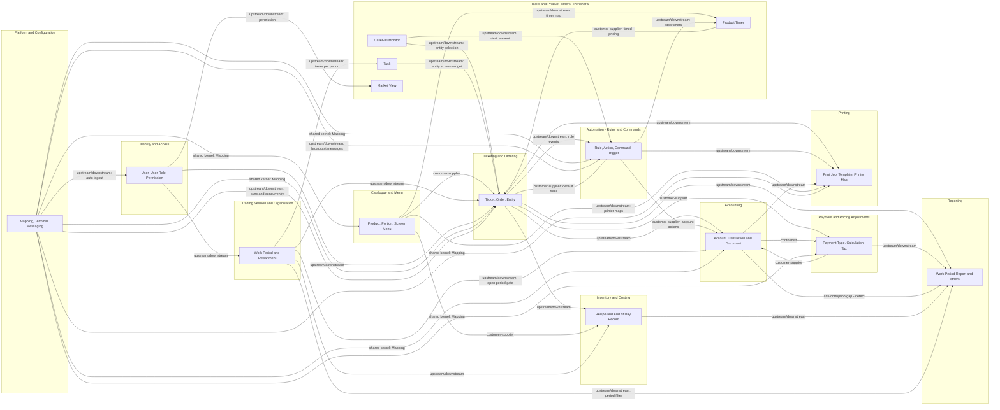

| Upstream | Downstream | Relationship | Description | Source |
|---|---|---|---|---|
| Catalogue & Menu | Ticketing & Ordering | Customer-supplier | Orders are created from products, portions and order tags selected on screen menus; mappings control visibility. When an order is added the department price tag, product timer and tax templates are applied and the product name, portion and price are copied onto the order as a snapshot. | [DOM 4.1] [APP section 4 "Create / open ticket and take orders", section 6] |
| Trading Session & Organisation | Ticketing & Ordering | Upstream/downstream | POS is available only while a work period is open; the department fixes ticket type, menu, price tag, warehouse and ticket creation method (select entity first or create ticket directly). | [DOM 4.1] [APP section 3 "Departments"] |
| Identity & Access | Trading Session & Organisation | Upstream/downstream | The role gives the default department (set as current department on login) and the permissions to change department, use each department and start or end work periods. | [DOM 4.1] [APP section 2, section 4 "Login and logout"] |
| Identity & Access | Ticketing & Ordering | Upstream/downstream | Permissions gate adding to locked tickets, moving orders, merging tickets, price change, and viewing other users' or old tickets; orders record the creating user. Void and gift have no permission and are controlled only by command mappings. | [DOM 4.1] [APP section 2] |
| Automation | Ticketing & Ordering | Customer-supplier (Automation supplies; Ticketing consumes default rules) | Default rules set ticket, order and entity states, lock and unlock, kitchen printing and closing; command buttons are inert until a rule reacts. Rule actions (for example add order, update order state, update ticket state, change ticket entity, close ticket, pay ticket) act on the active ticket. | [DOM 4.1] [APP section 3 action types, section 4 "Close (submit) ticket"] |
| Ticketing & Ordering | Automation | Upstream/downstream (PRD addition) | The ticket service and POS raise rule events (for example TicketCreated, OrderAdded, BeforeTicketClosing, TicketClosing, OrderStateUpdated, TicketEntityChanged, EntitySelected, EntityUpdated) carrying parameters that rule constraints and actions consume. | [APP section 3 rule events, section 4 "Rule engine execution"] |
| Ticketing & Ordering | Payment & Pricing Adjustments | Customer-supplier | Settle opens the payment screen for a ticket; payment completes the ticket (Paid and closed); the ticket type holds the tax-included flag; partially paid quantities are tracked per ticket. | [DOM 4.1] [APP section 4 "Payment and settlement"] |
| Payment & Pricing Adjustments | Accounting | Customer-supplier | Each payment type, change payment type, calculation type and tax template names an account transaction type; adding a payment creates an account transaction and change is posted to the change account. | [DOM 4.1] [APP section 4 "Payment and settlement", section 6 relationships] |
| Ticketing & Ordering | Accounting | Upstream/downstream | The ticket type names the sale transaction type (Sales to Receivables); each ticket owns one account transaction document; the entity type holds the account type and account-name template; the customer account is found via the ticket entity. | [DOM 4.1] [APP section 6 "Ticket", relationships] |
| Accounting | Payment & Pricing Adjustments | Conformist | Payment types and Customer Account availability conform to account existence, currency and working rules (no account, no charge); a payment is accepted only if the payment type has a fixed account or a ticket entity's account can take the transaction. | [DOM 4.1] [APP section 4 "Payment and settlement"] |
| Automation | Accounting | Customer-supplier (PRD addition) | Rule actions create account transactions on the ticket and create single or batch account transaction documents; document creation raises AccountTransactionDocumentCreated. | [APP section 3 action types, rule events] |
| Ticketing & Ordering | Inventory & Costing | Upstream/downstream | Submitted orders consume stock via recipes; order flags set by state (Gift consumes, Void does not) decide consumption; the department selects the warehouse. | [DOM 4.1] [APP section 4 "Order operations"] |
| Catalogue & Menu | Inventory & Costing | Customer-supplier | Recipes link product portions (and order-tag-linked products) to inventory items. | [DOM 4.1] [APP section 6 relationships] |
| Trading Session & Organisation | Inventory & Costing | Upstream/downstream | Ending a work period creates the End of Day Record (periodic consumption) when recipes exist; starting the next period recalculates the previous period's final cost; inventory transactions need an open work period; counts are made between periods. | [DOM 4.1] [APP section 4 "Start and end work period"] |
| Ticketing & Ordering | Printing | Upstream/downstream | Print Bill and kitchen jobs print ticket and order data; templates are state-aware (Gift, Void). | [DOM 4.1] [APP section 4 "Print bill"] |
| Automation | Printing | Upstream/downstream | Rules execute print jobs (ExecutePrintJob action, filtered by order state or tag); other actions print accounts, entities and reports. | [DOM 4.1] [APP section 3 action types, section 4 "Print job execution"] |
| Accounting | Printing | Upstream/downstream | Account documents print on the Customer Receipt Template (document type printer template). | [DOM 4.1] [APP section 4 "Account document creation"] |
| Catalogue & Menu | Printing | Upstream/downstream (PRD addition) | Printer maps route orders to printers and templates by product group code, then by product. | [APP section 4 "Print job execution", section 6] |
| Ticketing & Ordering; Payment & Pricing Adjustments; Accounting; Inventory & Costing | Reporting | Upstream/downstream | The work period report summarises sales, incomes, ticket tags, states and user sales; the cost, purchase and inventory reports read inventory data. | [DOM 4.1] [APP section 8] |
| Accounting | Reporting | Anti-corruption gap (observed defect) | Liability, Receivable and Internal Accounts reports are listed but always empty because their data method was not moved to the new account model. | [DOM 4.1] [APP section 8, section 10] |
| Trading Session & Organisation | Reporting | Upstream/downstream (PRD addition) | Reports are filtered by work period (defaulting to the current one) and require an open work period to be opened. | [APP section 2 permission catalogue, section 8] |
| Trading Session & Organisation | Accounting | Upstream/downstream (PRD addition) | The Accounts screen requires an open work period. | [APP section 2 permission catalogue] |
| Platform & Configuration | Catalogue & Menu; Payment & Pricing Adjustments; Printing; Automation; Ticketing & Ordering; Accounting | Shared kernel (Mapping mechanism) | The same mapping concept (user role, department, ticket type, terminal; "all" as wildcard) governs visibility of order tag groups, ticket tag groups, payment and change payment types, calculation selectors, print jobs, rules, automation commands, entity screens and account transaction document types. Accounting is a PRD addition. | [DOM 4.1] [APP section 2 "Authorisation approach"] |
| Platform & Configuration | Ticketing & Ordering | Upstream/downstream | The messaging server synchronises terminals (ticket refresh broadcast after a ticket close); the concurrency check on ticket close rejects a ticket changed on another terminal. | [DOM 4.1] [APP section 4 "Close (submit) ticket", "Multi-terminal synchronisation"] |
| Platform & Configuration | Automation | Upstream/downstream (PRD addition) | Broadcast action messages received from other terminals raise the MessageReceived rule event. | [APP section 4 "Multi-terminal synchronisation"] |
| Platform & Configuration | Identity & Access | Upstream/downstream (PRD addition) | The terminal Auto Logout flag logs the user out after each ticket close. | [APP section 2, section 4 "Login and logout"] |
| Catalogue & Menu | Tasks & Product Timers | Upstream/downstream (PRD addition) | Product timers are mapped to products (product timer maps). | [APP section 4 "Product timer pricing", section 6] |
| Tasks & Product Timers | Ticketing & Ordering | Customer-supplier (PRD addition) | A product timer attached to an order prices it by elapsed time; a ticket with active timers cannot be closed. | [APP section 4 "Product timer pricing"] |
| Automation | Tasks & Product Timers | Upstream/downstream (PRD addition) | The StopActiveTimers action stops product timers. | [APP section 3 action types] |
| Tasks & Product Timers | Ticketing & Ordering | Upstream/downstream (PRD addition) | Caller-ID looks the incoming number up in the Customers entity type and opens entity selection for the match or a new entity. | [APP section 3 "Caller-ID monitor", section 4 "Caller-ID popup"] |
| Tasks & Product Timers | Automation | Upstream/downstream (PRD addition) | Caller-ID raises the DeviceEventGenerated rule event. | [APP section 3 "Caller-ID monitor"] |
| Trading Session & Organisation | Tasks & Product Timers | Upstream/downstream (PRD addition) | Tasks are loaded per work period. | [APP section 3 "Tasks"] |
| Tasks & Product Timers | Ticketing & Ordering | Upstream/downstream (PRD addition) | Tasks are edited through a task editor widget placed on entity screens. | [APP section 3 "Tasks"] |
| Identity & Access | Tasks & Product Timers | Upstream/downstream (PRD addition) | The OpenMarket permission gates the Market view. | [APP section 2] |

### 3.3 Entities

This subsection specifies every persisted entity of SambaPOS V3: the 93 entity classes catalogued in [DB] section 3 (85 tables reached through a `DbSet` plus 8 tables reached only through navigation properties), the two many-to-many join tables generated by the persistence framework, the infrastructure table `VersionInfo`, and the value objects that are stored inside JSON or delimited text columns of their parent table [APP section 6][DB sections 3, 7]. Entities are grouped by the bounded contexts of section 3.1. The Reporting context owns no table ([DB] section 3 lists none and the database has no views [DB 1.1]).

#### Conventions used in the entity tables

- **Types.** `string` (Unicode text; "default length" means no length was configured: unlimited on SQL Server, 4,000 characters on SQL Server Compact; "MAX" means explicitly unlimited); `integer` (32-bit); `decimal` with the precision stated in Constraints - `16,2` for money, `16,3` for quantities, and `18,2` where precision was not configured and the framework default applies; `boolean`; `datetime`; `enum(...)` for integer columns whose coded values are documented in [APP] (enumerations, application-analysis 651-669) or [DB] section 6; `ref X` for a reference to entity X. A few columns are stored as floating point (stated as "decimal (floating point)") and one as a database-generated binary row version (`rowversion`) [DB section 3]. Inside embedded objects `numeric` marks a number whose exact type the analyses do not state, and Required is "not stated" where the analyses do not say whether a member is always written.
- **Common base properties.** Every entity has an integer surrogate `Id` generated by the database (identity), supplied by the base class `ValueClass`; it is not repeated in the tables below. Entities derived from `EntityClass` also carry `Name` (string, nullable in the database); `Name` is listed explicitly wherever it exists because validator rules differ per entity [APP section 6][DB 1.4].
- **Composite keys.** Children of an aggregate are keyed by (`Id`, parent id) or a longer composite; this is stated in the description line and the parent column is marked "key part" [DB 8.1].
- **Mapping rows (`AbstractMap`).** Map entities inherit `TerminalId`, `DepartmentId`, `UserRoleId` and `TicketTypeId` (integer, required, logical references to Terminal, Department, UserRole and TicketType). The value 0 means "any". An item is active only if at least one of its map rows matches the current terminal, department, user role and ticket type; a parent with no map rows is inactive. Product-related maps add `MenuItemGroupCode` (null = any group) and `MenuItemId` (0 = any) [DB 8.2][APP BR-041]. These four inherited columns are not repeated in the map tables below.
- **Reference kinds.** "Enforced reference" = a foreign-key constraint exists in the database (required parent-child collections cascade on delete; nullable reference columns do not cascade) [DB 5.1]. "Logical reference (not enforced by database)" = a plain integer holding another entity's `Id`; integrity relies only on application delete validators [DB 5.2, 9.2][APP BR-049]. "Name-based reference" = the link is held by a text value (user name, state name, price tag, command name) [DB 5.2].
- **Required.** `yes` = value-type column declared NOT NULL; `no` = nullable. All strings are nullable in the database, so they are `no`; where an application validator requires a value or uniqueness this is stated in Constraints (sources [APP BR-038..BR-051], [DB 9.2]). The database has no unique, check or default constraints apart from the unique index on `EntityStateValues.EntityId` and defaults added by migrations to upgraded databases [DB 5.3-5.5].
- **Defaults.** Defaults are applied by the application (class constructors). Database defaults exist only for columns added by migrations, so freshly created and upgraded databases differ [DB 5.5, R-02]. Where upgraded databases have a fixed string length (128 or 256) instead of the model's default length, this is noted.
- **Embedded value objects.** JSON columns are serialised as arrays of objects with shortened property keys; null or empty text is read as an empty list [DB 7]. Each such structure is documented as a separate small table marked "embedded (stored as JSON in Table.Column)". Delimited text columns are described in Constraints and, where their structure is known, as embedded tables.
- **Table names** follow the entity class name (pluralised), not the `DbSet` name [DB 1.3]; [APP 9.2] states the opposite for several tables (see section 14).
- **Not persisted.** UI-only or computed members are excluded: `Order.IsSelected` / `SelectedQuantity`, `AccountTransaction.Balance` and the source/target value accessors, and the helper `AccountData` [APP section 6][DB 9.4].

#### Ticketing & Ordering

##### Ticket

> The sale document (bill): totals, status flags, tags, states and logs, owning orders, calculations, payments, change payments, paid items and attached entities, and linked to one accounting document. Table `Tickets`; key `Id`. [APP][DB]

| Property | Type | Required | Constraints | Source |
|---|---|---|---|---|
| Name | string | no | Default length; not used for display | [APP][DB] |
| TicketNumber | string | no | Default length; generated from the ticket type's ticket numerator on first save or when an unnumbered ticket is printed [APP BR-018]; assigning it renames the accounting document to "Ticket Transaction [number]" [DB 10] | [APP][DB] |
| Date | datetime | yes | Creation time; application default = now | [APP][DB] |
| LastOrderDate | datetime | yes | Time of last order | [APP][DB] |
| LastPaymentDate | datetime | yes | Time of last payment; non-unique index `IX_Tickets_LastPaymentDate` exists only in databases created by the current code [DB R-09]; compared by the ticket concurrency check [DB 9.3] | [APP][DB] |
| LastUpdateTime | datetime | yes | Change stamp of a cached ticket; used by the application-level optimistic concurrency check (no database row version on tickets) [APP BR-019][DB 9.3] | [APP][DB] |
| IsClosed | boolean | yes | Set only when RemainingAmount = 0 and no product timer is active [APP BR-015][DB 9.4]; open tickets are those with IsClosed = false | [APP][DB] |
| IsLocked | boolean | yes | Lock flag; a closed ticket cannot be unlocked [APP BR-015, BR-017] | [APP][DB] |
| RemainingAmount | decimal | yes | 16,2; stored snapshot = round(total - payments + change payments, 2) [DB 10] | [APP][DB] |
| TotalAmount | decimal | yes | 16,2; stored snapshot recomputed on every recalculation [APP BR-001][DB 10] | [APP][DB] |
| DepartmentId | ref Department | yes | Logical reference (not enforced by database) | [APP][DB] |
| TicketTypeId | ref TicketType | yes | Logical reference (not enforced by database) | [APP][DB] |
| Note | string | no | MAX; free-text ticket note | [APP][DB] |
| LastModifiedUserName | string | no | Name-based reference to User (by name); 128 characters in upgraded databases (added by migration 11) [DB R-02] | [APP][DB] |
| TicketTags | string (JSON) | no | MAX; embedded list of TicketTagValue | [APP][DB] |
| TicketStates | string (JSON) | no | MAX; embedded list of TicketStateValue | [APP][DB] |
| TicketLogs | string (JSON) | no | MAX; embedded append-only list of TicketLogValue; added by migration 18 | [APP][DB] |
| ExchangeRate | decimal | yes | 18,2 (precision not configured, framework default - only 2 decimal places are kept) [DB R-06]; application default 1; taken from the currency of the sale transaction type's default target account [APP BR-029] | [APP][DB] |
| TaxIncluded | boolean | yes | Copied from the ticket type | [APP][DB] |
| TransactionDocument | ref AccountTransactionDocument | no | Enforced reference via nullable column `TransactionDocument_Id` (no cascade); in practice exactly one document per ticket [DB 5.1, 9.4] | [APP][DB] |
| Orders, Calculations, Payments, ChangePayments, PaidItems | collections | - | Owned children; enforced references with cascade delete [DB DB-02] | [APP][DB] |
| TicketEntities | collection | - | Owned children via nullable column `TicketEntities.Ticket_Id` | [APP][DB] |

##### Order

> A ticket line: product, portion, unit price, quantity, stock flags, and its tags, states and taxes held as JSON. Table `Orders`; composite key (`Id`, `TicketId`). [APP][DB]

| Property | Type | Required | Constraints | Source |
|---|---|---|---|---|
| TicketId | ref Ticket | yes | Key part; enforced reference, cascade delete | [APP][DB] |
| WarehouseId | ref Warehouse | yes | Logical reference (not enforced by database); stock warehouse of the line | [APP][DB] |
| DepartmentId | ref Department | yes | Logical reference (not enforced by database) | [APP][DB] |
| MenuItemId | ref MenuItem | yes | Logical reference (not enforced by database) | [APP][DB] |
| MenuItemName | string | no | Default length; snapshot of the product name at sale time [DB R-18] | [APP][DB] |
| PortionName | string | no | Default length; snapshot of the portion name | [APP][DB] |
| Price | decimal | yes | 16,2; unit price without order tags | [APP][DB] |
| Quantity | decimal | yes | 16,3 | [APP][DB] |
| PortionCount | integer | yes | Number of portions defined for the product | [APP][DB] |
| Locked | boolean | yes | Submitted/locked line; locked lines cannot be cancelled [APP BR-016] | [APP][DB] |
| CalculatePrice | boolean | yes | Application default true; false = the line contributes 0 to totals and tax (gift/void) [APP BR-005, BR-064] | [APP][DB] |
| DecreaseInventory | boolean | yes | Application default true; drives stock consumption [APP BR-037] | [APP][DB] |
| IncreaseInventory | boolean | yes | Drives stock movement | [APP][DB] |
| OrderNumber | integer | yes | From the ticket type's order numerator; orders with 0 are numbered when the ticket closes [APP BR-018] | [APP][DB] |
| CreatingUserName | string | no | Default length; name-based reference to User; a user who created orders cannot be deleted [DB 9.2] | [APP][DB] |
| CreatedDateTime | datetime | yes | Application default = now | [APP][DB] |
| AccountTransactionTypeId | ref AccountTransactionType | yes | Logical reference (not enforced by database); sale transaction type used for the line | [APP][DB] |
| ProductTimerValueId | ref ProductTimerValue | no | Nullable integer; enforced reference (no cascade); optional one-to-one timer instance | [APP][DB] |
| PriceTag | string | no | Default length; price list tag used for the price (name-based) | [APP][DB] |
| Tag | string | no | Default length; free marker set by actions | [APP][DB] |
| Taxes | string (JSON) | no | MAX; embedded list of TaxValue (snapshot of tax templates at order time) | [APP][DB] |
| OrderTags | string (JSON) | no | MAX; embedded list of OrderTagValue | [APP][DB] |
| OrderStates | string (JSON) | no | MAX; embedded list of OrderStateValue; the New / Submitted / Gift / Void states exist only here [DB 7.3] | [APP][DB] |

##### PaidItem

> Quantity of a product/price combination already paid by partial payments; cleared when the ticket closes. Table `PaidItems`; composite key (`Id`, `TicketId`). [APP][DB]

| Property | Type | Required | Constraints | Source |
|---|---|---|---|---|
| Key | string | no | Default length; format `menuItemId_price` [APP section 6, BR-053] | [APP][DB] |
| Quantity | decimal | yes | 16,3 | [APP][DB] |
| TicketId | ref Ticket | yes | Key part; enforced reference, cascade delete | [APP][DB] |

##### TicketEntity

> An entity (table, customer, waiter and so on) attached to a ticket, with a name, account and custom-data snapshot. Table `TicketEntities`; key `Id`. [APP][DB]

| Property | Type | Required | Constraints | Source |
|---|---|---|---|---|
| Ticket | ref Ticket | no | Enforced reference via nullable column `Ticket_Id` (the class has no `TicketId` property) [DB 5.1] | [DB] |
| EntityTypeId | ref EntityType | yes | Logical reference (not enforced by database) | [APP][DB] |
| EntityId | ref Entity | yes | Logical reference (not enforced by database); an entity used on any ticket cannot be deleted [APP BR-048] | [APP][DB] |
| AccountId | ref Account | yes | Logical reference (not enforced by database) | [APP][DB] |
| AccountTypeId | ref AccountType | yes | Logical reference (not enforced by database); database default 0 in upgraded databases (migration 3) | [APP][DB] |
| EntityName | string | no | Default length; snapshot of the entity name [DB R-18] | [APP][DB] |
| EntityCustomData | string (JSON) | no | MAX; embedded list of CustomDataValue - a copy of the entity's CustomData at the time it was attached | [APP][DB] |

##### TicketType

> Ticket template: numerators, sale transaction type, screen menu, tax-included flag, entity type and menu assignments. Table `TicketTypes`; key `Id`. [APP][DB]

| Property | Type | Required | Constraints | Source |
|---|---|---|---|---|
| Name | string | no | Default length | [APP][DB] |
| ScreenMenuId | ref ScreenMenu | yes | Logical reference (not enforced by database) | [APP][DB] |
| TaxIncluded | boolean | yes | Prices of this ticket type include tax | [APP][DB] |
| SortOrder | integer | yes | Database default 0 in upgraded databases (migration 3) | [APP][DB] |
| TicketNumerator | ref Numerator | no | Enforced reference via nullable column `TicketNumerator_Id`; application validator requires it and requires it to differ from OrderNumerator [APP BR-018] | [APP][DB] |
| OrderNumerator | ref Numerator | no | Enforced reference via nullable column `OrderNumerator_Id`; required by the application validator [APP BR-018] | [APP][DB] |
| SaleTransactionType | ref AccountTransactionType | no | Enforced reference via nullable column `SaleTransactionType_Id` | [APP][DB] |
| EntityTypeAssignments, MenuAssignments | collections | - | Owned children, cascade delete | [APP][DB] |
| (delete rule) | - | - | Cannot be deleted while used by an EntityScreen [DB 9.2] | [DB] |

##### EntityTypeAssignment

> Use of an entity type within a ticket type (ask before creating a ticket, default state, copy to new tickets). Table `EntityTypeAssignments` (no `DbSet`); composite key (`Id`, `TicketTypeId`). [APP][DB]

| Property | Type | Required | Constraints | Source |
|---|---|---|---|---|
| TicketTypeId | ref TicketType | yes | Key part; enforced reference, cascade delete; replaced the shadow column `TicketType_Id` in migration 13 | [APP][DB] |
| EntityTypeId | ref EntityType | yes | Logical reference (not enforced by database) | [APP][DB] |
| EntityTypeName | string | no | Default length; snapshot of the entity type name [DB R-18] | [APP][DB] |
| AskBeforeCreatingTicket | boolean | yes | Entity selection required before a ticket is created | [APP][DB] |
| State | string | no | Default length; state name (name-based) | [APP][DB] |
| CopyToNewTickets | boolean | yes | Application default true; entities with this flag are copied to a ticket created from an existing one [APP BR-062]; existing rows set to true by migration 10 | [APP][DB] |
| SortOrder | integer | yes | | [DB] |

##### MenuAssignment

> Terminal-specific screen menu of a ticket type. Table `MenuAssignments` (no `DbSet`; created by migration 13); composite key (`Id`, `TicketTypeId`). [APP][DB]

| Property | Type | Required | Constraints | Source |
|---|---|---|---|---|
| TicketTypeId | ref TicketType | yes | Key part; enforced reference, cascade delete | [APP][DB] |
| TerminalId | ref Terminal | yes | Logical reference (not enforced by database) | [APP][DB] |
| MenuId | ref ScreenMenu | yes | Logical reference (not enforced by database) | [APP][DB] |
| TerminalName | string | no | Default length; snapshot of the terminal name | [APP][DB] |
| SortOrder | integer | yes | | [DB] |

##### TicketTagGroup

> Ticket tag definition (free tagging, colours, data type, forced value). Table `TicketTagGroups`; key `Id`. [APP][DB]

| Property | Type | Required | Constraints | Source |
|---|---|---|---|---|
| Name | string | no | Default length | [APP][DB] |
| SortOrder | integer | yes | | [DB] |
| FreeTagging | boolean | yes | Users may type a tag value | [APP][DB] |
| SaveFreeTags | boolean | yes | Typed values are saved as TicketTag rows (case-insensitive, no duplicates) [DB 9.4] | [APP][DB] |
| ButtonColorWhenTagSelected | string | no | Default length; colour | [APP][DB] |
| ButtonColorWhenNoTagSelected | string | no | Default length; colour | [APP][DB] |
| ForceValue | boolean | yes | A value must be set before a ticket with orders can be closed [APP BR-013] | [APP][DB] |
| AskBeforeCreatingTicket | boolean | yes | | [APP][DB] |
| DataType | enum(0 alphanumeric, 1 integer, 2 decimal) | yes | Coded values per [APP]; [DB] only assumes the mapping (see section 14) | [APP][DB] |
| TicketTags, TicketTagMaps | collections | - | Owned children, cascade delete | [APP][DB] |

##### TicketTag

> A predefined value of a ticket tag group. Table `TicketTags`; key `Id`. [APP][DB]

| Property | Type | Required | Constraints | Source |
|---|---|---|---|---|
| Name | string | no | Default length; the tag value | [APP][DB] |
| TicketTagGroupId | ref TicketTagGroup | yes | Enforced reference, cascade delete | [APP][DB] |
| SortOrder | integer | yes | Database default 0 in upgraded databases (migration 12) | [DB] |

##### TicketTagMap

> Mapping row (AbstractMap) making a ticket tag group available by terminal, department, user role and ticket type. Table `TicketTagMaps`; key `Id`. [APP][DB]

| Property | Type | Required | Constraints | Source |
|---|---|---|---|---|
| TicketTagGroupId | ref TicketTagGroup | yes | Enforced reference, cascade delete | [APP][DB] |

##### Numerator

> Counter used for ticket and order numbers. Table `Numerators`; key `Id`. [APP][DB]

| Property | Type | Required | Constraints | Source |
|---|---|---|---|---|
| Name | string | no | Default length | [APP][DB] |
| LastUpdateTime | rowversion | yes | Database-generated row version; the only optimistic-concurrency token in the model; colliding increments are retried [DB DB-05][APP BR-018] | [APP][DB] |
| Number | integer | yes | Application default 0; incremented by 1 per request | [APP][DB] |
| NumberFormat | string | no | Default length; application default `#` | [APP][DB] |
| (delete rule) | - | - | Cannot be deleted while used as a ticket or order numerator of a TicketType [DB 9.2] | [DB] |

##### EntityType

> Kind of entity (for example Tables, Customers): display names, account type, account name template and display formats. Table `EntityTypes`; key `Id`. [APP][DB]

| Property | Type | Required | Constraints | Source |
|---|---|---|---|---|
| Name | string | no | Default length; application requires a unique name [APP BR-050][DB 9.2] | [APP][DB] |
| SortOrder | integer | yes | | [DB] |
| EntityName | string | no | Default length; singular display name | [APP][DB] |
| AccountTypeId | ref AccountType | yes | Logical reference (not enforced by database) | [APP][DB] |
| WarehouseTypeId | ref WarehouseType | yes | Logical reference (not enforced by database) | [APP][DB] |
| AccountNameTemplate | string | no | Default length; placeholders `[Id]`, `[Name]`, primary-field and custom-field names; an empty result means no account [APP BR-046] | [APP][DB] |
| PrimaryFieldName | string | no | Default length (128 in upgraded databases, migration 9) | [APP][DB] |
| PrimaryFieldFormat | string | no | Default length (128 in upgraded databases, migration 9) | [APP][DB] |
| DisplayFormat | string | no | Default length (128 in upgraded databases, migration 24) | [APP][DB] |
| AccountBalanceDisplayFormat | string | no | Default length (128 in upgraded databases, migration 11) | [APP][DB] |
| EntityCustomFields | collection | - | Children via nullable column `EntityCustomFields.EntityType_Id` | [APP][DB] |
| (delete rule) | - | - | Cannot be deleted while any Entity has this type [APP BR-048][DB 9.2] | [APP][DB] |

##### EntityCustomField

> Custom field definition of an entity type. Table `EntityCustomFields`; key `Id`. [APP][DB]

| Property | Type | Required | Constraints | Source |
|---|---|---|---|---|
| Name | string | no | Default length; field name, used as key inside CustomDataValue | [APP][DB] |
| FieldType | enum(0 string, 1 wide string, 2 number, 3 query, 4 date) | yes | Coded values from [APP] | [APP][DB] |
| EditingFormat | string | no | Default length; input mask, for example `(###) ### ####` | [APP][DB] |
| ValueSource | string | no | Default length; delimited value list (format not documented) | [APP][DB] |
| Hidden | boolean | yes | | [APP][DB] |
| EntityType | ref EntityType | no | Enforced reference via nullable column `EntityType_Id` (no cascade) | [DB] |

##### Entity

> An instance of an entity type (a table, customer, waiter and so on) with custom data, account and warehouse links. Table `Entities`; key `Id`. [APP][DB]

| Property | Type | Required | Constraints | Source |
|---|---|---|---|---|
| Name | string | no | Default length; application requires a non-empty, unique name [APP BR-050][DB 9.2] | [APP][DB] |
| EntityTypeId | ref EntityType | yes | Logical reference (not enforced by database); application requires an entity type [APP BR-051] | [APP][DB] |
| LastUpdateTime | datetime | yes | Change stamp | [APP][DB] |
| SearchString | string | no | Default length | [APP][DB] |
| CustomData | string (JSON) | no | MAX; embedded list of CustomDataValue | [APP][DB] |
| AccountId | ref Account | yes | Logical reference (not enforced by database) | [APP][DB] |
| WarehouseId | ref Warehouse | yes | Logical reference (not enforced by database) | [APP][DB] |
| (delete rule) | - | - | Cannot be deleted while used by an EntityScreenItem or a TicketEntity [APP BR-048][DB 9.2] | [APP][DB] |

##### EntityStateValue

> Current state set of one entity (for example a table being Available / New Orders / Bill Requested). Table `EntityStateValues`; key `Id`. [APP][DB]

| Property | Type | Required | Constraints | Source |
|---|---|---|---|---|
| EntityId | ref Entity | yes | Logical reference (not enforced by database); unique index `IX_EntityStateValue_EntityId` - at most one row per entity [DB DB-04] | [APP][DB] |
| EntityStates | string (JSON) | no | Default length (not MAX, so limited to 4,000 characters on SQL Server Compact); embedded list of EntityStateVal | [APP][DB] |

##### EntityScreen

> Screen from which entities are selected (automatic grid, search or custom widget layout), linked to a ticket type and entity type. Table `EntityScreens`; key `Id`. [APP][DB]

| Property | Type | Required | Constraints | Source |
|---|---|---|---|---|
| Name | string | no | Default length | [APP][DB] |
| TicketTypeId | ref TicketType | yes | Logical reference (not enforced by database); application requires it [APP BR-051] | [APP][DB] |
| EntityTypeId | ref EntityType | yes | Logical reference (not enforced by database); application requires it unless DisplayMode = 2 (custom) [APP BR-051] | [APP][DB] |
| SortOrder | integer | yes | | [DB] |
| DisplayMode | enum(0 automatic, 1 search, 2 custom) | yes | Coded values from [APP] | [APP][DB] |
| BackgroundColor | string | no | Default length | [DB] |
| BackgroundImage | string | no | Default length | [DB] |
| FontSize | integer | yes | | [DB] |
| PageCount | integer | yes | Paging | [APP][DB] |
| RowCount | integer | yes | | [DB] |
| ColumnCount | integer | yes | | [DB] |
| ButtonHeight | integer | yes | | [DB] |
| DisplayState | string | no | Default length; state group shown on buttons (name-based) | [APP][DB] |
| StateFilter | string | no | Default length; state used to filter entities (name-based) | [APP][DB] |
| AskTicketType | boolean | yes | Database default 0 in upgraded databases (migration 3) | [APP][DB] |
| SearchValueReplacePattern | string | no | Default length (256 in upgraded databases, migration 22) | [APP][DB] |
| EntityScreenItems, EntityScreenMaps, Widgets | collections | - | Owned children, cascade delete | [APP][DB] |

##### EntityScreenItem

> An entity placed on an entity screen, with its displayed state and order. Table `EntityScreenItems`; composite key (`Id`, `EntityScreenId`). [APP][DB]

| Property | Type | Required | Constraints | Source |
|---|---|---|---|---|
| Name | string | no | Default length; application requires a unique name [APP BR-050][DB 9.2] | [DB] |
| EntityScreenId | ref EntityScreen | yes | Key part; enforced reference, cascade delete | [DB] |
| EntityId | ref Entity | yes | Logical reference (not enforced by database) | [APP][DB] |
| EntityState | string | no | Default length; state name (name-based) | [APP][DB] |
| SortOrder | integer | yes | | [DB] |
| LastUpdateTime | datetime | yes | Change stamp (cached entity) [APP 9.1] | [APP][DB] |

##### EntityScreenMap

> Mapping row (AbstractMap) making an entity screen available by terminal, department, user role and ticket type. Table `EntityScreenMaps` (no `DbSet`); key `Id`. [APP][DB]

| Property | Type | Required | Constraints | Source |
|---|---|---|---|---|
| EntityScreenId | ref EntityScreen | yes | Enforced reference, cascade delete | [APP][DB] |

##### Widget

> A positioned widget on a custom entity screen, with type-specific settings held as JSON. Table `Widgets`; key `Id`. [APP][DB]

| Property | Type | Required | Constraints | Source |
|---|---|---|---|---|
| Name | string | no | Default length (128 in upgraded databases, migration 10) | [APP][DB] |
| EntityScreenId | ref EntityScreen | yes | Enforced reference, cascade delete | [APP][DB] |
| XLocation | integer | yes | Position | [APP][DB] |
| YLocation | integer | yes | Position | [APP][DB] |
| Height | integer | yes | Size | [APP][DB] |
| Width | integer | yes | Size | [APP][DB] |
| CornerRadius | integer | yes | | [APP][DB] |
| Angle | decimal | yes | Decimal (floating point) | [APP][DB] |
| Scale | decimal | yes | Decimal (floating point) | [APP][DB] |
| Properties | string (JSON) | no | Default length (no explicit maximum; 4,000 characters on SQL Server Compact) [DB R-03]; widget-type-specific settings object, structure not documented | [APP][DB] |
| CreatorName | string | no | Default length; creator of the widget | [DB] |
| AutoRefresh | boolean | yes | | [APP][DB] |
| AutoRefreshInterval | integer | yes | | [APP][DB] |

##### State

> Named state value for entities, tickets or orders, with colour and report/ticket display flags. Table `States`; key `Id`. [APP][DB]

| Property | Type | Required | Constraints | Source |
|---|---|---|---|---|
| Name | string | no | Default length; state value (for example New Orders, Available, Gift); referenced by name in JSON states and command maps | [APP][DB] |
| GroupName | string | no | Default length; state group (for example Status, GStatus) | [APP][DB] |
| StateType | enum(0 entity, 1 ticket, 2 order) | yes | | [APP][DB] |
| Color | string | no | Default length | [APP][DB] |
| ShowOnEndOfDayReport | boolean | yes | Database default 0 in upgraded databases (migration 22) | [APP][DB] |
| ShowOnProductReport | boolean | yes | Database default 0 in upgraded databases (migration 22) | [APP][DB] |
| ShowOnTicket | boolean | yes | Database default 0 in upgraded databases (migration 22) | [APP][DB] |

##### TicketTagValue

> Embedded (stored as JSON in `Tickets.TicketTags`): a tag value applied to a ticket. [APP][DB]

| Property | Type | Required | Constraints | Source |
|---|---|---|---|---|
| TagName | string | not stated | JSON key `TN`; ticket tag group name (name-based) | [APP][DB] |
| TagValue | string | not stated | JSON key `TV` | [APP][DB] |

##### TicketStateValue

> Embedded (stored as JSON in `Tickets.TicketStates`): a state currently held by a ticket. [APP][DB]

| Property | Type | Required | Constraints | Source |
|---|---|---|---|---|
| StateName | string | not stated | JSON key `SN`; state group name | [APP][DB] |
| State | string | not stated | JSON key `S`; an empty state removes the entry [APP BR-045] | [APP][DB] |
| StateValue | string | no | JSON key `SV`; omitted when empty | [APP][DB] |
| Quantity | numeric | no | JSON key `Q`; omitted when 0; exact numeric type not stated | [APP][DB] |
| LastUpdateTime | datetime | not stated | JSON key `D` | [APP][DB] |

##### TicketLogValue

> Embedded (stored as JSON in `Tickets.TicketLogs`): an append-only audit entry of the ticket. [APP][DB]

| Property | Type | Required | Constraints | Source |
|---|---|---|---|---|
| TicketNo | string | not stated | JSON key `N`; ticket number | [APP][DB] |
| DateTime | datetime | not stated | JSON key `D` | [APP][DB] |
| UserName | string | not stated | JSON key `U`; user by name | [APP][DB] |
| Category | string | not stated | JSON key `C` | [APP][DB] |
| Log | string | not stated | JSON key `L`; log text | [APP][DB] |

##### OrderStateValue

> Embedded (stored as JSON in `Orders.OrderStates`): a state held by an order (for example New, Submitted, Gift, Void). [APP][DB]

| Property | Type | Required | Constraints | Source |
|---|---|---|---|---|
| StateName | string | not stated | JSON key `SN`; state group name (for example Status, GStatus) | [APP][DB] |
| State | string | not stated | JSON key `S` | [APP][DB] |
| StateValue | string | not stated | JSON key `SV` | [APP][DB] |
| OrderKey | string | not stated | JSON key `OK` | [APP][DB] |
| LastUpdateTime | datetime | not stated | JSON key `D` | [APP][DB] |
| UserId | ref User | not stated | JSON key `U`; user who changed the state | [APP][DB] |

##### EntityStateVal

> Embedded (stored as JSON in `EntityStateValues.EntityStates`): one state of an entity. [APP][DB]

| Property | Type | Required | Constraints | Source |
|---|---|---|---|---|
| StateName | string | not stated | JSON key `SN`; state group name | [APP][DB] |
| State | string | not stated | JSON key `S` | [APP][DB] |
| LastUpdateTime | datetime | not stated | JSON key `D` | [APP][DB] |
| Quantity | numeric | not stated | JSON key `Q`; exact numeric type not stated | [APP][DB] |

##### CustomDataValue

> Embedded (stored as JSON in `Entities.CustomData` and, as a snapshot copy, in `TicketEntities.EntityCustomData`): the value of one entity custom field. [APP][DB]

| Property | Type | Required | Constraints | Source |
|---|---|---|---|---|
| Name | string | not stated | JSON key `Name` (no short key); custom field name | [DB] |
| Value | string | not stated | JSON key `Value`; read back by a regular expression that requires a non-empty value without quotes [DB R-03] | [DB] |

#### Catalogue & Menu

##### MenuItem

> A sellable product (name, product group, barcode, tag); parent of its portions. Table `MenuItems`; key `Id`. [APP][DB]

| Property | Type | Required | Constraints | Source |
|---|---|---|---|---|
| Name | string | no | Default length; application requires a unique name [APP BR-050][DB 9.2] | [APP][DB] |
| GroupCode | string | no | Default length; product group, matched by `MenuItemGroupCode` in maps | [APP][DB] |
| Barcode | string | no | Default length | [APP][DB] |
| Tag | string | no | Default length | [APP][DB] |
| Portions | collection | - | Owned MenuItemPortion rows, cascade delete | [APP][DB] |
| (delete rule) | - | - | Cannot be deleted while used by a ScreenMenuItem, a Recipe (through a portion) or an OrderTag [APP BR-049][DB 9.2] | [APP][DB] |

##### MenuItemPortion

> A serving size of a product with a multiplier; owns the per-price-list prices. Table `MenuItemPortions`; key `Id`. [APP][DB]

| Property | Type | Required | Constraints | Source |
|---|---|---|---|---|
| Name | string | no | Default length; portion name, snapshotted into orders | [APP][DB] |
| MenuItemId | ref MenuItem | yes | Enforced reference, cascade delete | [APP][DB] |
| Multiplier | integer | yes | Portion multiplier (used to normalise quantities above 9 [APP BR-009]) | [APP][DB] |
| Price | decimal | - | [APP] lists a base `Price` on the portion; [DB] shows no such column on `MenuItemPortions` (see section 14) | [APP] |
| Prices | collection | - | Owned MenuItemPrice rows, cascade delete | [APP][DB] |

##### MenuItemPrice

> Price of a portion for a named price tag (price list). Table `MenuItemPrices`; composite key (`Id`, `MenuItemPortionId`). [APP][DB]

| Property | Type | Required | Constraints | Source |
|---|---|---|---|---|
| MenuItemPortionId | ref MenuItemPortion | yes | Key part; enforced reference, cascade delete | [APP][DB] |
| PriceTag | string | no | Default length; name-based reference to MenuItemPriceDefinition.PriceTag | [APP][DB] |
| Price | decimal | yes | 16,2; used when the department's price tag matches and the price is greater than 0, otherwise the base price applies [APP BR-006] | [APP][DB] |

##### MenuItemPriceDefinition

> Definition of a named price tag (price list) that a department can select. Table `MenuItemPriceDefinitions`; key `Id`. [APP][DB]

| Property | Type | Required | Constraints | Source |
|---|---|---|---|---|
| Name | string | no | Default length | [DB] |
| PriceTag | string | no | Default length; application requires a value, unique case-insensitively [APP BR-050, BR-051][DB 9.2] | [APP][DB] |

##### ScreenMenu

> A point-of-sale button layout made of categories. Table `ScreenMenus`; key `Id`. [APP][DB]

| Property | Type | Required | Constraints | Source |
|---|---|---|---|---|
| Name | string | no | Default length | [APP][DB] |
| CategoryColumnCount | integer | yes | Migration 19 set 1 for existing rows | [DB] |
| CategoryColumnWidthRate | integer | yes | Migration 19 set 25 for existing rows | [DB] |
| Categories | collection | - | Owned ScreenMenuCategory rows, cascade delete | [APP][DB] |
| (delete rule) | - | - | Cannot be deleted while used by a TicketType or a Department [DB 9.2] | [APP][DB] |

##### ScreenMenuCategory

> A category of a screen menu with its button layout, colours, paging and numerator settings. Table `ScreenMenuCategories`; key `Id`. [APP][DB]

| Property | Type | Required | Constraints | Source |
|---|---|---|---|---|
| Name | string | no | Default length | [APP][DB] |
| SortOrder | integer | yes | | [DB] |
| ScreenMenuId | ref ScreenMenu | yes | Enforced reference, cascade delete | [APP][DB] |
| MostUsedItemsCategory | boolean | yes | | [APP][DB] |
| ColumnCount | integer | yes | | [APP][DB] |
| MenuItemButtonHeight | integer | yes | | [DB] |
| MenuItemButtonColor | string | no | Default length; colour | [APP][DB] |
| MenuItemFontSize | decimal | yes | Decimal (floating point) | [DB] |
| WrapText | boolean | yes | | [DB] |
| PageCount | integer | yes | Paging | [APP][DB] |
| MainButtonHeight | integer | yes | | [DB] |
| MainButtonColor | string | no | Default length; colour | [APP][DB] |
| MainFontSize | decimal | yes | Decimal (floating point) | [DB] |
| SubButtonHeight | integer | yes | Sub-button setting | [APP][DB] |
| SubButtonRows | integer | yes | Migration 19 set 1 for existing rows | [APP][DB] |
| SubButtonColorDef | string | no | MAX; delimited colour list | [APP][DB] |
| NumeratorType | integer | yes | Coded value; meanings not documented in the analyses | [APP][DB] |
| NumeratorValues | string | no | Default length; delimited value list | [DB] |
| AlphaButtonValues | string | no | Default length; delimited value list | [DB] |
| ImagePath | string | no | Default length | [DB] |
| MaxItems | integer | yes | | [APP][DB] |
| ScreenMenuItems | collection | - | Owned ScreenMenuItem rows, cascade delete | [APP][DB] |

##### ScreenMenuItem

> A product button within a category, optionally presetting portion, quantity, order tags, order states or an automation command. Table `ScreenMenuItems`; key `Id`. [APP][DB]

| Property | Type | Required | Constraints | Source |
|---|---|---|---|---|
| Name | string | no | Default length; button caption | [DB] |
| ScreenMenuCategoryId | ref ScreenMenuCategory | yes | Enforced reference, cascade delete | [APP][DB] |
| MenuItemId | ref MenuItem | yes | Logical reference (not enforced by database) | [APP][DB] |
| SortOrder | integer | yes | | [DB] |
| AutoSelect | boolean | yes | | [APP][DB] |
| ButtonColor | string | no | Default length; colour | [APP][DB] |
| Quantity | integer | yes | Preset quantity | [APP][DB] |
| ImagePath | string | no | Default length | [DB] |
| FontSize | decimal | yes | Decimal (floating point) | [DB] |
| SubMenuTag | string | no | Default length | [APP][DB] |
| ItemPortion | string | no | Default length; preset portion name | [APP][DB] |
| OrderTags | string | no | Default length (128 in upgraded databases, migration 12); delimited preset tag list | [APP][DB] |
| OrderStates | string | no | Default length (128 in upgraded databases, migration 12); delimited preset state list | [APP][DB] |
| AutomationCommand | string | no | Default length (128 in upgraded databases); name-based reference to AutomationCommand | [APP][DB] |
| AutomationCommandValue | string | no | Default length (128 in upgraded databases) | [APP][DB] |

##### OrderTagGroup

> A group of order tags (modifiers) with selection limits, layout, colours and free-tagging options. Table `OrderTagGroups`; key `Id`. [APP][DB]

| Property | Type | Required | Constraints | Source |
|---|---|---|---|---|
| Name | string | no | Default length | [APP][DB] |
| SortOrder | integer | yes | | [DB] |
| ColumnCount | integer | yes | Display setting | [APP][DB] |
| ButtonHeight | integer | yes | Display setting | [APP][DB] |
| FontSize | integer | yes | Database default 0 in upgraded databases (migration 14) | [APP][DB] |
| ButtonColor | string | no | Default length; re-created nullable by migration 16 (values in upgraded databases were lost) [DB R-10] | [APP][DB] |
| MaxSelectedItems | integer | yes | 1 = single-select (a new tag replaces the old); validator: Max >= Min when Max > 0 [APP BR-010] | [APP][DB] |
| MinSelectedItems | integer | yes | Minimum tags required before an order can be deselected or the ticket closed [APP BR-011] | [APP][DB] |
| AddTagPriceToOrderPrice | boolean | yes | | [APP][DB] |
| FreeTagging | boolean | yes | | [APP][DB] |
| SaveFreeTags | boolean | yes | Free tags saved as OrderTag rows if no tag of that name exists in any group [DB 9.4] | [APP][DB] |
| GroupTag | string | no | Default length; when set, MaxSelectedItems must be 1 and the group must have tags [APP BR-010] | [APP][DB] |
| TaxFree | boolean | yes | Database default 0 in upgraded databases (migration 4) | [APP][DB] |
| Hidden | boolean | yes | Database default 0 in upgraded databases (migration 12) | [APP][DB] |
| OrderTags, OrderTagMaps | collections | - | Owned children, cascade delete | [APP][DB] |

##### OrderTag

> A selectable, optionally priced modifier within an order tag group. Table `OrderTags`; key `Id`. [APP][DB]

| Property | Type | Required | Constraints | Source |
|---|---|---|---|---|
| Name | string | no | Default length | [APP][DB] |
| SortOrder | integer | yes | | [DB] |
| OrderTagGroupId | ref OrderTagGroup | yes | Enforced reference, cascade delete | [APP][DB] |
| Price | decimal | yes | 16,2 | [APP][DB] |
| MenuItemId | ref MenuItem | yes | Logical reference (not enforced by database); 0 = no linked product [DB R-20] | [APP][DB] |
| MaxQuantity | integer | yes | Tag removed when its quantity exceeds this value [APP BR-010] | [APP][DB] |

##### OrderTagMap

> Mapping row (AbstractMap) making an order tag group visible by terminal, department, user role, ticket type and product group or product. Table `OrderTagMaps`; key `Id`. [APP][DB]

| Property | Type | Required | Constraints | Source |
|---|---|---|---|---|
| OrderTagGroupId | ref OrderTagGroup | yes | Enforced reference, cascade delete | [APP][DB] |
| MenuItemGroupCode | string | no | Default length; null = any product group | [APP][DB] |
| MenuItemId | ref MenuItem | yes | Logical reference (not enforced by database); 0 = any product | [APP][DB] |

##### OrderTagValue

> Embedded (stored as JSON in `Orders.OrderTags`): an order tag applied to an order, with prices frozen at sale time. Zero or empty members marked "omitted" are not written. [APP][DB]

| Property | Type | Required | Constraints | Source |
|---|---|---|---|---|
| TagName | string | not stated | JSON key `TN`; order tag group name (name-based) | [APP][DB] |
| TagValue | string | not stated | JSON key `TV` | [APP][DB] |
| TagNote | string | no | JSON key `TO`; omitted when empty | [APP][DB] |
| UserId | ref User | not stated | JSON key `UI`; user who added the tag | [APP][DB] |
| Price | decimal | no | JSON key `PR`; omitted when 0; snapshot of the tag price | [APP][DB] |
| Quantity | numeric | no | JSON key `Q`; omitted when 0; exact numeric type not stated | [APP][DB] |
| OrderTagGroupId | ref OrderTagGroup | not stated | JSON key `OI` | [APP][DB] |
| MenuItemId | ref MenuItem | no | JSON key `MI`; omitted when 0 | [APP][DB] |
| AddTagPriceToOrderPrice | boolean | no | JSON key `AP`; omitted when false | [APP][DB] |
| PortionName | string | no | JSON key `PN`; omitted when empty | [APP][DB] |
| OrderKey | string | not stated | JSON key `OK` | [APP][DB] |
| FreeTag | boolean | no | JSON key `FT`; omitted when false; listed by [DB] only | [DB] |
| TaxFree | boolean | no | JSON key `TF`; omitted when false | [APP][DB] |

#### Payment & Pricing Adjustments

##### Payment

> Money received against a ticket, tied to its account transaction. Table `Payments`; composite key (`Id`, `TicketId`). [APP][DB]

| Property | Type | Required | Constraints | Source |
|---|---|---|---|---|
| PaymentTypeId | ref PaymentType | yes | Logical reference (not enforced by database) | [APP][DB] |
| TicketId | ref Ticket | yes | Key part; enforced reference, cascade delete | [APP][DB] |
| Name | string | no | Default length; account name | [APP][DB] |
| Date | datetime | yes | | [APP][DB] |
| AccountTransactionId | ref AccountTransaction | yes | Plain integer holding only the `Id` half of the composite key of AccountTransaction; joins within the ticket's document [DB R-04] | [APP][DB] |
| AccountTransaction | ref AccountTransaction | no | Reference to a composite-key entity; physical columns expected as `AccountTransaction_Id` + `AccountTransaction_AccountTransactionDocumentId` (nullable) - unverified [DB R-04] | [APP][DB] |
| Amount | decimal | yes | 16,2 | [APP][DB] |
| UserId | ref User | yes | Logical reference (not enforced by database); cashier; database default 0 in upgraded databases, so payments before migration 5 have no user [DB R-14] | [APP][DB] |

##### ChangePayment

> Change returned on a ticket, tied to its account transaction. Table `ChangePayments`; composite key (`Id`, `TicketId`). [APP][DB]

| Property | Type | Required | Constraints | Source |
|---|---|---|---|---|
| ChangePaymentTypeId | ref ChangePaymentType | yes | Logical reference (not enforced by database) | [APP][DB] |
| TicketId | ref Ticket | yes | Key part; enforced reference, cascade delete | [APP][DB] |
| Name | string | no | Default length; account name | [APP][DB] |
| Date | datetime | yes | | [APP][DB] |
| AccountTransactionId | ref AccountTransaction | yes | Plain integer holding only the `Id` half of the composite key [DB R-04] | [APP][DB] |
| AccountTransaction | ref AccountTransaction | no | Same unverified composite reference columns as Payment [DB R-04] | [APP][DB] |
| Amount | decimal | yes | 18,2 (precision not configured, framework default) - differs from Payment.Amount (16,2) [DB R-06] | [APP][DB] |
| UserId | ref User | yes | Logical reference (not enforced by database); database default 0 in upgraded databases (migration 5) | [APP][DB] |

##### PaymentType

> A payment button/method (cash, credit card, voucher, customer account) linked to a transaction type and optionally to a fixed account. Table `PaymentTypes`; key `Id`. [APP][DB]

| Property | Type | Required | Constraints | Source |
|---|---|---|---|---|
| Name | string | no | Default length | [APP][DB] |
| SortOrder | integer | yes | | [APP][DB] |
| ButtonColor | string | no | Default length; colour | [APP][DB] |
| FontSize | integer | yes | Application default 40 (migration 5 set 40 on existing rows) | [APP][DB] |
| AccountTransactionType | ref AccountTransactionType | no | Enforced reference via nullable column `AccountTransactionType_Id`; application requires it [APP BR-051] | [APP][DB] |
| Account | ref Account | no | Enforced reference via nullable column `Account_Id`; optional fixed account (none for "Customer Account") | [APP][DB] |
| PaymentTypeMaps | collection | - | Owned children, cascade delete | [APP][DB] |

##### PaymentTypeMap

> Mapping row (AbstractMap) making a payment type available by terminal, department, user role and ticket type. Table `PaymentTypeMaps`; key `Id`. [APP][DB]

| Property | Type | Required | Constraints | Source |
|---|---|---|---|---|
| PaymentTypeId | ref PaymentType | yes | Enforced reference, cascade delete; columns `DisplayAtPaymentScreen` and `DisplayUnderTicket` were dropped (migration 18; Compact handled separately) | [APP][DB] |

##### ChangePaymentType

> Definition of how change is returned (account and transaction type). Table `ChangePaymentTypes`; key `Id`. [APP][DB]

| Property | Type | Required | Constraints | Source |
|---|---|---|---|---|
| Name | string | no | Default length | [APP][DB] |
| SortOrder | integer | yes | | [DB] |
| AccountTransactionType | ref AccountTransactionType | no | Enforced reference via nullable column `AccountTransactionType_Id`; application requires it [APP BR-051] | [APP][DB] |
| Account | ref Account | no | Enforced reference via nullable column `Account_Id` | [APP][DB] |
| ChangePaymentTypeMaps | collection | - | Owned children, cascade delete | [APP][DB] |

##### ChangePaymentTypeMap

> Mapping row (AbstractMap) making a change payment type available. Table `ChangePaymentTypeMaps`; key `Id`. [APP][DB]

| Property | Type | Required | Constraints | Source |
|---|---|---|---|---|
| ChangePaymentTypeId | ref ChangePaymentType | yes | Enforced reference, cascade delete | [APP][DB] |

##### Calculation

> A discount, service charge, rounding or custom adjustment applied to a ticket. Table `Calculations`; composite key (`Id`, `TicketId`). [APP][DB]

| Property | Type | Required | Constraints | Source |
|---|---|---|---|---|
| Name | string | no | Default length; display name | [APP][DB] |
| Order | integer | yes | Order of application [DB 10] | [APP][DB] |
| CalculationTypeId | ref CalculationType | yes | Logical reference (not enforced by database) | [APP][DB] |
| TicketId | ref Ticket | yes | Key part; enforced reference, cascade delete | [APP][DB] |
| AccountTransactionTypeId | ref AccountTransactionType | yes | Logical reference (not enforced by database) | [APP][DB] |
| CalculationType | enum(0 rate from ticket amount / percentage of plain sum, 1 rate from previous template / percentage of running sum, 2 fixed amount, 3 fixed amount from ticket total, 4 round ticket total, 5 custom) | yes | Copy of the method; a calculation with Amount 0 is removed unless the method is 5 [APP BR-002, BR-003][DB 6] | [APP][DB] |
| IncludeTax | boolean | yes | true = applied after tax | [APP][DB] |
| DecreaseAmount | boolean | yes | true = result negated | [APP][DB] |
| UsePlainSum | boolean | yes | Base on inventory-affecting orders; database default 0 in upgraded databases (migration 2) | [APP][DB] |
| Amount | decimal | yes | 16,2; input amount or rate | [APP][DB] |
| CalculationAmount | decimal | yes | 16,2; computed value, rounded to 2 decimals | [APP][DB] |

##### CalculationType

> Definition of a discount/service/rounding (method, amount, limits, tax position) linked to a transaction type. Table `CalculationTypes`; key `Id`. [APP][DB]

| Property | Type | Required | Constraints | Source |
|---|---|---|---|---|
| Name | string | no | Default length | [APP][DB] |
| SortOrder | integer | yes | | [APP][DB] |
| CalculationMethod | enum(0 rate from ticket amount, 1 rate from previous template, 2 fixed amount, 3 fixed amount from ticket total, 4 round ticket total, 5 custom) | yes | Method 5 takes its amount from script `Calculation_<name>` [APP BR-002] | [APP][DB] |
| Amount | decimal | yes | 16,2 | [APP][DB] |
| MaxAmount | decimal | yes | 18,2 (precision not configured, framework default) [DB R-06] | [APP][DB] |
| IncludeTax | boolean | yes | | [APP][DB] |
| DecreaseAmount | boolean | yes | | [APP][DB] |
| UsePlainSum | boolean | yes | Database default 0 in upgraded databases (migration 2) | [APP][DB] |
| ToggleCalculation | boolean | yes | Applying the same amount again removes the calculation [APP BR-003]; database default 0 in upgraded databases (migration 13) | [APP][DB] |
| AccountTransactionType | ref AccountTransactionType | no | Enforced reference via nullable column `AccountTransactionType_Id`; application requires it [APP BR-051] | [APP][DB] |

##### CalculationSelector

> A button offering one or more calculation types to the cashier. Table `CalculationSelectors`; key `Id`. [APP][DB]

| Property | Type | Required | Constraints | Source |
|---|---|---|---|---|
| Name | string | no | Default length | [APP][DB] |
| ButtonHeader | string | no | Default length | [APP][DB] |
| ButtonColor | string | no | Default length; colour | [APP][DB] |
| FontSize | integer | yes | Migration 5 set 30 on existing rows | [APP][DB] |
| SortOrder | integer | yes | | [DB] |
| CalculationTypes | collection of ref CalculationType | - | Many-to-many through join table CalculationSelectorCalculationTypes | [APP][DB] |
| CalculationSelectorMaps | collection | - | Owned children, cascade delete | [APP][DB] |

##### CalculationSelectorMap

> Mapping row (AbstractMap) making a calculation selector visible. Table `CalculationSelectorMaps` (`DbSet` named `CalculationTypeMaps`); key `Id`. [APP][DB]

| Property | Type | Required | Constraints | Source |
|---|---|---|---|---|
| CalculationSelectorId | ref CalculationSelector | yes | Enforced reference, cascade delete | [APP][DB] |

##### CalculationSelectorCalculationTypes (join table)

> Framework-generated many-to-many join between CalculationSelector and CalculationType; name by convention, not verifiable without a live database. No entity class. [DB 3.10]

| Property | Type | Required | Constraints | Source |
|---|---|---|---|---|
| CalculationSelector_Id | ref CalculationSelector | yes | Composite key part; enforced reference | [DB] |
| CalculationType_Id | ref CalculationType | yes | Composite key part; enforced reference | [DB] |

##### TaxTemplate

> Tax definition (rate, rounding) linked to an account transaction type. Table `TaxTemplates`; key `Id`. [APP][DB]

| Property | Type | Required | Constraints | Source |
|---|---|---|---|---|
| Name | string | no | Default length | [APP][DB] |
| SortOrder | integer | yes | | [DB] |
| Rate | decimal | yes | 16,2; percentage | [APP][DB] |
| Rounding | integer | yes | Rounding digits applied when greater than 0 [APP BR-004]; database default 0 in upgraded databases (migration 7) | [APP][DB] |
| AccountTransactionType | ref AccountTransactionType | no | Enforced reference via nullable column `AccountTransactionType_Id`; application requires it [APP BR-051] | [APP][DB] |
| TaxTemplateMaps | collection | - | Owned children, cascade delete | [APP][DB] |

##### TaxTemplateMap

> Mapping row (AbstractMap) assigning a tax template by terminal, department, user role, ticket type and product group or product. Table `TaxTemplateMaps` (no `DbSet`); key `Id`. [APP][DB]

| Property | Type | Required | Constraints | Source |
|---|---|---|---|---|
| TaxTemplateId | ref TaxTemplate | yes | Enforced reference, cascade delete | [APP][DB] |
| MenuItemGroupCode | string | no | Default length; null = any product group | [APP][DB] |
| MenuItemId | ref MenuItem | yes | Logical reference (not enforced by database); 0 = any product | [APP][DB] |

##### ForeignCurrency

> A foreign currency with symbol, exchange rate and rounding. Table `ForeignCurrencies`; key `Id`. [APP][DB]

| Property | Type | Required | Constraints | Source |
|---|---|---|---|---|
| Name | string | no | Default length | [APP][DB] |
| CurrencySymbol | string | no | Default length | [APP][DB] |
| ExchangeRate | decimal | yes | 18,2 (precision not configured, framework default - rates keep only 2 decimals) [DB R-06]; application requires a value greater than 0 [APP BR-029, BR-051] | [APP][DB] |
| Rounding | decimal | yes | 18,2 (precision not configured); auto-round multiple for foreign-currency payment [APP BR-030] | [APP][DB] |

##### TaxValue

> Embedded (stored as JSON in `Orders.Taxes`): snapshot of a tax template applied to an order at sale time. [APP][DB]

| Property | Type | Required | Constraints | Source |
|---|---|---|---|---|
| TaxRate | decimal | not stated | JSON key `TR` | [APP][DB] |
| Rounding | integer | not stated | JSON key `RN`; rounding digits | [APP][DB] |
| TaxTemplateName | string | not stated | JSON key `TN` | [APP][DB] |
| TaxTemplateId | ref TaxTemplate | not stated | JSON key `TT` | [APP][DB] |
| TaxTempleteAccountTransactionTypeId | ref AccountTransactionType | not stated | JSON key `AT`; property name misspelt in the code | [APP][DB] |

#### Accounting

##### AccountType

> A class of accounts (Sales, Receivable, Payment, Discount, Customer and so on) with a working rule, default filter and tags. Table `AccountTypes`; key `Id`. [APP][DB]

| Property | Type | Required | Constraints | Source |
|---|---|---|---|---|
| Name | string | no | Default length; application requires a unique name [APP BR-050][DB 9.2] | [APP][DB] |
| DefaultFilterType | enum(0 all, 1 month, 2 week, 3 work period) | yes | Coded values from [APP] | [APP][DB] |
| WorkingRule | enum(0 permit credit and debit, 1 restriction, 2 restriction) | yes | Code comment: 1 disallow debit, 2 disallow credit [DB 6]; implementation: 1 blocks a negative target balance, 2 blocks exceeding the entity custom field "Credit Limit" [APP BR-027] (contradiction, see section 14) | [APP][DB] |
| SortOrder | integer | yes | | [APP][DB] |
| Tags | string | no | Default length; delimited tag list (format not documented) | [APP][DB] |
| (delete rule) | - | - | Cannot be deleted while used by any Account or as master account type of an AccountTransactionDocumentType [DB 9.2] | [APP][DB] |

##### Account

> A ledger account (for example Sales, Cash, a customer's account) of an account type and optional currency. Table `Accounts`; key `Id`. [APP][DB]

| Property | Type | Required | Constraints | Source |
|---|---|---|---|---|
| Name | string | no | Default length; application requires a unique name [APP BR-050][DB 9.2] | [APP][DB] |
| AccountTypeId | ref AccountType | yes | Logical reference (not enforced by database); application requires it [APP BR-051] | [APP][DB] |
| ForeignCurrencyId | ref ForeignCurrency | yes | Logical reference (not enforced by database); the payment uses the paying account's currency rate [APP BR-029] | [APP][DB] |
| (delete rule) | - | - | Cannot be deleted while used by a PaymentType, an Entity or any AccountTransactionValue [DB 9.2] | [APP][DB] |

##### AccountTransactionType

> Template of a money movement: source and target account types, default accounts and currency. Table `AccountTransactionTypes`; key `Id`. [APP][DB]

| Property | Type | Required | Constraints | Source |
|---|---|---|---|---|
| Name | string | no | Default length; application requires a unique name [APP BR-050][DB 9.2] | [APP][DB] |
| SortOrder | integer | yes | | [DB] |
| SourceAccountTypeId | ref AccountType | yes | Logical reference (not enforced by database); application requires at least one account type and source different from target [APP BR-051] | [APP][DB] |
| TargetAccountTypeId | ref AccountType | yes | Logical reference (not enforced by database) | [APP][DB] |
| DefaultSourceAccountId | ref Account | yes | Logical reference (not enforced by database) | [APP][DB] |
| DefaultTargetAccountId | ref Account | yes | Logical reference (not enforced by database) | [APP][DB] |
| ForeignCurrencyId | ref ForeignCurrency | yes | Logical reference (not enforced by database); database default 0 in upgraded databases (migration 23) | [APP][DB] |
| (delete rule) | - | - | Cannot be deleted while used by an AccountTransactionDocumentType, PaymentType, CalculationType or as a TicketType sale transaction type [DB 9.2] | [APP][DB] |

##### AccountTransactionDocument

> A group of account transactions: one per ticket, or a manually created document. Table `AccountTransactionDocuments`; key `Id`. [APP][DB]

| Property | Type | Required | Constraints | Source |
|---|---|---|---|---|
| Name | string | no | Default length; for tickets "Ticket Transaction [TicketNumber]" [DB 10] | [DB] |
| Date | datetime | yes | | [APP][DB] |
| DocumentTypeId | ref AccountTransactionDocumentType | yes | Logical reference (not enforced by database); database default 0 in upgraded databases (migration 8) | [APP][DB] |
| AccountTransactions | collection | - | Owned children, cascade delete | [APP][DB] |

##### AccountTransaction

> One double-entry movement between a source and a target account type, with amount, exchange rate and reversal flags. Table `AccountTransactions`; composite key (`Id`, `AccountTransactionDocumentId`). [APP][DB]

| Property | Type | Required | Constraints | Source |
|---|---|---|---|---|
| Name | string | no | Default length; description, for payments "<name> [<account>]" [DB 10] | [DB] |
| Amount | decimal | yes | 16,2; setting it writes source credit = target debit = Amount [DB 9.4] | [APP][DB] |
| ExchangeRate | decimal | yes | 16,2 | [APP][DB] |
| AccountTransactionDocumentId | ref AccountTransactionDocument | yes | Key part; enforced reference, cascade delete | [APP][DB] |
| AccountTransactionTypeId | ref AccountTransactionType | yes | Logical reference (not enforced by database); at most one "singleton" transaction per type for sales, taxes and calculations within a ticket document [DB 9.4] | [APP][DB] |
| SourceAccountTypeId | ref AccountType | yes | Logical reference (not enforced by database) | [APP][DB] |
| TargetAccountTypeId | ref AccountType | yes | Logical reference (not enforced by database) | [APP][DB] |
| IsReversed | boolean | yes | Reversal is recorded by flag, not by deletion | [APP][DB] |
| Reversable | boolean | yes | Application default true | [APP][DB] |
| AccountTransactionValues | collection | - | Exactly two owned values (source and target) [DB 9.4]; cascade delete | [APP][DB] |

##### AccountTransactionValue

> The debit or credit line of a transaction against one account. Table `AccountTransactionValues`; composite key (`Id`, `AccountTransactionId`, `AccountTransactionDocumentId`). [APP][DB]

| Property | Type | Required | Constraints | Source |
|---|---|---|---|---|
| Name | string | no | Default length | [DB] |
| AccountTypeId | ref AccountType | yes | Logical reference (not enforced by database) | [APP][DB] |
| AccountId | ref Account | yes | Logical reference (not enforced by database) | [APP][DB] |
| Date | datetime | yes | Ledger timestamp | [APP][DB] |
| Debit | decimal | yes | 16,2 | [APP][DB] |
| Credit | decimal | yes | 16,2 | [APP][DB] |
| Exchange | decimal | yes | 16,2; = round((Debit - Credit) / exchange rate, 2), 0 when the rate is 0 [DB 9.4] | [APP][DB] |
| AccountTransactionId | ref AccountTransaction | yes | Key part; enforced composite reference (with AccountTransactionDocumentId), cascade delete | [DB] |
| AccountTransactionDocumentId | ref AccountTransactionDocument | yes | Key part; part of the composite reference to AccountTransaction | [DB] |

##### AccountTransactionDocumentType

> Template of a manual account document (button, master account type, transaction types, default amount, description, printing). Table `AccountTransactionDocumentTypes`; key `Id`. [APP][DB]

| Property | Type | Required | Constraints | Source |
|---|---|---|---|---|
| Name | string | no | Default length; application requires a unique name [APP BR-050][DB 9.2] | [APP][DB] |
| ButtonHeader | string | no | Default length | [APP][DB] |
| ButtonColor | string | no | Default length; colour | [APP][DB] |
| MasterAccountTypeId | ref AccountType | yes | Logical reference (not enforced by database) | [APP][DB] |
| DefaultAmount | string | no | Default length; fixed value, `[Balance]`, `[BalanceEx]` or `[:field]` [APP BR-055] | [APP][DB] |
| DescriptionTemplate | string | no | Default length | [APP][DB] |
| ExchangeTemplate | string | no | Default length; fixed exchange template [APP BR-029] | [APP][DB] |
| BatchCreateDocuments | boolean | yes | | [APP][DB] |
| Filter | enum(0 all accounts of master type, 1 balanced accounts, 2 mapped accounts) | yes | Coded values from [APP] | [APP][DB] |
| SortOrder | integer | yes | | [DB] |
| PrinterTemplateId | ref PrinterTemplate | yes | Logical reference (not enforced by database); database default 0 in upgraded databases (migration 8) | [APP][DB] |
| TransactionTypes | collection of ref AccountTransactionType | - | Many-to-many through join table AccountTransactionDocumentTypeAccountTransactionTypes | [APP][DB] |
| AccountTransactionDocumentTypeMaps, AccountTransactionDocumentAccountMaps | collections | - | Owned children, cascade delete | [APP][DB] |
| (delete rule) | - | - | Cannot be deleted while any AccountTransactionDocument uses it [DB 9.2] | [APP][DB] |

##### AccountTransactionDocumentTypeMap

> Mapping row (AbstractMap) making a document type available. Table `AccountTransactionDocumentTypeMaps`; key `Id`. [APP][DB]

| Property | Type | Required | Constraints | Source |
|---|---|---|---|---|
| AccountTransactionDocumentTypeId | ref AccountTransactionDocumentType | yes | Enforced reference, cascade delete | [APP][DB] |

##### AccountTransactionDocumentAccountMap

> Maps an account to another account for a document type (used by the "mapped accounts" filter). Table `AccountTransactionDocumentAccountMaps` (no `DbSet`); key `Id`; no Name column. [APP][DB]

| Property | Type | Required | Constraints | Source |
|---|---|---|---|---|
| AccountTransactionDocumentTypeId | ref AccountTransactionDocumentType | yes | Enforced reference, cascade delete | [DB] |
| AccountId | ref Account | yes | Logical reference (not enforced by database) | [APP][DB] |
| AccountName | string | no | Default length; snapshot | [DB] |
| MappedAccountId | ref Account | yes | Logical reference (not enforced by database) | [APP][DB] |
| MappedAccountName | string | no | Default length; snapshot | [DB] |

##### AccountTransactionDocumentTypeAccountTransactionTypes (join table)

> Framework-generated many-to-many join between AccountTransactionDocumentType and AccountTransactionType; name by convention, not verifiable without a live database. No entity class. [DB 3.10]

| Property | Type | Required | Constraints | Source |
|---|---|---|---|---|
| AccountTransactionDocumentType_Id | ref AccountTransactionDocumentType | yes | Composite key part; enforced reference | [DB] |
| AccountTransactionType_Id | ref AccountTransactionType | yes | Composite key part; enforced reference | [DB] |

##### AccountScreen

> A configurable account summary screen (filter, tree display, command buttons). Table `AccountScreens`; key `Id`. [APP][DB]

| Property | Type | Required | Constraints | Source |
|---|---|---|---|---|
| Name | string | no | Default length | [APP][DB] |
| Filter | integer | yes | Coded value; meanings not documented in the analyses | [APP][DB] |
| DisplayAsTree | boolean | yes | Database default 0 in upgraded databases (migration 8) | [APP][DB] |
| SortOrder | integer | yes | Database default 0 in upgraded databases (migration 11) | [DB] |
| AutomationCommandMapData | string (JSON) | no | MAX; embedded list of AccountScreenAutomationCommandMap (added by migration 18) | [APP][DB] |
| AccountScreenValues | collection | - | Owned children, cascade delete | [APP][DB] |

##### AccountScreenValue

> An account type shown on an account screen, with display options. Table `AccountScreenValues` (no `DbSet`); composite key (`Id`, `AccountScreenId`). [APP][DB]

| Property | Type | Required | Constraints | Source |
|---|---|---|---|---|
| AccountScreenId | ref AccountScreen | yes | Key part; enforced reference, cascade delete; replaced shadow column `AccountScreen_Id` in migration 12 (orphan rows deleted) | [APP][DB] |
| AccountTypeId | ref AccountType | yes | Logical reference (not enforced by database) | [APP][DB] |
| AccountTypeName | string | no | Default length; snapshot [DB R-18] | [DB] |
| DisplayDetails | boolean | yes | | [APP][DB] |
| HideZeroBalanceAccounts | boolean | yes | Database default 0 in upgraded databases (migration 8) | [APP][DB] |
| SortOrder | integer | yes | | [DB] |

##### AccountScreenAutomationCommandMap

> Embedded (stored as JSON in `AccountScreens.AutomationCommandMapData`): an automation command button placed on an account screen (class name spelt `AccountScreenAutmationCommandMap` in the code [APP section 10]). [APP][DB]

| Property | Type | Required | Constraints | Source |
|---|---|---|---|---|
| AutomationCommandName | string | not stated | JSON key `AC`; name-based reference to AutomationCommand | [DB] |
| SortOrder | integer | not stated | JSON key `SO` | [DB] |
| ValueType | integer | no | JSON key `VT`; omitted when 0; meanings not documented | [DB] |

#### Trading Session & Organisation

##### Department

> A business section (for example Restaurant) with its price list, warehouse, ticket type, screen menu and ticket creation method. Table `Departments`; key `Id`. [APP][DB]

| Property | Type | Required | Constraints | Source |
|---|---|---|---|---|
| Name | string | no | Default length | [APP][DB] |
| SortOrder | integer | yes | | [APP][DB] |
| PriceTag | string | no | Default length; name-based reference to MenuItemPriceDefinition.PriceTag | [APP][DB] |
| WarehouseId | ref Warehouse | yes | Logical reference (not enforced by database); application requires it [APP BR-051] | [APP][DB] |
| TicketTypeId | ref TicketType | yes | Logical reference (not enforced by database); application requires it [APP BR-051] | [APP][DB] |
| ScreenMenuId | ref ScreenMenu | yes | Logical reference (not enforced by database); added by migration 19 | [APP][DB] |
| TicketCreationMethod | enum(0 select entity first, 1 create ticket) | yes | Coded values from [APP] | [APP][DB] |
| (delete rule) | - | - | Cannot be deleted while any UserRole uses it [DB 9.2] | [APP][DB] |

##### WorkPeriod

> A business day (trading period) with start and end timestamps and descriptions. Table `WorkPeriods`; key `Id`. [APP][DB]

| Property | Type | Required | Constraints | Source |
|---|---|---|---|---|
| Name | string | no | Default length | [DB] |
| StartDate | datetime | yes | | [APP][DB] |
| EndDate | datetime | yes | StartDate = EndDate means the period is open; a new period may start only when the last one is closed [DB 9.4][DB BR-016][APP BR-031] | [APP][DB] |
| StartDescription | string | no | Default length | [APP][DB] |
| EndDescription | string | no | Default length; set only when an open period is ended | [APP][DB] |

#### Inventory & Costing

##### WarehouseType

> A category of warehouse. Table `WarehouseTypes`; key `Id`. [APP][DB]

| Property | Type | Required | Constraints | Source |
|---|---|---|---|---|
| Name | string | no | Default length | [APP][DB] |

##### Warehouse

> A stock location of a warehouse type. Table `Warehouses`; key `Id`. [APP][DB]

| Property | Type | Required | Constraints | Source |
|---|---|---|---|---|
| Name | string | no | Default length | [APP][DB] |
| WarehouseTypeId | ref WarehouseType | yes | Logical reference (not enforced by database); application requires it [APP BR-051] | [APP][DB] |
| SortOrder | integer | yes | | [DB] |

##### InventoryItem

> A stock item with base and transaction units and a unit multiplier. Table `InventoryItems`; key `Id`. [APP][DB]

| Property | Type | Required | Constraints | Source |
|---|---|---|---|---|
| Name | string | no | Default length; application requires a unique name [APP BR-050][DB 9.2] | [APP][DB] |
| GroupCode | string | no | Default length | [APP][DB] |
| BaseUnit | string | no | Default length | [APP][DB] |
| TransactionUnit | string | no | Default length | [APP][DB] |
| TransactionUnitMultiplier | integer | yes | | [APP][DB] |
| Warehouse | string | no | Default length (128 in upgraded databases, migration 17); name-based restriction to warehouses | [APP][DB] |
| (delete rule) | - | - | Cannot be deleted while used by a PeriodicConsumptionItem [DB 9.2] | [APP][DB] |

##### Recipe

> Bill of materials for one product portion, with a fixed cost. Table `Recipes`; key `Id`. [APP][DB]

| Property | Type | Required | Constraints | Source |
|---|---|---|---|---|
| Name | string | no | Default length | [DB] |
| FixedCost | decimal | yes | 16,2 | [APP][DB] |
| Portion | ref MenuItemPortion | no | Enforced reference via nullable column `Portion_Id`; application requires a portion and allows at most one recipe per portion [APP BR-034][DB 9.2] | [APP][DB] |
| RecipeItems | collection | - | Owned children, cascade delete; each line needs an inventory item and non-zero quantity | [APP][DB] |

##### RecipeItem

> An ingredient line of a recipe. Table `RecipeItems`; key `Id`. [APP][DB]

| Property | Type | Required | Constraints | Source |
|---|---|---|---|---|
| RecipeId | ref Recipe | yes | Enforced reference, cascade delete | [APP][DB] |
| Quantity | decimal | yes | 16,3; application requires a value greater than 0 [APP BR-034] | [APP][DB] |
| InventoryItem | ref InventoryItem | no | Enforced reference via nullable column `InventoryItem_Id`; application requires it [APP BR-034] | [APP][DB] |

##### InventoryTransactionType

> Template of a stock movement between warehouse types and default warehouses. Table `InventoryTransactionTypes`; key `Id`. [APP][DB]

| Property | Type | Required | Constraints | Source |
|---|---|---|---|---|
| Name | string | no | Default length | [APP][DB] |
| SourceWarehouseTypeId | ref WarehouseType | yes | Logical reference (not enforced by database); application validates warehouse types [APP BR-051] | [APP][DB] |
| TargetWarehouseTypeId | ref WarehouseType | yes | Logical reference (not enforced by database) | [APP][DB] |
| DefaultSourceWarehouseId | ref Warehouse | yes | Logical reference (not enforced by database) | [APP][DB] |
| DefaultTargetWarehouseId | ref Warehouse | yes | Logical reference (not enforced by database) | [APP][DB] |
| SortOrder | integer | yes | | [DB] |

##### InventoryTransactionDocumentType

> Template of a stock document (source/target entity types, inventory and account transaction types). Table `InventoryTransactionDocumentTypes`; key `Id`. [APP][DB]

| Property | Type | Required | Constraints | Source |
|---|---|---|---|---|
| Name | string | no | Default length | [APP][DB] |
| SourceEntityTypeId | ref EntityType | yes | Logical reference (not enforced by database) | [APP][DB] |
| TargetEntityTypeId | ref EntityType | yes | Logical reference (not enforced by database) | [APP][DB] |
| DefaultSourceEntityId | ref Entity | yes | Logical reference (not enforced by database) | [DB] |
| DefaultTargetEntityId | ref Entity | yes | Logical reference (not enforced by database) | [DB] |
| SortOrder | integer | yes | | [DB] |
| AccountTransactionType | ref AccountTransactionType | no | Enforced reference via nullable column `AccountTransactionType_Id` | [APP][DB] |
| InventoryTransactionType | ref InventoryTransactionType | no | Enforced reference via nullable column `InventoryTransactionType_Id` | [APP][DB] |

##### InventoryTransactionDocument

> Header of a stock document (for example a purchase). Table `InventoryTransactionDocuments` (`DbSet` named `InventoryTransactionsDocuments`); key `Id`. [APP][DB]

| Property | Type | Required | Constraints | Source |
|---|---|---|---|---|
| Name | string | no | Default length | [DB] |
| Date | datetime | yes | Application requires a date later than the current work period start [APP BR-033] | [APP][DB] |
| TransactionItems | collection | - | Owned InventoryTransaction rows, cascade delete; application requires at least one line [APP BR-033] | [APP][DB] |

##### InventoryTransaction

> A stock movement line: item, warehouses, unit, quantity and price. Table `InventoryTransactions`; key `Id`. [APP][DB]

| Property | Type | Required | Constraints | Source |
|---|---|---|---|---|
| InventoryTransactionDocumentId | ref InventoryTransactionDocument | yes | Enforced reference, cascade delete | [APP][DB] |
| InventoryTransactionTypeId | ref InventoryTransactionType | yes | Logical reference (not enforced by database) | [APP][DB] |
| SourceWarehouseId | ref Warehouse | yes | Logical reference (not enforced by database) | [APP][DB] |
| TargetWarehouseId | ref Warehouse | yes | Logical reference (not enforced by database) | [APP][DB] |
| Date | datetime | yes | | [DB] |
| Unit | string | no | Default length | [APP][DB] |
| Multiplier | integer | yes | | [APP][DB] |
| Quantity | decimal | yes | 16,3 | [APP][DB] |
| Price | decimal | yes | 16,2 | [APP][DB] |
| InventoryItem | ref InventoryItem | no | Enforced reference via nullable column `InventoryItem_Id` | [APP][DB] |

##### PeriodicConsumption

> End-of-day inventory record for one work period. Table `PeriodicConsumptions`; key `Id`. [APP][DB]

| Property | Type | Required | Constraints | Source |
|---|---|---|---|---|
| Name | string | no | Default length | [DB] |
| WorkPeriodId | ref WorkPeriod | yes | Logical reference (not enforced by database); one record per work period [DB 15.1] | [APP][DB] |
| StartDate | datetime | yes | | [APP][DB] |
| EndDate | datetime | yes | | [APP][DB] |
| LastUpdateTime | datetime | yes | Change stamp (cached entity) | [APP][DB] |
| WarehouseConsumptions | collection | - | Owned children, cascade delete | [APP][DB] |

##### WarehouseConsumption

> The per-warehouse part of an end-of-day record. Table `WarehouseConsumptions`; composite key (`Id`, `PeriodicConsumptionId`). [APP][DB]

| Property | Type | Required | Constraints | Source |
|---|---|---|---|---|
| PeriodicConsumptionId | ref PeriodicConsumption | yes | Key part; enforced reference, cascade delete | [APP][DB] |
| WarehouseId | ref Warehouse | yes | Logical reference (not enforced by database) | [APP][DB] |
| PeriodicConsumptionItems, CostItems | collections | - | Owned children, cascade delete | [APP][DB] |

##### PeriodicConsumptionItem

> Stock position and consumption of one inventory item in one warehouse for a period. Table `PeriodicConsumptionItems`; composite key (`Id`, `WarehouseConsumptionId`, `PeriodicConsumptionId`). [APP][DB]

| Property | Type | Required | Constraints | Source |
|---|---|---|---|---|
| PeriodicConsumptionId | ref PeriodicConsumption | yes | Key part; part of the enforced composite reference to WarehouseConsumption, cascade delete | [DB] |
| WarehouseConsumptionId | ref WarehouseConsumption | yes | Key part; enforced composite reference, cascade delete | [DB] |
| InventoryItemId | ref InventoryItem | yes | Logical reference (not enforced by database) | [APP][DB] |
| InventoryItemName | string | no | Default length; snapshot [DB R-18] | [DB] |
| UnitName | string | no | Default length; snapshot | [DB] |
| UnitMultiplier | decimal | yes | 16,2; snapshot | [DB] |
| InStock | decimal | yes | 16,3; previous record's physical (or predicted) inventory [APP BR-035] | [APP][DB] |
| Added | decimal | yes | 16,3 in the model; precision in upgraded databases set by migration 4 is unverified [DB R-02]; replaced the dropped column `Purchase` (read-only alias `Purchase` remains in the domain) | [APP][DB] |
| Removed | decimal | yes | 16,3 in the model; same migration caveat as Added | [APP][DB] |
| Consumption | decimal | yes | 16,3; consumption from sales via recipes | [APP][DB] |
| PhysicalInventory | decimal | no | 16,3; nullable - present only when a physical count was entered | [APP][DB] |
| Cost | decimal | yes | 16,2; item cost | [APP][DB] |

##### CostItem

> Predicted and final cost of a product portion for a warehouse in a period. Table `CostItems`; composite key (`Id`, `WarehouseConsumptionId`, `PeriodicConsumptionId`). [APP][DB]

| Property | Type | Required | Constraints | Source |
|---|---|---|---|---|
| Name | string | no | Default length | [DB] |
| WarehouseConsumptionId | ref WarehouseConsumption | yes | Key part; enforced composite reference, cascade delete | [DB] |
| PeriodicConsumptionId | ref PeriodicConsumption | yes | Key part; part of the composite reference | [DB] |
| MenuItemId | ref MenuItem | yes | Logical reference (not enforced by database) | [DB] |
| PortionId | ref MenuItemPortion | yes | Logical reference (not enforced by database) | [APP][DB] |
| PortionName | string | no | Default length; snapshot | [DB] |
| Quantity | decimal | yes | 16,3 | [APP][DB] |
| CostPrediction | decimal | yes | 16,2 | [APP][DB] |
| Cost | decimal | yes | 16,2; final portion cost [APP BR-036] | [APP][DB] |

#### Printing

##### Printer

> A printer definition (type, share name, code page, line width, page height, custom printer settings). Table `Printers`; key `Id`. [APP][DB]

| Property | Type | Required | Constraints | Source |
|---|---|---|---|---|
| Name | string | no | Default length | [APP][DB] |
| ShareName | string | no | Default length | [APP][DB] |
| PrinterType | enum(0 ticket/slip, 1 text, 2 HTML, 3 port, 4 demo, 5 Windows, 6 custom, 7 raw) | yes | | [APP][DB] |
| CodePage | integer | yes | Application default 857; application requires a value greater than 0 [APP BR-051] | [APP][DB] |
| CharsPerLine | integer | yes | Application default 42; application requires a value greater than 0 [APP BR-051] | [APP][DB] |
| PageHeight | integer | yes | Limits "last lines" printing [APP BR-053] | [APP][DB] |
| CustomPrinterName | string | no | Default length (128 in upgraded databases, migration 12) | [APP][DB] |
| CustomPrinterData | string (JSON) | no | MAX; settings object of a custom printer; structure not documented in the analyses | [APP][DB] |
| (delete rule) | - | - | Cannot be deleted while used as a Terminal report or transaction printer or by a PrinterMap [DB 9.2] | [APP][DB] |

##### PrinterTemplate

> A print template (template text and merge-lines flag). Table `PrinterTemplates`; key `Id`. [APP][DB]

| Property | Type | Required | Constraints | Source |
|---|---|---|---|---|
| Name | string | no | Default length | [APP][DB] |
| Template | string | no | MAX; template text | [APP][DB] |
| MergeLines | boolean | yes | | [APP][DB] |
| (delete rule) | - | - | Cannot be deleted while used by a PrinterMap or an AccountTransactionDocumentType [DB 9.2] | [APP][DB] |

##### PrintJob

> A print job (what to print, use for paid tickets, tax exclusion) routed through its printer maps. Table `PrintJobs`; key `Id`. [APP][DB]

| Property | Type | Required | Constraints | Source |
|---|---|---|---|---|
| Name | string | no | Default length | [APP][DB] |
| WhatToPrint | enum(0 Everything, 1 LastLinesByPrinterLineCount, 2 LastPaidOrders, 3 OrdersByQuanity, 4 SeparatedByQuantity) | yes | Legacy values were remapped by migration 6 (1-4 to 0, 5 to 1, 6 to 2); "OrdersByQuanity" is spelt so in the code | [APP][DB] |
| UseForPaidTickets | boolean | yes | | [APP][DB] |
| ExcludeTax | boolean | yes | Prints tax-excluded totals [APP BR-053] | [APP][DB] |
| PrinterMaps | collection | - | Owned children, cascade delete; application requires at least one map, each with printer and template [APP BR-051] | [APP][DB] |

##### PrinterMap

> Routes a print job to a printer and template, optionally per product group or product. Not an AbstractMap (no terminal/department/role/ticket-type columns). Table `PrinterMaps`; key `Id`. [APP][DB]

| Property | Type | Required | Constraints | Source |
|---|---|---|---|---|
| PrintJobId | ref PrintJob | yes | Enforced reference, cascade delete | [APP][DB] |
| MenuItemGroupCode | string | no | Default length; exact group match preferred, otherwise maps without a group [APP BR-052] | [APP][DB] |
| MenuItemId | ref MenuItem | yes | Logical reference (not enforced by database); 0 = any product | [APP][DB] |
| PrinterId | ref Printer | yes | Logical reference (not enforced by database) | [APP][DB] |
| PrinterTemplateId | ref PrinterTemplate | yes | Logical reference (not enforced by database) | [APP][DB] |

#### Automation (Rules & Commands)

##### AppRule

> An automation rule reacting to an event, with constraints and an ordered list of actions. Table `AppRules` (`DbSet` named `Rules`); key `Id`. [APP][DB]

| Property | Type | Required | Constraints | Source |
|---|---|---|---|---|
| Name | string | no | Default length; system rules are found by localised name during regeneration [DB R-08] | [APP][DB] |
| EventName | string | no | Default length; rule event identifier | [APP][DB] |
| EventConstraints | string | no | MAX; delimited list of EventConstraint | [APP][DB] |
| CustomConstraint | string | no | Default length | [APP][DB] |
| RuleConstraints | string (JSON) | no | MAX; embedded list of RuleConstraintValue (added by migration 19) | [APP][DB] |
| ConstraintMatch | enum(0 Matches, 1 MatchesAny, 2 MatchesAll, 3 NotMatchesAny, 4 NotMatchesAll) | yes | 0 = default grouped match [APP BR-043]; database default 0 in upgraded databases (migration 19) | [APP][DB] |
| SortOrder | integer | yes | Rules run in sort order [APP BR-043] | [DB] |
| Actions (ActionContainers), AppRuleMaps | collections | - | Owned children, cascade delete | [APP][DB] |

##### AppRuleMap

> Mapping row (AbstractMap) making a rule active by terminal, department, user role and ticket type. Table `AppRuleMaps` (no `DbSet`); key `Id`. [APP][DB]

| Property | Type | Required | Constraints | Source |
|---|---|---|---|---|
| AppRuleId | ref AppRule | yes | Enforced reference, cascade delete | [APP][DB] |

##### ActionContainer

> Invocation of a reusable action within a rule, with parameter values and an optional constraint. Table `ActionContainers`; key `Id`. [APP][DB]

| Property | Type | Required | Constraints | Source |
|---|---|---|---|---|
| AppActionId | ref AppAction | yes | Logical reference (not enforced by database); an action used by any container cannot be deleted [DB 9.2] | [APP][DB] |
| AppRuleId | ref AppRule | yes | Enforced reference, cascade delete | [APP][DB] |
| Name | string | no | Default length | [DB] |
| ParameterValues | string | no | MAX; delimited list of ActionParameterValue | [APP][DB] |
| CustomConstraint | string | no | Default length | [APP][DB] |
| SortOrder | integer | yes | Execution order within the rule | [APP][DB] |

##### AppAction

> A reusable action definition (action type and parameters). Table `AppActions` (`DbSet` named `RuleActions`); key `Id`. [APP][DB]

| Property | Type | Required | Constraints | Source |
|---|---|---|---|---|
| Name | string | no | Default length | [APP][DB] |
| ActionType | string | no | Default length; action type identifier | [APP][DB] |
| Parameter | string | no | MAX; [DB]: JSON key/value array (embedded AppActionParameter); [APP]: `name=value#...` (see section 14); application requires that values do not start or end with a space [APP BR-044][DB 9.2] | [APP][DB] |
| SortOrder | integer | yes | | [DB] |

##### AutomationCommand

> A button-style command that raises the automation-command-executed event. Table `AutomationCommands`; key `Id`. [APP][DB]

| Property | Type | Required | Constraints | Source |
|---|---|---|---|---|
| Name | string | no | Default length; referenced by name from rules, screen menu items and account screens | [APP][DB] |
| ButtonHeader | string | no | Default length | [APP][DB] |
| Color | string | no | Default length | [APP][DB] |
| FontSize | integer | yes | Migration 5 set 30 on existing rows | [APP][DB] |
| Values | string | no | Default length; delimited value list (format not documented) | [APP][DB] |
| ToggleValues | boolean | yes | | [APP][DB] |
| SortOrder | integer | yes | | [DB] |
| AutomationCommandMaps | collection | - | Owned children, cascade delete | [APP][DB] |

##### AutomationCommandMap

> Mapping row (AbstractMap) controlling where a command is shown and in which states it is enabled or visible. Table `AutomationCommandMaps`; key `Id`. [APP][DB]

| Property | Type | Required | Constraints | Source |
|---|---|---|---|---|
| AutomationCommandId | ref AutomationCommand | yes | Enforced reference, cascade delete | [APP][DB] |
| DisplayOnTicket | boolean | yes | | [APP][DB] |
| DisplayOnPayment | boolean | yes | | [APP][DB] |
| DisplayOnOrders | boolean | yes | | [APP][DB] |
| DisplayOnTicketList | boolean | yes | Database default 0 in upgraded databases (migration 10) | [APP][DB] |
| DisplayUnderTicket | boolean | yes | Database default 0 in upgraded databases (migration 14) | [APP][DB] |
| DisplayUnderTicket2 | boolean | yes | Database default 0 in upgraded databases (migration 20) | [APP][DB] |
| DisplayOnCommandSelector | boolean | yes | Database default 0 in upgraded databases (migration 20) | [APP][DB] |
| EnabledStates | string | no | Default length; comma-separated `State` or `Group=State` tokens; `*` = always; `IsClosed` permits closed tickets; `GStatus=` = no gift state [APP BR-042][DB 6, 7.2] | [APP][DB] |
| VisibleStates | string | no | Default length; same format as EnabledStates | [APP][DB] |

##### Script

> A stored user script. Table `Scripts`; key `Id`. [APP][DB]

| Property | Type | Required | Constraints | Source |
|---|---|---|---|---|
| Name | string | no | Default length | [APP][DB] |
| HandlerName | string | no | Default length | [APP][DB] |
| Code | string | no | MAX; script source | [APP][DB] |

##### Trigger

> A scheduled (cron) trigger. Table `Triggers`; key `Id`. [APP][DB]

| Property | Type | Required | Constraints | Source |
|---|---|---|---|---|
| Name | string | no | Default length | [APP][DB] |
| Expression | string | no | Default length; cron expression | [APP][DB] |
| LastTrigger | datetime | yes | Last execution time | [APP][DB] |

##### RuleConstraintValue

> Embedded (stored as JSON in `AppRules.RuleConstraints`): one rule constraint, evaluated according to ConstraintMatch. [APP][DB]

| Property | Type | Required | Constraints | Source |
|---|---|---|---|---|
| Name | string | not stated | JSON key `N`; random 10-character name | [DB] |
| Left | string | not stated | JSON key `L`; left-hand side | [DB] |
| Operation | string | not stated | JSON key `O` | [DB] |
| Right | string | not stated | JSON key `R`; right-hand side | [DB] |

##### AppActionParameter

> Embedded (stored as JSON in `AppActions.Parameter` per [DB]): one action parameter, serialised as an array of key/value objects; values may contain placeholders such as `[:Status]`. [DB]

| Property | Type | Required | Constraints | Source |
|---|---|---|---|---|
| Key | string | not stated | JSON key `Key`; parameter name | [DB] |
| Value | string | not stated | JSON key `Value`; migration 21 rewrote `"Key":"Value"` to `"Key":"FieldValue"` for action type UpdateEntityData | [DB] |

##### EventConstraint

> Embedded (stored as delimited text in `AppRules.EventConstraints`): a constraint on an event parameter in the form `Name;Operation;Value`, for example `RemainingAmount;=;0`; the separator between several constraints is not confirmed. A constraint on a parameter absent from the event is ignored [APP BR-043]. [APP][DB]

| Property | Type | Required | Constraints | Source |
|---|---|---|---|---|
| Name | string | not stated | Event parameter name | [DB] |
| Operation | string | not stated | Comparison operator, for example `=` or `>` | [DB] |
| Value | string | not stated | Comparison value | [DB] |

##### ActionParameterValue

> Embedded (stored as delimited text in `ActionContainers.ParameterValues`): `Key=Value` pairs joined by `#`, for example `Status=Unpaid#Current Status=New Orders`. [DB]

| Property | Type | Required | Constraints | Source |
|---|---|---|---|---|
| Key | string | not stated | Parameter name of the action | [DB] |
| Value | string | not stated | May be a placeholder `[:CommandValue]`, `[:LoopValue]` or `[:NumberpadValue]` (renamed from `[:Value]` by migration 21) | [DB] |

#### Identity & Access

##### User

> An application user identified by PIN and assigned to a role. Table `Users`; key `Id`. [APP][DB]

| Property | Type | Required | Constraints | Source |
|---|---|---|---|---|
| Name | string | no | Default length; referenced by name from orders and tickets | [APP][DB] |
| PinCode | string | no | Default length; stored as plain text [DB R-05]; application requires length 4-20 and uniqueness across users [APP BR-038][DB 9.2]; seeded Administrator PIN 1234 | [APP][DB] |
| UserRole | ref UserRole | no | Enforced reference via nullable column `UserRole_Id`; application requires a role [APP BR-038] | [APP][DB] |
| (delete rule) | - | - | Cannot be deleted if its role is admin, if it is the last user, or if any Order.CreatingUserName equals its name [APP BR-039][DB 9.2] | [APP][DB] |

##### UserRole

> A role with admin flag and default department; owns permissions. Table `UserRoles`; key `Id`. [APP][DB]

| Property | Type | Required | Constraints | Source |
|---|---|---|---|---|
| Name | string | no | Default length | [APP][DB] |
| IsAdmin | boolean | yes | Admin = all permissions [APP BR-040] | [APP][DB] |
| DepartmentId | ref Department | yes | Logical reference (not enforced by database); application requires a default department [APP BR-039]; seeded role uses hard-coded 1 [DB R-12] | [APP][DB] |
| Permissions | collection | - | Owned children, cascade delete | [APP][DB] |
| (delete rule) | - | - | Role with `Id` 1 or IsAdmin, or any role used by a User, cannot be deleted [APP BR-039][DB 9.2] | [APP][DB] |

##### Permission

> A permission setting of a role. Table `Permissions`; key `Id`. [APP][DB]

| Property | Type | Required | Constraints | Source |
|---|---|---|---|---|
| Name | string | no | Default length; permission identifier (see section 10) | [APP][DB] |
| Value | enum(0 Enabled, 1 Disabled, 2 Invisible) | yes | Only Enabled grants; a missing permission is denied [APP BR-040] | [APP][DB] |
| UserRoleId | ref UserRole | yes | Enforced reference, cascade delete | [APP][DB] |

#### Platform & Configuration

##### Terminal

> A workstation with auto-logout and report/transaction printer settings. Table `Terminals`; key `Id`. [APP][DB]

| Property | Type | Required | Constraints | Source |
|---|---|---|---|---|
| Name | string | no | Default length | [APP][DB] |
| IsDefault | boolean | yes | | [APP][DB] |
| AutoLogout | boolean | yes | Closing a ticket logs the user out [APP BR-059] | [APP][DB] |
| ReportPrinterId | ref Printer | yes | Logical reference (not enforced by database); the former enforced column `ReportPrinter_Id` was dropped by migration 8 | [APP][DB] |
| TransactionPrinterId | ref Printer | yes | Logical reference (not enforced by database); database default 0 in upgraded databases (migration 8) | [APP][DB] |

##### ProgramSettingValue

> A stored key/value application setting. Table `ProgramSettingValues` per [DB] (`DbSet` named `ProgramSettings`; [APP] gives the table as `ProgramSettings`); key `Id`. [APP][DB]

| Property | Type | Required | Constraints | Source |
|---|---|---|---|---|
| Name | string | no | Default length; setting key | [APP][DB] |
| Value | string | no | Default length | [APP][DB] |

##### VersionInfo

> Infrastructure table holding the schema version log; created by raw SQL, not part of the entity model. [DB 3.11]

| Property | Type | Required | Constraints | Source |
|---|---|---|---|---|
| Version | integer | yes | 64-bit; no primary key; a new database receives rows 1-24 at once, each migration adds one row | [DB] |

#### Tasks & Product Timers (Peripheral)

This context groups code-only features found in [APP] and [DB] but not discussed by the Product Owner.

##### ProductTimer

> Time-based pricing definition (price per duration, minimum time, rounding). Table `ProductTimers` (`DbSet` named `Productimers`); key `Id`. [APP][DB]

| Property | Type | Required | Constraints | Source |
|---|---|---|---|---|
| Name | string | no | Default length | [DB] |
| PriceType | enum(0 minute, 1 hour, 2 day) | yes | | [APP][DB] |
| PriceDuration | decimal | yes | 16,2 | [APP][DB] |
| MinTime | decimal | yes | 16,2 | [APP][DB] |
| TimeRounding | decimal | yes | 16,2 | [APP][DB] |
| StartTime | integer | yes | Database default 0 in upgraded databases (migration 6) | [APP][DB] |
| ProductTimerMaps | collection | - | Owned ProdcutTimerMap rows, cascade delete | [APP][DB] |

##### ProdcutTimerMap

> Mapping row (AbstractMap) assigning a product timer by terminal, department, user role, ticket type and product group or product. Class and table name are misspelt in the code. Table `ProdcutTimerMaps` (`DbSet` named `ProductTimerMaps`); key `Id`. [APP][DB]

| Property | Type | Required | Constraints | Source |
|---|---|---|---|---|
| ProductTimerId | ref ProductTimer | yes | Enforced reference, cascade delete | [APP][DB] |
| MenuItemGroupCode | string | no | Default length; null = any product group | [APP][DB] |
| MenuItemId | ref MenuItem | yes | Logical reference (not enforced by database); 0 = any product | [APP][DB] |

##### ProductTimerValue

> A running or recorded timer instance for one order line, snapshotting the timer parameters. Table `ProductTimerValues`; key `Id`. [APP][DB]

| Property | Type | Required | Constraints | Source |
|---|---|---|---|---|
| ProductTimerId | ref ProductTimer | yes | Logical reference (not enforced by database) | [DB] |
| PriceType | enum(0 minute, 1 hour, 2 day) | yes | Snapshot | [APP][DB] |
| PriceDuration | decimal | yes | 16,2; snapshot | [APP][DB] |
| MinTime | decimal | yes | 16,2; snapshot | [APP][DB] |
| TimeRounding | decimal | yes | 16,2; snapshot | [APP][DB] |
| Start | datetime | yes | | [APP][DB] |
| End | datetime | yes | Start = End means the timer is active; an active timer prevents the ticket from closing [APP BR-007, BR-015] | [APP][DB] |

##### TaskType

> Type of task; owns custom field definitions. Table `TaskTypes`; key `Id`. [APP][DB]

| Property | Type | Required | Constraints | Source |
|---|---|---|---|---|
| Name | string | no | Default length | [APP][DB] |
| TaskCustomFields | collection | - | Owned children, cascade delete | [APP][DB] |

##### TaskCustomField

> Custom field definition of a task type. Table `TaskCustomFields` (no `DbSet`; created by migration 21); composite key (`Id`, `TaskTypeId`). [APP][DB]

| Property | Type | Required | Constraints | Source |
|---|---|---|---|---|
| Name | string | no | Default length | [DB] |
| TaskTypeId | ref TaskType | yes | Key part; enforced reference, cascade delete | [APP][DB] |
| FieldType | integer | yes | Coded value; meanings not documented; database default 0 in upgraded databases | [DB] |
| EditingFormat | string | no | Default length | [DB] |
| DisplayFormat | string | no | Default length | [DB] |

##### Task

> A task record with content, dates, completion flag and custom data. Table `Tasks`; key `Id`. [APP][DB]

| Property | Type | Required | Constraints | Source |
|---|---|---|---|---|
| Name | string | no | Default length | [DB] |
| TaskTypeId | ref TaskType | yes | Logical reference (not enforced by database) | [APP][DB] |
| Content | string | no | Default length | [APP][DB] |
| StartDate | datetime | yes | | [APP][DB] |
| EndDate | datetime | yes | | [APP][DB] |
| CustomData | string (JSON) | no | MAX; embedded list of TaskCustomDataValue (added by migration 21) | [APP][DB] |
| Completed | boolean | yes | | [APP][DB] |
| LastUpdateTime | datetime | yes | Change stamp (cached entity) | [APP][DB] |
| TaskTokens | collection | - | Owned children, cascade delete | [APP][DB] |

##### TaskToken

> A caption/value token attached to a task, optionally referencing another record. Table `TaskTokens` (`DbSet` named `TaskResources`); composite key (`Id`, `TaskId`). [APP][DB]

| Property | Type | Required | Constraints | Source |
|---|---|---|---|---|
| TaskId | ref Task | yes | Key part; enforced reference, cascade delete | [APP][DB] |
| Caption | string | no | Default length | [APP][DB] |
| Value | string | no | Default length | [APP][DB] |
| Type | integer | yes | Coded value; meanings not documented | [APP][DB] |
| ReferenceTypeId | integer | yes | Logical reference, apparently polymorphic (unverified) | [APP][DB] |
| ReferenceId | integer | yes | Logical reference, apparently polymorphic (unverified) | [APP][DB] |

##### TaskCustomDataValue

> Embedded (stored as JSON in `Tasks.CustomData`): the value of one task custom field. [DB]

| Property | Type | Required | Constraints | Source |
|---|---|---|---|---|
| Name | string | not stated | JSON key `N`; field name | [DB] |
| Value | string | not stated | JSON key `V` | [DB] |

## 4. Key User Interfaces & Screens

SambaPOS V3 is a Windows WPF desktop application designed for touch screens (800x600 upwards) with on-screen keyboard and number pads [INT 0.1]. It has no URLs: each screen is identified below by its XAML view, its ViewModel (where [APP] names one) and, for top-level screens, the `AppScreens` value that the shell switches between. This section lists every screen evidenced by the HTML mockups and transcripts [INT section 2] and every additional view found only in the code [APP section 3]. Screens are ordered along the primary operational path first, then management/configuration screens grouped by Manage dashboard category, then code-only screens. Sources: [INT] sections 2, 4, 5 and 7; [APP] sections 2, 3 and 10; [DOM] section 9.

### 4.1 Conventions Used by All Screens

- **Top-level screens (`AppScreens`).** The shell switches between twelve top-level screens: LoginScreen, Navigation, TicketView, PaymentView, EntityView, AccountView, WorkPeriods, Management, ReportView, InventoryView, TicketListView, MarketView. Every screen change raises the `ApplicationScreenChanged` rule event (parameters PreviousScreen, CurrentScreen) [APP section 3, rule events]. [APP] lists these values and the XAML views but does not state explicitly which view is hosted under which value; where this section pairs a view with an `AppScreens` value by name correspondence, it says so (see Open Questions).
- **Common chrome.** Nearly every screen has a footer with **Keyboard** (toggles the on-screen keyboard), the current **User** name and **Main Menu** (returns to the Main Menu), and a header with the product logo and date/time [INT section 2]. The shell also shows a work period status indicator and a messaging client status indicator (see 4.73) [APP section 3, Shell].
- **Management layout.** Management screens show a module bar (later builds and manual: Products, Tickets, Entities, Accounts, Inventory, Printing, Settings, Users; early V3 build: Settings, Products, Tickets, Accounts, Resources, Automation, Users, Samba Network), a side menu for the active module, and closable document tabs such as "Foreign Currency List" and "Adding New Foreign Currency" [INT section 2, 4]. "Samba Network" is not described in any transcript and is not specified here.
- **List/editor pattern.** Every configuration area is a searchable list with Add, Edit, Delete and Change Sort Order (or Sort) commands, opening an editor tab with a **Save** command; many lists also offer **Batch Create** [INT section 2.C]. Validation errors are shown as messages such as "'Name' should not be empty." [INT section 2.C, Printer Template Editor].
- **Mappings tab pattern.** Configurable objects that appear on POS screens (automation commands, rules, payment types, change payment types, calculation selectors, entity screens, order tag groups, ticket tag groups, account transaction document types, print-job printer maps) carry a Mappings grid of rows: User Role, Department, Ticket Type and, depending on the object, Terminal, Product Group and Product. `*` means "all". An object with no mapping row is visible nowhere [INT 0.3; APP section 2].
- **Data types.** Field data types below are as displayed in the mockups or stated in [APP]; authoritative storage types are in Section 3.3 Entities and [DB].
- **Terminology.** Mockups from the early V3 build use "Resource / Resource Type / Resource Screen"; this PRD uses Entity / Entity Type / Entity Screen [INT 0.3].

---

### 4.2 PIN Login

- **Purpose:** Identify the user by PIN before any other screen is accessible.
- **View / route:** `LoginView.xaml` with `LoginPadControl.xaml`; `LoginViewModel`; `AppScreens.LoginScreen` [APP section 3, Login and user administration].
- **Key fields:**
  - Number pad (digits only); no user-name field [INT section 2.D].
  - PIN entry: string, 4 to 20 characters, unique across users [APP section 2].
  - Hint "Admin PIN: 1234" shown while the seeded Administrator (PIN 1234) is the only user, on CE/TX databases [INT section 2.D; APP section 2].
  - Version label (ending CE, SQ or TX) [INT section 2.D].
- **Key actions:**
  - Enter PIN -> user and role (with permissions) are loaded; `UserLoggedIn` rule event fires (UserName, RoleName); the role's default department becomes the current department [APP section 2].
  - Unknown PIN -> login refused (no lockout, no rate limiting) [APP section 10].
- **Navigation:** To Main Menu (role has OpenNavigation); directly to the POS Entity Screen for roles without navigation when a work period is open [INT section 4]. Returned to from Main Menu **Logout**, from the footer user/logout button when the role lacks OpenNavigation, and after every ticket close when the terminal has **Auto Logout** set [INT section 1; APP section 2].
- **Access:** Available to everyone (user `Nobody`, not logged in) [APP section 2].
- **Workflows:** WF-02 PIN Login and Logout; WF-24 Application Start-up and Database Initialisation.
- **Mockups:** None [INT section 2.D].
- **Source:** [INT section 2.D, section 1]; [APP section 2, section 3 Login and user administration].

### 4.3 Main Menu (Navigation)

- **Purpose:** Present the top-level module buttons the logged-in user is permitted to open.
- **View / route:** `NavigationView.xaml`; `NavigationViewModel`; `AppScreens.Navigation` [APP section 3, Shell, start-up and navigation]. The logged-in user indicator is `LoggedInUserView.xaml` (`LoggedInUserViewModel`) [APP section 3].
- **Key fields:** Module buttons, visible according to role: POS, Tickets, Accounts, Warehouses, Reports, Manage, Work Periods, Logout [INT section 2.D]. The code also registers a Market button (OpenMarket permission) [APP section 2].
- **Key actions:**
  - POS -> POS Entity Screen (enabled only while a work period is open) [INT section 2.A].
  - Tickets -> Ticket Explorer; Accounts -> Accounts; Warehouses -> Warehouses; Reports -> Reports; Manage -> Manage Dashboard; Work Periods -> Work Periods [INT section 4].
  - Logout -> PIN Login; `UserLoggedOut` rule event [APP section 3].
- **Navigation:** From PIN Login or the footer **Main Menu** of any screen; to all module screens [INT section 4].
- **Access:** OpenNavigation permission; if the role lacks it, the logout button logs out directly and the user never sees this screen [APP section 2].
- **Workflows:** WF-02 PIN Login and Logout.
- **Mockups:** None [INT section 2.D].
- **Source:** [INT section 2.D, section 4]; [APP section 2, section 3].

### 4.4 Work Periods

- **Purpose:** Start and end the business-day work period, which gates POS, accounts and reports.
- **View / route:** `WorkPeriodsView.xaml` (with `WorkPeriodViewModel` rows); `WorkPeriodsViewModel`; `AppScreens.WorkPeriods` [APP section 3, Work periods].
- **Key fields:**
  - Date of Work Period, Time of Work Period, Total Work Time (display) [INT section 2.A].
  - List of recent work periods with start and end date-times; the code lists the last 30 periods [INT section 2.A; APP section 3].
  - Optional description text entered on start (and on end) [INT section 2.A; APP section 10].
- **Key actions:**
  - **Start Work Period** -> optional description prompt; opens the period; runs work-period processors (inventory) and the `WorkPeriodStarts` rule event; enables POS [INT section 2.A; APP section 3].
  - **End Work Period** -> disabled while any ticket is open or if the period has been open for less than one minute; on end runs `BeforeWorkPeriodEnds` and `WorkPeriodEnds` rule events, creates the End of Day Record automatically, and shows "Visit Reports section and create Work Period Reports" [INT section 2.A, 2.C End of Day Records; APP section 3].
- **Navigation:** From Main Menu; footer Main Menu returns; ending leads the user to Reports [INT section 4].
- **Access:** OpenWorkPeriods permission ("work periods"); cashiers often hold it [INT section 7; APP section 2].
- **Workflows:** WF-01 Start Work Period; WF-15 End of Day (Work Period Report and End Work Period); WF-16 Inventory Cycle.
- **Mockups:** `manual_1-1_work-period_p02_02` (divider `manual_1-1_work-period_p02_01`).
- **Limitations:** The "open tickets" check counts every non-closed ticket in the database regardless of department or terminal, and the end-description input may be bound to the start description [APP section 10]. Automatic backup at end of work period is **not** a V3 feature [DOM section 9; APP section 10].
- **Source:** [INT section 2.A]; [APP section 3 Work periods, section 10].

### 4.5 POS Entity Screen

- **Purpose:** Choose the entity (table, waiter, customer, room) a new or existing ticket attaches to; entity buttons are coloured by entity state.
- **View / route:** Entity module views `EntityDashboardView.xaml`, `EntitySelectorView.xaml`, `EntitySearchView.xaml` and `EntitySwitcherView.xaml`; [APP] does not state which view renders which display mode or the entity screen buttons; `AppScreens.EntityView` (pairing by name correspondence) [APP section 3, Entities].
- **Key fields:**
  - One button per Entity Screen mapped to the current department (e.g. "Bar/Cash", "Open Tickets", "Staff", "Pool Table"; "All Tables", "Customer Search", "Customer Tickets", "Waiters") [INT section 2.A].
  - Entity button grid (e.g. tables B10 to M30), button colour from the entity's display state [INT section 2.A].
  - Display modes: **Automatic** (paged grid with column count, row count, button height, font size), **Search** (type name or phone; custom-data search `field:value`), **Custom** (background image or floor plan with placed buttons and widgets) [INT section 2.A; APP section 3, Entities].
  - Optional widgets in Custom mode: entity button, entity grid, entity search, ticket lister, ticket explorer, task editor, HTML viewer (see 4.69) [APP section 3].
- **Key actions:**
  - Tap an Entity Screen button -> switch the displayed entity screen.
  - Tap an entity -> creates a ticket for it, opens its single open ticket, or shows the Ticket List for an Entity when it has several open tickets; `EntitySelected` rule event [INT section 2.A; APP section 3].
  - Right-click -> **Design Mode** to place buttons on a Custom layout [INT section 2.A].
- **Navigation:** From Main Menu **POS**, or directly after login for roles without navigation; to POS Ticket Screen, Ticket List for an Entity, or Entity Selection Overlay ("Ask Before Creating Ticket") [INT section 4]. Returned to when a ticket is closed, its bill printed or it is fully paid.
- **Access:** POS disabled without an open work period; entity screen visibility through its mappings (user role, department, ticket type); Design Mode for admin roles only [INT section 7].
- **Workflows:** WF-03 Create Ticket and Take Orders; WF-07 Change Entity, Add Ticket and Merge Tickets; WF-22 Caller-ID Popup; WF-26 Configure Entity Types, Entities and Entity Screens.
- **Mockups:** `manual_1-2_pos_p03_01`, `v3_resource-types_07`, `v3_resource-types_08`, `v3_resource-types_10` (divider `manual_1-2_pos_p03_02`).
- **Source:** [INT section 2.A]; [APP section 3 Point of sale; Entities].

### 4.6 Entity Selection Overlay (Select Waiter / Select Customer / Change Table)

- **Purpose:** Pick an entity of a given Entity Type for the current ticket, either on ticket creation ("Ask Before Creating Ticket") or from the ticket's entity buttons.
- **View / route:** `EntitySelectorView.xaml` (pairing by name; not stated explicitly in [APP]); the `ChangeTicketEntity` action opens the selector when no entity is supplied [APP section 3, Entities; action types].
- **Key fields:** List of entities of the chosen Entity Type (e.g. waiter names) [INT section 2.A].
- **Key actions:**
  - Tap entity -> assigns it to the ticket; `TicketEntityChanged` rule event (EntityTypeName, OldEntityName, NewEntityName, custom data) [APP section 3].
  - **Close** -> dismisses the overlay without change [INT section 2.A].
- **Navigation:** Opens over the POS Ticket Screen (Change Table / Select Table, Select Customer, Change/Select Waiter buttons) or from the POS Entity Screen when the ticket type asks before creating; returns to the ticket [INT section 4].
- **Access:** None observed; Change Table is blocked on locked tickets [INT section 2.A, 7].
- **Workflows:** WF-03 Create Ticket and Take Orders; WF-07 Change Entity, Add Ticket and Merge Tickets; WF-22 Caller-ID Popup (the popup opens the entity selector).
- **Mockups:** `v3_resource-types_14`; waiter list rendered as an entity screen in `v3_resource-types_08`, `v3_resource-types_10`.
- **Source:** [INT section 2.A]; [APP section 3 Entities, Caller-ID monitor].

### 4.7 Customer Search and Customer Card (Entity Search / Entity Editor)

- **Purpose:** Find a customer by name or phone, create a new customer, edit its custom data and optionally create its account.
- **View / route:** `EntitySearchView.xaml` and `EntityEditorView.xaml` with `EntityCustomDataEditor.xaml`; `EntityEditorViewModel` [APP section 2, 3 Entities].
- **Key fields:**
  - Search box (name or phone; `field:value` search on custom data) [INT section 2.D; APP section 3].
  - Entity name (text) and the Entity Type's custom fields (string, wide string, number, query, date; with editing format such as `### ###-####`) [APP section 3; INT section 2.C Entity Type Editor].
- **Key actions:**
  - Search -> lists matching entities; select -> assigns to the ticket.
  - Create customer -> new entity of the searched type.
  - **Create Account** -> creates the customer's account from the Entity Type's account type and account-name template [INT section 2.D; APP section 2].
- **Navigation:** From the "Customer Search" entity screen or Select Customer on the ticket; from the Caller-ID popup with the phone number pre-filled; back to the ticket [INT section 2.A, 2.D; APP section 3 Caller-ID monitor].
- **Access:** **Create Account** requires the CreateAccount permission [APP section 2; INT section 7].
- **Workflows:** WF-07 Change Entity, Add Ticket and Merge Tickets; WF-11 Settle to Customer Account and Collect a Tab; WF-22 Caller-ID Popup.
- **Mockups:** None for the card; the "Customer Search" tab appears in `v3_resource-types_07` [INT section 2.A, 2.D].
- **Source:** [INT section 2.D]; [APP section 2, section 3 Entities].

### 4.8 POS Ticket Screen

- **Purpose:** Build a ticket: add products, set portions and order tags, run order and ticket commands, then Close, Print Bill or Settle.
- **View / route:** `PosView.xaml` containing `TicketView.xaml`, `TicketOrdersView.xaml`, `TicketTotalsView.xaml`, `TicketInfoView.xaml`, `MenuItemSelectorView.xaml`, `TicketEntityListView.xaml`, `TicketTagListView.xaml`, `TicketTypeListView.xaml`; ViewModels `PosViewModel`, `TicketViewModel`, `TicketOrdersViewModel`, `OrderViewModel`, `MenuItemSelectorViewModel`, `TicketInfoViewModel`; `AppScreens.TicketView` [APP section 3, Point of sale].
- **Key fields:**
  - Ticket title: ticket number and entity, e.g. "# 6 Table: Bar 4"; Status [INT section 2.A].
  - Order list grouped by submission round ("Ord.No: 7 - A-Tech 15:37"): quantity (decimal), item name, price (decimal), order states (e.g. SUBMITTED, ACTIVE, VOID:LONG WAIT, GIFT:VALUED CUSTOMER); a "New Order" group for unsent lines [INT section 2.A].
  - Ticket opening time and elapsed minutes; Balance (decimal) [INT section 2.A].
  - Ticket totals area [APP section 3].
  - Menu item selector: screen-menu category column, product buttons, sub-menu tags, most-used strip, paging and a text filter [INT section 2.A; APP section 3].
  - Number pad (digits, comma, C, x) for quantity prefix; keyboard and barcode entry [INT section 2.A; APP section 3].
  - Ticket entity list, ticket tag list and ticket type list sub-regions [APP section 3].
- **Key actions:**
  - Tap a product -> adds an order (`OrderAdded` rule event) [APP section 3].
  - With no order selected (default automation command buttons, mapping-controlled): Change Table / Select Table, Select Customer, Change/Select Waiter -> Entity Selection Overlay; **Ticket Note** -> Ticket Note Editor; ticket tag buttons -> Ticket Tag Selector; **Print Bill** -> prints the bill (locking behaviour: see WF-08); **Add Ticket** -> new ticket for the same entities [INT section 2.A].
  - With an order selected: **+** and **-** (new orders only); **Gift**, **Void**, **Cancel** and their cancel counterparts; **Move** (split bill); **Change Price**; portion buttons and order tag groups (Order Details Panel) [INT section 2.A].
  - **Settle** -> Payment Screen [INT section 2.A].
  - **Close** -> saves the ticket, prints new orders to the kitchen through print jobs, returns to the POS Entity Screen (or PIN Login with Auto Logout) [INT section 2.A, 1].
  - **Unlock Ticket** (default command) on locked tickets [INT section 5.3].
  - Further installer-defined automation command buttons may appear on the ticket, on orders and under the ticket [APP section 3].
- **Navigation:** From POS Entity Screen, Ticket List for an Entity, Ticket Explorer (Display) and Account Details (Find Ticket); to Payment Screen, Entity Selection Overlay, Order Details Panel, Ticket Tag Selector, Ticket Note Editor, Ticket Log Viewer; back to the POS Entity Screen on Close or Print Bill [INT section 4].
- **Access:**
  - Void, Gift, Cancel and similar are automation commands visible only through their mappings, not through role permissions [INT section 7; APP section 2].
  - Change Price requires the ChangeItemPrice permission unless the price is zero [INT section 7]; note that [APP section 10] reports this permission is never registered, so in practice only admins can change non-zero prices.
  - Locked tickets block new orders, Move, table change and Change Price unless the user has AddItemsToLockedTickets [INT section 7; APP section 2].
  - Move requires MoveOrders (locked lines) or MoveUnlockedOrders (saved, unlocked lines) [APP section 2].
  - Opening another user's ticket requires DisplayOtherWaitersTickets [APP section 2].
- **Workflows:** WF-03 Create Ticket and Take Orders; WF-04 Close (Submit) Ticket; WF-05 Cancel, Void or Gift an Order; WF-06 Move Orders (Split Bill); WF-07 Change Entity, Add Ticket and Merge Tickets; WF-08 Print Bill, Lock and Unlock Ticket; WF-17 Rule Engine Execution; WF-20 Print Job Execution; WF-23 Product Timer Pricing.
- **Mockups:** `manual_1-2_pos_p04_01`, `manual_1-2_pos_p05_01`, `manual_1-2_pos_p06_01`, `v3_resource-types_09`, `v3_resource-types_11`, `v3_resource-types_15`, `manual_2-2_order-tags_p19_01`, `manual_2-2_order-tags_p22_02`, `manual_2-5_inventory-consumption-order-tags_p32_01`.
- **Exclusions:** The buttons **Select SambaCard**, **Petty Expense** and **Open Drawer** in `manual_1-2_pos_p04_01` are not confirmed as V3 features (possibly installer-defined automation commands) and are not specified [INT section 5.3]. The prefix buttons No/Less/More/Double in `manual_2-2_order-tags_p22_02` are order tag prefixes, which are **not** in V3 [DOM section 9; APP section 10].
- **Source:** [INT section 2.A]; [APP section 2, section 3 Point of sale].

### 4.9 Order Details Panel (Portions and Order Tags)

- **Purpose:** For the selected order, choose a portion and apply order tags (modifiers) within group selection limits.
- **View / route:** Part of the POS Ticket Screen; `OrderTagGroupEditorView.xaml` (Modifier module) [APP section 3, Point of sale].
- **Key fields:**
  - Portion buttons with price, e.g. Rib Eye 12.00, T-Bone 16.00, Salmon 22.00 [INT section 2.A].
  - One button set per mapped order tag group, e.g. Modifier (Rice, Fries, Mashed Potato), Level (Rare to Well) [INT section 2.A].
  - **Free Tag** with Name (text) and Price (decimal) where the group allows free tagging [INT section 2.A].
- **Key actions:** Tap portion -> changes portion and price; tap tag -> `OrderTagged` / `OrderUntagged` rule events [APP section 3]; groups with Min = Max = 1 behave as single choice and block closing until chosen [INT section 2.C Order Tag Group].
- **Navigation:** Opens when an order is selected on the POS Ticket Screen; closes back to it [INT section 2.D].
- **Access:** Order tag groups appear only through their mappings (user role, department, ticket type, product group, product) [INT section 2.C].
- **Workflows:** WF-03 Create Ticket and Take Orders; WF-28 Configure Order Tag Groups.
- **Mockups:** Partially visible in `manual_2-2_order-tags_p19_01` [INT section 2.D].
- **Exclusions:** Order tag prefixes (No/Less/More/Double) are **not** in V3 [DOM section 9].
- **Source:** [INT section 2.A, 2.D]; [APP section 3].

### 4.10 Ticket Tag Selector

- **Purpose:** Set a ticket tag value (e.g. a ticket-level attribute) from a list of sub-tags or as free text.
- **View / route:** `TicketTagEditorView.xaml` (Modifier module) and `TicketTagListView.xaml` / `TicketTagButton` on the ticket screen [APP section 3, Point of sale].
- **Key fields:** One button per ticket tag group; sub-tag list; free-tag text box [INT section 2.D].
- **Key actions:** Select or type a value -> sets the tag; `TicketTagSelected` rule event (TagName, TagValue, NumericValue) [APP section 3].
- **Navigation:** From ticket tag buttons on the POS Ticket Screen; returns to it [INT section 2.D].
- **Access:** Ticket tag groups are controlled by mappings [APP section 2]. A RemoveTicketTag permission is registered but not enforced [APP section 2].
- **Workflows:** WF-03 Create Ticket and Take Orders.
- **Mockups:** None [INT section 2.D].
- **Exclusions:** Ticket tag post-selection actions and account-linked sub-tags are **not** in V3 [DOM section 9].
- **Source:** [INT section 2.D]; [APP section 2, 3].

### 4.11 Ticket Note Editor

- **Purpose:** Enter a free-text note for the ticket (printed with `{NOTE}` and searchable in the Ticket Explorer).
- **View / route:** `TicketNoteEditorView.xaml` (Modifier module) [APP section 3].
- **Key fields:** Note (text).
- **Key actions:** Save note -> stored on the ticket.
- **Navigation:** From the **Ticket Note** button on the POS Ticket Screen [INT section 2.A].
- **Access:** None recorded.
- **Workflows:** WF-03 Create Ticket and Take Orders; WF-13 Find a Ticket (Ticket Note filter).
- **Mockups:** None; the Ticket Note button appears in `v3_resource-types_09`, `_11`, `_15` [INT section 2.A].
- **Source:** [INT section 2.A, 2.C Tickets filter]; [APP section 3, printer template tags].

### 4.12 Ticket List for an Entity

- **Purpose:** When an entity has more than one open ticket, list them and allow opening, adding or merging.
- **View / route:** `OpenTicketsView.xaml` / `TicketListView.xaml` with `OpenTicketsViewModel` / `TicketListViewModel` in the POS module; [APP] does not state which of the two views renders this list (see Open Questions) [APP section 3, Point of sale].
- **Key fields:** One button per open ticket showing ticket number, entity and amount (e.g. "Tom Parker 7,00", "2 B10 4,00"); total remaining amount for the entity [INT section 2.A].
- **Key actions:**
  - Tap a ticket -> opens it on the POS Ticket Screen.
  - **Add Ticket** -> new ticket for the same entity.
  - Select several then **Merge Tickets** -> merged ticket opens; `TicketsMerged` rule event [APP section 3].
  - **Close** -> back to the entity screen.
- **Navigation:** From the POS Entity Screen; to the POS Ticket Screen [INT section 4].
- **Access:** Merge requires MergeTickets; tickets with calculations (e.g. a discount) or with different entities of the same type cannot be merged [INT section 2.A; APP section 2].
- **Workflows:** WF-07 Change Entity, Add Ticket and Merge Tickets.
- **Mockups:** `v3_resource-types_12`.
- **Source:** [INT section 2.A]; [APP section 2, 3].

### 4.13 Payment Screen (Settle)

- **Purpose:** Take full, partial or per-item payments against a ticket in base or foreign currency, apply discount/rounding calculations and handle change.
- **View / route:** `PaymentEditorView.xaml` composed of `NumberPadView.xaml`, `TenderedValueView.xaml`, `PaymentButtonsView.xaml`, `CommandButtonsView.xaml`, `OrderSelectorView.xaml`, `ForeignCurrencyButtonsView.xaml`, `ChangeTemplatesView.xaml`, `ReturningAmountView.xaml`, `PaymentTotalsView.xaml`; `PaymentEditorViewModel`, `OrderSelectorViewModel`, `ForeignCurrencyButtonsViewModel`, `ChangeTemplatesViewModel`, `ReturningAmountViewModel`, `TenderedValueViewModel`, `CommandButtonsViewModel`, `NumberPadViewModel`; `AppScreens.PaymentView` [APP section 3, Payment and settlement].
- **Key fields:**
  - Order selector (left) listing order lines for item/quantity selection; Ticket Total, Discount, Grand Total, Payment Total with timed payment lines (e.g. "15:09 Euro Cash 21,20"), Balance (all decimal) [INT section 2.A; APP section 3].
  - Foreign currency buttons showing the amount due converted (e.g. "$ 21,82", "18,63 €") [INT section 2.A].
  - Total (amount due) and Charged (tendered amount) fields [INT section 2.A].
  - Quick-value buttons 1, 5, 10, 20, 50, 100; numeric keypad; partial-amount buttons All, 1/2, 1/3, 1/4, 1/n; amount-due button [INT section 2.A].
  - Returning (change) amount display and change template buttons [APP section 3].
- **Key actions:**
  - Payment type buttons (Cash, Credit Card, Voucher, Customer Account; "Cash ($)" or "Cash (EUR)" when a currency is selected) -> post a payment of the tendered amount; `PaymentProcessed` rule event [INT section 2.A; APP section 3].
  - Calculation selector buttons (e.g. **Discount %**, **Round**) -> add/toggle a calculation [INT section 2.A].
  - Tap a currency button -> switch the payment currency; tap again -> back to base [INT section 2.A].
  - Change templates -> choose the currency in which change is returned (offered only when a foreign currency is selected) [APP section 3, section 10].
  - Account mode -> pay from a customer account balance [APP section 3].
  - **Print Bill**; **Close** -> back to the ticket; automation command buttons [INT section 2.A; APP section 3].
  - Balance/ticket toggle and "repeat last amount" are described in a transcript but not shown in the mockups [INT section 2.A].
- **Navigation:** From POS Ticket Screen **Settle** or the `DisplayPaymentScreen` action; returns to the ticket on Close, to the POS Entity Screen when fully paid [INT section 4; APP section 3].
- **Access:** Payment types, change payment types and calculation selectors filtered by mappings (terminal, department, user role, ticket type); calculation buttons disabled on locked tickets or when the typed value exceeds the calculation type's maximum; Customer Account disabled without a customer with an account (optional credit limit) [INT section 2.A, 7].
- **Workflows:** WF-09 Settle Ticket (Payment); WF-10 Apply Discount or Rounding; WF-11 Settle to Customer Account and Collect a Tab; WF-12 Foreign Currency Payment with Change; WF-08 Print Bill, Lock and Unlock Ticket.
- **Mockups:** `v3_foreign-currencies_09`, `_10`, `_11`, `_13`, `_18`, `_19`, `_20`.
- **Source:** [INT section 2.A]; [APP section 3 Payment and settlement, section 10].

### 4.14 Tickets (Ticket Explorer)

- **Purpose:** Find and display tickets by date range and filter, and reprint bills.
- **View / route:** `TicketExplorerView.xaml`; `TicketExplorerViewModel` (rows `TicketExplorerRowData`, filter `TicketExplorerFilter`); `AppScreens.TicketListView` (pairing by name correspondence) [APP section 3, Ticket explorer].
- **Key fields:**
  - From and To dates; << and >> day jump; filter drop-down (default "All Tickets") [INT section 2.A].
  - Filter types: Only Open Tickets, All Tickets, Ticket Number, Ticket Note, per Entity Type; the code also filters on ticket state and ticket tags [INT section 2.A; APP section 3].
  - Grid columns: Ticket Type, Number, Date, Op-Cls, User, Ticket Note, Total, Table, Customer (entity columns); expandable order lines; quantity and total sums at the bottom [INT section 2.A].
- **Key actions:** **Refresh**; change dates; **Display** -> opens the ticket on the POS Ticket Screen [INT section 2.A].
- **Navigation:** From Main Menu **Tickets**; to POS Ticket Screen [INT section 4].
- **Access:** Date filter and old tickets require DisplayOldTickets; without DisplayOtherWaitersTickets the user sees only tickets they last modified [INT section 7; APP section 2].
- **Workflows:** WF-13 Find a Ticket; WF-15 End of Day (finding open tickets).
- **Mockups:** `manual_1-3_tickets_p07_02` (divider `manual_1-3_tickets_p07_01`).
- **Exclusions:** Re-opening and modifying a closed, paid ticket is **not** in V3 [DOM section 9; INT section 2.A]. Mockup columns Suppliers, Deliverer, SambaCard and Gift Certificate are not confirmed as V3 and are not specified [INT section 5.3].
- **Source:** [INT section 2.A]; [APP section 2, section 3 Ticket explorer].

### 4.15 Accounts

- **Purpose:** Show the financial position at a glance: account screens summarising account types and per-account debit, credit and balance.
- **View / route:** `AccountSelectorView.xaml`; `AppScreens.AccountView` (pairing by name correspondence); batch documents through `BatchDocumentCreatorView.xaml` [APP section 3, Accounts and account documents].
- **Key fields:**
  - Account Screen buttons (V3 default: "General") [INT section 2.B].
  - Accounts grouped by Account Type (Sales, Receivables, Discounts, Payment Accounts, Customer Accounts) with Debit, Credit, Balance (decimal); foreign-currency balances shown with the currency symbol (e.g. "Euro Cash 10,00 EUR") [INT section 2.B].
- **Key actions:**
  - **Account Details** -> Account Details for the selected account.
  - **Print** -> prints the account screen (`PrintAccountScreen`).
  - Per-screen automation command and batch document buttons -> run commands or create one document per mapped account (`CreateBatchAccountTransactionDocument`) [INT section 2.B; APP section 3 action types].
- **Navigation:** From Main Menu **Accounts**; to Account Details [INT section 4].
- **Access:** NavigateAccountView permission; requires an open work period; waiters are usually excluded [APP section 2; INT section 7].
- **Workflows:** WF-14 Review Accounts and Account Details; WF-11 Settle to Customer Account and Collect a Tab; WF-12 Foreign Currency Payment with Change (currency balances); WF-21 Create Account Transaction Document.
- **Mockups:** `manual_1-4_accounts_p08_02` (divider `manual_1-4_accounts_p08_01`), `v3_foreign-currencies_12`, `v3_foreign-currencies_21`.
- **Exclusions:** Account screens and accounts in the manual mockup for SambaCard, Customer Tabs, Gift Certificates (GC Funds, GC Balances, GC Purchases, GC Redemptions), Expenses and Suppliers are not confirmed as V3 and are not specified [INT section 5.3].
- **Source:** [INT section 2.B]; [APP section 2, section 3].

### 4.16 Account Details and Document Creator

- **Purpose:** Show one account's transaction statement and create manual account documents (e.g. a customer cash payment).
- **View / route:** `AccountDetailsView.xaml` and `DocumentCreatorView.xaml` [APP section 3, Accounts and account documents].
- **Key fields:**
  - Filter drop-down: Default, All, This Month, Past Month, This Week, Past Week, Work Period [INT section 2.B].
  - Grid: Date (date-time), Description (text), Debit, Credit, Balance (decimal); Grand Total row [INT section 2.B].
  - Document creator: amount (decimal; default `[Balance]`), description, and for foreign-currency accounts an exchange rate [INT section 2.B; APP section 3].
- **Key actions:**
  - **Refresh**; **Print** (`PrintAccountTransactions`; needs a printer template); **Close**.
  - **Find Ticket** -> opens the ticket behind the selected transaction on the POS Ticket Screen.
  - Document buttons (e.g. **Cash**, **Credit Card** for customer accounts) -> Document Creator -> **Save** or **Print** receipt; `AccountTransactionDocumentCreated` rule event [INT section 2.B; APP section 3].
- **Navigation:** From Accounts; Find Ticket to POS Ticket Screen [INT section 4].
- **Access:** Document buttons appear only for document types whose master account type matches the account and whose mappings allow them [INT section 2.B; APP section 2].
- **Workflows:** WF-14 Review Accounts and Account Details; WF-11 Settle to Customer Account and Collect a Tab; WF-21 Create Account Transaction Document.
- **Mockups:** `manual_1-4_accounts_p09_01`.
- **Source:** [INT section 2.B]; [APP section 3].

### 4.17 Warehouses (Stock View and Purchase Document)

- **Purpose:** Show current stock per warehouse and enter purchase documents.
- **View / route:** `WarehouseInventoryView.xaml` for the stock view; `TransactionDocumentView.xaml` for the purchase document; `AppScreens.InventoryView` (pairing by name correspondence) [APP section 3, Inventory].
- **Key fields:**
  - Warehouse tabs (e.g. Local Warehouse, Fridge) [INT section 2.B].
  - Stock grid: Name, Unit, In Stock, Purchase, Cost, Consumption, Inventory Prediction (decimal) [INT section 2.B].
  - Purchase document: Document Number, Currency, Description, lines Name, Quantity, Unit, Price, Total [INT section 2.B].
- **Key actions:** **Display Cost**; **Purchase Transaction** -> purchase document with **Add**, **Delete**, **Save**, **Close** and on-screen keyboard [INT section 2.B].
- **Navigation:** From Main Menu **Warehouses** [INT section 4].
- **Access:** OpenInventory ("inventory") permission; transactions can be saved only while a work period is open [INT section 2.B; APP section 2].
- **Workflows:** WF-16 Inventory Cycle (Purchases, End of Day Record, Stock Count, Cost).
- **Mockups:** `manual_1-5_warehouses_p10_02` (divider `manual_1-5_warehouses_p10_01`), `manual_1-5_warehouses_p11_01`.
- **Exclusions:** The **Suppliers** field on the purchase document is not confirmed as V3 and is not specified [INT section 5.3].
- **Source:** [INT section 2.B]; [APP section 2, section 3 Inventory].

### 4.18 Reports

- **Purpose:** Run, preview, print or save reports for a date range or work period.
- **View / route:** `BasicReportView.xaml` and `ReportView.xaml` (BasicReports module); `AppScreens.ReportView` [APP section 3, Reports].
- **Key fields:**
  - Report list (left) [INT section 2.B].
  - Filter panel: presets Today, Yesterday, This Week, Past/Last Week, This Month, Past/Last Month; start and end dates (date-time); list of work periods [INT section 2.B, 6].
  - Report preview, e.g. Work Period Report sections Sales, Discount, Auto Round, Grand Total, Payments (with %), Customer Transaction Total, Customer Receivables, Ticket Details, Ticket Counts, Amount per Ticket, Order Counts; banner "DON'T FORGET TO END WORK PERIOD!" [INT section 2.B].
- **Key actions:** **Refresh** -> rebuilds the report; **Print** -> terminal report printer; **Save** -> XPS file [INT section 2.B, 6].
- **Navigation:** From Main Menu **Reports**; suggested after ending a work period [INT section 4].
- **Access:** OpenReports ("can display reports"), which the code makes conditional on an open work period; separate ChangeReportDate permission for changing the date filter [APP section 2; INT section 7].
- **Workflows:** WF-15 End of Day (Work Period Report and End Work Period).
- **Mockups:** `manual_1-6_reports_p12_02` (divider `manual_1-6_reports_p12_01`), `manual_1-6_reports_p13_01`.
- **Limitations and exclusions:** Accounts Liability, Accounts Receivable and Internal Accounts reports are listed but always empty [APP section 10; INT section 5.3]. The manual-only report entries (SambaCard Work Period Report, SambaCard Transactions, Group Sales Advanced, Money Flow Report, Void & Gift Report, Settlements by User and others) are not confirmed as V3 [INT section 5.3]. The report catalogue is specified in Section 8.
- **Source:** [INT section 2.B, 6]; [APP section 2, section 3 Reports, section 10].

### 4.19 End of Day Records

- **Purpose:** Record physical stock counts and reconcile consumption and cost for a closed work period.
- **View / route:** `PeriodicConsumptionView.xaml` (Inventory module) [APP section 3, Inventory].
- **Key fields:** Period; warehouse tab (e.g. Local Warehouse); tabs **Inventory Items** and **Costs**; columns Inventory Item Name, Unit, In Stock, Purchase, Cost, Inventory Consumption, Inventory Prediction, Current Inventory (decimal; Current Inventory is the physical count entry) [INT section 2.C].
- **Key actions:** **Save**; **Append Unmapped Items** [INT section 2.C].
- **Navigation:** Inventory module side menu; created by ending a work period [INT section 4].
- **Access:** OpenInventory ("inventory") permission; records are created automatically at work-period end and cannot be created manually [INT section 2.C, 7].
- **Workflows:** WF-16 Inventory Cycle; WF-15 End of Day.
- **Mockups:** `manual_2-7_end-of-day-records_p35_01`.
- **Source:** [INT section 2.C]; [APP section 3 Inventory].

---

### 4.20 Manage Dashboard

- **Purpose:** Tile dashboard giving access to every configuration area.
- **View / route:** `ManagementView.xaml` (tabbed dashboard with commands grouped by category); `AppScreens.Management` [APP section 3, Shell].
- **Key fields:** Tiles by category: Products, Tickets, Entities, Accounts, Inventory, Automation, Settings, Users [INT section 2.C].
- **Key actions:** Open a configuration list (each opens list/editor tabs) [INT section 2.C].
- **Navigation:** From Main Menu **Manage**; to all screens in 4.21 to 4.57 [INT section 4].
- **Access:** OpenDashboard ("management dashboard") permission; waiters never see it [APP section 2; INT section 7].
- **Workflows:** WF-25 to WF-31 (all configuration workflows).
- **Mockups:** `manual_2-1_products-menus_p14_01` (divider only).
- **Source:** [INT section 2.C]; [APP section 2, 3].

**Manage dashboard category: Products**

### 4.21 Product List, Batch Create and Product Editor

- **Purpose:** Maintain the sellable catalogue of products (menu items) and their portions with prices.
- **View / route:** `MenuItemView.xaml` (Menu module) [APP section 3, Products].
- **Key fields:**
  - List grouped by Group Code (e.g. Alcohol, Coffee, Detox, Food) [INT section 2.C].
  - Editor: Product Name (text), Group Code (text), Barcode (text), Tag (text), Portion Prices grid: Portion (text, default "Normal"), Multiplier (decimal), Price (decimal), plus a price column per price tag [INT section 2.C; APP section 3].
  - Batch Create text area: `#Group` lines set the group; other lines "name price" [INT section 2.C].
- **Key actions:** Add / Edit / Delete Product; **Batch Create Products** (`#` line sets group; last word is the price, zero if not numeric; lines without a space skipped; only single-portion products); Change Sort Order; Add Portion; Delete Portion; Save [INT section 2.C].
- **Navigation:** Products module side menu: Product List, Menu List, Price List Editor, Price Definitions, Tax Templates, Product Timers [INT section 2.C].
- **Access:** OpenDashboard [INT section 7].
- **Workflows:** WF-27 Build Products and the Screen Menu.
- **Mockups:** `manual_2-1_products-menus_p14_02`, `manual_2-1_products-menus_p16_01`, `manual_2-1_products-menus_p15_01`, `manual_2-5_inventory-consumption-order-tags_p32_02`.
- **Exclusions:** The **Product Tag Editor** tab and **Custom Tags** (Silver %, Gold %, Platinum %, Staff %, Subtitle) are not confirmed as V3 and are not specified; V2-style sub-menus from product tags are **not** in V3 [INT section 5.3; DOM section 9].
- **Source:** [INT section 2.C]; [APP section 3 Products].

### 4.22 Screen Menu Editor and Menu Button Properties

- **Purpose:** Lay out the POS menu: categories, the products in each category and button appearance.
- **View / route:** `ScreenMenuView.xaml` (Menu module) [APP section 3, Products].
- **Key fields:**
  - Menu Name; category list with product counts (e.g. "BBQ (6)", "Soft Drinks (10)") [INT section 2.C].
  - Two-list product selector ("Select Products for BBQ category") [INT section 2.C].
  - Button property grid: Product Name, Header, Appearance, Sort Order (integer), Auto Select (boolean), Color, Image Path, Font Size, Quantity, Sub Menu Tags, Group Tags, Portion, Order Tag, Order State, Automation [INT section 2.C].
  - Category settings in code: colours, paging, numerator modes, most-used category [APP section 3].
- **Key actions:** Edit Menu Properties; Add Category; Add Missing Categories; Edit Category; Edit All Categories; Delete Category; Edit Category Products; Sort Category Products; Sort Categories; Add Custom Button; Edit Product Properties; >> and << to move products; OK; Cancel; Details [INT section 2.C].
- **Navigation:** Products module side menu (Menu List) [INT section 2.C].
- **Access:** OpenDashboard [INT section 7].
- **Workflows:** WF-27 Build Products and the Screen Menu.
- **Mockups:** `manual_2-1_products-menus_p17_01`, `manual_2-1_products-menus_p18_01`.
- **Exclusions:** "TopItems" sort is **not** in V3 [DOM section 9; APP section 10].
- **Source:** [INT section 2.C]; [APP section 3 Products].

### 4.23 Price Definitions and Batch Price List

- **Purpose:** Define price tags (alternative price levels) and edit prices in bulk per product and portion.
- **View / route:** `MenuItemPriceDefinitionView.xaml` and `PriceListView.xaml` [APP section 3, Products].
- **Key fields:** Price tag name (text); price grid per product and portion with one column per price tag (decimal) [INT section 2.D; APP section 3].
- **Key actions:** Add / Edit / Delete price definitions; edit prices in the grid; Save.
- **Navigation:** Products module side menu (Price Definitions, Price List Editor) [INT section 2.C].
- **Access:** OpenDashboard.
- **Workflows:** WF-27 Build Products and the Screen Menu.
- **Mockups:** None [INT section 2.D].
- **Source:** [INT section 2.D]; [APP section 3 Products].

### 4.24 Tax Template Editor

- **Purpose:** Define a tax with its rate, rounding and posting transaction type, mapped to products.
- **View / route:** `TaxTemplateView.xaml` [APP section 3, Products].
- **Key fields:** Name (text); Rate (decimal); Rounding (decimal); Account Transaction Type (selection); Mappings by product group and product [INT section 2.D; APP section 3].
- **Key actions:** Add / Edit / Delete; Mappings Add/Delete; Save.
- **Navigation:** Products module side menu (Tax Templates) [INT section 2.C].
- **Access:** OpenDashboard.
- **Workflows:** WF-09 Settle Ticket (taxes in totals); the "taxes included" flag lives on the Ticket Type (4.25) [INT section 2.C].
- **Mockups:** None [INT section 2.D].
- **Source:** [INT section 2.D]; [APP section 3 Products].

**Manage dashboard category: Tickets**

### 4.25 Ticket Type Editor

- **Purpose:** Define ticket behaviour: numerators, sale transaction type, POS menu, attached entity types and which are asked for first.
- **View / route:** `TicketTypeView.xaml` [APP section 3, Ticket configuration].
- **Key fields:** Ticket Type Name (text); POS Menu (selection; per-terminal menu assignments in code); Ticket Number Generator and Order Number Generator (selection of Numerators); Transaction Type (e.g. Sale Transaction); Taxes Included (boolean); entity type list (e.g. Waiters, Customers, Tables) each with **Ask Before Creating Ticket** (boolean) and **Copy to New Tickets** (boolean) [INT section 2.C; APP section 3].
- **Key actions:** Add entity type; Save [INT section 2.C].
- **Navigation:** Tickets module side menu (Ticket Types; "Ticket Templates" in the early build) [INT section 2.C].
- **Access:** OpenDashboard.
- **Workflows:** WF-26 Configure Entity Types, Entities and Entity Screens; WF-03 Create Ticket and Take Orders.
- **Mockups:** `v3_resource-types_13`.
- **Source:** [INT section 2.C]; [APP section 3 Ticket configuration].

### 4.26 Ticket Tag Group Editor

- **Purpose:** Define ticket tag groups and their values for the Ticket Tag Selector.
- **View / route:** `TicketTagGroupView.xaml` [APP section 3, Ticket configuration].
- **Key fields:** Name (text); tagging type; Selection Required (boolean); Ask Before Creating (boolean); tag value list; Mappings [INT section 2.D; APP section 2].
- **Key actions:** Add / Edit / Delete groups and tag values; Save.
- **Navigation:** Tickets module side menu (Ticket Tags) [INT section 2.C].
- **Access:** OpenDashboard.
- **Workflows:** WF-03 Create Ticket and Take Orders.
- **Mockups:** None [INT section 2.D].
- **Exclusions:** Post-selection actions and account-linked sub-tags are **not** in V3 [DOM section 9].
- **Source:** [INT section 2.D]; [APP section 2, 3].

### 4.27 Order Tag Group List and Editor

- **Purpose:** Define modifier groups with selection limits, prices, inventory links and where they apply.
- **View / route:** `OrderTagGroupView.xaml` [APP section 3, Ticket configuration].
- **Key fields:**
  - General Settings: Name (text); Min Selected Items, Max Selected Items (integer); Group Tag; Category Tags; Add Tag Price To Order Price (boolean); Tax Free (boolean); Free Tagging (boolean); Save Free Tags (boolean); Free Tag Format [INT section 2.C].
  - Order Tag List grid: Tag (text), Max Quantity (integer), Product (link to a product for inventory), Price (decimal), Rate, Color, Header, Description, Filter [INT section 2.C].
  - Display Settings: Button Color, Column Count, Button Height, Font Size, Display Format, Hidden [INT section 2.C].
  - Mappings: User Role, Department, Ticket Type, Product Group, Product [INT section 2.C].
- **Key actions:** Add / Edit / Delete / Sort Order Tag Groups; Add / Delete / Sort Order Tags; Mappings Add/Delete; Save [INT section 2.C].
- **Navigation:** Tickets module side menu (Order Tags; "Order Tag Templates" in the early build) [INT section 2.C].
- **Access:** OpenDashboard.
- **Workflows:** WF-28 Configure Order Tag Groups.
- **Mockups:** `manual_2-2_order-tags_p20_02`, `p20_01`, `p21_01`, `p21_02`, `p23_01`, `manual_2-5_inventory-consumption-order-tags_p33_01`.
- **Exclusions:** The **Prefix List** tab (No, Less, More, Double; `manual_2-2_order-tags_p22_01`) and the **Product Portion** mapping column (`p23_01`) are **not** V3 features [DOM section 9; APP section 10; INT section 5.3]. Tag-list columns Rate, Header, Description, Filter and settings Group Tag, Category Tags, Free Tag Format, Display Format, Hidden are visible in mockups but not described in transcripts [INT section 5.2].
- **Source:** [INT section 2.C]; [APP section 3].

### 4.28 Payment Type List and Editor

- **Purpose:** Define payment buttons and the account that receives the money.
- **View / route:** `PaymentTypeView.xaml` [APP section 3, Ticket configuration].
- **Key fields:** Template Name (button caption, text); Account Transaction Type (selection, e.g. Payment Transaction); Account (selection, e.g. Dollar Cash); Button Color; Mappings grid (User Role, Department, Ticket Type, Terminal) [INT section 2.C; APP section 2].
- **Key actions:** Add / Edit / Delete / Sort Payment Types; Search; Mappings Add/Delete; Save [INT section 2.C].
- **Navigation:** Tickets module side menu (Payment Types) [INT section 2.C].
- **Access:** OpenDashboard.
- **Workflows:** WF-09 Settle Ticket (Payment); WF-25 Set Up a Foreign Currency.
- **Mockups:** `v3_foreign-currencies_06`, `_07`, `_08`.
- **Exclusions:** The mapping checkboxes "Display at payment screen" and "Display under ticket" in `v3_foreign-currencies_08` are **not** V3 fields (removed by Migration_018; "under ticket" payment is now an automation command using the Pay Ticket action) [DOM section 9; APP section 10; INT section 2.C].
- **Source:** [INT section 2.C]; [APP section 3, section 10].

### 4.29 Change Payment Type List and Editor

- **Purpose:** Define how change is returned, per account and currency.
- **View / route:** `ChangePaymentTypeView.xaml` [APP section 3, Ticket configuration].
- **Key fields:** Template Name (text, e.g. "TL Change", "Dollar Change", "Euro Change"); Account Transaction Type (e.g. Change Transaction); Account (e.g. Cash); Mappings tab [INT section 2.C].
- **Key actions:** Add / Edit / Delete / Sort Change Payment Types; Save [INT section 2.C].
- **Navigation:** Tickets module side menu [INT section 2.C].
- **Access:** OpenDashboard.
- **Workflows:** WF-12 Foreign Currency Payment with Change; WF-25 Set Up a Foreign Currency.
- **Mockups:** `v3_foreign-currencies_16`, `v3_foreign-currencies_17`.
- **Source:** [INT section 2.C]; [APP section 3].

### 4.30 Calculation Type and Calculation Selector Editors

- **Purpose:** Define discounts, services, rounding and similar ticket calculations (types) and the buttons that apply them (selectors).
- **View / route:** `CalculationTypeView.xaml` and `CalculationSelectorView.xaml` [APP section 3, Ticket configuration].
- **Key fields:** Calculation Type: name, calculation method, maximum amount (decimal), decrease (boolean), include tax (boolean), toggle (boolean); "Custom" calculation types take their amount from a `Calculation_<name>` script. Calculation Selector: name, the calculation types it offers (not detailed), Mappings [INT section 2.D; APP section 2, 3].
- **Key actions:** Add / Edit / Delete; Mappings Add/Delete; Save.
- **Navigation:** Tickets module side menu (Calculation Types, Calculation Selectors) [INT section 2.C].
- **Access:** OpenDashboard. Who may apply a discount is controlled by the selector's mappings, not a role permission [INT section 7].
- **Workflows:** WF-10 Apply Discount or Rounding.
- **Mockups:** None [INT section 2.D].
- **Source:** [INT section 2.D, 7]; [APP section 3].

**Manage dashboard category: Entities**

### 4.31 Entity Type Editor

- **Purpose:** Define a kind of thing a ticket can be attached to (table, customer, waiter, room) with custom fields and an optional account.
- **View / route:** `EntityTypeView.xaml` [APP section 3, Entities].
- **Key fields:** Name (plural, e.g. "Waiters"); Entity Name (singular, e.g. "Waiter"); Account Type (selection); Account Name Template (text); Primary Field Name and format; display format; Custom Fields grid: Custom Field Name, Field Type (String, WideString, Number, Query, Date), Editing Format (e.g. `### ###-####`), Values, Hidden (boolean) [INT section 2.C; APP section 3].
- **Key actions:** Add custom field rows; Save [INT section 2.C].
- **Navigation:** Entities module side menu (Entity Types; "Resource Types" in the early build) [INT section 2.C].
- **Access:** OpenDashboard.
- **Workflows:** WF-26 Configure Entity Types, Entities and Entity Screens.
- **Mockups:** `v3_resource-types_01`.
- **Source:** [INT section 2.C]; [APP section 3 Entities].

### 4.32 Entity List and Batch Create

- **Purpose:** Maintain entity records and create many in one step.
- **View / route:** `EntityView.xaml` (entity editor) and `BatchEntityEditorView.xaml` [APP section 3, Entities].
- **Key fields:** Entity names grouped by Entity Type; Search; Batch Create text box ("We'll create Resources for each line you entered here") [INT section 2.C].
- **Key actions:** Add / Edit / Delete; **Batch Create** -> first line `#TypeName` (creates the type if missing), one entity per further line, existing names skipped; OK / Cancel [INT section 2.C].
- **Navigation:** Entities module side menu (Entities) [INT section 2.C].
- **Access:** OpenDashboard; creating an entity's account requires CreateAccount [APP section 2].
- **Workflows:** WF-26 Configure Entity Types, Entities and Entity Screens.
- **Mockups:** `v3_resource-types_02`, `v3_resource-types_03`.
- **Source:** [INT section 2.C]; [APP section 3 Entities].

### 4.33 Entity Screen Editor

- **Purpose:** Define how entities are chosen on the POS Entity Screen and where the screen is available.
- **View / route:** `EntityScreenView.xaml` [APP section 3, Entities].
- **Key fields:**
  - General Settings: Name; Ticket Type; View Mode (Automatic, Search, Custom); Background Image; Column Count, Row Count, Button Height, Page Count, Font Size (integer); "ask ticket type" [INT section 2.C; APP section 3].
  - Entity list tab: Entity Type (required; "'Resource Type Id' must be greater than '0'." if missing), Display State (state group used to colour buttons, e.g. "Status"), State Filter, selected entities [INT section 2.C].
  - Mappings: User Role, Department, Ticket Type (default `* * *`) [INT section 2.C].
- **Key actions:** Save; Mappings Add/Delete [INT section 2.C].
- **Navigation:** Entities module side menu (Entity Screens) [INT section 2.C].
- **Access:** OpenDashboard; Design Mode on the POS side is admin only [INT section 2.C].
- **Workflows:** WF-26 Configure Entity Types, Entities and Entity Screens.
- **Mockups:** `v3_resource-types_04`, `v3_resource-types_05`, `v3_resource-types_06`.
- **Source:** [INT section 2.C]; [APP section 3 Entities].

**Manage dashboard category: Accounts**

### 4.34 Account Type Editor

- **Purpose:** Define account types (e.g. Sales, Receivables, Payment Accounts, Customer Accounts) with a working rule and default filter.
- **View / route:** `Dashboard/AccountTypeView.xaml` [APP section 3, Accounts].
- **Key fields:** Name; working rule (balance restriction); default filter [APP section 3]. [APP section 10] reports that the working-rule semantics are inconsistent between comment and implementation.
- **Key actions:** Add / Edit / Delete; Save.
- **Navigation:** Accounts module side menu (Account Types) [INT section 2.C].
- **Access:** OpenDashboard.
- **Workflows:** WF-14 Review Accounts and Account Details.
- **Mockups:** None; side-menu entry only [INT section 2.C].
- **Source:** [INT section 2.C Account List]; [APP section 3, section 10].

### 4.35 Account List and Account Editor

- **Purpose:** Maintain ledger accounts, including one cash account per currency.
- **View / route:** `AccountView.xaml` [APP section 3, Accounts].
- **Key fields:** Account Name (text); Account Type (selection, e.g. Payment Accounts); Currency (optional foreign currency, e.g. Dollar). List grouped by account type: Sales Accounts, Receivable Accounts, Discount Accounts (Discount, Rounding), Payment Accounts (Cash, Credit Card, Voucher) [INT section 2.C; APP section 3].
- **Key actions:** Search; Add / Edit / Delete Account; Batch Create Accounts; Save [INT section 2.C].
- **Navigation:** Accounts module side menu (Accounts) [INT section 2.C].
- **Access:** OpenDashboard.
- **Workflows:** WF-25 Set Up a Foreign Currency; WF-14 Review Accounts and Account Details.
- **Mockups:** `v3_foreign-currencies_03`, `_04`, `_05`.
- **Exclusions:** An "Internal" account flag is **not** in V3 [DOM section 9].
- **Source:** [INT section 2.C]; [APP section 3].

### 4.36 Account Screen Editor

- **Purpose:** Configure an account screen shown on the Accounts screen: which account types it summarises and how.
- **View / route:** `AccountScreenView.xaml` [APP section 3, Accounts].
- **Key fields:** Name; account types per screen; Display Details (boolean); Hide Zero Balance Accounts (boolean); automation command maps for the screen's buttons [INT section 2.D; APP section 10 (map naming)].
- **Key actions:** Add / Edit / Delete; Save.
- **Navigation:** Accounts module side menu (Account Screens) [INT section 2.C].
- **Access:** OpenDashboard.
- **Workflows:** WF-14 Review Accounts and Account Details.
- **Mockups:** None; transcript only [INT section 2.D].
- **Source:** [INT section 2.D]; [APP section 3].

### 4.37 Account Transaction Type List and Editor

- **Purpose:** Define a movement between account types (debit source to credit target) with default accounts.
- **View / route:** `AccountTransactionTypeView.xaml` [APP section 3, Accounts].
- **Key fields:** Account Transaction Type Name (text); Source Account Type (Debit); Target Account Type (Credit); Default Source Account; Default Target Account (selections) [INT section 2.C].
- **Key actions:** Add / Edit / Delete / Sort; Search; Save [INT section 2.C].
- **Navigation:** Accounts module side menu (Transaction Types) [INT section 2.C].
- **Access:** OpenDashboard.
- **Workflows:** WF-25 Set Up a Foreign Currency; WF-12 Foreign Currency Payment with Change.
- **Mockups:** `v3_foreign-currencies_14`, `v3_foreign-currencies_15`.
- **Source:** [INT section 2.C]; [APP section 3].

### 4.38 Account Transaction Document Type Editor

- **Purpose:** Define a manual account document (e.g. customer cash payment) and the button that creates it.
- **View / route:** `AccountTransactionDocumentTypeView.xaml` [APP section 3, Accounts].
- **Key fields:** Button header (text); master account type; transaction type(s); default amount template (e.g. `[Balance]`); default description template; exchange template; batch creation (boolean); printer template; Mappings [INT section 2.D; APP section 2, 3].
- **Key actions:** Add / Edit / Delete; Mappings Add/Delete; Save.
- **Navigation:** Accounts module side menu (Document Types) [INT section 2.C].
- **Access:** OpenDashboard.
- **Workflows:** WF-21 Create Account Transaction Document; WF-11 Settle to Customer Account and Collect a Tab.
- **Mockups:** None; transcript only [INT section 2.D].
- **Limitation:** With several transaction types in a foreign currency the document amount compounds [APP section 10].
- **Source:** [INT section 2.D]; [APP section 3, section 10].

### 4.39 Transaction Documents List

- **Purpose:** Browse and edit saved account transaction documents.
- **View / route:** `AccountTransactionDocumentView.xaml` [APP section 3, Accounts].
- **Key fields:** Not detailed in the analyses.
- **Key actions:** List / Edit / Delete (standard list pattern).
- **Navigation:** Accounts module side menu (Transaction Documents) [INT section 2.C].
- **Access:** OpenDashboard.
- **Workflows:** WF-21 Create Account Transaction Document.
- **Mockups:** None; side-menu entry only [INT section 2.C].
- **Source:** [INT section 2.C]; [APP section 3].

**Manage dashboard category: Inventory**

### 4.40 Inventory Item Editor

- **Purpose:** Define a purchasable stock item and its units.
- **View / route:** `InventoryItemView.xaml` [APP section 3, Inventory].
- **Key fields:** Inventory Item Name (text); Group Code (text); Warehouse Code; Warehouse (selection, e.g. Local Warehouse); Currency; Base Unit (text, e.g. Can); Default Cost (decimal); Transaction Unit (text); Multiplier (decimal); Additional Units grid (Unit Name, Multiplier, Unit Cost) [INT section 2.C].
- **Key actions:** Add / Delete units; Save [INT section 2.C].
- **Navigation:** Inventory module side menu (tabs Transactions, Inventory Items, Recipes, End of day Records) [INT section 2.C].
- **Access:** OpenInventory ("inventory") permission [INT section 7].
- **Workflows:** WF-16 Inventory Cycle.
- **Mockups:** `manual_2-3_inventory-items_p25_01`.
- **Source:** [INT section 2.C]; [APP section 3 Inventory].

### 4.41 Recipe Editor

- **Purpose:** Link a product portion to the inventory items it consumes, with quantities and a fixed cost.
- **View / route:** `RecipeView.xaml` [APP section 3, Inventory].
- **Key fields:** Recipe Name (text); Group Code; Product (selection); Portion (selection); Fixed Cost (decimal); Items grid: Order Tag, Item Type, Item Name, Quantity (decimal, in base units), Unit [INT section 2.C].
- **Key actions:** Add Inventory Item; Delete Line; Save [INT section 2.C].
- **Navigation:** Inventory module side menu (Recipes) [INT section 2.C].
- **Access:** OpenInventory permission [INT section 7].
- **Workflows:** WF-16 Inventory Cycle.
- **Mockups:** `manual_2-4_inventory-recipes_p28_01`, `manual_2-5_inventory-consumption-order-tags_p32_03`.
- **Exclusions:** **Add Product** and recipe lines of Item Type "Product" (nested recipes, `manual_2-4_inventory-recipes_p30_01`, `p31_01`, concept `p27_01`) and the inventory **Products** tab with units (`manual_2-4_inventory-recipes_p29_01`) belong to inventory products (semi-products), which are **not** in V3 [DOM section 9; APP section 10; INT section 5.3].
- **Source:** [INT section 2.C]; [APP section 3 Inventory].

### 4.42 Inventory Transactions (Documents)

- **Purpose:** Record purchases into, and transfers between, warehouses.
- **View / route:** `TransactionDocumentView.xaml` [APP section 3, Inventory].
- **Key fields:** Date (date-time); Document No (text); line grid: Transaction (inventory transaction type), Source, Target (warehouses), Inventory Item Name, Quantity (decimal), Unit, Unit Price, Total (decimal) [INT section 2.C].
- **Key actions:** Add / Edit / Delete Transaction Document; Change Sort Order; Add / Delete lines; Search; Save [INT section 2.C].
- **Navigation:** Inventory module side menu (Transactions); also reached from Warehouses **Purchase Transaction** [INT section 4].
- **Access:** OpenInventory permission; save only while a work period is open and dated after its start; no empty documents, zero quantities or lines without a unit [INT section 2.C].
- **Workflows:** WF-16 Inventory Cycle.
- **Mockups:** `manual_2-6_inventory-transactions_p34_01`, `manual_2-6_inventory-transactions_p34_02`.
- **Source:** [INT section 2.C]; [APP section 3 Inventory].

End of Day Records are also listed in the Inventory module; see 4.19.

**Manage dashboard category: Automation**

### 4.43 Rule Editor

- **Purpose:** Define an event-driven rule: the triggering event, constraints and the ordered actions to run.
- **View / route:** `RuleView.xaml` [APP section 3, Automation].
- **Key fields:** Name; Event (one of the registered rule events, e.g. TicketCreated, OrderAdded, PaymentProcessed); constraints on event parameters; action list with parameter values (supporting `[:Name]` placeholders and `[=expression]` tokens); Mappings [INT section 2.D; APP section 3].
- **Key actions:** Add / Edit / Delete rules; add / remove / order actions; Save.
- **Navigation:** Automation module side menu (Rules) [INT section 4].
- **Access:** OpenDashboard. Editing rules allows arbitrary process execution, file writing, e-mail and scripts (see Section 11) [APP section 10].
- **Workflows:** WF-31 Configure Automation (Rules, Actions, Commands); WF-17 Rule Engine Execution.
- **Mockups:** None [INT section 2.D].
- **Source:** [INT section 2.D]; [APP section 3 Automation].

### 4.44 Rule Action Editor

- **Purpose:** Define a reusable action of one of the registered action types with its parameter values.
- **View / route:** `RuleActionView.xaml` [APP section 3, Automation].
- **Key fields:** Name; Action Type (selection from the action catalogue, e.g. ExecutePrintJob, UpdateTicketTag, AddOrder, SendEmail); type-specific parameters [APP section 3, action types].
- **Key actions:** Add / Edit / Delete; Save.
- **Navigation:** Automation module side menu (Actions) [INT section 4].
- **Access:** OpenDashboard.
- **Workflows:** WF-31 Configure Automation; WF-17 Rule Engine Execution.
- **Mockups:** None [INT section 2.D].
- **Source:** [INT section 2.D]; [APP section 3].

### 4.45 Automation Command Editor

- **Purpose:** Define a configurable button (e.g. Void, Gift, Print Bill, Unlock Ticket) shown on the ticket, orders, payment or account screens.
- **View / route:** `AutomationCommandView.xaml` [APP section 3, Automation].
- **Key fields:** Name; command values (for multi-value commands; see 4.61); where the button is shown (ticket, orders, under-ticket rows, payment screen, account screens); Mappings (user role, department, ticket type, terminal); optional enablement script `CanExecuteAutomationCommand` [APP section 2, 3; INT section 2.D]. Other display properties are not detailed in the analyses.
- **Key actions:** Add / Edit / Delete; Mappings Add/Delete; Save. Executing the button raises `AutomationCommandExecuted`, which rules handle [APP section 3].
- **Navigation:** Automation module side menu (Commands) [INT section 4].
- **Access:** OpenDashboard. Command mappings are the only control over Void and Gift [APP section 2].
- **Workflows:** WF-31 Configure Automation; WF-05 Cancel, Void or Gift an Order.
- **Mockups:** None [INT section 2.D].
- **Source:** [INT section 2.D]; [APP section 2, 3].

### 4.46 Trigger Editor

- **Purpose:** Define a scheduled (cron-style) trigger that raises `TriggerExecuted`.
- **View / route:** `TriggerView.xaml` [APP section 3, Automation].
- **Key fields:** Name; cron expression [APP section 3].
- **Key actions:** Add / Edit / Delete; Save.
- **Navigation:** Automation module side menu (Triggers) [INT section 4].
- **Access:** OpenDashboard.
- **Workflows:** WF-18 Scheduled Trigger; WF-31 Configure Automation.
- **Mockups:** None. Triggers were deliberately not covered by the Product Owner [DOM section 10].
- **Source:** [INT section 2.D]; [APP section 3].

**Manage dashboard category: Settings**

### 4.47 Department Editor

- **Purpose:** Define a department and its POS defaults.
- **View / route:** `DepartmentView.xaml` [APP section 3, Departments].
- **Key fields:** Name; Ticket Type; Screen Menu; Price Tag; Warehouse; Ticket Creation Method (0 = select entity first, 1 = create ticket directly) [APP section 3].
- **Key actions:** Add / Edit / Delete; Save. Each department registers a `UseDepartment_{id}` permission [APP section 2].
- **Navigation:** Settings module side menu (Departments) [INT section 2.C].
- **Access:** OpenDashboard.
- **Workflows:** WF-03 Create Ticket and Take Orders (department defaults); WF-30 Maintain Users and Roles (department permissions).
- **Mockups:** None [INT section 2.D].
- **Source:** [INT section 2.D]; [APP section 2, 3 Departments].

### 4.48 Printer Editor

- **Purpose:** Define a printer (one of eight printer types, including custom URL, Setting and save-to-file printers and an HTML printer).
- **View / route:** `PrinterView.xaml` [APP section 3, Printing].
- **Key fields:** Name; printer type (one of 8 types); other printer properties are not detailed in the analyses [APP section 3].
- **Key actions:** Add / Edit / Delete; Save.
- **Navigation:** Settings module side menu (Printers; "Printing" module in manual builds) [INT section 2.C, 4].
- **Access:** OpenDashboard.
- **Workflows:** WF-29 Design Printer Templates and Print Jobs; WF-20 Print Job Execution.
- **Mockups:** None [INT section 2.D].
- **Source:** [INT section 2.D]; [APP section 3 Printing].

### 4.49 Printer Template Editor

- **Purpose:** Edit text templates for bills, kitchen slips and documents using value tags, collection tags and state-specific sections.
- **View / route:** `PrinterTemplateView.xaml` [APP section 3, Printing].
- **Key fields:** Template Name (required); Merge Lines (boolean); Template text area (layout with sections such as `[LAYOUT]`, `[ORDERS]`, `[ORDERS:GIFT]`, `[ENTITIES:Table]` and tags such as `{TICKET NO}`, `{ENTITY NAME}`); side panel "Printer Template Token Documentation" [INT section 2.C; APP section 3 template tags].
- **Key actions:** Save. An empty `[ORDERS:Void]` section suppresses voided lines; a missing state section falls back to `[ORDERS]` [INT section 2.C].
- **Navigation:** Settings module side menu; tabs "Printer Template List", "Adding New Printer Template", "Editing Printer Template" [INT section 2.C].
- **Access:** OpenDashboard.
- **Workflows:** WF-29 Design Printer Templates and Print Jobs.
- **Mockups:** `v3_printer-templates_01` to `_05` (these show the legacy tags `{RESOURCES}`, `[RESOURCES:Table]`; current names are `{ENTITIES}`, `[ENTITIES:Table]`, `{ENTITY NAME}`, `{ENTITY DATA:Phone}`) [INT section 2.C].
- **Source:** [INT section 2.C]; [APP section 3 Printing].

### 4.50 Print Job Editor

- **Purpose:** Define a print job (e.g. kitchen print, bill) and which printer and template are used per terminal, department and other mapping dimensions.
- **View / route:** `PrintJobView.xaml` [APP section 3, Printing].
- **Key fields:** Name; printer maps (mapping rows determining which printer and printer template are used; columns not detailed) [APP section 2, 3; INT section 4].
- **Key actions:** Add / Edit / Delete; map rows Add/Delete; Save. Executed by the `ExecutePrintJob` action with order state/tag filters [APP section 3].
- **Navigation:** Settings module side menu (Print Jobs) [INT section 2.C].
- **Access:** OpenDashboard.
- **Workflows:** WF-29 Design Printer Templates and Print Jobs; WF-20 Print Job Execution.
- **Mockups:** None [INT section 2.D].
- **Source:** [INT section 2.D]; [APP section 2, 3].

### 4.51 Local Settings

- **Purpose:** Configure settings local to this machine.
- **View / route:** `SettingsView.xaml` [APP section 3, Settings].
- **Key fields:** Connection string; terminal name; messaging server settings; API server settings; language; caller-ID device [APP section 3].
- **Key actions:** Save.
- **Navigation:** Settings module side menu (Local Settings) [INT section 2.C].
- **Access:** OpenDashboard.
- **Workflows:** WF-24 Application Start-up and Database Initialisation; WF-19 Multi-terminal Synchronisation; WF-22 Caller-ID Popup.
- **Mockups:** None [INT section 2.D].
- **Exclusions:** Major/minor currency names in Local Settings are **not** in V3 [DOM section 9; INT section 5.3].
- **Source:** [INT section 2.D]; [APP section 3 Settings].

### 4.52 Terminal Editor

- **Purpose:** Define a POS terminal and its behaviour.
- **View / route:** `TerminalView.xaml` [APP section 3, Settings].
- **Key fields:** Name; Default (boolean); Auto Logout (boolean); Report Printer; Transaction Printer [APP section 3].
- **Key actions:** Add / Edit / Delete; Save.
- **Navigation:** Settings module side menu (Terminals) [INT section 2.C].
- **Access:** OpenDashboard.
- **Workflows:** WF-02 PIN Login and Logout (Auto Logout); WF-15 End of Day (report printer).
- **Mockups:** None [INT section 2.D].
- **Source:** [INT section 2.D]; [APP section 3 Settings].

### 4.53 Numerator (Number Generator) Editor

- **Purpose:** Define a counter used for ticket and order numbers.
- **View / route:** `NumeratorView.xaml` [APP section 3, Settings].
- **Key fields:** Name; current counter (integer); number format (.NET format string) [APP section 3].
- **Key actions:** Add / Edit / Delete; Save.
- **Navigation:** Settings module side menu ("Number Generators" in the early build) [INT section 2.C].
- **Access:** OpenDashboard.
- **Workflows:** WF-03 Create Ticket and Take Orders (numbering).
- **Mockups:** None [INT section 2.D].
- **Source:** [INT section 2.D]; [APP section 3].

### 4.54 Foreign Currency List and Editor

- **Purpose:** Define additional currencies with exchange rate and rounding.
- **View / route:** Foreign currency editor in the Settings module (view name not given in [APP]; listed under "Settings, terminals, states, numerators, currencies") [APP section 3].
- **Key fields:** Name (text, e.g. Dollar, Euro); Currency Symbol (format string that must contain `{0}`, e.g. `$ {0:N}`, `{0:N} €`); Exchange Rate (decimal > 0, entered manually, e.g. 1,81); Rounding (decimal, e.g. 0,25) [INT section 2.C; APP section 3].
- **Key actions:** Add / Edit / Delete; Save. A single currency at rate 1 is treated as base and produces no currency buttons [INT section 2.C].
- **Navigation:** Settings module side menu ("Currency List"); tabs "Foreign Currency List", "Adding New Foreign Currency" [INT section 2.C].
- **Access:** OpenDashboard.
- **Workflows:** WF-25 Set Up a Foreign Currency; WF-12 Foreign Currency Payment with Change.
- **Mockups:** `v3_foreign-currencies_01`, `v3_foreign-currencies_02`.
- **Source:** [INT section 2.C]; [APP section 3].

### 4.55 State Editor

- **Purpose:** Define entity, ticket and order states (e.g. table Available/Occupied, order Submitted/Void/Gift) used for colouring, reports and rules.
- **View / route:** `StateView.xaml` [APP section 3, Settings].
- **Key fields:** Name; state group; state type (entity, ticket or order); colour; report visibility flags (boolean) [APP section 3].
- **Key actions:** Add / Edit / Delete; Save.
- **Navigation:** Settings module side menu ("Order States" in the early build) [INT section 0.3, 2.D].
- **Access:** OpenDashboard.
- **Workflows:** WF-05 Cancel, Void or Gift an Order; WF-26 Configure Entity Types, Entities and Entity Screens; WF-17 Rule Engine Execution.
- **Mockups:** None [INT section 2.D].
- **Source:** [INT section 2.D]; [APP section 3].

**Manage dashboard category: Users**

### 4.56 User List and User Editor

- **Purpose:** Maintain users with their PIN and role.
- **View / route:** `UserView.xaml`; `UserViewModel` [APP section 3, Login and user administration].
- **Key fields:** User Name (text); Pin Code (string, 4 to 20 characters, unique, shown masked `********`); User Role (selection, required) [INT section 2.C; APP section 2, 3].
- **Key actions:** Add User; Edit User and Delete User (disabled with nothing selected); Change Sort Order; Search; Save. The last user and admin-role users cannot be deleted [INT section 2.C; APP section 2].
- **Navigation:** Users module side menu (User List) [INT section 2.C].
- **Access:** OpenDashboard.
- **Workflows:** WF-30 Maintain Users and Roles.
- **Mockups:** `manual_2-10_users_p36_01`, `manual_2-10_users_p36_02`.
- **Exclusions:** The **Password** field in `manual_2-10_users_p36_02` is **not** a V3 feature; login is PIN only [APP section 10; INT section 5.3].
- **Source:** [INT section 2.C]; [APP section 2, 3].

### 4.57 User Role Editor

- **Purpose:** Define a role with an Admin flag, a default department and a permission list.
- **View / route:** `UserRoleView.xaml`; `UserRoleViewModel` [APP section 3].
- **Key fields:** Name (text, e.g. "Owners & Management"); Is Admin (boolean; grants all permissions); Default Department (required, > 0); permission grid listing every registered permission with a value Enabled / Disabled / Invisible (only Enabled grants access) [APP section 2; INT section 1].
- **Key actions:** Add / Edit / Delete; set permission values; Save.
- **Navigation:** Users module side menu (Roles) [INT section 4].
- **Access:** OpenDashboard.
- **Workflows:** WF-30 Maintain Users and Roles.
- **Mockups:** None [INT section 2.D].
- **Limitation:** ChangeItemPrice is never registered and therefore cannot be granted here [APP section 10]. The permission catalogue is specified in Section 10.
- **Source:** [INT section 2.D]; [APP section 2].

---

**Code-only screens**

The following screens exist in the code [APP section 3] but have no mockup or transcript coverage in [INT]. They are part of the V3 code base and are listed for completeness; their behaviour is only as detailed as [APP] describes it.

### 4.58 Ticket Log Viewer (code-only)

- **Purpose:** Show the log entries recorded against the current ticket.
- **View / route:** `TicketLogViewerView.xaml` (Modifier module) [APP section 3, Point of sale].
- **Key fields:** Log entries (category, text) appended by the `AddTicketLog` action [APP section 3].
- **Key actions:** Opened by the `DisplayTicketLog` action; close [APP section 3].
- **Navigation:** Over the POS Ticket Screen.
- **Access:** Through the mappings of the automation command that triggers it.
- **Workflows:** WF-17 Rule Engine Execution.
- **Mockups:** None.
- **Source:** [APP section 3].

### 4.59 Product Timer Editor and POS Product Timer Panel (code-only)

- **Purpose:** Configure time-based pricing for products (management) and start/stop or view timers on an order (POS).
- **View / route:** `ProductTimerView.xaml` (Menu module, management) and `ProductTimerEditorView.xaml` (Modifier module, POS) [APP section 3].
- **Key fields:** Not detailed in [APP]; timers apply to products by mapping (`ProdcutTimerMap`) [APP section 3, section 10].
- **Key actions:** Configure timers; on POS, timers run on orders and can be stopped with the `StopActiveTimers` action [APP section 3].
- **Navigation:** "Product Timers" appears in the Products side menu of one manual mockup [INT section 2.C]; the POS panel opens over the ticket screen.
- **Access:** OpenDashboard for the editor.
- **Workflows:** WF-23 Product Timer Pricing.
- **Mockups:** None (side-menu label only in `manual_2-5_inventory-consumption-order-tags_p32_02`).
- **Source:** [APP section 3]; [INT section 2.C].

### 4.60 Ticket Type Selector (code-only)

- **Purpose:** Let the user pick the ticket type for a new ticket where more than one applies (entity screen "ask ticket type").
- **View / route:** `TicketTypeListView.xaml`; `TicketTypeListViewModel` [APP section 3].
- **Key fields:** Ticket type buttons.
- **Key actions:** Select a ticket type -> sets the active ticket type (also settable by the `SetActiveTicketType` action) [APP section 3].
- **Navigation:** From the POS Entity Screen / ticket creation.
- **Access:** Not specified.
- **Workflows:** WF-03 Create Ticket and Take Orders.
- **Mockups:** None.
- **Source:** [APP section 3].

### 4.61 Automation Command Selector and Value Selector (code-only)

- **Purpose:** Prompt the user to choose an automation command, or a value for a multi-value command.
- **View / route:** `AutomationCommandSelectorView.xaml`, `AutomationCommandValueSelectorView.xaml` (Modifier module) [APP section 3].
- **Key fields:** Command or value buttons.
- **Key actions:** Opened by the `SelectAutomationCommand` action; selection raises `AutomationCommandExecuted` with CommandValue [APP section 3].
- **Navigation:** Over the POS Ticket Screen.
- **Access:** Command mappings.
- **Workflows:** WF-17 Rule Engine Execution; WF-31 Configure Automation.
- **Mockups:** None.
- **Source:** [APP section 3].

### 4.62 Department Selector (code-only)

- **Purpose:** Switch the current department.
- **View / route:** `DepartmentSelectorView.xaml`; `DepartmentSelectorViewModel` [APP section 3, Departments].
- **Key fields:** Buttons for permitted departments (filtered by `UseDepartment_{id}`) [APP section 2].
- **Key actions:** Select department -> becomes current (department switch is refused while a ticket is open or without a work period) [INT section 7].
- **Navigation:** POS area.
- **Access:** ChangeDepartment permission plus UseDepartment_{id} per department [APP section 2; INT section 7].
- **Workflows:** WF-03 Create Ticket and Take Orders.
- **Mockups:** None.
- **Source:** [APP section 2, 3]; [INT section 7].

### 4.63 Task Type Editor (code-only)

- **Purpose:** Define task types with custom fields.
- **View / route:** `TaskTypeView.xaml` (Task module) [APP section 3, Tasks].
- **Key fields:** Name; custom fields [APP section 3].
- **Key actions:** Add / Edit / Delete; Save.
- **Navigation:** Management (category not stated in the analyses).
- **Access:** Not stated in the analyses.
- **Workflows:** None defined (Peripheral context: Tasks & Product Timers).
- **Mockups:** None.
- **Source:** [APP section 3 Tasks].

### 4.64 Task Editor Widget (code-only)

- **Purpose:** Enter and display tasks on an entity screen.
- **View / route:** `Widgets/TaskEditor/TaskEditorView.xaml` [APP section 3, Tasks].
- **Key fields:** Task content entered as comma-separated text parsed into tokens (date/time and `=expression` parsers); tasks loaded per work period with refresh throttling [APP section 3].
- **Key actions:** Add / complete tasks (not detailed).
- **Navigation:** Placed as a widget on a Custom-mode entity screen.
- **Access:** Entity screen mappings.
- **Workflows:** None defined (Peripheral context).
- **Mockups:** None.
- **Source:** [APP section 3 Tasks].

### 4.65 Script Editor (code-only)

- **Purpose:** Maintain stored scripts in the embedded expression language for use by rules, commands and calculations.
- **View / route:** `ScriptView.xaml` (Automation module) [APP section 3].
- **Key fields:** Name; Handler Name (e.g. `CanExecuteAutomationCommand`, `Calculation_<name>`); Code (text) [APP section 3].
- **Key actions:** Add / Edit / Delete; Save. Executed by the `ExecuteScript` action or the hooks [APP section 3].
- **Navigation:** Automation module.
- **Access:** OpenDashboard; security-sensitive (arbitrary script execution) [APP section 10].
- **Workflows:** WF-17 Rule Engine Execution; WF-31 Configure Automation.
- **Mockups:** None.
- **Source:** [APP section 3, section 10].

### 4.66 Program Settings (code-only)

- **Purpose:** View and edit database-wide program settings.
- **View / route:** `ProgramSettingsView.xaml` (Settings module) [APP section 3].
- **Key fields:** Named settings with values (e.g. quantity separators and weight barcode settings used by the POS numerator; `AutoRoundDiscount`, which is unused) [APP section 10].
- **Key actions:** Edit; Save. Also changed by the `UpdateProgramSetting` action (Update, Increase, Decrease, Toggle; local or global) [APP section 3].
- **Navigation:** Settings module side menu ("Program Settings" appears in the early-build Settings menu) [INT section 2.C].
- **Access:** OpenDashboard.
- **Workflows:** WF-31 Configure Automation (settings used in rules).
- **Mockups:** None.
- **Source:** [APP section 3, section 10]; [INT section 2.C].

### 4.67 Warehouse Types and Warehouse Editor (code-only)

- **Purpose:** Define warehouse types and warehouses used by inventory items, departments and transactions.
- **View / route:** `WarehouseTypeView.xaml`, `WarehouseView.xaml` (Inventory module) [APP section 3, Inventory].
- **Key fields:** Name; warehouse type (for warehouses) [APP section 3].
- **Key actions:** Add / Edit / Delete; Save.
- **Navigation:** Inventory module.
- **Access:** Not stated precisely (OpenInventory or OpenDashboard).
- **Workflows:** WF-16 Inventory Cycle.
- **Mockups:** None (the operational Warehouses stock view is 4.17).
- **Source:** [APP section 3 Inventory].

### 4.68 Inventory Transaction Types and Document Types (code-only)

- **Purpose:** Define inventory movement types (e.g. Purchase Transaction, transfers) and the document types that group them.
- **View / route:** `TransactionTypeView.xaml`, `TransactionDocumentTypeView.xaml` (Inventory module) [APP section 3, Inventory].
- **Key fields:** Name; source and target warehouse types / defaults (not detailed in the analyses).
- **Key actions:** Add / Edit / Delete; Save.
- **Navigation:** Inventory module.
- **Access:** Not stated precisely (OpenInventory or OpenDashboard).
- **Workflows:** WF-16 Inventory Cycle.
- **Mockups:** None.
- **Source:** [APP section 3 Inventory].

### 4.69 Entity Screen Widgets (code-only)

- **Purpose:** Widgets placed on Custom-mode entity screens.
- **View / route:** Entity dashboard widgets (entity button, entity grid, entity search) in `EntityDashboardView.xaml`; `TicketListerControl.xaml` (Ticket Lister) and Ticket Explorer widget; Task Editor widget; HTML viewer widget [APP section 3].
- **Key fields:** Widget-specific; values can be set by the `SetWidgetValue` action [APP section 3].
- **Key actions:** Design Mode placement; widget-specific interaction.
- **Navigation:** Part of the POS Entity Screen (4.5).
- **Access:** Design Mode admin only [INT section 7].
- **Workflows:** WF-26 Configure Entity Types, Entities and Entity Screens.
- **Mockups:** None.
- **Source:** [APP section 3 Entities, Ticket explorer, Settings].

### 4.70 Market View (code-only)

- **Purpose:** Host an embedded browser showing `http://www.sambamarket.com/`.
- **View / route:** `MarketModuleView.xaml`; `AppScreens.MarketView` [APP section 3, Market].
- **Key fields:** Embedded browser.
- **Key actions:** Browse.
- **Navigation:** From Main Menu (Market button).
- **Access:** OpenMarket permission [APP section 2].
- **Workflows:** None.
- **Mockups:** None.
- **Source:** [APP section 2, 3, 10].

### 4.71 Browser View (code-only)

- **Purpose:** Embedded browser views to SambaPOS web resources.
- **View / route:** `BrowserView.xaml` (Settings module) [APP section 3].
- **Key fields / actions:** Not detailed.
- **Navigation / Access:** Not stated.
- **Workflows:** None.
- **Mockups:** None.
- **Source:** [APP section 3 Settings].

### 4.72 Error Report Dialog (code-only)

- **Purpose:** Report an unhandled exception.
- **View / route:** `ErrorReportView.xaml`; `ErrorReportViewModel` [APP section 3, Shell].
- **Key fields:** Error details.
- **Key actions:** **Copy**; **Save**; **Submit** (uploads to `http://reports.sambapos.com` over plain HTTP) [APP section 3, section 10].
- **Navigation:** Modal, raised by any unhandled exception.
- **Access:** Any user.
- **Workflows:** None.
- **Mockups:** None.
- **Source:** [APP section 3, 10].

### 4.73 Shell Status Views and Splash Screen (code-only)

- **Purpose:** Show the work period status, messaging client connection status and start-up progress.
- **View / route:** `WorkPeriodStatusView.xaml`, `MessageClientStatusView.xaml`, `SplashScreenForm.xaml` [APP section 3, Shell].
- **Key fields:** Work period open/closed indicator; messaging connection indicator; splash during start-up (language selection, data seeding, messaging start, trigger start, caller-ID initialisation) [APP section 3].
- **Key actions:** None (indicators).
- **Navigation:** Part of the shell chrome.
- **Access:** Any user.
- **Workflows:** WF-24 Application Start-up and Database Initialisation; WF-19 Multi-terminal Synchronisation; WF-01 Start Work Period.
- **Mockups:** None.
- **Source:** [APP section 3].

### 4.74 Caller-ID Popup and Caller-ID Monitor Settings (code-only)

- **Purpose:** Notify the user of an incoming call and open the matching customer.
- **View / route:** Popup window and WinForms `FrmMain` settings form (CidMonitor module) [APP section 3, Caller-ID monitor].
- **Key fields:** Caller number (trimmed with configurable trim characters); matched customer from the "Customers" entity type; device selection (CTI Comet USB, Hugin, generic modem, test "show" device) [APP section 3].
- **Key actions:** Click popup -> opens the entity selector for the unique match or a new entity with the phone number; raises `DeviceEventGenerated` (`CID_Event`) [APP section 3].
- **Navigation:** Popup over any screen; to Entity Selection Overlay / Customer card.
- **Access:** Any logged-in user.
- **Workflows:** WF-22 Caller-ID Popup.
- **Mockups:** None.
- **Limitation:** Lookup depends on the localised name "Customers"; the Comet device has a defect that breaks receiving data [APP section 10].
- **Source:** [APP section 3, 10].

---

### 4.75 Screen Navigation Map

Solid arrows are navigation evidenced by buttons, tabs or menus; dotted arrows are configuration dependencies, not clickable navigation. The nodes Customer Search, Order Details Panel, Ticket Tag Selector, Ticket Note Editor and the Auto Logout return are added from the [INT] section 2 screen descriptions; all other nodes and edges follow [INT] section 4. Mockup hyperlinks are all `#`, so navigation is inferred from labels [INT section 4].

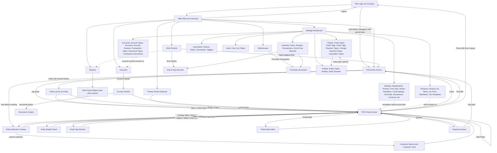

Source: [INT section 4], supplemented by [INT section 1, 2].

### 4.76 Screen Elements Excluded from V3

The following elements appear in mockups (mostly the 2019 training manual) but must **not** be implemented as V3 features. "Excluded" items are listed in [DOM section 9] and/or [APP section 10]; "Not confirmed" items are flagged only by [INT section 5.3] (absent from all transcripts and not mentioned in [DOM section 9] or [APP section 10]) and are excluded pending confirmation (see Section 14).

| Element | Where seen | Status | Source |
|---|---|---|---|
| "Display at payment screen" / "Display under ticket" payment type mapping checkboxes | `v3_foreign-currencies_08` (Payment Type editor) | Excluded: removed by Migration_018; replaced by automation commands with the Pay Ticket action | [DOM section 9]; [APP section 10]; [INT section 5.3] |
| Order tag mapping by Product Portion | `manual_2-2_order-tags_p23_01` | Excluded: portion-level order tag mapping not supported | [DOM section 9]; [INT section 5.3] |
| Order tag Prefix List (No, Less, More, Double) and prefix buttons on POS | `manual_2-2_order-tags_p22_01`, `p22_02` | Excluded: order tag prefixes | [DOM section 9]; [APP section 10] |
| Inventory Products tab with Units; recipe lines of Item Type "Product"; Add Product in recipes | `manual_2-4_inventory-recipes_p27_01`, `p29_01`, `p30_01`, `p31_01` | Excluded: inventory products (semi-products) | [DOM section 9]; [APP section 10] |
| User Password field | `manual_2-10_users_p36_02` | Excluded: no user passwords; PIN only | [APP section 10]; [INT section 5.3] |
| Product Tag Editor; product Custom Tags (Silver %, Gold %, Platinum %, Staff %, Subtitle) | `manual_2-1_products-menus_p14_02`, `p15_01` | Not confirmed; V2 sub-menus from product tags are excluded | [INT section 5.3]; [DOM section 9] |
| Select SambaCard button; SambaCard account screen, accounts, ticket column and reports | `manual_1-2_pos_p04_01`, `manual_1-3_tickets_p07_02`, `manual_1-4_accounts_p08_02`, `manual_1-6_reports_p12_02` | Not confirmed | [INT section 5.3] |
| Gift Certificates (account screen; GC Funds, GC Balances, GC Purchases, GC Redemptions accounts; ticket column) | `manual_1-3_tickets_p07_02`, `manual_1-4_accounts_p08_02` | Not confirmed | [INT section 5.3] |
| Suppliers (accounts tab, ticket column, purchase document field) | `manual_1-3_tickets_p07_02`, `manual_1-4_accounts_p08_02`, `manual_1-5_warehouses_p11_01` | Not confirmed | [INT section 5.3] |
| Expenses account screen; Customer Tabs account screen; Deliverer ticket column | `manual_1-3_tickets_p07_02`, `manual_1-4_accounts_p08_02` | Not confirmed | [INT section 5.3] |
| Petty Expense and Open Drawer ticket buttons | `manual_1-2_pos_p04_01` | Not confirmed (possibly installer-defined automation commands) | [INT section 5.3] |
| Manual-only report entries (SambaCard reports, Group Sales Advanced, Money Flow, Void & Gift, Settlements by User, etc.) | `manual_1-6_reports_p12_02` | Not confirmed | [INT section 5.3] |
| "Samba Network" module bar entry | early `v3_*` mockups | Not described in any analysis; not specified | [INT section 4] |
| Ticket tag post-selection actions and account-linked sub-tags | (not in mockups) | Excluded | [DOM section 9] |
| "Internal" account flag | (not in mockups) | Excluded | [DOM section 9]; [INT section 5.3] |
| Currency major/minor names in Local Settings | (not in mockups) | Excluded | [DOM section 9]; [INT section 5.3] |
| Re-opening paid tickets from the Ticket Explorer | (not in mockups) | Excluded | [DOM section 9]; [APP section 10] |
| Automatic backup at end of work period; TopItems menu sort; handheld terminal application | (not in mockups) | Excluded | [DOM section 9]; [APP section 10] |

## 5. Business Rules & Processes

This section unifies the domain rules of [DOM] (DR-001..DR-064), the code-level business rules of [APP] (BR-001..BR-065) and the persistence rules, validators and invariants of [DB] (sections 5, 8, 9, 10, 16 including its BR-001..BR-020) into one de-duplicated rule set. Rule IDs below are new and are the IDs used everywhere else in this PRD; the Source column gives the analysis IDs they were derived from. Where analyses differ, the Statement gives the behaviour confirmed by the code analyses ([APP], [DB]) and a "Difference" note records the other view; every such difference is also raised in Section 14 (Open Questions).

Criticality: **Core** = fundamental to sales, money or data integrity; **Supporting** = important operational behaviour; **Peripheral** = convenience, edge or code-only behaviour.

### 5.1 Business rules by bounded context

#### Ticketing & Ordering

| Rule ID | Statement | Criticality | Source |
|---|---|---|---|
| BR-001 | A ticket owns its orders, calculations, payments, change payments and paid items. These cannot exist without the ticket, and physically deleting a ticket removes all of them. | Core | [DB BR-001], [DB DB-02], [DB 8.1] |
| BR-002 | Ticket opening path: if a ticket is already selected, no entity screen exists for ticket creation, or the department's ticket creation method is "Create Ticket", the ticket screen opens directly. Otherwise the entity screen is shown. When an entity is selected (the Entity Selected event is raised first) and no ticket is selected: with no open ticket for the entity a new ticket is created, and the user is first asked for a ticket type when the entity screen has "Ask Ticket Type" and more than one ticket type exists. With exactly one open ticket that ticket opens. With several open tickets a ticket list is shown. | Supporting | [APP workflow "Create / open ticket"], [INT WF Create a Ticket], [DOM glossary Select Entity / Create Ticket] |
| BR-003 | While a ticket has no orders, the user is asked for every entity type and ticket tag group flagged "Ask Before Creating Ticket" before the menu is shown. With a waiter configured this way, the ticket opens with both the table and the waiter. | Supporting | [APP workflow step 4], [DOM glossary Ask Before Creating Ticket], [INT WF Configure Entity Types step 5] |
| BR-004 | Add Ticket creates an additional ticket for the same entity. Entities whose ticket-type assignment has "Copy To New Tickets" set are copied to the new ticket. New assignments default to copying. | Peripheral | [APP BR-062], [DB 5.5], [INT WF Change Table step 1], [DOM glossary Add Ticket] |
| BR-005 | An order cannot be added when the ticket is closed, when the ticket is locked and the user lacks AddItemsToLockedTickets, or when the product portion is missing. | Core | [APP BR-017], [APP workflow step 5], [DOM DR-019] |
| BR-006 | When an order is added: Calculate Price and Decrease Inventory are on, the creation time and creating user name are recorded, and the department's price tag, any product timer and the mapped tax templates are applied. The screen-menu button may also pre-apply order tags, order states and an automation command. A button with Auto Select opens the order for portion and tag selection straight away. The Order Added event is raised. | Core | [DB 5.5], [DB 11], [APP workflow step 5], [DOM glossary Auto Select] |
| BR-007 | At the time of sale the order keeps its own copy of the product name, portion name, price, taxes and order tags (with tag prices). Later changes to master data do not change it. | Core | [DB BR-015], [DB R-18] |
| BR-008 | The plus and minus quantity buttons work only on new (unlocked) orders. On submitted (locked) orders the bracketed plus and minus only select part of the quantity, for example for moving or paying selected units. | Supporting | [DOM DR-012], [APP BR-017], [INT WF Cancel, Void or Gift step 1] |
| BR-009 | Order tag selection: in a group whose maximum is 1, choosing a tag replaces the group's existing tag and keeps its position (radio behaviour). In a group whose maximum is more than 1, further selections are refused once the maximum is reached. Selecting a tag that is already selected increases its quantity, and the tag is removed once its quantity would exceed the tag's maximum quantity (or immediately in a single-select group). | Core | [APP BR-010], [DOM DR-023], [INT WF Configure Order Tag Groups step 1] |
| BR-010 | Mandatory order tags: an unlocked, stock-decreasing order must have at least the group's minimum number of tags from each mapped order tag group. Until it does, it cannot be deselected and the ticket cannot be closed or settled, and a message names the missing group. | Supporting | [APP BR-011], [DOM DR-023], [DOM pain point "mandatory order tag groups look like a frozen screen"] |
| BR-011 | Cancel is a built-in operation, not an automation command. It is allowed only for orders that are not yet saved, are unlocked and belong to the ticket. Cancelled orders are removed as if never added and the Order Cancelled event is raised. Submitted orders cannot be cancelled and must be voided. | Core | [DOM DR-013], [APP BR-016], [DB 9.4], [INT WF Cancel, Void or Gift step 2] |
| BR-012 | Void (default automation command) applies to submitted orders and is disabled on new orders. The default rule sets the order state Void in the GStatus group, switches Calculate Price and Decrease Inventory off, and resets the order status to New so the next close sends a "VOID" line to the kitchen. The order stays on the ticket with no price, consumes no stock and is hidden from the bill by the default template. | Core | [DOM DR-014], [APP workflow "Order operations" step 2], [DB BR-014], [INT WF Cancel, Void or Gift] |
| BR-013 | Cancel Void is available only until the ticket is closed, that is while the voided order is still New. It clears the Void state, restores Calculate Price and Decrease Inventory, and returns the order status to Submitted. | Supporting | [DOM DR-015], [DOM glossary Cancel Void], [APP workflow "Order operations" step 2] |
| BR-014 | Gift (default automation command) sets the state Gift in the GStatus group with Calculate Price off and Decrease Inventory on. The order is not billed, still consumes stock, and prints as "GIFT" with a separate gift total. | Core | [DOM DR-016], [APP BR-064], [APP workflow "Order operations" step 2], [INT WF Cancel, Void or Gift step 4] |
| BR-015 | Cancel Gift clears the gift state and turns Calculate Price and Decrease Inventory back on, which restores the price. | Supporting | [APP workflow "Order operations" step 2], [DOM glossary Cancel Gift] |
| BR-016 | No permission controls Void or Gift. Who may use them, and where, depends only on the automation command mappings and their enabled/visible states. | Supporting | [DOM DR-061], [APP section 2 note], [APP section 10 Security] |
| BR-017 | A ticket may be closed (submitted) when its remaining amount is 0, or it has at least one ticket entity of any type, or it has no orders. Otherwise it may still close if it carries a defined ticket tag. If none of these holds, Close does nothing. A waiter entity alone is enough, so no table is needed. Difference: [DOM] states the same rule as "entity, or fully paid, or ticket tag". The [APP] "no orders" branch corresponds to [DOM]'s "empty tickets are discarded". | Core | [APP BR-014], [APP workflow "Close (submit) ticket" step 1], [DOM DR-011], [INT WF Close the Ticket], [INT WF Configure Entity Types step 6] |
| BR-018 | Closing a ticket that has no orders discards it. Nothing is saved or numbered. | Supporting | [DOM DR-011], [DOM glossary Close], [INT WF Close the Ticket step 1] |
| BR-019 | When a ticket is closed with a remaining amount of 0, any calculable order (Calculate Price on) whose value is zero stops the close with an error. Gifted and voided orders are exempt because they are not calculable. | Supporting | [APP BR-012], [DOM DR-027] |
| BR-020 | Required ticket tags: when a not-yet-closed ticket with orders is closed (the check runs in the same step as BR-019, when the remaining amount is 0), every ticket tag group with "Selection Required" (Force Value) must have a value. Otherwise the first missing tag group is reported and the close stops. | Supporting | [APP BR-013], [DOM DR-024], [INT WF Create a Ticket step 5] |
| BR-021 | The close sequence runs in this order: (1) concurrency check (BR-027); (2) if the ticket is unchanged and not closed, recalculate it; (3) raise Before Ticket Closing (the default rule marks the ticket Paid and closed when the remaining amount is 0); (4) if orders exist, give new orders an order number and merge identical new orders (BR-024); (5) the first save gives the ticket its number; (6) raise Ticket Closing (the default rule prints New orders to the kitchen and sets ticket status Unpaid and order status Submitted); (7) lock all orders, and lock the ticket if a lock was requested; (8) remove zero-amount transactions from closed tickets; (9) save; (10) raise Entity Updated for each ticket entity with its number of open tickets; (11) broadcast a ticket refresh to other terminals. | Core | [APP workflow "Close (submit) ticket"], [APP BR-017], [APP BR-058], [DB 13.3] |
| BR-022 | On close, only orders whose status is New are sent to the kitchen. They are then marked Submitted. No kitchen slip is produced when there are no New orders. | Core | [DOM DR-017], [APP workflow "Close (submit) ticket" step 2], [APP workflow "Print job execution"], [INT WF Close the Ticket step 2] |
| BR-023 | Numbering: a ticket gets its number from the ticket type's ticket numerator on its first save, or when an unnumbered ticket is printed. On close, orders with no order number get the next number from the order numerator, so all orders of one round share it. | Core | [APP BR-018], [DOM DR-018], [DOM glossary Order Number / Ticket Number] |
| BR-024 | Order merging on submit: new, unsaved orders are merged into one line when quantity, price, product, portion, Calculate Price, Increase/Decrease Inventory and order states are identical and neither order has order tags. Products that have an order with quantity greater than 1 are not merged. | Supporting | [APP BR-008], [DB 9.4] |
| BR-025 | A ticket becomes closed (Is Closed) only when its remaining amount is 0 and no product timer on it is active. Closing clears the paid-item records. A closed ticket cannot be unlocked. | Core | [APP BR-015], [DB BR-004], [DB 9.4], [DOM DR-027] |
| BR-026 | A closed, paid ticket is final. It can be displayed and its bill reprinted, but it cannot be reopened or changed. There is no "delete ticket": every ticket with submitted orders ends paid, settled to an account, or fully voided. Voiding every order gives a remaining amount of 0, so the ticket closes as paid. | Core | [DOM DR-028], [DOM DR-029], [INT WF Find a Ticket step 2] |
| BR-027 | Ticket concurrency: before an existing ticket is saved, its last-update time is compared with the stored copy. If they differ, the save is rejected with a message, and changes are never silently overwritten, when: the set of attached entities changed ("ticket moved"); the closed flag differs ("ticket paid, changes not saved" or "changed"); stored payments exist that this terminal does not know about; or the ticket is fully paid here but the stored total differs. This is an application check. There is no row-version column on tickets. | Core | [APP BR-019], [DB BR-005], [DB 9.3], [DOM DR-010] |
| BR-028 | Print Bill (default automation command, enabled in states New Orders, Unpaid and Is Closed) runs these default rule actions in order: run the "Print Bill" print job, request a lock, set the entity Status to Bill Requested, set the ticket Status to Locked, and close the active ticket. The lock takes effect when the ticket is closed. Print Bill remains available for reprints. | Core | [APP workflow "Print bill"], [DOM DR-019], [DOM glossary Print Bill], [INT WF Print Bill step 1] |
| BR-029 | A locked ticket accepts no new orders unless the user has AddItemsToLockedTickets. It also blocks table change, moving orders out, Change Price and the calculation (discount and round) buttons. | Core | [DOM DR-019], [DOM DR-037], [APP BR-017], [APP BR-021], [APP BR-022], [INT WF Print Bill step 2] |
| BR-030 | Unlock Ticket (default automation command, visible only on locked tickets) unlocks the ticket and sets it back to Unpaid, which turns the table orange. Release Lock is a built-in action visible only to roles with AddItemsToLockedTickets. Unlocking is usually restricted to managers through mappings. | Supporting | [DOM DR-019], [DOM glossary Unlock Ticket / Release Lock], [APP section 2 AddItemsToLockedTickets], [INT WF Print Bill step 2] |
| BR-031 | Move Orders requires saved orders on an open, unlocked ticket, and the value of the selected orders must not exceed the ticket's remaining amount. Moving unlocked (saved but not yet locked) orders needs MoveUnlockedOrders; moving locked (submitted) orders needs MoveOrders. Difference: [DOM] states only "saved orders, not on a locked ticket". The [APP] permission catalogue describes MoveOrders as "move locked ticket lines", which refers to locked orders on an unlocked ticket. | Supporting | [APP BR-021], [APP section 2], [DOM DR-020], [INT WF Split a Bill step 1] |
| BR-032 | Move mechanics: a partly selected quantity is split off into a cloned order, and the original keeps the rest. The Ticket Moving and Order Moving events are raised, the orders are cloned, the source ticket is closed, and the target ticket is opened (a new ticket when none is given). The orders are added, Order Moved and Ticket Moved are raised, and the result is saved. The default rule resets the ticket status to New Orders. The user normally picks the same table, which then has two tickets. | Supporting | [APP workflow "Order operations" step 3], [INT WF Split a Bill], [DOM glossary Move] |
| BR-033 | Merge Tickets requires the MergeTickets permission and at least two selected tickets. It is refused if any ticket has calculations (for example a discount), or if the tickets have different entities of the same entity type. | Core | [APP BR-020], [DOM DR-021], [INT WF Change Table step 2] |
| BR-034 | Merge mechanics: orders, payments, change payments, ticket tags, entities and logs are cloned into one new ticket. The source tickets are emptied and closed, and the Tickets Merged event is raised (default rule "Update Merged Tickets State"). The close result of each source ticket is not checked. | Supporting | [APP workflow "Order operations" step 4], [APP section 10], [DB 13.3] |
| BR-035 | Change Price applies to a selected order on an open, unlocked ticket. Anyone may price an order whose price is 0 (open-price item). A non-zero price may be changed only with the ChangeItemPrice permission, and the typed price must be greater than 0. Difference: the code never registers ChangeItemPrice, so no role can be granted it and only Admin-role users can change non-zero prices. [DOM] describes it as a grantable permission. | Supporting | [APP BR-022], [APP section 2], [APP section 10 Security], [DOM DR-022] |
| BR-036 | Change Table and Change Waiter re-attach the ticket to another entity of that type, but the table cannot be changed on a locked ticket. The default rules recolour entities: the new table shows New Orders, and the old table returns to Available if it has no other open tickets. | Supporting | [DOM DR-019], [INT WF Change Table], [DB 13.3 "Update Moved Entity Colour"] |
| BR-037 | Entities: an entity needs an entity type and a non-empty, unique name. An entity used by an entity-screen item or by any ticket cannot be deleted. An entity type that still has entities cannot be deleted. Entity type names are unique. | Supporting | [APP BR-048], [APP BR-050], [APP BR-051], [DB 9.2] |
| BR-038 | Each entity has exactly one state record (a unique index on the entity), which holds its state per state group, for example Status = Available. | Supporting | [DB BR-013], [DB DB-04], [DB 13.2] |
| BR-039 | Entity search: text of the form "field:value" searches that custom field only. Any other text searches the name and the custom data. | Peripheral | [APP BR-047] |
| BR-040 | Free tags: when "Save Free Tags" is set, a typed ticket tag or order tag value is added as a button only if it is not already present, compared case-insensitively. Ticket tags are checked within their group. Order tags are checked by name across all order tag groups. | Peripheral | [DB BR-019], [DB 9.4], [DOM glossary Free Tagging] |
| BR-041 | Every ticket keeps an append-only log of ticket events (number, time, user name, category, text). It also records the last modifying user. Orders record the creating user name and time, and each order state change records who made it and when. | Supporting | [DB 11], [DOM pain point "who voided what"] |

##### State transitions (default system rules)

The life cycles below are data held in seeded states, automation commands and rules ([DB 13.3]). They are not hard-coded, and a re-implementation must reproduce them as default configuration.

| Rule ID | Object / state group | From | Event / command | To | Source |
|---|---|---|---|---|---|
| BR-042 | Ticket, Status group | (none) | Ticket created (New Ticket Creating Rule) | New | [APP workflow "Close (submit) ticket"], [DB 13.3] |
| BR-042 | Ticket, Status group | New | Order added (New Order Adding Rule) | New Orders | [APP], [DB 13.3] |
| BR-042 | Ticket, Status group | New Orders | Ticket Closing | Unpaid | [APP], [DOM glossary Unpaid], [DB 13.3] |
| BR-042 | Ticket, Status group | Unpaid / New Orders | Print Bill | Locked (and lock flag set on close) | [APP workflow "Print bill"] |
| BR-042 | Ticket, Status group | Locked | Unlock Ticket | Unpaid | [DOM glossary Unlock Ticket], [INT WF Print Bill] |
| BR-042 | Ticket, Status group | any open state | Before Ticket Closing with remaining amount 0 (Ticket Payment Check) | Paid, ticket marked closed | [APP workflow "Payment and settlement" step 7], [DB 13.3], [DOM glossary Paid] |
| BR-042 | Ticket, Status group | any | Ticket Moved (Ticket Moved Rule) | New Orders | [APP workflow "Order operations" step 3] |
| BR-043 | Order, Status group | New | Ticket Closing | Submitted | [DOM DR-017], [DB 13.3] |
| BR-043 | Order, Status group | Submitted | Void | New (with GStatus = Void) | [DOM DR-014] |
| BR-043 | Order, Status group | New (voided) | Cancel Void (before close) | Submitted, GStatus cleared | [APP], [DOM DR-015] |
| BR-043 | Order, GStatus group | (empty) | Gift / Void | Gift / Void | [DOM glossary GStatus], [APP] |
| BR-043 | Order, GStatus group | Gift | Cancel Gift | (empty) | [APP] |
| BR-044 | Entity, Status group | Available (white) | Ticket with ordered items closed (Update New Order Entity Colour) | New Orders (orange) | [DOM glossary New Orders], [INT WF Close the Ticket step 3] |
| BR-044 | Entity, Status group | New Orders | Print Bill | Bill Requested (maroon) | [APP workflow "Print bill"], [DOM glossary Bill Requested] |
| BR-044 | Entity, Status group | Bill Requested | Unlock Ticket | New Orders (orange) | [INT WF Print Bill] |
| BR-044 | Entity, Status group | any | Entity Updated with 0 open tickets (Update Available Entity Colour) | Available | [APP workflow "Close (submit) ticket" step 3] |
| BR-045 | Ticket flags | Is Locked false | Lock requested, then close | Is Locked true (closed tickets cannot be unlocked) | [APP BR-015], [APP BR-017] |
| BR-045 | Ticket flags | Is Closed false | Remaining amount 0 and no active timer | Is Closed true, paid items cleared | [APP BR-015], [DB 9.4] |
| BR-045 | Order flags | Unsaved (no id), unlocked | First close | Saved, numbered, locked | [APP workflow "Create / open ticket" state transitions] |

#### Payment & Pricing Adjustments

| Rule ID | Statement | Criticality | Source |
|---|---|---|---|
| BR-046 | A payment can be made only when the ticket is open, the tendered value is not zero, and the remaining amount is not zero. In addition, either the payment type has a fixed account, or one of the ticket's entities can take the account transaction (BR-074). In account (Balance) mode the tendered amount must not exceed the amount due, and the payment type needs a fixed account. | Core | [APP BR-024], [DOM DR-034], [DOM DR-041] |
| BR-047 | Amount entry: the amount is entered first and the payment type is pressed second. An empty amount means the full amount due. Quick-value buttons (from program settings), the keypad, fraction buttons (All, 1/2, 1/3, 1/4, 1/n) and "repeat last amount" help enter the amount. | Supporting | [INT WF Settle step 3] |
| BR-048 | While an amount is typed but not yet paid, the Close button on the payment screen is disabled. | Supporting | [DOM DR-031], [INT WF Settle step 4] |
| BR-049 | Payment outcome: when the payment equals the amount due (within the tolerance of BR-050), the payment screen closes and the ticket becomes Paid and closed. When it is less, a partial payment is recorded and the screen stays open. When it is more, change is shown. Leaving the payment screen with an unpaid balance leaves the ticket open and the table occupied. Each payment raises Payment Processed and recalculates the remaining amount. | Core | [DOM DR-032], [APP workflow "Payment and settlement" steps 4-7], [INT WF Settle] |
| BR-050 | Payment tolerance: an amount due within 0.01 of the remaining amount is set to the remaining amount, and a tendered amount within 0.01 of the amount due is set to the amount due. | Supporting | [DOM DR-033], [APP BR-025] |
| BR-051 | Change: change is produced when the tendered amount is greater than the amount due. Change payment types are offered only when a foreign currency is selected, filtered by account type. With fewer than two matching types the single match (or none) is used without asking, and otherwise the cashier chooses. The cashier is never asked in the base currency. Difference: [DOM] DR-032 says base-currency change "comes from base cash unless change payment types exist". | Core | [APP BR-026], [DOM DR-032], [DOM DR-046], [INT WF Foreign Currency step 5] |
| BR-052 | Balance mode (Ticket/Balance toggle): the amount due becomes the ticket remainder plus the customer's open balance. A payment pays the ticket first, and any surplus, up to the active account's balance, is posted to the customer account (event Account Transaction Added To Ticket). The cashier cannot tender more than is due, and only payment types with a fixed account work. | Supporting | [DOM DR-034], [DOM glossary Balance], [APP workflow "Payment and settlement" step 6] |
| BR-053 | Paying selected items: the order selector groups lines of the same product and price, and each tap selects one unit. Paid units stay marked as paid until the ticket closes. Paid items are matched by product and price only, so orders that differ only in tags are not told apart. | Supporting | [INT WF Settle step 2], [APP section 10], [APP BR-015] |
| BR-054 | Order selector prices include the share of every spread adjustment (discounts, services, taxes), so selected items are paid at their adjusted value. | Supporting | [DOM DR-035], [APP BR-004] |
| BR-055 | Calculation methods: 0 = percentage of the plain sum (or of stock-affecting orders only when "Use Plain Sum" is set); 1 = percentage of the running sum ("rate from previous template", so calculations stack); 2 = fixed amount (default); 3 = set the ticket total to the amount; 4 = round the ticket total to a multiple of the amount; 5 = custom. Formulas are in Section 7. Difference: [APP] says method 5 takes its amount from a script named "Calculation_<name>". [DB] calls it "special", kept even when its amount is 0. Both are compatible, but only [APP] documents the script. | Core | [APP BR-002], [DB 6], [DOM glossary Calculation Type / Rate from Previous Template] |
| BR-056 | Calculation lifecycle: a calculation whose amount is 0 (other than a custom one) is removed together with its account transaction. With "Toggle Calculation" set, applying the same amount again removes the calculation. Applying a calculation type that is already on the ticket updates it. Each calculation's transaction type holds one transaction. | Supporting | [APP BR-003], [DB 10] |
| BR-057 | A calculation selector without a button header is applied automatically to every new ticket where its mapping matches, for example a service charge. Calculation selectors with headers appear as buttons on the payment screen, subject to their mappings (role, department, ticket type, terminal). | Supporting | [APP workflow "Create / open ticket" step 3], [DOM glossary Calculation Selector], [INT WF Apply a Discount step 1] |
| BR-058 | Pressing Discount % with nothing typed removes the discount. | Supporting | [DOM glossary Discount %], [INT WF Apply a Discount] |
| BR-059 | When the typed value is above the calculation type's maximum amount, the calculation button is disabled. | Supporting | [DOM DR-036], [INT WF Apply a Discount], [DB 3.1 CalculationTypes.MaxAmount] |
| BR-060 | If button calculations make the remaining amount negative on the payment screen, all button-selectable calculations are removed, the ticket is recalculated and "All discounts removed" is shown. | Supporting | [APP BR-028], [DOM DR-036], [APP workflow "Payment and settlement" step 8] |
| BR-061 | Calculation (discount and round) buttons are disabled on a locked ticket. The recommended practice is to discount first and then print the bill. | Supporting | [DOM DR-037], [INT WF Apply a Discount step 2] |
| BR-062 | Round is a fixed-amount, decreasing calculation booked to the Rounding account, separately from discounts (Discount account). | Supporting | [DOM DR-038], [DB 13.1] |
| BR-063 | Taxes: the ticket type decides whether prices include tax. Tax templates are mapped to product group and product (and department, ticket type), and the order keeps its tax values at sale time. Tax-free order tags are excluded from the taxable price. Pre-tax calculations are spread over orders in proportion to their share of the plain sum before tax is computed. | Core | [DOM DR-039], [APP BR-004], [DB BR-015] |
| BR-064 | Foreign currency set-up: each foreign currency needs its own cash account (with that currency) and its own payment type with mapping rows. Selecting a currency on the payment screen shows only payment types in that currency, and clicking the currency again returns to the base currency. | Supporting | [DOM DR-044], [INT WF Set Up a Foreign Currency], [DOM pain point "payment buttons change"] |
| BR-065 | Exchange rates are maintained by hand and must be greater than 0. A ticket's exchange rate comes from the currency of the default target account of the ticket type's sale transaction type. A payment uses the currency rate of the paying account. Account documents use the currency rate or a fixed exchange template. A stale rate gives unnoticed discounts. | Core | [APP BR-029], [APP BR-051], [DOM glossary Exchange Rate], [DOM pain point "manual exchange rate"] |
| BR-066 | Currency rounding: when a currency has a rounding value, every order selector price shown in that currency is rounded to the nearest multiple, away from zero. The difference from the ticket total is added to the cheapest remaining order. With rounding 0, raw converted prices are shown. | Supporting | [APP BR-030], [DOM DR-045], [INT WF Foreign Currency steps 2-3] |
| BR-067 | Currency display: the symbol format must contain the "{0}" placeholder, otherwise only the symbol appears in the change display. No currency buttons are shown when only the base currency (rate 1) exists. | Peripheral | [INT WF Set Up a Foreign Currency step 1], [INT WF Foreign Currency step 1], [DOM pain point "currency symbol without {0}"] |

#### Accounting

| Rule ID | Statement | Criticality | Source |
|---|---|---|---|
| BR-068 | Double entry: every money movement is an account transaction between a source and a target account. The amount is credited to the source and debited to the target, so each transaction balances to zero. An account's balance is its debits minus its credits. | Core | [DOM DR-040], [APP BR-057], [DB BR-002], [DB 9.4] |
| BR-069 | Default postings: a sale moves Sales to Receivables; a payment moves Receivables to the payment account (Cash, Credit Card, Voucher); a discount or rounding moves Receivables to the Discount or Rounding account; a tab moves Receivables to the customer account; settling a tab moves the customer account to Cash or Credit Card. Change reverses a payment (payment account to Receivables). | Core | [DOM DR-040], [DOM glossary Change Transaction Type], [DB 13.1] |
| BR-070 | Each ticket owns exactly one transaction document, named "Ticket Transaction [ticket number]". Sales lines, taxes and calculations each get one shared transaction per transaction type, recalculated with the ticket. Each payment and change payment gets its own transaction. A transaction type is removed when no orders or calculations use it. Zero-amount transactions are removed from closed tickets. | Supporting | [APP BR-057], [APP BR-058], [DB 9.4], [DB 10] |
| BR-071 | Account transactions are reversed by flag (reversible / reversed), not deleted. | Supporting | [DB 11], [DB 5.5] |
| BR-072 | An entity without an account cannot take account transactions. The Customer Account payment button is disabled when the ticket has no customer, or the customer has no account. | Core | [DOM DR-041], [APP BR-024], [INT WF Settle to a Customer Account step 2] |
| BR-073 | An account can be created for an entity only when its entity type has an account type, the entity has no account yet, every field in the account name template is filled, and the user has CreateAccount. Open tickets of that entity are then updated to use the new account. | Supporting | [DOM DR-042], [APP section 2 CreateAccount], [INT WF Settle to a Customer Account step 1] |
| BR-074 | Account working rule (on the entity's account type): 0 allows debit and credit; 1 blocks a transaction that would make the target balance negative; 2 blocks the transaction when the balance exceeds the entity's "Credit Limit" custom field, which disables Customer Account. Difference: the code comment and [DB] label the values "0 permit, 1 disallow debit, 2 disallow credit". [DOM] describes only the optional credit-limit rule. The behaviour stated here is the code-confirmed [APP] behaviour. | Core | [APP BR-027], [APP section 10], [DB 6], [DB 9.4], [DOM DR-043] |
| BR-075 | Account document default amount: a fixed value; "[Balance]" (the absolute account balance, the default for customer documents); "[BalanceEx]" (the absolute balance in foreign currency times the rate); or "[:field]" (taken from the entity's custom data). Descriptions may use [MONTH], [NEXT MONTH], [WEEK], [NEXT WEEK], [YEAR] and [ACCOUNT NAME]. | Supporting | [APP BR-055], [APP workflow "Account document creation"], [DOM DR-047] |
| BR-076 | An account document can be printed only when its document type has a printer template, and the terminal needs a transaction printer. Without a template there is no Print button. | Supporting | [DOM DR-047], [INT WF Settle to a Customer Account step 4] |
| BR-077 | Account document creation: the document builds one transaction for each of its transaction types, between the master account and the chosen counter accounts. Counter accounts are listed by filter (all, balanced only, mapped). The exchange rate comes from the currency or a fixed exchange template. The document is saved and Account Transaction Document Created is raised. Known defect: with several transaction types the running amount is multiplied by each type's currency rate in turn, so it compounds. | Supporting | [APP workflow "Account document creation"], [APP BR-056], [APP section 10] |
| BR-078 | Accounting configuration: an account needs an account type. A transaction type needs at least one account type, and its source and target must differ. Payment, change payment, calculation and tax types each need a transaction type. Account, account type, transaction type and document type names are unique. | Supporting | [APP BR-050], [APP BR-051], [DB 9.2] |

#### Automation (Rules & Commands)

| Rule ID | Statement | Criticality | Source |
|---|---|---|---|
| BR-079 | Automation command buttons do nothing on their own. Pressing one raises Automation Command Executed, and only a matching rule produces behaviour. | Core | [DOM DR-061], [DOM glossary Automation Command] |
| BR-080 | Mapping visibility: an item that has mappings (rules, automation commands, payment types, change payment types, calculation selectors, ticket tag groups, order tag groups, entity screens, account document types, tax templates, product timers) is available only if at least one mapping row matches the current terminal, department, user role and ticket type. A value of 0 (shown as "*") matches anything. An item with no mapping row is available nowhere. | Core | [DOM DR-025], [APP BR-041], [DB BR-012], [DB 8.2], [DB R-20] |
| BR-081 | Product-level mappings (order tag groups, tax templates, product timers) also filter on product group code (empty = any group) and product (0 = any). There is no portion-level mapping. | Supporting | [DB 8.2], [DOM DR-026], [INT WF Configure Order Tag Groups step 3] |
| BR-082 | Automation command availability: a mapping's enabled and visible states are comma-separated state expressions ("State" or "Group=State"; "*" = always; "GStatus=" = no gift/void state; "IsClosed" allows closed tickets). For order commands, every selected order must be in a listed state. A closed ticket blocks every command except those listing IsClosed. A script (CanExecuteAutomationCommand) can restrict further. The mapping also sets placement (on ticket, payment screen, orders, ticket list, under ticket, command selector). | Core | [APP BR-042], [DB 6], [DB 8.2] |
| BR-083 | Rule selection: when an event is raised, the rules for that event whose mappings match the context run in sort order, if their constraints pass under the match mode: Matches (default: each constrained left-hand side needs at least one match), Match Any, Match All, Not Any or Not All. A constraint on a parameter the event does not carry is ignored. Rules can also have a script constraint. | Core | [APP BR-043], [APP workflow "Rule engine execution" steps 1-3], [DB 6] |
| BR-084 | Action execution: the actions of a satisfied rule run in sort order, each with an optional constraint. Parameter values set on the rule override the action's own values, and placeholders such as "[:Variable]" are replaced before the action runs. | Core | [APP workflow "Rule engine execution" step 4], [DOM glossary Variable] |
| BR-085 | State semantics: "is in state" with "*" as the group checks any group. An empty state means "in no state of that group". Setting an empty state removes the value. Ticket and order states can carry a state value, a quantity and a last-update time. | Core | [APP BR-045] |
| BR-086 | Saved action parameter values must not start or end with a space. | Peripheral | [APP BR-044], [DB BR-018] |
| BR-087 | Default commands, actions, states and rules are seeded and encode the ticket, order and entity life cycles (BR-042 to BR-044). Placing "regen.txt" in the user data folder and restarting recreates them by name. Own rules stay, but edits to defaults are lost. | Supporting | [DOM DR-063], [DB 13.3], [DB R-08] |
| BR-088 | The Send Message action broadcasts a message to all terminals, and receivers run their Message Received rules. | Supporting | [APP workflow "Rule engine execution" step 5], [APP workflow "Multi-terminal synchronisation"] |
| BR-089 | Scheduled triggers fire on their cron expression and record their last run time. While the Management screen is active they do not raise Trigger Executed. A trigger that no longer exists stops itself. | Peripheral | [APP BR-060], [APP workflow "Trigger"], [DOM glossary Trigger] |

#### Catalogue & Menu

| Rule ID | Statement | Criticality | Source |
|---|---|---|---|
| BR-090 | Every product has at least one portion. The default portion is "Normal". | Supporting | [DOM DR-048], [INT WF Build Products step 2] |
| BR-091 | Batch Create (products): a "#Name" line starts a product group, and on other lines the last word is the price (comma or dot; a non-number gives 0). Lines without a space are skipped, and only single-portion products are created. | Peripheral | [DOM DR-049], [INT WF Build Products step 1] |
| BR-092 | Price tags (price definitions) are at most 10 characters ([DOM] only), are required, and are unique ignoring case. | Supporting | [DOM DR-050], [APP BR-050], [APP BR-051], [DB BR-010] |
| BR-093 | Portion price: when the department has a price tag and the portion has a price for that tag greater than 0, that price is used. Otherwise the portion's base price is used. | Core | [APP BR-006], [DOM glossary Price Tag] |
| BR-094 | Changing an order's portion realigns the order tags linked to products, so they point to the portion of the same name. | Supporting | [APP BR-006], [DOM DR-053] |
| BR-095 | Order tag group configuration: when Maximum is greater than 0 it must be at least Minimum. A group with a group tag must have Maximum 1 and at least one tag. Minimum 1 with Maximum 1 means exactly one. "Add Tag Price To Order Price" decides whether tag prices show inside the order price. Tax-free groups are excluded from tax. | Supporting | [APP BR-010], [APP BR-005], [INT WF Configure Order Tag Groups step 1] |
| BR-096 | Menu entry: a typed value with a quantity separator ("x" or "X" by default) multiplies the quantity. Text starting with a lower-case letter filters the menu buttons (at most 30). Enter looks up a barcode. A weight barcode (prefix, item code, quantity digits) gives the product and the quantity. Unknown numbers raise Numberpad Value Entered. Quantities greater than 9 are divided by the portion multiplier (Section 7). | Supporting | [APP BR-054], [APP BR-009], [INT WF Create a Ticket step 3] |
| BR-097 | Product names are unique. A product used by a screen menu, a recipe or an order tag cannot be deleted, and a screen menu used by a ticket type or department cannot be deleted. | Supporting | [APP BR-049], [APP BR-050], [DB 9.2] |

#### Trading Session & Organisation

| Rule ID | Statement | Criticality | Source |
|---|---|---|---|
| BR-098 | The POS is disabled ("Start Work Period to enable POS"), and the Reports and Accounts screens are unavailable, while no work period is open. | Core | [DOM DR-001], [APP BR-032], [INT WF Start the Work Period] |
| BR-099 | At most one work period is open for the whole database. Start is allowed only when no period exists or the latest one has ended. Starting while one is open does nothing. A period is open while its start and end times are equal, and ending it sets the end time and end description. | Core | [DOM DR-002], [APP BR-031], [DB BR-016], [DB 9.4], [DB 10] |
| BR-100 | Work period times come from the computer clock, so a wrong clock gives wrong work periods. | Supporting | [DOM DR-003], [INT WF Start the Work Period step 2] |
| BR-101 | A work period can be ended only from the Work Periods screen, only while it is open, only after it has been open for more than one minute, and only when there are no open tickets. Otherwise End is disabled and a red message gives the count ("There are 3 open tickets..."). The count includes every non-closed ticket in the database, regardless of department or terminal. | Core | [DOM DR-004], [DOM DR-005], [APP BR-031], [APP section 10], [INT WF Run the Work Period Report step 3] |
| BR-102 | Starting a period runs the work-period processors in a transaction, then raises Work Period Starts. Ending raises Before Work Period Ends, ends the period, runs the processors and raises Work Period Ends. A failure is logged and rolled back with a generic error. | Supporting | [APP workflow "Start and end work period"] |
| BR-103 | Ending a work period creates the End of Day Record automatically when recipes exist, removing zero rows. It can never be created by hand. | Supporting | [DOM DR-006], [APP workflow "Start and end work period" step 2], [INT WF Run the Work Period Report step 3] |
| BR-104 | Switching department requires a role allowed to use more than one department and the ChangeDepartment permission. The allowed departments come from the per-department permission UseDepartment_{id}. Switching is blocked while a ticket is open or no work period is open. | Supporting | [DOM DR-007], [APP section 2], [INT WF Log in step 2] |
| BR-105 | Each role has a default department (required), which becomes the current department at login. | Supporting | [DOM DR-008], [APP BR-039], [APP workflow "Login and logout" step 3] |
| BR-106 | A department needs a ticket type and a warehouse. A department cannot be deleted while a user role uses it. | Supporting | [APP BR-051], [DB 9.2] |
| BR-107 | When the terminal has Auto Logout set, closing a ticket logs the user out, so the next waiter signs in. | Peripheral | [APP BR-059], [DOM glossary Auto Logout], [INT WF Log in step 3] |

#### Inventory & Costing

| Rule ID | Statement | Criticality | Source |
|---|---|---|---|
| BR-108 | An inventory item is not a product. Recipes connect product portions to inventory items, and a product without a recipe consumes no stock. | Supporting | [DOM DR-051] |
| BR-109 | A recipe needs a portion. Every line needs an inventory item and a quantity greater than 0, in base units. A portion can have only one recipe. | Supporting | [DOM DR-052], [APP BR-034], [DB BR-011], [DB 9.2] |
| BR-110 | If a product has recipes and a sold portion has none, the inventory calculation fails with an error. | Supporting | [DOM DR-052], [INT WF Count Stock step 2] |
| BR-111 | Only orders flagged Decrease Inventory or Increase Inventory count towards consumption. A gifted order still consumes stock and a voided order does not. | Core | [APP BR-037], [DOM DR-057], [DB BR-014] |
| BR-112 | When an order tag points to a product, that product's recipe also consumes stock, multiplied by the tag quantity and the order quantity. The portion with the same name is used, otherwise the first portion. | Supporting | [DOM DR-053], [APP BR-035], [INT WF Configure Order Tag Groups step 2] |
| BR-113 | An inventory transaction document can be entered only while a work period is open. It must be dated after the start of the current work period and must have at least one line. [DOM] adds that zero quantities and lines without a unit are refused. | Supporting | [DOM DR-054], [APP BR-033], [INT WF Count Stock step 3] |
| BR-114 | Physical stock is counted, and Current Inventory entered on the End of Day Record, only between the end of one work period and the start of the next. The next period's In Stock uses the count. | Supporting | [DOM DR-055], [INT WF Count Stock step 4] |
| BR-115 | At the start of the next work period, final costs of the previous period are recalculated when recipes exist. The difference between predicted and counted consumption is spread by recipe ratios, and products whose recipes do not use the item are unaffected. | Supporting | [DOM DR-056], [APP BR-036], [APP workflow "Start and end work period" step 1] |
| BR-116 | Inventory configuration: inventory item names are unique, and an item that appears on an End of Day Record cannot be deleted. A warehouse needs a warehouse type, and inventory transaction types are validated against warehouse types. A purchase type has only a target warehouse, and a transfer has both source and target. | Supporting | [APP BR-049], [APP BR-050], [APP BR-051], [DB 9.2], [DOM glossary Inventory Transaction Type] |

#### Printing

| Rule ID | Statement | Criticality | Source |
|---|---|---|---|
| BR-117 | A printer without a share name prints nothing. | Supporting | [DOM DR-058], [APP workflow "Print job execution"] |
| BR-118 | A print task is skipped when its printer has no share name, when its template is missing, or (for non-custom printers) when it has no orders while the template contains the orders collection tag. This is how empty kitchen slips are avoided. | Supporting | [APP workflow "Print job execution"], [DOM DR-017] |
| BR-119 | Template sections: when there is no section for a state (for example "[ORDERS:Gift]"), the plain "[ORDERS]" section is used. An empty section prints nothing, so an empty "[ORDERS:Void]" keeps voids off the bill, while the kitchen template prints "VOID". Lines starting with "--" are comments, and collection tags need matching sections. | Supporting | [DOM DR-059], [INT WF Design Printer Templates steps 2-4] |
| BR-120 | Printer map choice: for each order, maps with the order's product group code win over maps with no group, and then maps for the order's product win over maps for any product. The first map left is used. A print job with a single unmapped map prints everything to that printer, unless it prints orders by quantity. Difference: [DOM] describes printer maps as also filtering by terminal, department, role and ticket type. [DB] states the printer map table has no such columns. | Supporting | [APP BR-052], [DOM DR-060], [DB 8.2] |
| BR-121 | What to print: Everything; Last Lines (limited by the printer's page height, newest first); Last Paid Orders; Orders By Quantity or Separated By Quantity (one line or one task per unit). "Exclude Tax" prints totals without tax. | Supporting | [APP BR-053], [DB 6] |
| BR-122 | Printing configuration: a printer needs characters per line greater than 0 and a code page greater than 0 (defaults 42 and 857). A print job needs at least one map, each with a printer and a template. A printer template needs a name. Printers and templates in use (by terminals, maps or document types) cannot be deleted. | Peripheral | [APP BR-051], [DB 5.5], [DB 9.2], [INT WF Design Printer Templates step 1] |

#### Identity & Access

| Rule ID | Statement | Criticality | Source |
|---|---|---|---|
| BR-123 | Users log in with a PIN only, with no user name or password. A PIN is 4 to 20 characters ([DOM]: digits), unique across users, and every user needs a role. An unknown PIN does not log in. | Core | [DOM DR-009], [APP BR-038], [APP section 2], [DB BR-009] |
| BR-124 | A new database with no users is seeded with the Admin role and the user "Administrator", PIN 1234. On Compact or text-file databases, the login screen shows a hint while this is the only user with that PIN. | Supporting | [DOM DR-009], [DB BR-020], [DB 13.2], [APP section 2] |
| BR-125 | Permissions: Admin-role users have every permission. With no role, nothing is granted. A missing permission is denied, and only the value Enabled grants (Disabled and Invisible both deny). | Core | [APP BR-040], [DB 6] |
| BR-126 | RemoveTicketTag and ChangeExtraProperty can be granted but are not enforced. ChangeItemPrice is checked but never registered, so it cannot be granted (BR-035). | Peripheral | [APP section 2], [APP section 10] |
| BR-127 | Admin-role users, the last remaining user, and users who created orders cannot be deleted. The Admin role and the first role cannot be deleted, nor can roles that users still have. | Supporting | [APP BR-039], [DB 9.2], [DB BR-009] |
| BR-128 | After login, a role with OpenNavigation lands on the main menu. A role without it goes straight to the POS when a work period is open, and its logout button logs out directly. Logout is blocked while a ticket is open. Login and logout raise User Logged In and User Logged Out. | Supporting | [APP section 2], [APP workflow "Login and logout"], [INT WF Log in] |
| BR-129 | Without DisplayOtherWaitersTickets, a user cannot open a ticket whose first order was created by another user ("Can't display this ticket"), and ticket lists are filtered the same way. | Supporting | [DOM DR-030], [APP BR-023] |
| BR-130 | The Tickets screen, and its date filter for old tickets, need DisplayOldTickets. Its default is today's open tickets. | Supporting | [DOM DR-030], [APP section 2], [INT WF Find a Ticket step 1] |

#### Reporting

| Rule ID | Statement | Criticality | Source |
|---|---|---|---|
| BR-131 | Opening reports needs OpenReports and an open work period. Changing the report date filter needs ChangeReportDate. | Supporting | [DOM DR-062], [APP section 2], [APP BR-032] |
| BR-132 | Order and ticket states appear on the Work Period Report only when flagged "Show On End Of Day Report", and on the product report only when flagged "Show On Product Report". | Supporting | [APP section 8], [DB 13.3] |
| BR-133 | The Liability, Receivable and Internal Accounts reports always show no data in this build (known defect). The workaround is the Accounts screen with zero balances hidden. | Peripheral | [APP section 10], [DOM pain point "account reports empty"] |

#### Platform & Configuration

| Rule ID | Statement | Criticality | Source |
|---|---|---|---|
| BR-134 | These must have unique names: accounts, account types, transaction types, document types, entities, entity types, entity-screen items, inventory items and products. | Supporting | [APP BR-050], [DB BR-008], [DB 9.2] |
| BR-135 | A configuration record that is still referenced cannot be deleted. This covers account types, transaction types, accounts, document types, products, screen menus, printers, printer templates, numerators, ticket types, inventory items, departments, actions, entities, entity types, users and roles (full list in [DB 9.2]). The database itself enforces almost no foreign keys or unique constraints, so these checks protect integrity. | Core | [APP BR-049], [DB BR-007], [DB 9.2], [DB R-01] |
| BR-136 | Configuration checks: an entity screen needs a ticket type, and an entity type unless it is in Custom mode ("Resource Type Id must be greater than 0"). An entity needs an entity type. A ticket type's ticket and order numerators must both be set and must differ. A currency rate must be greater than 0. A price definition needs a tag. | Supporting | [APP BR-051], [APP BR-018], [INT WF Configure Entity Types step 3] |
| BR-137 | Numerators increase by one per request, with an optimistic concurrency check and retry, so two terminals never get the same number. | Core | [APP BR-018], [DB BR-006], [DB DB-05], [DB 10] |
| BR-138 | Money is stored with 2 decimals and quantities with 3. Exchange rates and currency rounding values are stored with only 2 decimals. Arithmetic is decimal, and the mix of rounding modes in Section 7 must be kept. | Supporting | [DB DB-06], [DB R-06], [DB 10] |
| BR-139 | Configuration is cached. New payment types or currencies may need an application restart before they appear. | Peripheral | [DOM DR-064] |
| BR-140 | Only one client runs per machine unless "Allow Multiple Clients" is set. | Peripheral | [APP BR-063] |
| BR-141 | After a ticket is closed, a ticket refresh message is broadcast so other terminals update entity screens and ticket lists. Widget refreshes are broadcast the same way. | Supporting | [APP workflow "Multi-terminal synchronisation"], [DOM glossary Messaging Server] |
| BR-142 | Seed data (accounts, types, payment types, numerators, ticket type, department, warehouse, printers, templates, print jobs, terminal, entity screens, menu, tables and system rules) is created only for an empty database (no users). Seed names follow the installation language and are used as lookup keys. | Supporting | [DB 13], [DB R-07] |
| BR-143 | API tokens expire after a period of inactivity (default 30 minutes). They are cleaned up every minute and all are deleted when the application exits. | Peripheral | [APP BR-061] |
| BR-144 | Email is always sent over SSL. An optional setting skips certificate errors, and attachments can be deleted after sending. | Peripheral | [APP BR-065] |

#### Tasks & Product Timers (Peripheral; code-only features in [APP]/[DB], not discussed by the Product Owner)

| Rule ID | Statement | Criticality | Source |
|---|---|---|---|
| BR-145 | A product timer applies to an order of a product that matches the timer's mapping (product group code, where empty means any, and product, where 0 means any). The timer is active while its start equals its end, and stopping it sets the end. Its price is computed as in Section 7. | Peripheral | [APP BR-007], [APP workflow "Product timer pricing"], [DB 8.2] |
| BR-146 | A ticket with an active product timer cannot be marked closed. | Peripheral | [APP BR-015], [DB BR-004] |
| BR-147 | Caller-ID: the incoming number is trimmed and customers are searched by phone. A single match shows the customer name, otherwise the raw number is shown. Clicking opens entity selection, and Device Event Generated is raised. The lookup finds the customer entity type by its localised name "Customers". | Peripheral | [APP workflow "Caller-ID popup"], [APP section 10] |

### 5.2 Processes

The business processes below are governed by the rules above and are specified as workflows in Section 6.

| Process | Workflow(s) in Section 6 | Principal rules |
|---|---|---|
| Start of day | WF-01 Start Work Period; WF-02 PIN Login and Logout | BR-098 to BR-102, BR-104, BR-105, BR-123 to BR-128 |
| Order taking | WF-03 Create Ticket and Take Orders | BR-002 to BR-010, BR-093 to BR-096 |
| Submitting a round to the kitchen | WF-04 Close (Submit) Ticket | BR-017 to BR-027, BR-042 to BR-045 |
| Order corrections | WF-05 Cancel, Void or Gift an Order; WF-06 Move Orders (Split Bill); WF-07 Change Entity, Add Ticket and Merge Tickets | BR-011 to BR-016, BR-031 to BR-036 |
| Bill and payment | WF-08 Print Bill, Lock and Unlock Ticket; WF-09 Settle Ticket (Payment); WF-10 Apply Discount or Rounding | BR-028 to BR-030, BR-046 to BR-063 |
| Customer tab | WF-11 Settle to Customer Account and Collect a Tab; WF-21 Create Account Transaction Document; WF-14 Review Accounts and Account Details | BR-068 to BR-077 |
| Foreign currency | WF-12 Foreign Currency Payment with Change; WF-25 Set Up a Foreign Currency | BR-051, BR-064 to BR-067 |
| Ticket lookup | WF-13 Find a Ticket | BR-026, BR-129, BR-130 |
| End of day | WF-15 End of Day (Work Period Report and End Work Period) | BR-101 to BR-103, BR-131, BR-132 |
| Stock and costing | WF-16 Inventory Cycle (Purchases, End of Day Record, Stock Count, Cost) | BR-108 to BR-116 |
| Automation and background | WF-17 Rule Engine Execution; WF-18 Scheduled Trigger; WF-19 Multi-terminal Synchronisation; WF-20 Print Job Execution; WF-22 Caller-ID Popup; WF-23 Product Timer Pricing; WF-24 Application Start-up and Database Initialisation | BR-079 to BR-089, BR-117 to BR-121, BR-137, BR-140 to BR-147 |
| Installation and configuration | WF-26 Configure Entity Types, Entities and Entity Screens; WF-27 Build Products and the Screen Menu; WF-28 Configure Order Tag Groups; WF-29 Design Printer Templates and Print Jobs; WF-30 Maintain Users and Roles; WF-31 Configure Automation (Rules, Actions, Commands) | BR-037, BR-078, BR-080, BR-081, BR-087, BR-090 to BR-097, BR-106, BR-122, BR-134 to BR-136 |

## 6. Workflows

This section describes every canonical workflow end to end, reconciling the user's view (Product Owner interviews and mockups, [DOM] section 7, [INT] section 3) with the system behaviour found in the code ([APP] section 4) and the seeded data ([DB] section 13). Operational workflows are WF-01 to WF-16 and WF-21; system workflows are WF-17 to WF-20 and WF-22 to WF-24; configuration workflows are WF-25 to WF-31.

Much of the ticket and order life cycle is not hard-coded: it is held as **default automation data** seeded by `RuleGenerator.GenerateSystemRules` on a new database (and recreated when a file `regen.txt` is present at start-up) [DB section 13.3] [DOM DR-063]. A rewrite must reproduce these defaults, because the workflows below depend on them [APP section 4] [DB section 13.3].

| Default item (seeded) | Content | Drives workflows |
|---|---|---|
| States (5) | New Orders (orange, group Status), Available (white), Bill Requested (maroon), Gift (group GStatus; shown on end-of-day, product report and ticket), Status (group Status) | WF-03, WF-04, WF-05, WF-07, WF-08 |
| Automation commands (9) | Close Ticket (red), Settle, Print Bill, Unlock Ticket, Add Ticket, Gift, Cancel Gift, Void, Cancel Void - each with enabled/visible state strings, placement flags and a map | WF-04, WF-05, WF-07, WF-08, WF-09 |
| Rule actions (13) | Update Order, Update Ticket Status, Update Order Status, Update Order Gift State, Update Entity State, Create Ticket, Close Ticket, Display Payment Screen, Execute Print Bill Job, Execute Kitchen Orders Print Job, Lock Ticket, Unlock Ticket, Mark Ticket As Closed | all ticket workflows |
| Rules (18, 34 action containers) | New Ticket Creating Rule (TicketCreated); New Order Adding Rule (OrderAdded); Ticket Payment Check (BeforeTicketClosing, constraint RemainingAmount = 0); Ticket Closing (TicketClosing: kitchen print, ticket Unpaid, orders Submitted); Ticket Moved Rule (TicketMoved); Gift, Cancel Gift, Void, Cancel Void (AutomationCommandExecuted); Update New Order Entity Colour, Update Available Entity Colour, Update Moved Entity Colour (ticket state / entity events); Print Bill; Unlock Ticket; Create Ticket; Update Merged Tickets State; Close Ticket; Settle | WF-03 to WF-09 |
| Print jobs | "Print Bill" (Everything to Ticket Printer with Ticket template); "Print Orders To Kitchen Printer" (Everything to Kitchen Printer with Kitchen Order template) | WF-04, WF-08, WF-20 |

Default ticket status life cycle: New, New Orders, Unpaid, Locked (after bill), Paid (closed); order states New / Submitted and Gift / Void (group GStatus); entity (table) states Available / New Orders / Bill Requested [APP section 4 "Close (submit) ticket"] [DB section 13.3]. Default rule names are localised at seeding time, and several migrations find them by localised name [DB section 13.3, R-07].

Sources: [APP section 4] [DB section 13.3] [DOM DR-061, DR-063] [INT section 3.2 "Configure Automation"].

### WF-01 Start Work Period

**Description.** At the start of the business day the POS button is disabled ("Start Work Period to enable POS") because no work period is open [INT 3.1] [DOM DR-001]. A user whose role holds the `OpenWorkPeriods` permission chooses Work Periods from the Main Menu; the screen lists the history of the last 30 periods and shows Start/End buttons and a status label [APP section 3 "Work periods"]. Start is enabled only when no work period exists or the latest one is closed (a period is open while its start and end dates are equal), so at most one work period is open for the whole database [APP BR-031] [DOM DR-002] [DB section 9.4]. The user presses Start Work Period and may enter an optional description (for example "Saturday, wedding party") [INT 3.1]. The system re-checks the condition (starting is a no-op if the latest period is still open), then, inside one transaction, runs every work-period processor: the inventory processor recalculates the final costs of the previous period when recipes exist, so that stock counts entered between periods are distributed (see WF-16) [APP section 4 "Start and end work period"] [APP BR-036]. It then raises the `WorkPeriodStarts` rule event (no parameters; no default rule listens to it) and gives feedback. Any failure is logged and rolled back with a generic error message. Start and end times come from the computer clock, so a wrong server clock yields wrong work periods [DOM DR-003]. Once a period is open, POS, Reports and Accounts become available [APP BR-032].

**Trigger.** Start of the business day or shift; POS button disabled.

**Actors.** Cashier; Owner / Manager (any role with `OpenWorkPeriods`).

**Screens.** PIN Login, Main Menu, Work Periods.

**Outcome.** One open work period (start date set, end date equal to start); POS, inventory transactions, Reports and Accounts enabled; label shows start time and elapsed duration [INT 3.1].

**Diagram.**

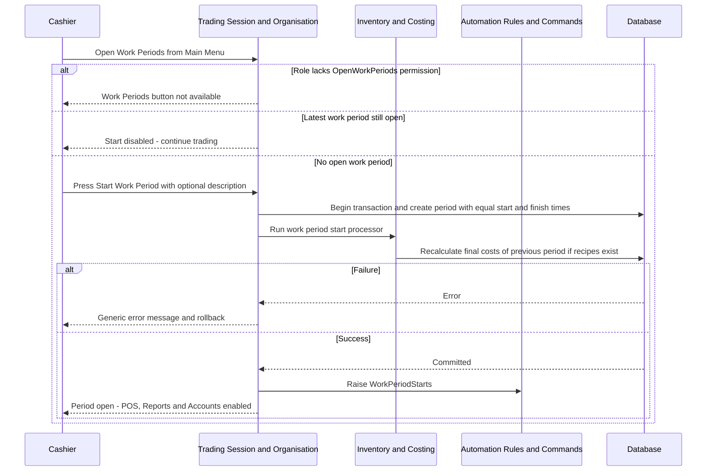

Sources: [INT 3.1 "Start the Work Period"] [APP section 4 "Start and end work period", BR-031, BR-032, BR-036] [DOM DR-001, DR-002, DR-003] [DB section 9.4, section 10].

### WF-02 PIN Login and Logout

**Description.** A user approaches a terminal and types a PIN on the number pad; there is no user name or password [INT 3.1] [APP section 2]. The system verifies that the PIN exists (login status CanLogin or PinNotFound) and loads the user with role and permissions; an unknown PIN simply returns the user to the pad, with no lockout or failed-login audit [APP section 4 "Login and logout"] [APP section 10]. On success the current user is stored, the `CURRENTUSER` local setting is updated, caches are reset, and the `UserLoggedIn` UI event and rule event (parameters UserName, RoleName) are raised. The department selector sets the current department to the role's default department [APP section 4] [DOM DR-008]. A role with `OpenNavigation` lands on the Main Menu; a role without it goes straight to the POS when a work period is open, and has no POS access otherwise [INT 3.1]. Department switching later requires `ChangeDepartment` plus the relevant `UseDepartment_<id>` permission and is blocked while a ticket is open or no work period is open [DOM DR-007] [APP section 2]. On a Compact or text-file database whose only user still has the default PIN 1234, the login screen shows an admin-PIN hint [DOM DR-009] [APP section 2]. Logout happens through the logout button (for roles without `OpenNavigation` the button logs out directly) or automatically after a ticket closes when the terminal has Auto Logout set (WF-04) [APP BR-059]. Logout raises `UserLoggedOut`, resets the current user and caches, and is blocked while the application is locked because a ticket is open [APP section 4].

**Trigger.** A user approaches a terminal; logout button; terminal Auto Logout after closing a ticket.

**Actors.** Waiter; Cashier; Owner / Manager; Administrator (built-in user).

**Screens.** PIN Login, Main Menu, POS Entity Screen.

**Outcome.** User identified (state Nobody to logged-in user and back to Nobody); landing screen chosen by role; orders created by the user carry the user's name [INT 3.1] [APP section 4] [DB section 11].

**Diagram.**

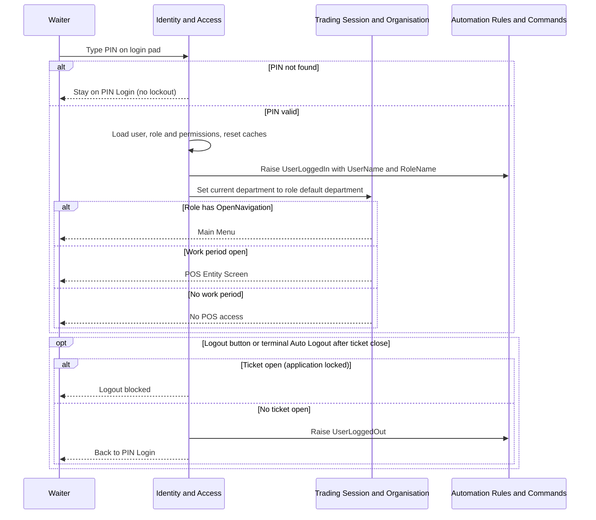

Sources: [INT 3.1 "Log in with PIN", section 4 D] [APP section 2, section 4 "Login and logout", BR-038, BR-040, BR-059] [DOM DR-007, DR-008, DR-009].

### WF-03 Create Ticket and Take Orders

**Description.** Guests sit at a table or a counter customer orders. The POS requires an open work period [DOM DR-001]. The department's ticket creation method decides the entry point: "Select Entity" starts on the POS Entity Screen, "Create Ticket" opens an empty ticket directly; the ticket screen is also shown directly when a ticket is already selected or no ticket entity screens exist [INT 3.1] [APP section 4 "Create / open ticket"]. On the POS Entity Screen entity buttons are coloured by their Status state (Available white, New Orders orange, Bill Requested maroon) [INT 3.1] [DB section 13.3]. Tapping an entity raises the `EntitySelected` rule event first. With no ticket selected the system looks up the entity's open tickets: none - optionally ask the ticket type (when the entity screen has Ask Ticket Type and more than one ticket type exists), create a new ticket and assign the entity; one - open it (raising `TicketOpened` with OrderCount); several - show the Ticket List for an Entity [APP section 4]. A ticket whose first order was created by another user cannot be opened without `DisplayOtherWaitersTickets` ("Can't display this ticket") [APP BR-023] [DOM DR-030]. A new ticket is built from the current ticket type and department; its exchange rate comes from the default target account currency of the ticket type's sale transaction type, calculation selectors without a button header are pre-applied, and `TicketCreated` (TicketTypeName) is raised, which fires the default **New Ticket Creating Rule** [APP section 4, BR-029] [DB section 13.3]. While the ticket has no orders, entity types and ticket tag groups flagged "Ask Before Creating Ticket" are requested first, for example a Select Waiter overlay [APP section 4] [INT 3.1]. The waiter then taps products (optionally typing a quantity first; `qty x barcode`, a barcode, or a weight barcode are also accepted; an unrecognised number raises `NumberpadValueEntered`; text starting with a lower-case letter filters buttons) [APP BR-054]. Adding an order is rejected when the ticket is locked and the user lacks `AddItemsToLockedTickets`, when the ticket is closed, or when the portion is missing [APP section 4, BR-017]. Otherwise the department price tag is applied (falling back to the portion base price), along with any product timer (WF-23), tax templates and quantity normalisation (a quantity greater than 9 is divided by the portion multiplier); optional order states from the menu item are set; the ticket is recalculated and `OrderAdded` (MenuItemGroupCode, MenuItemTag, MenuItemName) fires the default **New Order Adding Rule** [APP section 4, BR-006, BR-009] [DB section 13.3]. A menu button can pre-apply order tags, order states and an automation command; with Auto Select the portion and order tag panel opens automatically [APP section 4] [INT 3.1]. Order tags obey group limits (single-select replaces; multi-select refused at the limit; minimum selected blocks deselection and closing) and appear only where mapped [APP BR-010, BR-011] [DOM DR-023, DR-025]. Plus and minus work only on new orders [DOM DR-012]. The waiter may add a ticket note, ticket tags (raising `TicketTagSelected`) and a customer [INT 3.1]. The ticket and its orders stay unsaved (identifier 0) until the first Close (WF-04) [APP section 4].

**Trigger.** Selecting an entity, pressing Create Ticket or Add Ticket, selecting an open ticket, scanning a barcode, or an automation action (for example `CreateTicket`, `ChangeTicketEntity` with "can create ticket") [APP section 4] [APP section 3 action types].

**Actors.** Waiter; Cashier; Customer / Guest.

**Screens.** POS Entity Screen, Entity Selection Overlay, Ticket List for an Entity, POS Ticket Screen (with its order details / order tag panel and ticket tag selector).

**Outcome.** A ticket with new orders (portions, order tags, notes, tags, entities), ready to be closed (WF-04) or settled (WF-09).

**Diagram.**

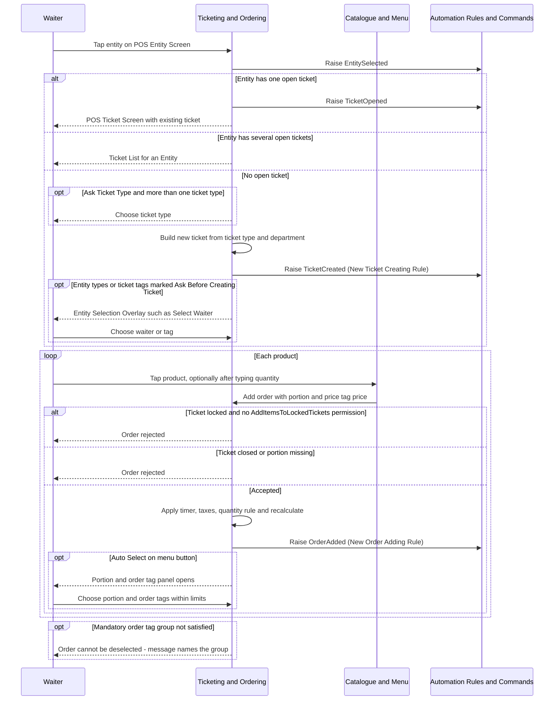

Sources: [INT 3.1 "Create a Ticket and Take Orders"] [APP section 4 "Create / open ticket and take orders", BR-006, BR-009, BR-010, BR-011, BR-017, BR-023, BR-029, BR-054] [DOM section 7 item 2, DR-001, DR-012, DR-023, DR-025, DR-030] [DB section 13.3].

### WF-04 Close (Submit) Ticket

**Description.** After entering a round of orders the waiter presses Close; this is the default automation command **Close Ticket** whose default **Close Ticket** rule runs the Close Ticket (`CloseActiveTicket`) action. Leaving the ticket or a `CloseActiveTicket` action from any rule has the same effect [APP section 4 "Close (submit) ticket"] [DB section 13.3]. A ticket without orders is simply discarded [INT 3.1] [DOM DR-011]. The system then decides whether the ticket may close: it needs a remaining amount of zero, or at least one entity, or no orders; otherwise it may still close if a defined ticket tag is set; failing all of these, Close does nothing [APP BR-014] [DOM DR-011]. Orders below the minimum of a mapped order tag group block closing and a message names the missing group [APP BR-011]. When the remaining amount is zero, a calculable order with a zero value (a missing price) stops the close with an error (gifts and voids are exempt), and every ticket tag group with "force value" (Selection Required) must be set, otherwise the first missing tag is reported [APP BR-012, BR-013] [DOM DR-024, DR-027]. The ticket service then runs the optimistic concurrency check against the stored ticket: if its entities changed (moved), its closed state changed (paid elsewhere), its payments differ, or a fully paid ticket's totals differ, a message is shown and the changes are not saved [APP BR-019] [DB section 9.3] [DOM DR-010]. If the ticket is unchanged and not yet closed it is recalculated and `BeforeTicketClosing` (TicketId, RemainingAmount, TotalAmount) is raised; the default **Ticket Payment Check** rule (constraint RemainingAmount = 0) sets the status to Paid and runs Mark Ticket As Closed, which closes the ticket only if no product timer is active [APP section 4, BR-015] [DB section 13.3]. If orders exist, new orders receive an order number from the ticket type's order numerator (all orders of the round share it) and identical new untagged orders are merged; the first save assigns the ticket number from the ticket numerator [APP BR-008, BR-018] [DOM DR-018]. `TicketClosing` is raised: the default **Ticket Closing** rule runs the Execute Kitchen Orders Print Job action, which prints only orders whose status is New (no slip when there are none), then sets the ticket status to Unpaid and the order status to Submitted [APP section 4] [DOM DR-017] [DB section 13.3]. All orders are locked (and the ticket too if a lock was requested, for example by Print Bill, WF-08), zero-amount transactions of closed tickets are removed, and the ticket is saved [APP BR-017, BR-058]. `EntityUpdated` is raised for each ticket entity with its open-ticket count; the default **Update Available Entity Colour** rule sets the entity state to Available when the count is zero [APP section 4]. A `TICKET_REFRESH` message is broadcast to other terminals (WF-19); with terminal Auto Logout the user is logged out (WF-02); otherwise the POS view returns to the entity screen, where the table shows orange (New Orders) - the table turns orange only on close [APP section 4] [INT 3.1]. Forgetting to press Close means nothing reaches the kitchen [DOM section 8].

**Trigger.** Close Ticket command; leaving the ticket; `CloseActiveTicket` action (for example from the Print Bill rule).

**Actors.** Waiter; Cashier; Kitchen and Bar Staff (receive the slip); Other Terminals (refreshed).

**Screens.** POS Ticket Screen, POS Entity Screen.

**Outcome.** New orders printed to the kitchen or bar, numbered and marked Submitted, ticket saved with status Unpaid (or Paid and closed when the remaining amount is zero), orders locked, table colour updated [INT 3.1] [APP section 4].

**Diagram.**

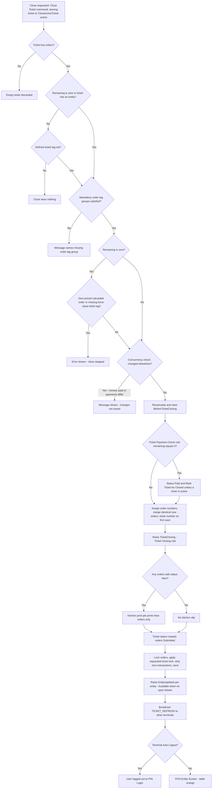

Sources: [INT 3.1 "Close the Ticket"] [APP section 4 "Close (submit) ticket", BR-008, BR-011 to BR-015, BR-017 to BR-019, BR-058, BR-059] [DOM DR-010, DR-011, DR-017, DR-018, DR-024, DR-027, section 8] [DB section 9.3, section 13.3].

### WF-05 Cancel, Void or Gift an Order

**Description.** The waiter selects an order line; the order operations column offers +, -, Gift, Void, Cancel, Move and Change Price; on submitted lines bracketed +/- select part of the quantity [INT 3.1] [DOM DR-012]. **Cancel** is a built-in command allowed only for orders not yet saved (identifier 0), unlocked and contained in the ticket; it raises `OrderCancelled` (MenuItemName, Quantity) and removes the order as if it had never been added [APP section 4 "Order operations", BR-016] [DOM DR-013]. Once an order has been submitted, **Void** or **Gift** must be used; these are default automation commands displayed on orders, governed by their enabled and visible state strings (Void is disabled on new orders and enabled on submitted and gifted orders) and by their mappings - there is no void permission, so restricting Void is done by command mapping [APP BR-042, section 2] [DOM DR-061] [INT 3.1]. Each press raises `AutomationCommandExecuted` per selected order and the matching default rule runs Update Order and order-state actions: the **Gift** rule sets "calculate price" off and keeps "decrease inventory" on and puts the order in GStatus Gift; the **Void** rule sets both "calculate price" and "decrease inventory" off and puts the order in GStatus Void, resetting its status to New so the next Close prints VOID to the kitchen; **Cancel Gift** and **Cancel Void** restore both flags and clear the state, and Cancel Void also sets the status back to Submitted [APP section 4] [APP BR-037, BR-064] [DOM DR-014, DR-016, DR-057]. Cancel Void is possible only until the ticket is closed [DOM DR-015]. Voided orders stay on the ticket without a price and consume no stock; an empty `[ORDERS:VOID]` template section hides them from the bill, while gifted orders print as GIFT with a separate gift total and still consume stock [INT 3.1] [DOM DR-059]. The user and time of each state change are stored with the order state, so managers can see who voided what [DB section 11] [DOM section 8]. Voiding every order leaves a zero remaining amount, so the ticket closes as paid - there is no delete-ticket operation [DOM DR-028]. Cancel versus Void is the top training issue [INT section 8].

**Trigger.** Wrong item added, guest rejects an item, or an item is given free.

**Actors.** Waiter; Owner / Manager (follows up voids and gifts); Kitchen and Bar Staff (receive VOID slips).

**Screens.** POS Ticket Screen.

**Outcome.** Order removed (Cancel), voided (no price, no stock consumption, kitchen informed at next Close, absent from bill) or gifted (no price, stock consumed, GIFT printed) [INT 3.1].

**Diagram.**

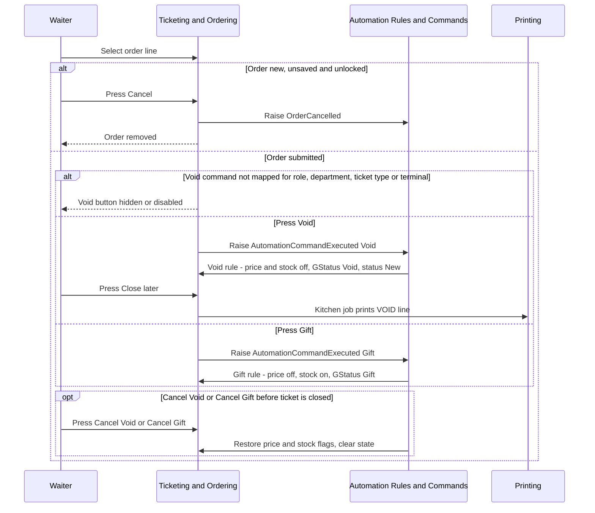

Sources: [INT 3.1 "Cancel, Void or Gift an Order", section 8] [APP section 2, section 4 "Order operations", BR-016, BR-037, BR-042, BR-064] [DOM DR-012 to DR-016, DR-028, DR-057, DR-059, DR-061, section 8] [DB section 11, section 13.3].

### WF-06 Move Orders (Split Bill)

**Description.** Two guests at one table want separate bills. On the open ticket the waiter selects the second guest's orders (part quantities through bracketed selection) and presses Move [INT 3.1]. The move is allowed only for saved orders on an unlocked, open ticket, with a selected value not exceeding the remaining amount; moving unlocked (saved) orders requires `MoveUnlockedOrders`, otherwise `MoveOrders` [APP BR-021] [DOM DR-020]. Partially selected quantities are split by cloning the order and reducing the original quantity [APP section 4]. The ticket service raises `TicketMoving` and `OrderMoving`, clones the orders, closes the source ticket, opens the target (a new ticket when none is given), adds the orders, raises `OrderMoved` and `TicketMoved` (with OldTicketNumber) and saves; the default **Ticket Moved Rule** resets the ticket status to New Orders [APP section 4] [DB section 12 Migration 2, section 13.3]. The new ticket opens with the moved orders, the waiter selects the table (normally the same one) and closes it (WF-04). The table then holds two tickets; tapping it shows the Ticket List for an Entity with each ticket's amount and the table total remaining [INT 3.1]. An automation action `MoveTaggedOrders` can also move tagged orders to a new ticket [APP section 3].

**Trigger.** Guests want separate bills.

**Actors.** Waiter; Cashier; Customer / Guest.

**Screens.** POS Ticket Screen, Entity Selection Overlay, Ticket List for an Entity.

**Outcome.** Selected saved orders moved to a new ticket on the same (or another) entity; two tickets on the table.

**Diagram.**

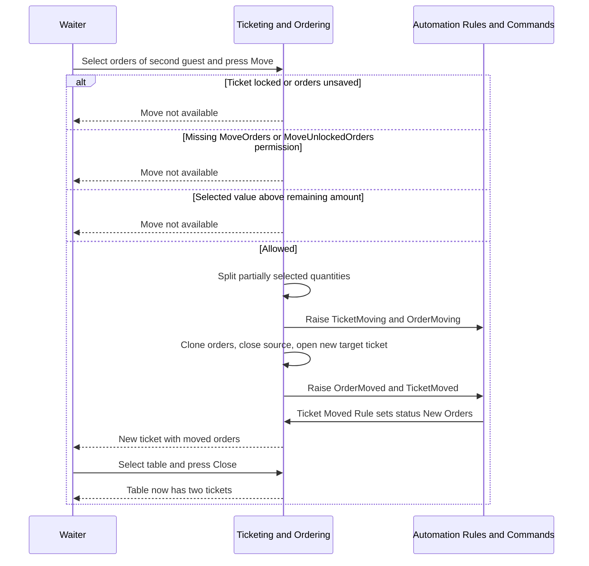

Sources: [INT 3.1 "Split a Bill by Moving Orders"] [APP section 3, section 4 "Order operations", BR-021] [DOM DR-020] [DB section 12, section 13.3].

### WF-07 Change Entity, Add Ticket and Merge Tickets

**Description.** On the POS Ticket Screen the left column shows a button per entity type assigned to the ticket type (for example Change Table, Change Waiter, Select Customer) plus Add Ticket [INT 3.1]. **Change entity:** the button opens the Entity Selection Overlay; the chosen entity replaces the ticket's entity of that type (the `ChangeTicketEntity` action provides the same through automation) and `TicketEntityChanged` (EntityTypeName, OrderCount, OldEntityName, NewEntityName, OldCustomData, CustomData) is raised; the default **Update Moved Entity Colour** rule recolours the entities, so the new table turns orange and the old table white when it has no other tickets [APP section 3 action types, section 3 rule events] [INT 3.1] [DB section 13.3]. A locked ticket cannot change table [DOM DR-019]. **Add Ticket:** the default automation command Add Ticket fires the default **Create Ticket** rule (Create Ticket action); entities whose ticket-type assignment has "Copy to New Tickets" are carried over, giving a second ticket on the same table [APP BR-062] [INT 3.1] [DB section 13.3]. **Merge Tickets:** on the Ticket List for an Entity the user selects at least two tickets and presses Merge Tickets; this requires the `MergeTickets` permission and is refused when any ticket has calculations (for example a discount) or when entities of the same type differ (message "Can't merge tickets", hard-coded in English) [APP BR-020, section 10] [DOM DR-021]. The system clones orders, payments, change payments, tags, entities and logs into one new ticket, closes the old tickets (their data removed) and raises `TicketsMerged` (TicketNumbers); the default **Update Merged Tickets State** rule sets the status to New Orders [APP section 4] [DB section 12 Migration 2].

**Trigger.** Guests relocate; ticket needs another waiter or customer; a second bill is needed; split bills are recombined.

**Actors.** Waiter; Cashier; Owner / Manager (merge permission).

**Screens.** POS Ticket Screen, Entity Selection Overlay, Ticket List for an Entity.

**Outcome.** Ticket re-attached with entity colours updated; second ticket on the same entity; or one merged ticket combining orders, payments, tags and entities.

**Diagram.**

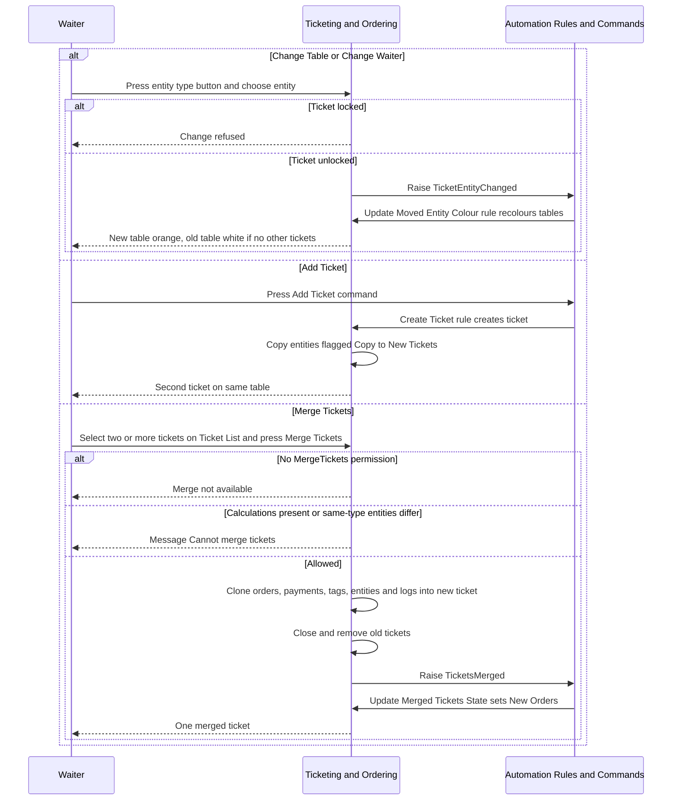

Sources: [INT 3.1 "Change Table, Change Waiter, Add Ticket and Merge Tickets"] [APP section 3, section 4 "Order operations", BR-020, BR-062, section 10] [DOM DR-019, DR-021] [DB section 12, section 13.3].

### WF-08 Print Bill, Lock and Unlock Ticket

**Description.** Guests ask for the bill. With no order selected the waiter presses Print Bill, a default automation command shown on the ticket and payment screens and enabled in the states New Orders, Unpaid and IsClosed [APP section 4 "Print bill"] [INT 3.1]. The default **Print Bill** rule runs, in order: Execute Print Bill Job (the "Print Bill" print job, Ticket Printer with Ticket template, WF-20), Lock Ticket (a lock request), Update Entity State (Status = Bill Requested, shown dark red / maroon), Update Ticket Status (Status = Locked) and Close Ticket; the lock takes effect when the ticket is closed (WF-04) [APP section 4, BR-017] [DB section 13.3]. Printing an unnumbered ticket assigns its ticket number [APP BR-018]. A locked ticket blocks new orders (unless the user has `AddItemsToLockedTickets`), table change, moving orders out and Change Price, and disables the calculation (discount) buttons, so paper and system agree [DOM DR-019, DR-037] [INT 3.1]. If the guest orders more or asks for a discount, a user presses **Unlock Ticket** (visible only on locked tickets; often restricted to managers through its mapping) or uses Release Lock (permission `AddItemsToLockedTickets`); the default **Unlock Ticket** rule unlocks the ticket, which returns to Unpaid with the table orange, after which the bill can be printed again [INT 3.1] [APP section 2] [DB section 13.3]. A closed ticket cannot be unlocked; for a closed (paid) ticket Print Bill only reprints [APP BR-015] [DOM DR-029]. A locked ticket surprising staff is a known pain point; the guidance is "discount first, then print the bill" [DOM section 8].

**Trigger.** Guest asks for the bill; later, guest orders more or requests a discount (unlock).

**Actors.** Waiter; Cashier; Owner / Manager (unlock); Customer / Guest.

**Screens.** POS Ticket Screen, Payment Screen, POS Entity Screen.

**Outcome.** Bill printed, ticket locked with status Locked, table Bill Requested; after unlock the ticket is Unpaid and editable again.

**Diagram.**

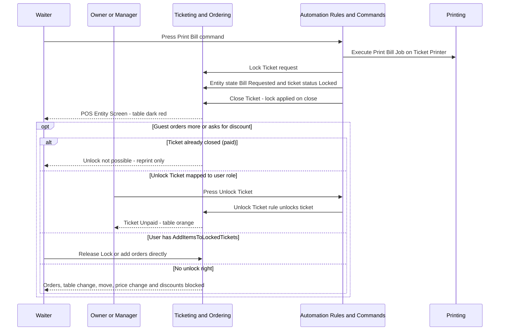

Sources: [INT 3.1 "Print Bill, Lock and Unlock Ticket"] [APP section 2, section 4 "Print bill", BR-015, BR-017, BR-018] [DOM DR-019, DR-029, DR-037, section 8] [DB section 13.3].

### WF-09 Settle Ticket (Payment)

**Description.** The guest pays and the waiter or cashier presses Settle; the default **Settle** rule runs the Display Payment Screen action (a `PayTicket` action can instead pay the remaining amount in one touch, the installers' replacement for the removed "display under ticket" payment option) [APP section 4 "Payment and settlement"] [INT section 3.3 item 5] [DB section 13.3]. The Payment Screen loads the ticket, number pad and order selector [APP section 4]. Optionally the user selects lines to pay for specific items: identical product and price are grouped, each tap selects one unit, selector prices include spread discounts, services and taxes, and paid items stay marked as paid [INT 3.1] [DOM DR-035]. The amount is entered first (quick values from program settings, keypad, All and 1/2, 1/3, 1/4, 1/n, repeat last amount, Ticket/Balance toggle); an empty amount takes the full amount due [INT 3.1]. Pressing a payment type (only payment types mapped to the current role, department, ticket type and terminal are shown) is allowed when the ticket is open, the tendered value and the remaining amount are non-zero, and either the payment type has a fixed account or a ticket entity can take the account transaction under its account type's working rule [APP BR-024, BR-027, BR-041]. Due and tendered amounts within 0.01 of the target are snapped to it [APP BR-025] [DOM DR-033]. Over-tendering shows change; in the base currency change is taken from base cash, while change payment types are offered only when a foreign currency is selected (WF-12) [APP BR-026] [DOM DR-032]. The ticket service creates an account transaction (Receivables to the payment account, per the Payment transaction type) and a `Payment` record with the user, raises `PaymentProcessed` (PaymentTypeName, TenderedAmount, ProcessedAmount, ChangeAmount, RemainingAmount, SelectedQuantity) and recomputes the remaining amount [APP section 4] [DB section 10, section 11] [DOM DR-040]. A partial payment leaves the screen open; Close is disabled while a typed amount is unpaid, and leaving with a balance keeps the ticket open and the table occupied [INT 3.1] [DOM DR-031]. When the remaining amount reaches zero (and no change prompt is pending) the screen closes and the close flow (WF-04) raises `BeforeTicketClosing`; the default **Ticket Payment Check** rule sets Paid and Mark Ticket As Closed, so the ticket is closed and its paid items cleared, unless a product timer is active [APP section 4, BR-015]. A required ticket tag blocks completion once paid [DOM DR-024]. If discounts make the remaining amount negative, all button discounts are removed ("All discounts removed", WF-10) [APP BR-028]. On a concurrency conflict (paid or moved elsewhere) the close is refused with a message (WF-04) [APP BR-019].

**Trigger.** Settle command; `PayTicket` action.

**Actors.** Cashier; Waiter; Customer / Guest.

**Screens.** POS Ticket Screen, Payment Screen, POS Entity Screen.

**Outcome.** Payments posted as account transactions; ticket Paid and closed when the remaining amount is zero (table white); otherwise a partial payment recorded with the ticket still open.

**Diagram.**

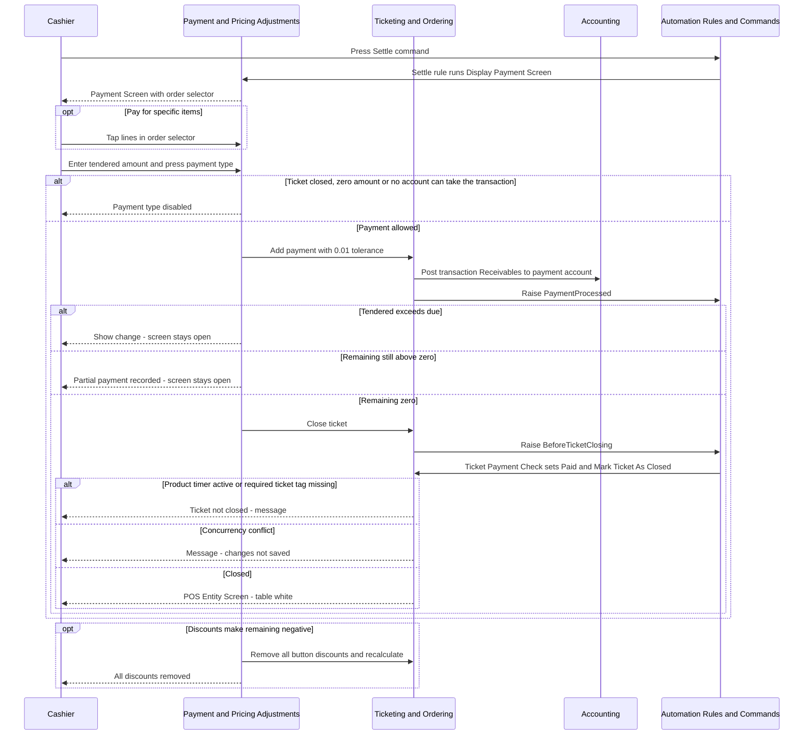

Sources: [INT 3.1 "Settle a Ticket", section 3.3] [APP section 4 "Payment and settlement", BR-015, BR-019, BR-024 to BR-028, BR-041] [DOM DR-024, DR-031 to DR-035, DR-040] [DB section 10, section 11, section 13.1, section 13.3].

### WF-10 Apply Discount or Rounding

**Description.** A manager grants a percentage discount or rounds the bill, normally on the Payment Screen through calculation selector buttons; the new database seeds "Discount" (shown as "%", percentage method, decreasing) and "Round" (fixed-amount method, decreasing, including tax), each mapped everywhere [DB section 13.1] [INT 3.1]. Calculation selectors are visible only where their mappings match the role, department, ticket type and terminal; there is no separate permission [INT section 7] [APP section 2]. The buttons are disabled while the ticket is locked (unlock first, WF-08) and when the typed value exceeds the calculation type's maximum amount [DOM DR-036, DR-037]. The user types a value and presses the button: the ticket calculation is added, updated, toggled off (when the type is a toggle and the same amount is applied again) or removed (pressing Discount with nothing typed removes it; a zero-amount calculation is removed with its transaction) [APP BR-003] [INT 3.1]. The amount is computed by the calculation method (percentage of plain sum, percentage of running sum, fixed amount, set total, round to a multiple, or custom script), rounded to two decimals and negated for decreasing types; pre-tax adjustments are distributed across orders before tax [APP BR-001, BR-002, BR-004]. The ticket is recalculated (`TicketTotalChanged` carries PreviousTotal, TicketTotal, RemainingAmount, DiscountTotal, PaymentTotal) and the adjustment is booked as an account transaction from Receivables to the Discount account or, for rounding, to the separate Rounding account [APP section 3 rule events] [DOM DR-038, DR-040] [DB section 13.1]. If discounts push the remaining amount below zero, every button-selectable calculation is removed with the message "All discounts removed" [APP BR-028] [DOM DR-036]. A ticket with calculations cannot later be merged (WF-07) [APP BR-020]. Calculations can also be applied by the `UpdateTicketCalculation` action, for example tips from a ticket tag [INT section 3.2].

**Trigger.** Manager grants a discount or rounds the bill.

**Actors.** Cashier; Owner / Manager.

**Screens.** Payment Screen, POS Ticket Screen (Unlock Ticket).

**Outcome.** Ticket recalculated; discount or rounding booked to its own account; discount removed if invalid.

**Diagram.**

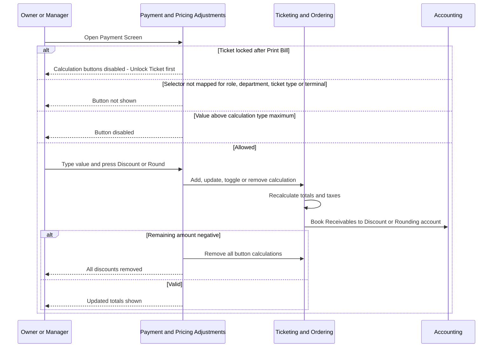

Sources: [INT 3.1 "Apply a Discount or Rounding", section 7] [APP section 2, section 3, BR-001 to BR-004, BR-020, BR-028] [DOM DR-036, DR-037, DR-038, DR-040] [DB section 13.1].

### WF-11 Settle to Customer Account and Collect a Tab

**Description.** A customer will pay later. On the POS Ticket Screen the waiter presses Select Customer, which opens the seeded "Customer Search" entity screen; customers are searched by name or phone (a `field:value` search targets one custom field) or created [INT 3.1] [APP BR-047] [DB section 13.2]. An account can be created from the customer only when the entity type has an account type, the customer has no account yet, all fields in the account name template are filled (seeded Customers template `[Name]-[Phone]`) and the user holds `CreateAccount`; open tickets are then updated to the new account [DOM DR-042] [APP BR-046, section 2]. The cashier presses Settle (WF-09) and then the Customer Account payment type, which has no fixed account and uses the "Customer Account Transaction" type (Receivables to Customer) [DB section 13.1]. The button is disabled when the ticket has no customer or the customer has no account, and when the account type's working rule blocks it (optional credit limit held in the customer's "Credit Limit" custom field) [DOM DR-041, DR-043] [APP BR-027]. The ticket then closes as paid and the customer owes the amount. Alternatively, in balance (account) mode a payment first pays the ticket and the surplus, up to the customer's balance, is posted to the account (`AccountTransactionAddedToTicket`); in that mode the tendered amount cannot exceed the amount due and only fixed-account payment types work [APP section 4 step 6, BR-024] [DOM DR-034]. Later, to collect the tab, the cashier opens Accounts (requires `NavigateAccountView` and an open work period), picks the customer account screen (optionally hiding zero balances to list open tabs), opens Account Details and presses a document button such as "Customer - Cash" or "Customer - Credit Card"; the amount is prefilled with `[Balance]` and the user chooses Save, or Print to also print the "Customer Receipt" on the terminal's transaction printer (WF-21) [INT 3.1] [DB section 13.1] [DOM DR-047]. This posts Customer to Cash (or Credit Card) and reduces the balance [DOM DR-040]. Putting an unpaid ticket on a customer account is also the workaround to end a day with unpaid tickets (WF-15) [INT section 3.3 item 4].

**Trigger.** Customer will pay later (tab); later the customer pays what they owe.

**Actors.** Cashier; Waiter; Customer / Guest; Online Partner (same pattern for partner accounts) [INT section 3.2 examples].

**Screens.** POS Ticket Screen, Entity Selection Overlay (Customer Search entity screen), Payment Screen, Accounts, Account Details.

**Outcome.** Ticket closed against the customer's account; later receipt posted against the account and balance reduced; optional printed receipt.

**Diagram.**

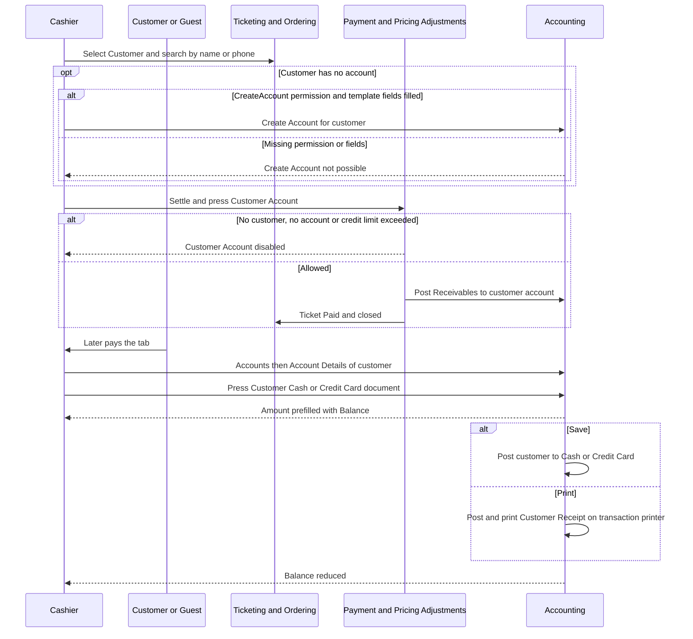

Sources: [INT 3.1 "Settle to a Customer Account and Collect a Customer's Tab", section 3.3] [APP section 2, section 4 "Payment and settlement", BR-024, BR-027, BR-046, BR-047] [DOM section 7 item 5, DR-034, DR-040 to DR-043, DR-047] [DB section 13.1, section 13.2].

### WF-12 Foreign Currency Payment with Change

**Description.** A guest pays in a configured foreign currency (see WF-25). On the Payment Screen a button per currency shows the live converted total (for example "$ 21,82" or "18,63 EUR"); no buttons appear when only the base currency at rate 1 exists [INT 3.1]. Selecting a currency recomputes the order selector prices by the exchange rate and filters the payment buttons to payment types whose account is in that currency (for example only "Cash ($)") [APP section 4 step 2] [DOM DR-044]. With a currency rounding step every selector price is rounded to the nearest multiple (away from zero) and the difference to the ticket total is placed on the cheapest remaining order; rounding 0 shows raw converted prices [APP BR-030] [DOM DR-045] [INT 3.1]. The cashier tenders an amount and presses the currency payment type; the payment uses the paying account's currency rate and is posted to that currency's cash account [APP BR-029]. If change is due, change payment types are offered only because a foreign currency is selected: the types are filtered to fit the payment's account type, and with fewer than two options the single one (or the base cash) is used automatically, otherwise the cashier chooses one, for example Euro change [APP BR-026] [DOM DR-046]. A `ChangePayment` is posted to the chosen change account [APP section 4 step 4]. A partial payment can also be taken and the screen left with the rest unpaid in Receivables [INT 3.1]. Clicking the currency again returns to the base currency; payment buttons changing when a currency is selected confuses cashiers [INT section 8]. Exchange rates are entered by hand, so a stale rate silently grants a discount, and a newly added currency or payment type may need an application restart [DOM DR-064, section 8]. Each currency's cash account then shows its own balance on the Accounts screen (WF-14) [INT 3.1].

**Trigger.** Guest pays in a configured foreign currency.

**Actors.** Cashier; Customer / Guest.

**Screens.** Payment Screen, Accounts.

**Outcome.** Payment posted to the currency's cash account; change paid out in the chosen currency; each drawer section reconciles.

**Diagram.**

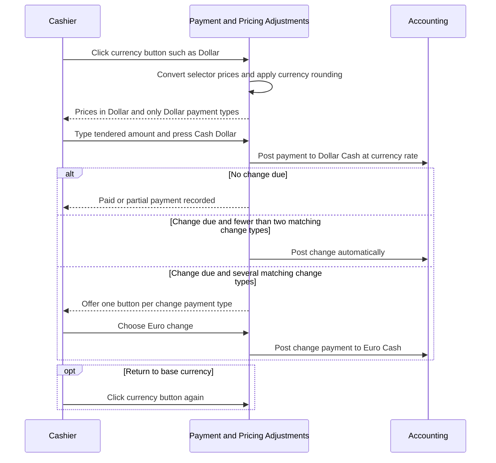

Sources: [INT 3.1 "Pay in a Foreign Currency with Change", section 8] [APP section 4 "Payment and settlement", BR-026, BR-029, BR-030] [DOM section 7 item 6, DR-044, DR-045, DR-046, DR-064, section 8].

### WF-13 Find a Ticket

**Description.** A manager needs to find open or past tickets, check who ordered what, reprint a bill or settle open tickets before the end of the day. From the Main Menu the user opens Tickets (the Ticket Explorer) [INT 3.1]. The default view is today's open tickets; changing the date range (From/To with arrows) requires `DisplayOldTickets` [INT 3.1] [APP section 2]. The user chooses a filter type and text (ticket number, entity, note, state or tags; with open/all tickets the text filters by product name) and presses Refresh [APP section 3 "Ticket explorer"] [INT 3.1]. Without `DisplayOtherWaitersTickets` the list shows only the user's own last-modified tickets and opening someone else's ticket is refused [APP BR-023] [DOM DR-030]. Selecting a row expands its orders; Display opens the ticket on the POS Ticket Screen [INT 3.1]. A closed (paid) ticket can only be displayed and its bill reprinted; reopening paid tickets is not supported in V3 [DOM DR-029] [INT section 3.3 item 14]. Related entry points: the ticket lister widget on entity screens, the `DisplayTicketList` action, and pressing a ticket tag button with no ticket open to list tickets carrying that tag (the "pay later" workaround) [APP section 3] [INT section 3.3 item 1].

**Trigger.** Manager needs to find open or past tickets.

**Actors.** Owner / Manager; Cashier.

**Screens.** Main Menu, Tickets (Ticket Explorer), POS Ticket Screen.

**Outcome.** Ticket found and displayed; bill reprinted or open ticket settled.

**Diagram.**

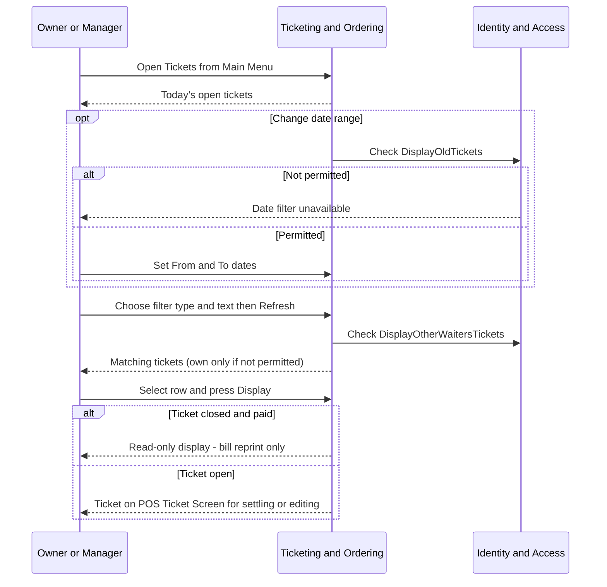

Sources: [INT 3.1 "Find a Ticket", section 3.3] [APP section 2, section 3 "Ticket explorer", BR-023] [DOM DR-029, DR-030].

### WF-14 Review Accounts and Account Details

**Description.** An owner or cashier wants the current financial position or to reconcile the drawer without running a report. Accounts is reachable from the Main Menu only with `NavigateAccountView` and while a work period is open [APP section 2, BR-032]. The user picks an account screen button; each account screen summarises selected account types with Debit, Credit and Balance per account (the seeded "General" screen shows Sales, Receivable, Discount and Payment account types), accounts with a currency show an extra currency column, and screens can hide zero balances or display as a tree [INT 3.1] [DB section 13.1, section 12 Migration 8]. Selecting an account opens Account Details: its transactions with running balance, date filters (Default, All, This Month and others), Find Ticket (opens the ticket behind a transaction) and Print [INT 3.1] [APP section 8]. Document-type buttons on Account Details start WF-21. Because the Liability, Receivable and Internal Accounts reports always come up empty, staff use an account screen listing only customer accounts with zero balances hidden and print from there or per-customer Account Details [INT section 3.3 item 2] [APP section 10].

**Trigger.** Owner or cashier wants the financial position or to reconcile the drawer.

**Actors.** Owner / Manager; Cashier; Accountant.

**Screens.** Main Menu, Accounts, Account Details, POS Ticket Screen (via Find Ticket).

**Outcome.** Sales, receivables, discounts, payment-account and customer balances visible; statements printed.

**Diagram.**

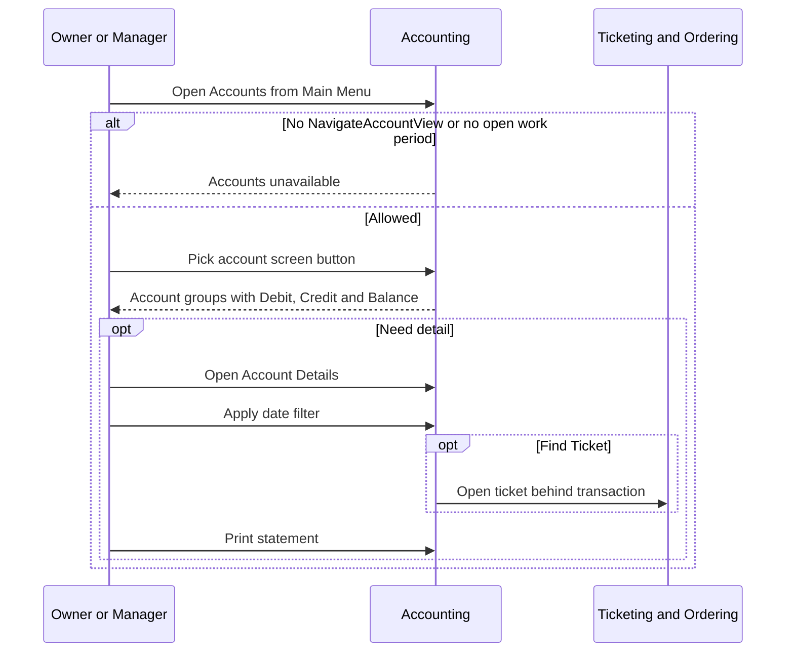

Sources: [INT 3.1 "Review Accounts", section 3.3] [APP section 2, section 8, BR-032, section 10] [DB section 12, section 13.1].

### WF-15 End of Day (Work Period Report and End Work Period)

**Description.** At closing time every ticket must be paid, put on an account or voided [DOM DR-028]. The manager opens Tickets with "Only Open Tickets" and settles each one (WF-09), puts it on a customer account (WF-11) or voids it; typical causes are cash taken but not settled and test tickets [INT 3.1] [DOM section 8]. The Work Period Report is run from Reports (`OpenReports`, open work period; changing the date filter needs `ChangeReportDate`), picking Today or a work period and pressing Refresh, then printed on the terminal report printer or saved as XPS, for example for the Accountant [INT 3.1, section 6] [APP section 2, section 8]. The report can be run for the current period and shows a banner reminding the user to end the period [INT 3.1]. On Work Periods the user presses End Work Period. Ending is allowed only on the Work Periods screen, with zero open tickets (counting every non-closed ticket in the database, regardless of department or terminal), with the period open for more than one minute, and with the period still open; otherwise the button is disabled and a red message such as "There are 3 open tickets..." is shown [APP section 4, BR-031, section 10] [DOM DR-004, DR-005]. On ending, the `BeforeWorkPeriodEnds` rule event is raised, the period's end date and optional end description are set, and the work-period processors run: when recipes exist the inventory processor creates and saves the End of Day Record (periodic consumption, zero rows removed, WF-16); then `WorkPeriodEnds` is raised [APP section 4]. Failures are logged and rolled back with a generic message. End of Day Records cannot be created manually [DOM DR-006]. After ending, POS, Reports and Accounts are unavailable until the next start (WF-01); stock should be counted between periods [DOM DR-055] [APP BR-032].

**Trigger.** Closing time.

**Actors.** Owner / Manager; Cashier; Accountant (receives the saved report).

**Screens.** Tickets (Ticket Explorer), Payment Screen, Reports, Work Periods, End of Day Records.

**Outcome.** All tickets settled; report printed or saved; work period closed; End of Day Record created; POS unavailable.

**Diagram.**

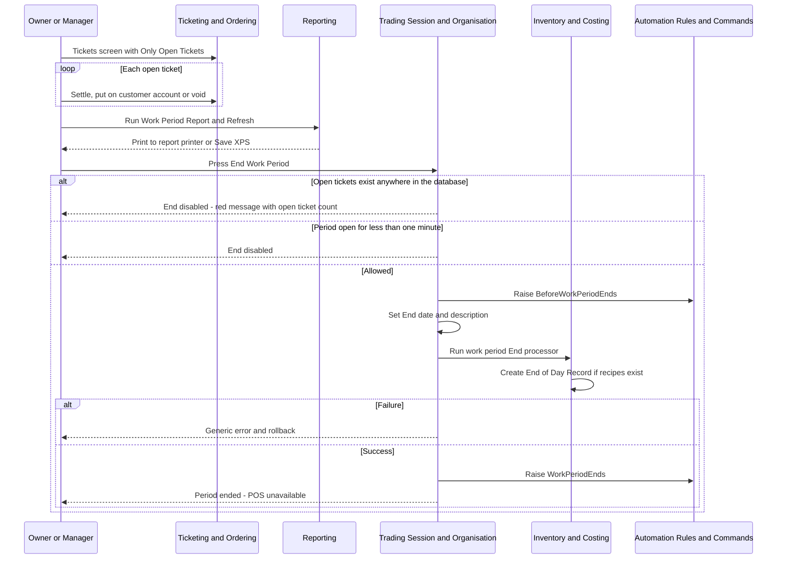

Sources: [INT 3.1 "Run the Work Period Report and End the Work Period", section 6] [APP section 2, section 4 "Start and end work period", section 8, BR-031, BR-032, section 10] [DOM section 7 item 7, DR-004, DR-005, DR-006, DR-028, DR-055, section 8].

### WF-16 Inventory Cycle (Purchases, End of Day Record, Stock Count, Cost)

**Description.** A business that tracks stock first defines inventory items (base unit, transaction unit, multiplier - zero when the units are the same - and warehouse) and one recipe per product portion (inventory item quantities in base units plus a fixed cost); a recipe needs a portion, no line may lack an item or have zero quantity, and a portion can have only one recipe [INT 3.2] [APP BR-034] [DOM DR-051, DR-052]. Find Missing Recipes helps the installer [DOM section 5]. During an open work period purchases are entered as inventory transaction documents (seeded "Purchase" type into "Local Warehouse") on Warehouses / Inventory Transactions; the document date must be after the period start, it needs at least one line, no zero quantities and a unit on every line [APP BR-033] [DOM DR-054] [DB section 13.2]. While trading, orders flagged "decrease inventory" consume stock through recipes: gifts consume, voids do not; products attached to order tags consume their own recipe multiplied by tag and order quantity [APP BR-037] [DOM DR-053, DR-057]. When the work period ends (WF-15) the inventory processor creates the End of Day Record: per warehouse and item, In Stock (previous physical count or predicted stock), Added and Removed (from inventory transactions), Consumption (sales times recipes) and predicted inventory, plus cost items per sold portion with a predicted cost; if a product has recipes and a sold portion lacks one, the calculation fails with an error [APP section 4 "End-of-day inventory and cost", BR-035] [DOM DR-052]. Between ending one period and starting the next, the manager opens End of Day Records, enters the counted Current Inventory per item and saves; counting during the day cannot be saved [INT 3.2] [DOM DR-055]. When the next work period starts (WF-01) the previous period's final cost is recomputed: actual consumption equals In Stock plus Added minus the count, and the variance is distributed by recipe ratios, giving the real cost per product (Costs tab: Cost Prediction versus Current Cost); the next In Stock uses the count [APP BR-036] [DOM DR-056] [INT 3.2]. Purchase, Inventory and Cost reports read these records [APP section 8].

**Trigger.** Business tracks stock and costs; work period end and start; manual edit of the End of Day Record.

**Actors.** Owner / Manager; Reseller / Installer (set-up, recipe checks).

**Screens.** Warehouses, End of Day Records, Reports, Work Periods, and the management editors for inventory items, recipes and inventory transactions.

**Outcome.** Stock levels, consumption and real product costs reconciled each work period.

**Diagram.**

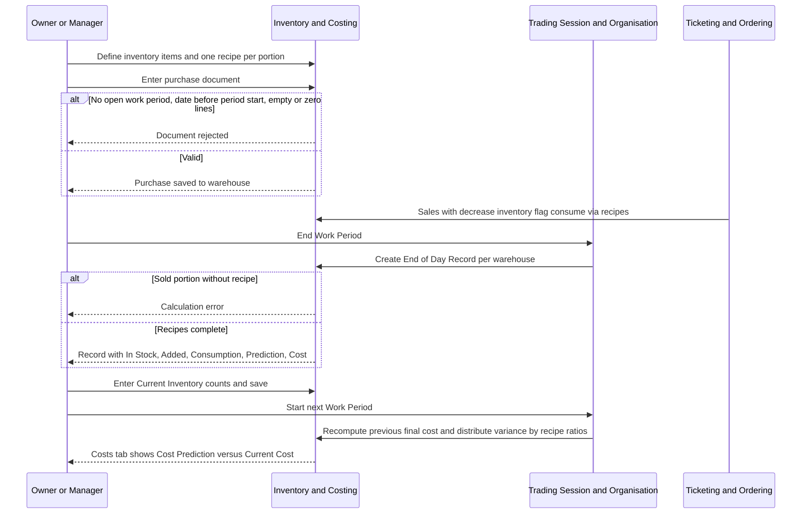

Sources: [INT 3.2 "Count Stock and Close Inventory"] [APP section 4 "End-of-day inventory and cost", section 8, BR-033 to BR-037] [DOM section 7 item 8, DR-051 to DR-057] [DB section 10, section 13.2].

### WF-17 Rule Engine Execution

**Description.** Every rule event (see the event catalogue: application, user, work period, ticket, order, payment, entity, account, automation command, trigger, message, device, loop, number pad and popup events) is published through the application state's notify-event call with its event data [APP section 3 rule events]. The rule executor selects the rules registered for that event whose rule mappings match the current terminal, department, user role and ticket type (0 acts as a wildcard), ordered by sort order [APP section 4 "Rule engine execution", BR-041]. For each rule the condition checker evaluates the custom constraint list (match mode Match Any, Match All, Not Any, Not All, or the default where each constrained left-hand side needs at least one match), the legacy event constraints and the rule's script constraint; constraint values are pre-processed (settings, `[:param]` placeholders, model data, expressions), and a constraint on a parameter absent from the event is ignored [APP BR-043]. Operations include Equal, NotEquals, Greater, Less, IsNull, IsNotNull, Contains, Starts, Ends, LengthEquals, Matches, NotMatches, MatchesMod10, After and Before. For each satisfied rule its action containers run in sort order, each subject to an optional container constraint; the action definition is cloned, container parameter values override the action's own parameters, placeholders and inline expressions are expanded, and the resulting action is published and dispatched to the registered action type [APP section 4]. Actions frequently raise further events (for example Close Ticket raises `BeforeTicketClosing` and `TicketClosing`), so evaluation nests. Automation command buttons do nothing themselves: they raise `AutomationCommandExecuted` and their behaviour lives entirely in rules; an extra script hook can restrict button enablement [DOM DR-061] [APP BR-042]. The Send Message action broadcasts to other terminals, whose `MessageReceived` rules then run (WF-19). Scripts and accessors share static state and are not thread safe [APP section 10]. Example: `BeforeTicketClosing` with RemainingAmount 0 satisfies the default Ticket Payment Check rule, which sets Paid and marks the ticket closed [DB section 13.3].

**Trigger.** Any rule event raised by the application, a command button, a trigger, a message or a device.

**Actors.** All users indirectly; Scheduler (cron trigger); Messaging Server; Caller-ID Device; Reseller / Installer (author of rules).

**Screens.** None directly (system workflow); effects appear on every operational screen.

**Outcome.** Configured actions executed in deterministic order for the matching context.

**Diagram.**

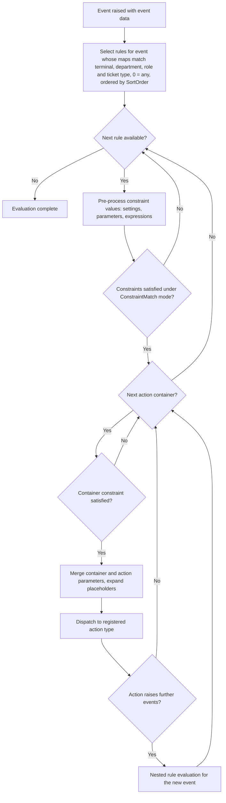

Sources: [APP section 3 rule events and action types, section 4 "Rule engine execution", BR-041 to BR-043, section 10] [DOM DR-061] [DB section 13.3].

### WF-18 Scheduled Trigger

**Description.** Installers can define triggers with a cron-style expression (the Trigger editor is narrated in the interviews but not shown) [INT section 4 D] [DOM section 2 "Automation"]. At start-up, and whenever triggers change, the trigger service creates one scheduled object per trigger. When a schedule fires, the trigger's "last trigger" time is updated and, unless the Management screen is currently active, the `TriggerExecuted` rule event (TriggerName) is raised, which runs any matching rules (WF-17); a trigger that no longer exists stops itself [APP section 4 "Trigger", BR-060] [DB section 11]. Triggers are stopped on application exit (WF-24). The behaviour is documented only in [APP]; the Product Owner did not describe scheduled use cases.

**Trigger.** Cron expression of a Trigger row.

**Actors.** Scheduler (cron trigger).

**Screens.** None (system workflow); configured through the Trigger editor (management editors).

**Outcome.** Rules bound to `TriggerExecuted` run on schedule.

**Diagram.**

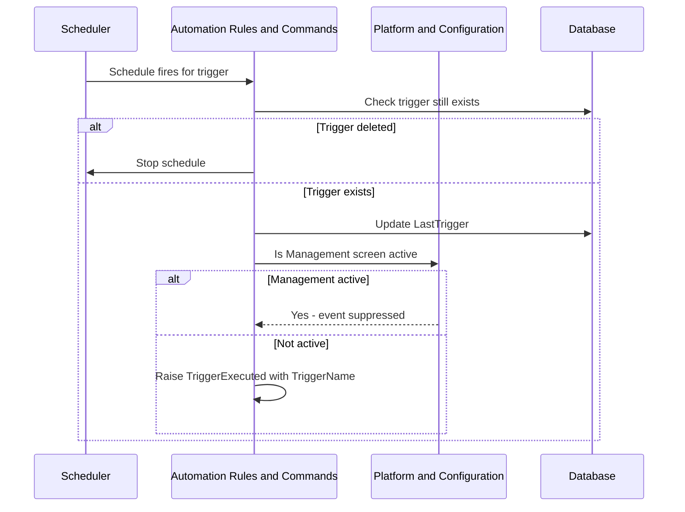

Sources: [APP section 4 "Trigger (scheduled automation)", BR-060] [INT section 4 D] [DOM section 2] [DB section 11].

### WF-19 Multi-terminal Synchronisation

**Description.** Several terminals share one database and stay in step through a messaging server [DOM section 2 "Platform & Configuration"]. A terminal whose local settings enable the messaging client attaches at start-up to the messaging server object ("ChatServer", .NET Remoting over TCP; server hosted by a desktop application or Windows service, default port 8383 for the service) [APP section 4 "Multi-terminal synchronisation", section 7]. Sending a message posts a keyed command string to the server, which notifies every attached client; clients poll their queue every second and publish the message internally. Handlers react to `TICKET_REFRESH` (raised after every ticket close, WF-04) and `WIDGET_REFRESH` by refreshing entity dashboards and ticket listers, and to `ActionMessage` (from the Send Message / Broadcast Message action) by raising the `MessageReceived` rule event (Command) on the receiving terminal (WF-17). A lost connection is re-established on the next send [APP section 4]. The channel has no authentication, so any host reaching the port can broadcast [APP section 10]. Messaging only refreshes views; data consistency between terminals is protected by the ticket concurrency check on save (WF-04) [APP BR-019] [DOM DR-010].

**Trigger.** Ticket close, widget refresh, Broadcast Message action.

**Actors.** Other Terminals; Messaging Server.

**Screens.** POS Entity Screen and ticket lister widgets (refreshed); no dedicated screen.

**Outcome.** Entity colours and ticket lists on other terminals refreshed; broadcast rules executed remotely.

**Diagram.**

```mermaid
sequenceDiagram
    participant T1 as Ticketing and Ordering
    participant MSG as Messaging Server
    participant OTH as Other Terminals
    participant AUT as Automation Rules and Commands
    T1->>MSG: Post TICKET_REFRESH after ticket close
    alt Connection lost
        T1->>MSG: Reconnect on next send
    end
    MSG->>OTH: Notify all attached clients
    loop Every second
        OTH->>OTH: Poll message queue
    end
    OTH->>OTH: Refresh entity screens and ticket lists
    opt Broadcast Message action
        T1->>MSG: Post ActionMessage with command
        MSG->>OTH: Notify all attached clients
        OTH->>AUT: Raise MessageReceived on each terminal
    end
```

Sources: [APP section 4 "Multi-terminal synchronisation", section 7, BR-019, section 10] [DOM section 2, DR-010].

### WF-20 Print Job Execution

**Description.** Printing is driven by print jobs referenced by the `ExecutePrintJob` action (parameters include print job name, order state and order tag filters, copies and high priority), by report printing and by account document printing [APP section 4 "Print job execution", section 3 action types]. Before printing a ticket, its number is assigned if missing [APP section 3] [APP BR-018]. The print task builder selects orders according to the job's "what to print" option: everything, the last lines limited by printer page height, the last paid orders, or orders by quantity / separated by quantity; the default kitchen job of the Ticket Closing rule filters to orders whose status is New [APP BR-053] [DOM DR-017]. Orders are grouped per printer map, filtering by product group code (exact match preferred, else blank) then product (exact preferred, else any); the most specific map wins [APP BR-052] [DOM DR-060]. Each task is formatted with the map's printer template: tags, collection sections such as `[ORDERS]`, state sections such as `[ORDERS:GIFT]` and `[ORDERS:VOID]` (a missing state section falls back to `[ORDERS]`, an empty one prints nothing), and formatting commands [APP section 3] [DOM DR-059]. Tasks are skipped when the printer has no share name (so "the kitchen doesn't print"), the template is missing, or a non-custom printer has no orders while its template contains the orders collection (no empty kitchen slips) [APP section 4] [DOM DR-058]. Tasks are queued on a background print thread (normal or high priority) and sent through the printer type's implementation: slip/ticket, text, HTML, port, demo, Windows, custom (URL, setting, save-to-file) or raw [APP section 4, section 7].

**Trigger.** `ExecutePrintJob` action (for example from the Ticket Closing and Print Bill rules); report print; account document print.

**Actors.** Kitchen and Bar Staff (receive slips); Waiter / Cashier (receive bills) indirectly.

**Screens.** None directly (system workflow).

**Outcome.** Kitchen slips, bills and receipts printed on the right printers with only the relevant orders.

**Diagram.**

```mermaid
sequenceDiagram
    participant AUT as Automation Rules and Commands
    participant PRT as Printing
    participant TIX as Ticketing and Ordering
    participant KIT as Kitchen and Bar Staff
    AUT->>PRT: ExecutePrintJob with job name and order state filter
    PRT->>TIX: Assign ticket number if missing
    PRT->>PRT: Select orders by WhatToPrint and filters
    PRT->>PRT: Group orders by most specific printer map
    loop Each printer task
        alt Printer has no share name or template missing
            PRT->>PRT: Skip task
        else No orders and template prints the orders collection
            PRT->>PRT: Skip task - no empty slip
        else Printable
            PRT->>PRT: Format with template sections and state fallback
            PRT->>KIT: Queue on print thread and print
        end
    end
```

Sources: [APP section 3, section 4 "Print job execution", section 7, BR-018, BR-052, BR-053] [DOM DR-017, DR-058, DR-059, DR-060].

### WF-21 Create Account Transaction Document

**Description.** Manual account documents (for example a customer payment of a tab) are created from Accounts by selecting an account and pressing a document-type button on Account Details, through the batch document creator, or by the `CreateAccountTransactionDocument` / `CreateBatchAccountTransactionDocument` actions [APP section 4 "Account document creation"]. Document types are visible according to their mappings [APP section 2]. The default amount and description are built from templates: a fixed amount, `[Balance]` (absolute balance), `[BalanceEx]` (absolute foreign-currency balance times rate), `[:field]` from entity custom data, and date tokens such as `[MONTH]`, `[NEXT MONTH]`, `[WEEK]`, `[NEXT WEEK]`, `[YEAR]` and `[ACCOUNT NAME]` [APP section 4, BR-055]. The account chooser lists accounts by filter (all, balanced only, mapped). The document type creates one transaction per configured transaction type between the master account and the chosen counter accounts, using the currency's exchange rate or a fixed exchange template; with several transaction types in a foreign currency the amount compounds (a defect) [APP BR-056, section 10]. The document is saved, `AccountTransactionDocumentCreated` (AccountTransactionDocumentName, DocumentId) is raised and, if the document type has a printer template, it can be printed on the terminal's transaction printer; without a template there is no Print button [APP section 4] [DOM DR-047]. The seeded document types "Customer - Cash" and "Customer - Credit Card" default to `[Balance]` with the Customer Receipt template [DB section 13.1].

**Trigger.** Accounts screen document-type button; batch creator; rule action.

**Actors.** Cashier; Owner / Manager; Customer / Guest (paying).

**Screens.** Accounts, Account Details (document creator and batch document creator dialogs).

**Outcome.** Saved account transaction document with balanced transactions; optional printed receipt.

**Diagram.**

```mermaid
sequenceDiagram
    participant CSH as Cashier
    participant ACC as Accounting
    participant AUT as Automation Rules and Commands
    participant PRT as Printing
    CSH->>ACC: Select account and press document type button
    ACC-->>CSH: Default amount and description from templates
    CSH->>ACC: Confirm or edit amount and counter account
    ACC->>ACC: Create one transaction per transaction type at exchange rate
    ACC->>ACC: Save document
    ACC->>AUT: Raise AccountTransactionDocumentCreated
    opt Print requested
        alt Document type has printer template
            ACC->>PRT: Print on terminal transaction printer
        else No printer template
            ACC-->>CSH: No Print button
        end
    end
```

Sources: [APP section 2, section 4 "Account document creation", BR-055, BR-056, section 10] [DOM DR-047] [DB section 13.1] [INT 3.1 "Settle to a Customer Account"].

### WF-22 Caller-ID Popup

**Description.** Found only in [APP]; the Product Owner did not describe it and no screen was captured [INT section 9 item 8]. A serial-port caller-ID device configured in local settings (Comet USB, Hugin, generic modem, or a "show" test device) is initialised at start-up (WF-24) [APP section 3 "Caller-ID monitor", section 7]. When the device sends data, the number is parsed and trimmed of configured characters, a popup is shown on the UI thread, and customers are searched by phone in the Customers entity type (located by its localised name): a single match shows the customer name, otherwise the raw number. Clicking the popup opens entity selection for the unique match or for a new entity carrying the phone number, and the `DeviceEventGenerated` rule event (DeviceName, EventName `CID_Event`, EventData) is raised [APP section 4 "Caller-ID popup", section 3]. The Comet device implementation has a defect that would make receiving data fail [APP section 10]. This belongs to the Peripheral grouping (Tasks & Product Timers) of code-only features.

**Trigger.** Serial data from a caller-ID device.

**Actors.** Caller-ID Device; Cashier or Delivery Staff taking the call; Customer / Guest (caller).

**Screens.** Caller-ID popup window; Entity Selection Overlay (Customer Search entity screen).

**Outcome.** Caller identified and a ticket can be started for the customer; rules may react to the device event.

**Diagram.**

```mermaid
sequenceDiagram
    participant CID as Caller-ID Device
    participant TPT as Tasks and Product Timers
    participant TIX as Ticketing and Ordering
    participant AUT as Automation Rules and Commands
    participant CSH as Cashier
    CID->>TPT: Serial data with phone number
    TPT->>TPT: Parse and trim number
    TPT->>TIX: Search Customers by phone
    alt Single match
        TPT-->>CSH: Popup with customer name
    else No or several matches
        TPT-->>CSH: Popup with raw number
    end
    CSH->>TPT: Click popup
    TPT->>TIX: Open entity selection for match or new customer with phone
    TPT->>AUT: Raise DeviceEventGenerated CID_Event
```

Sources: [APP section 3 "Caller-ID monitor", section 4 "Caller-ID popup", section 7, section 10] [INT section 9].

### WF-23 Product Timer Pricing

**Description.** Found only in [APP] and [DB]; not discussed by the Product Owner. When an order is added for a product mapped to a product timer, the order stores a timer value whose start and end are equal while the timer is active [APP section 4 "Product timer pricing"] [DB section 3.9]. The order price is the unit price divided by the price duration, multiplied by the elapsed time in minutes, hours or days, with a minimum time and rounding of the time up to the next multiple of the time-rounding step, rounded to two decimals [APP BR-007]. Stopping the timer (product timer editor on the ticket, or the `StopActiveTimers` action) sets the end time and freezes the price. A ticket with active timers cannot be marked closed, so settlement (WF-09) does not close it until the timers stop [APP section 4, BR-015] [DB section 9.4]. Part of the Peripheral grouping (Tasks & Product Timers).

**Trigger.** Ordering a product mapped to a product timer.

**Actors.** Waiter; Cashier; Customer / Guest.

**Screens.** POS Ticket Screen (product timer editor), Payment Screen.

**Outcome.** Time-based order price; ticket closable only after timers stop.

**Diagram.**

```mermaid
sequenceDiagram
    participant W as Waiter
    participant TIX as Ticketing and Ordering
    participant TPT as Tasks and Product Timers
    W->>TIX: Add order for timed product
    TIX->>TPT: Start timer value with equal start and finish times
    loop While active
        TPT->>TIX: Price from elapsed time, minimum time and rounding step
    end
    W->>TPT: Stop timer or StopActiveTimers action
    TPT->>TIX: Set finish time and freeze price
    W->>TIX: Settle and close
    alt Any timer still active
        TIX-->>W: Ticket not marked closed
    else All timers stopped
        TIX-->>W: Ticket closed when remaining is zero
    end
```

Sources: [APP section 4 "Product timer pricing", BR-007, BR-015] [DB section 3.9, section 9.4].

### WF-24 Application Start-up and Database Initialisation

**Description.** Behaviour documented in [APP] and [DB]; the interviews mention only the `regen.txt` recovery and restarts for configuration changes [DOM DR-063, DR-064]. Launching the application composes the modules and enforces a single instance per machine through a named mutex (unless multiple clients are allowed), notifying the running instance instead [APP section 4 "Application start-up", BR-063]. The language is set from local settings, a splash screen is shown, the messaging listener is registered and, if configured, the messaging client starts (WF-19). The database connection is chosen from the connection string: empty means a SQL Server Compact file (or a text-file database when Compact is not installed), `.sdf` means Compact, otherwise SQL Server [DB section 2]. A new database is created from the model, receives the version history 1 to 24 and the supporting indexes, and is then seeded with default data (accounts, transaction types, payment types, calculation types, numerators, ticket type, entity types and screens, department, warehouse, Admin role and Administrator user with PIN 1234, printers, templates, print jobs, terminal, menu and tables from import files) plus the default states, commands, actions and rules from `RuleGenerator`; names are taken from the installation language [DB section 2, section 13] [APP section 4]. An existing database is migrated only when a `migrate.txt` file exists (then deleted); model drift is not detected [DB section 2]. When `regen.txt` exists the default automation data is regenerated: own rules stay, edits to defaults are lost [DOM DR-063] [DB section 13.3]. Default currencies are created in local settings. Failures prompt for a corrected connection string and exit [APP section 4]. Status views are registered, cron triggers start (WF-18), the caller-ID device is initialised if configured (WF-22), the shell is shown and the `ApplicationStarted` rule event (Arguments) is raised; on exit the messaging client and triggers stop [APP section 4]. Configuration is cached, so new payment types or currencies may need a restart [DOM DR-064].

**Trigger.** Launching the application.

**Actors.** Reseller / Installer (first start, recovery files); Administrator (built-in user, seeded).

**Screens.** Splash screen, then PIN Login.

**Outcome.** Application ready at PIN Login with a created, migrated or regenerated database.

**Diagram.**

```mermaid
sequenceDiagram
    participant INS as Reseller or Installer
    participant PLT as Platform and Configuration
    participant DB as Database
    participant AUT as Automation Rules and Commands
    participant MSG as Messaging Server
    INS->>PLT: Launch application
    alt Another instance running and multiple clients not allowed
        PLT-->>INS: Running instance activated - exit
    else Single instance
        PLT->>PLT: Set language and show splash
        opt Messaging client enabled
            PLT->>MSG: Attach messaging client
        end
        PLT->>DB: Resolve connection string
        alt New empty database
            DB->>DB: Create schema and version rows 1 to 24
            PLT->>DB: Seed default data and RuleGenerator automation
        else Existing database and migrate.txt present
            DB->>DB: Run migrations and delete migrate.txt
        end
        opt regen.txt present
            PLT->>DB: Regenerate default states, commands, actions and rules
        end
        alt Database failure
            PLT-->>INS: Prompt for corrected connection string and exit
        else Ready
            PLT->>AUT: Start cron triggers and caller-ID device
            PLT->>AUT: Raise ApplicationStarted
            PLT-->>INS: PIN Login screen
        end
    end
```

Sources: [APP section 4 "Application start-up", BR-063] [DB section 2, section 13] [DOM DR-063, DR-064].

### WF-25 Set Up a Foreign Currency

**Description.** A business in a tourist area accepts a second currency. On the Foreign Currency editor the installer adds each currency with name, currency symbol format (which must include the `{0}` placeholder, otherwise only the symbol appears in the change display), a manually entered exchange rate (must be greater than 0) and a rounding step [INT 3.2] [APP BR-029, BR-051] [DOM section 8]. Each currency needs its own cash account (account type "Payment Accounts" with the currency set) created on the Account editor [INT 3.2] [DOM DR-044]. A payment type per currency (for example "Cash ($)") is added with its transaction type and account; its mapping rows are mandatory, otherwise the button never appears [INT 3.2] [DOM DR-025]. To give change in other currencies the installer clones the payment transaction type as a "Change Transaction" with swapped source and target account types, then adds change payment types per currency account, again with mappings [INT 3.2]. If the Payment Screen does not show the new buttons, the application must be restarted because configuration is cached [DOM DR-064]. Validators require a transaction type on payment and change payment types and a positive rate [APP BR-051].

**Trigger.** Business accepts a second currency.

**Actors.** Reseller / Installer; Owner / Manager.

**Screens.** Management editors: Foreign Currency editor, Account List and Account editor, Payment Type editor, Account Transaction Type editor, Change Payment Type editor; then Payment Screen for verification.

**Outcome.** Currency selectable on the Payment Screen with its own cash account, payment type and optional change types (used by WF-12).

**Diagram.**

```mermaid
sequenceDiagram
    participant INS as Reseller or Installer
    participant PLT as Platform and Configuration
    participant ACC as Accounting
    participant PAY as Payment and Pricing Adjustments
    INS->>PLT: Add currency with symbol format, rate and rounding
    alt Rate not above zero
        PLT-->>INS: Save refused
    end
    INS->>ACC: Add cash account per currency
    INS->>PAY: Add currency payment type with account and mappings
    alt No mapping rows
        PAY-->>INS: Button never appears
    end
    opt Change in other currencies
        INS->>ACC: Clone payment transaction type with swapped account types
        INS->>PAY: Add change payment types per currency account with mappings
    end
    opt Payment Screen not updated
        INS->>PLT: Restart application
    end
```

Sources: [INT 3.2 "Set Up a Foreign Currency"] [APP BR-029, BR-051] [DOM DR-025, DR-044, DR-064, section 8].

### WF-26 Configure Entity Types, Entities and Entity Screens

**Description.** The business wants something other than tables on tickets (waiters, rooms, drivers). On the Entity Type editor the installer creates the type with its name, entity name, optional account type and account name template (enabling Create Account) and custom fields of type String, Wide String, Number, Date or Query, optionally with an edit mask, primary field and display formats [INT 3.2] [APP section 3 "Entities"]. Entities are added one by one or with Batch Create ("#Type" line then names; existing names skipped) on the Entity List [INT 3.2] [DOM DR-049]. On the Entity Screen editor the installer sets the ticket type, view mode (automatic grid, search or custom canvas with widgets; Design Mode is for admin roles only), columns and rows, the display state and state filter, and "Ask Ticket Type"; saving fails without an entity type unless in custom mode ("Resource Type Id must be greater than 0") [INT 3.2, section 7] [APP BR-051]. Mapping rows (user role, department, ticket type; default all) are required, otherwise the screen is hidden [INT 3.2] [DOM DR-025]. Finally the Ticket Type editor gets the entity type assignment with "Ask Before Creating Ticket" and "Copy to New Tickets" [INT 3.2] [APP section 3 "Ticket configuration"]. Verification on the POS Entity Screen: a Waiters tab appears; tapping a waiter creates a ticket assigned to him, closable without a table [INT 3.2]. Entity names must be unique; an entity used on a screen or ticket, or an entity type with entities, cannot be deleted [APP BR-048, BR-050].

**Trigger.** Business needs new entity types or screens.

**Actors.** Reseller / Installer; Owner / Manager.

**Screens.** Management editors: Entity Type editor, Entity List with Batch Create, Entity Screen editor, Ticket Type editor; then POS Entity Screen.

**Outcome.** New entity buttons appear on the POS Entity Screen and, if configured, are asked for at ticket creation (WF-03).

**Diagram.**

```mermaid
sequenceDiagram
    participant INS as Reseller or Installer
    participant TIX as Ticketing and Ordering
    participant PLT as Platform and Configuration
    INS->>TIX: Create entity type with fields and optional account type
    INS->>TIX: Add entities or Batch Create - duplicates skipped
    INS->>PLT: Define entity screen with ticket type, view mode and display state
    alt No entity type chosen and not custom mode
        PLT-->>INS: Save fails - type id must be greater than 0
    else Valid
        INS->>PLT: Add mapping rows for role, department and ticket type
        alt No mapping row
            PLT-->>INS: Screen hidden everywhere
        end
    end
    INS->>TIX: Assign entity type on ticket type with Ask Before Creating and Copy to New Tickets
    TIX-->>INS: New tab on POS Entity Screen
```

Sources: [INT 3.2 "Configure Entity Types, Entities and Entity Screens", section 7] [APP section 3, BR-048, BR-050, BR-051] [DOM DR-025, DR-049].

### WF-27 Build Products and the Screen Menu

**Description.** For a new installation or a menu change the installer works on the Product List. Many products can be entered with Batch Create: a line starting with a hash sets the product group, the last word of each line is the price (comma or dot; a non-number gives zero), lines without a space are skipped, and only a single portion is created [INT 3.2] [DOM DR-049]. Individual products are edited on the Product editor (name, group code, barcode and at least one portion, default "Normal", with prices per price tag) [INT 3.2] [DOM DR-048]. Price tags (price definitions) have names of at most 10 characters, unique case-insensitively [DOM DR-050] [DB section 9.2]. On the Menu editor the installer adds categories (optionally auto-selected by group code when codes are clean) and assigns products with a two-list selector; button properties set Auto Select (recommended for steak, not for a soft drink), header, colour, sub-menu tags (levels comma-separated) and Max Items for root buttons [INT 3.2]. A menu button can also carry order tags, order states and an automation command applied when the product is added (WF-03) [APP section 4]. The screen menu is attached to the ticket type and optionally to a department [DB section 12 Migration 19]. Product names must be unique, and a product used on menus, recipes or order tags cannot be deleted [APP BR-049, BR-050]. Top-seller sorting is manual in V3 [INT section 3.3 item 7].

**Trigger.** New installation or menu change.

**Actors.** Reseller / Installer; Owner / Manager.

**Screens.** Management editors: Product List with Batch Create, Product editor, Price Definitions, Menu editor and button properties; then POS Ticket Screen.

**Outcome.** Products with portions and prices placed on POS menu buttons.

**Diagram.**

```mermaid
sequenceDiagram
    participant INS as Reseller or Installer
    participant CAT as Catalogue and Menu
    alt Many products
        INS->>CAT: Batch Create with group lines and prices
        CAT-->>INS: Single-portion products, invalid lines skipped
    else Few products
        INS->>CAT: Add product with portions and prices
    end
    alt Duplicate product name
        CAT-->>INS: Save refused
    end
    INS->>CAT: Open menu and add categories
    INS->>CAT: Assign products to categories
    INS->>CAT: Set Auto Select, header, colour and sub-menu tags
    CAT-->>INS: Menu shown on POS Ticket Screen
```

Sources: [INT 3.2 "Build Products and the Screen Menu", section 3.3] [APP section 4, BR-049, BR-050] [DOM DR-048, DR-049, DR-050] [DB section 9.2, section 12].

### WF-28 Configure Order Tag Groups

**Description.** The kitchen needs cooking levels, extras or free text on order lines. On the Order Tag Group editor the installer sets the name, minimum and maximum selected (minimum 1 and maximum 1 means exactly one), whether tag prices are added to the order price, tax-free, free tagging and display settings [INT 3.2] [APP section 3]. Validation requires maximum not below minimum when a maximum is set, and a group tag forces maximum 1 and at least one tag [APP BR-010]. On the Order Tag List each tag has a name, maximum quantity, optional product (whose recipe then consumes stock, WF-16) and price [INT 3.2] [DOM DR-053]. Mapping rows by user role, department, ticket type, product group and product are required; without a row the group appears nowhere, which is the top support call; there is no portion-level mapping in V3 [INT 3.2, section 5.3] [DOM DR-025, DR-026]. Free tags typed on the POS are saved into the group without duplicates (the duplicate check looks across all groups) [DB section 9.4]. Mandatory groups (minimum 1) should be kept minimal because they look like a frozen screen to new staff [DOM section 8].

**Trigger.** Kitchen needs modifiers on order lines.

**Actors.** Reseller / Installer; Owner / Manager.

**Screens.** Management editors: Order Tag Group list and editor (General, Order Tag List, Display Settings, Mappings); then POS Ticket Screen.

**Outcome.** Modifier groups with limits, prices and mappings appear on the mapped products (used in WF-03).

**Diagram.**

```mermaid
sequenceDiagram
    participant INS as Reseller or Installer
    participant CAT as Catalogue and Menu
    INS->>CAT: Add group with min, max, price handling and free tagging
    alt Max below min or invalid group tag settings
        CAT-->>INS: Save refused
    end
    INS->>CAT: Add tags with max quantity, product and price
    INS->>CAT: Add mapping rows for role, department, ticket type, group and product
    alt No mapping row
        CAT-->>INS: Group appears nowhere
    else Mapped
        CAT-->>INS: Tags offered on mapped products
    end
```

Sources: [INT 3.2 "Configure Order Tag Groups", section 5.3] [APP section 3, BR-010] [DOM DR-023, DR-025, DR-026, DR-053, section 8] [DB section 9.4].

### WF-29 Design Printer Templates and Print Jobs

**Description.** The installer customises the bill or kitchen slip. Printers are defined with type, share name (without it nothing prints), characters per line and code page (both greater than 0) [DOM DR-058] [APP BR-051]. On the Printer Template editor the installer enters a mandatory name and the layout using format tags (title, fill, bold on/off, justify, centre, left, right, beep, bitmap, cut), inserts collection tags such as `{ORDERS}` and `{ENTITIES}` (legacy `{RESOURCES}`), and defines a matching section for each collection, such as `[ORDERS]` and `[ENTITIES:Table]`; lines starting with `--` are comments [INT 3.2] [APP section 3]. State sections such as `[ORDERS:GIFT]` and an empty `[ORDERS:VOID]` control how gifts and voids print; an empty section prints nothing and a missing one falls back to `[ORDERS]`, so deleting the empty void section makes voids appear on the bill [INT 3.2] [DOM DR-059, section 8]. On the Print Job editor the installer chooses what to print and adds at least one printer map, each with a printer and a template, optionally limited by product group or product; the most specific map wins [APP BR-051, BR-052] [DOM DR-060]. The terminal's report and transaction printers are set on the Terminal editor [APP section 3]. Printers and templates in use cannot be deleted [APP BR-049]. Defaults seeded on a new database: Ticket, Kitchen Order and Customer Receipt templates; Ticket, Kitchen and Invoice printers; "Print Bill" and "Print Orders To Kitchen Printer" print jobs [DB section 13.2].

**Trigger.** Installer customises printouts.

**Actors.** Reseller / Installer.

**Screens.** Management editors: Printer editor, Printer Template editor, Print Job editor, Terminal editor.

**Outcome.** Printed output with entity, order and state-specific lines routed to the right printers (used in WF-20).

**Diagram.**

```mermaid
sequenceDiagram
    participant INS as Reseller or Installer
    participant PRT as Printing
    INS->>PRT: Define printer with share name, chars per line and code page
    alt No share name
        PRT-->>INS: Saved but nothing will print
    end
    INS->>PRT: Write template with format tags and collection tags
    INS->>PRT: Add ORDERS and ENTITIES sections
    INS->>PRT: Add GIFT section and empty VOID section
    alt Template name missing
        PRT-->>INS: Save refused
    end
    INS->>PRT: Create print job with printer maps
    alt No map or map without printer or template
        PRT-->>INS: Save refused
    else Valid
        PRT-->>INS: Print job ready for rules
    end
```

Sources: [INT 3.2 "Design Printer Templates"] [APP section 3, BR-049, BR-051, BR-052] [DOM DR-058, DR-059, DR-060, section 8] [DB section 13.2].

### WF-30 Maintain Users and Roles

**Description.** For a new staff member or a permission change the administrator opens the User List (Add User; Edit and Delete enabled after selection; Change Sort Order) and the User Editor: user name, PIN code (4 to 20 digits, unique across users, shown masked) and user role (required) [INT 3.2] [APP BR-038, section 3]. The default Administrator PIN 1234 should be changed [INT 3.2] [DOM DR-009]. On the User Role editor the administrator sets the default department (required) and the permission list; each permission is Enabled, Disabled or Invisible and only Enabled grants it; an admin role implicitly has every permission [APP section 2, BR-039, BR-040]. The permission `ChangeItemPrice` cannot be granted because it is never registered, so only admins can change a non-zero price [APP section 10]. Users with the admin role, the last remaining user and users who created orders cannot be deleted; the admin/first role and roles in use cannot be deleted [APP BR-039]. Void, Gift, discounts and payment types are not permissions; they are restricted through mappings of the respective commands, selectors and payment types (WF-31) [INT section 7] [DOM DR-061]. A password field seen in a manual mockup is not part of V3 login [INT section 5.3].

**Trigger.** New staff member or permission change.

**Actors.** Administrator (built-in user); Owner / Manager.

**Screens.** Management editors: User List, User Editor, User Role editor.

**Outcome.** Staff log in with their own PIN (WF-02) and see only permitted functions.

**Diagram.**

```mermaid
sequenceDiagram
    participant ADM as Administrator
    participant IAM as Identity and Access
    ADM->>IAM: Add user with name, PIN and role
    alt PIN not 4 to 20 digits or already used
        IAM-->>ADM: Cannot save
    else No role selected
        IAM-->>ADM: Cannot save
    else Valid
        IAM-->>ADM: User saved
    end
    opt Edit role
        ADM->>IAM: Set default department and permission values
        alt No default department
            IAM-->>ADM: Cannot save
        else Valid
            IAM-->>ADM: Only Enabled permissions grant access
        end
    end
    opt Delete user
        alt Admin user, last user or creator of orders
            IAM-->>ADM: Deletion refused
        else Allowed
            IAM-->>ADM: User deleted
        end
    end
```

Sources: [INT 3.2 "Maintain Users and Roles", section 5.3, section 7] [APP section 2, section 3, BR-038, BR-039, BR-040, section 10] [DOM DR-009, DR-061].

### WF-31 Configure Automation (Rules, Actions, Commands)

**Description.** The installer changes behaviour that V3 holds as data (cover charges, tips, online partners, state colours); there are no mockups for these editors [INT 3.2]. First rule actions are defined: an action type from the catalogue with parameter values (values must not start or end with a space; parameters can be left as `[:Name]` placeholders to be filled per rule) [APP section 3 action types, BR-044]. Automation commands are defined with a header, colour, enabled and visible state strings (for example `Status=Unpaid`, `*` for always, `IsClosed` to allow closed tickets), display flags (on ticket, on orders, under ticket, on ticket list, on command selector) and mappings [APP BR-042] [DB section 12 Migrations 10, 14, 20]. A rule names an event, constraints with a match mode, an ordered list of action containers with parameter values (for example binding `[:Cover Quantity]` to `[:NumericValue]`) and mappings [INT 3.2 examples] [APP section 4 "Rule engine execution"]. Triggers (cron) and scripts complete the toolset [APP section 3]. At run time a button press or event executes the rules (WF-17). Examples from the interviews: a Guest Count ticket tag adds a Cover order; a Tip tag updates a ticket calculation; an Online Order tag changes the ticket entity and displays the payment screen; one-touch payment uses a Pay Ticket rule [INT 3.2]. Deleting or breaking default rules stops the ticket flow; placing `regen.txt` in the user data folder and restarting recreates the default commands, actions, states and rules (own rules stay, edits to defaults are lost) [DOM DR-063, section 8] [DB section 13.3]. Actions such as Start Process, Send Email, Execute Script and Set Current Terminal give whoever can edit rules wide power [APP section 10].

**Trigger.** Installer changes behaviour.

**Actors.** Reseller / Installer; Administrator (built-in user).

**Screens.** Management editors: Rule Action editor, Automation Command editor, Rule editor, Trigger editor, Script editor.

**Outcome.** Behaviour configured as data: buttons fire commands, rules react to events.

**Diagram.**

```mermaid
sequenceDiagram
    participant INS as Reseller or Installer
    participant AUT as Automation Rules and Commands
    participant PLT as Platform and Configuration
    INS->>AUT: Define rule actions with parameters
    alt Parameter value starts or ends with a space
        AUT-->>INS: Save refused
    end
    INS->>AUT: Define automation command with header, states and mappings
    INS->>AUT: Define rule with event, constraints and action containers
    INS->>AUT: Add rule mappings
    alt No mapping row
        AUT-->>INS: Rule or command never applies
    else Mapped
        AUT-->>INS: Button press or event runs the rule
    end
    opt Default rules broken or deleted
        INS->>PLT: Place regen.txt in user data folder and restart
        PLT->>AUT: Recreate default commands, actions, states and rules
    end
```

Sources: [INT 3.2 "Configure Automation"] [APP section 3, section 4, BR-042, BR-044, section 10] [DOM DR-061, DR-063, section 8] [DB section 12, section 13.3].

## 7. Computed Fields & Formulas

All values are computed by the application in decimal arithmetic. The database has no computed columns and stores only some results, rounded to its column scale ([DB 10], [DB DB-06]). Rounding modes are mixed, and a rewrite must reproduce them to match historic totals: tax values and per-tax totals round half away from zero, while ticket tax, calculations and the remaining amount use the default .NET rounding, which rounds a half to the even neighbour (banker's rounding) ([DB 10] precision caveat). The system decimal count is fixed at 2 ([APP section 10]).

### 7.1 Orders and tickets

| Field name | Formula/logic | Where used | Source |
|---|---|---|---|
| Order price | Unit price of the portion (BR-093) plus, for every order tag, tag price times tag quantity, then adjusted by any product timer (7.6). | Order line value, tax, ticket totals | [APP BR-005], [DB 10] |
| Order visible price | Unit price plus only the prices of tags whose group has "Add Tag Price To Order Price". Other tag prices are shown separately on their tag lines. Reports and inventory use a mix of the two price accessors. | Ticket display | [APP BR-005], [APP section 10] |
| Order taxable price | Unit price plus the prices of tags that are not tax-free, timer-adjusted. | Tax calculation | [DB 10], [APP BR-004] |
| Order value | Order price times quantity. | Order selector, reports, CSV export | [DB 10] |
| Order total | Order value when Calculate Price is on, otherwise 0 (gifts and voids). Orders with Calculate Price off also add nothing to tax. | Plain sum, tax | [APP BR-005], [DB 10] |
| Plain sum | Sum of order totals of the ticket. | Calculation base, tax spreading | [APP BR-001], [DB 10] |
| Pre-tax services | Calculations with "Include Tax" off, applied in their configured order to the plain sum or running sum (7.2). | Ticket total | [APP BR-001] |
| Pre-tax spread per order | Order taxable price plus (taxable price times total pre-tax services divided by plain sum), so discounts and services are spread in proportion to each order's share. | Tax, order selector prices | [APP BR-004], [DB 10] |
| Tax per tax value (tax-included prices) | Price times rate divided by (100 plus the total rate of all the order's taxes). Rounded to the tax template's rounding digits, half away from zero, only when that rounding is greater than 0. | Order tax, ticket tax | [APP BR-004], [DB 10] |
| Tax per tax value (tax-excluded prices) | Price times rate divided by 100. | Order tax, ticket tax | [APP BR-004], [DB 10] |
| Order tax | Sum of the order's tax values. | Ticket tax | [APP BR-004] |
| Ticket tax | Sum of order taxes, rounded to the system decimals (2). It is 0 in the ticket total when the ticket type has prices tax-included, because the tax is already inside the prices. | Ticket total, bill | [APP BR-001], [APP BR-004] |
| Per-tax-type total | For each tax template, the sum of line taxes rounded to 2 decimals, half away from zero. Posted as that tax's account transaction amount. | Ticket transaction document, Work Period Report | [APP BR-004], [DB 10] |
| Sale transaction amount | For each sale transaction type, the sum of the tax-excluded line totals. | Ticket transaction document | [DB 10] |
| Subtotal | Plain sum plus pre-tax services plus ticket tax (0 when tax-included). | Post-tax services base | [APP BR-001], [DB 10] |
| Ticket total (Total Amount, stored) | Subtotal plus post-tax services (calculations with "Include Tax" on, computed in order on the running sum). | Ticket, entity ticket list, reports | [APP BR-001], [DB 10] |
| Remaining amount (stored) | Ticket total minus sum of payments plus sum of change payments, rounded to 2 decimals. | Close rules, payment screen, concurrency check | [APP BR-001], [DB 10] |
| Gift total | Sum of values of orders in the Gift state, printed separately on the bill. | Bill printout | [INT WF Cancel, Void or Gift step 4] |
| Paid item key | Product id and price (for example "Rib Eye at 12.00"). Tags are ignored. | Partial payment by selected items | [APP section 10], [APP BR-053] |
| Entity open-ticket count | Number of open tickets attached to the entity, passed with Entity Updated. 0 sets the entity to Available. | Entity colours | [APP workflow "Close (submit) ticket" step 3] |
| Open ticket count (end of day) | Number of non-closed tickets in the whole database. | End Work Period check | [APP BR-031], [DB 15.1] |
| Work period open flag and duration | Open when start time equals end time. The Work Periods label shows the start time and the time elapsed since start. | Work Periods screen, POS availability | [DB 10], [INT WF Start the Work Period step 3] |

### 7.2 Calculations (discounts, services, rounding)

| Field name | Formula/logic | Where used | Source |
|---|---|---|---|
| Method 0 - percentage of plain sum | Amount percent of the plain sum. With "Use Plain Sum", only orders that affect inventory form the base. | Discount % (seeded, decreasing) | [APP BR-002], [DB 6], [DB 13.1] |
| Method 1 - percentage of running sum | Amount percent of the running total after earlier calculations, so calculations stack ("rate from previous template"). | Stacked services/discounts | [APP BR-002], [DOM glossary Rate from Previous Template] |
| Method 2 - fixed amount | The amount itself (default method). | Round (seeded, decreasing, include tax), Tip example | [APP BR-002], [DB 13.1], [DOM glossary Tip] |
| Method 3 - set ticket total | Whatever amount takes the ticket total to the entered amount. It becomes 0 if that would move the total in the direction the calculation forbids (decrease or increase). | "Fixed amount from ticket total" | [APP BR-002] |
| Method 4 - round ticket total | Rounds the ticket total to a multiple of the amount. A positive amount rounds to the nearest multiple, half away from zero, and a negative amount truncates. The adjustment is clipped to the allowed direction. | Ticket rounding | [APP BR-002] |
| Method 5 - custom | Amount supplied by the script "Calculation_<name>". The calculation is kept even when its amount is 0. | Custom calculations | [APP BR-002], [DB 6] |
| Calculation amount (stored) | Result of the method, rounded to 2 decimals and negated when "Decrease Amount" is set. When it is 0 (other than method 5) the calculation and its transaction are removed. Applying the same amount again with "Toggle" set removes it. | Ticket total, Discount/Rounding account posting | [APP BR-002], [APP BR-003], [DB 10] |
| Order selector price | Order value including its share of every spread discount, service and tax. In a foreign currency it is also converted and rounded (7.4). | Payment screen | [DOM DR-035], [APP BR-030] |

### 7.3 Payments

| Field name | Formula/logic | Where used | Source |
|---|---|---|---|
| Amount due | The remaining amount, or the total of the selected order-selector units. In Balance mode it is the ticket remainder plus the customer's open balance. An empty tendered amount means the full amount due. | Payment screen | [INT WF Settle], [DOM glossary Balance] |
| Fraction buttons | Amount due divided by 2, 3, 4 or n ("All" = full due). | Payment screen | [INT WF Settle step 3] |
| Tolerance snapping | If the amount due is within 0.01 of the remaining amount, the amount due becomes the remaining amount. If the tendered amount is within 0.01 of the amount due, the tendered amount becomes the amount due. | Payment submission | [APP BR-025], [DOM DR-033] |
| Payment amount | Tendered amount, up to the amount due. | Payment record, payment transaction (description "<payment type> [<account>]") | [DB 10] |
| Change amount | Tendered amount minus amount due, when positive. Posted as a change payment to the chosen or default change account. | Payment screen change display, change payment | [APP BR-026], [DOM DR-032] |
| Balance-mode surplus to account | Payment minus ticket remainder, up to the customer account's balance. | Customer account transaction | [APP workflow "Payment and settlement" step 6] |

### 7.4 Foreign currency

| Field name | Formula/logic | Where used | Source |
|---|---|---|---|
| Ticket exchange rate | Rate of the currency of the default target account of the ticket type's sale transaction type. It is 1 when that account has no currency. | Ticket valuation | [APP BR-029], [DB 5.5] |
| Payment exchange rate | Rate of the paying account's currency. | Payment transaction | [APP BR-029] |
| Amount in foreign currency | Base amount divided by the exchange rate. Example: 39.50 at Dollar rate 1.81 gives 21.82. | Currency buttons, foreign selector prices, account currency column | [DB 9.4], [APP BR-029], [INT WF Foreign Currency step 1] |
| Transaction value in currency (Exchange, stored) | (Debit minus credit) divided by the exchange rate, rounded to 2 decimals. It is 0 when the rate is 0. | Account balances in currency | [DB 9.4] |
| Currency-rounded selector price | Each foreign selector price is rounded to the nearest multiple of the currency rounding (for example 0.25), away from zero. The difference between the rounded prices and the ticket total is added to the cheapest remaining selector. | Payment screen in foreign currency | [APP BR-030], [DOM DR-045] |
| Stored rate precision | Exchange rates and rounding values keep 2 decimals. | All currency maths | [DB R-06] |

### 7.5 Accounting

| Field name | Formula/logic | Where used | Source |
|---|---|---|---|
| Transaction values | Source value: credit = amount, debit = 0. Target value: debit = amount, credit = 0. | Every account transaction | [DB 9.4], [APP BR-057] |
| Account balance | Sum of debits minus sum of credits over the account's transaction values. | Accounts screen, Account Details, credit limit, document defaults | [APP BR-057], [DOM glossary Account] |
| Account Details running balance | Cumulative debit minus credit shown per transaction row, within the chosen filter. | Account Details | [APP section 8 Account details], [DOM glossary Account Details] |
| Document default amount | Fixed value; "[Balance]" = absolute value of the account balance; "[BalanceEx]" = absolute foreign-currency balance times the rate; "[:field]" = value of the entity custom field. | Account document creation | [APP BR-055] |
| Document description | Template with [MONTH], [NEXT MONTH], [WEEK], [NEXT WEEK], [YEAR] and [ACCOUNT NAME] replaced. | Account document creation | [APP workflow "Account document creation"] |
| Document transaction amounts (known defect) | For each transaction type in turn, the running amount is multiplied by that type's currency rate, so with several types the amount compounds. | Account document creation | [APP BR-056], [APP section 10] |
| Account name | The entity type's account name template (for example "[Name]-[Phone]") with [Id], [Name], the primary field and custom fields filled in. An empty result means no account can be created. | Account creation | [APP BR-046], [DB 13.2] |
| Ticket document name | "Ticket Transaction [ticket number]", set when the ticket number is assigned. | Ticket transaction document | [DB 10], [APP BR-058] |
| Next number (numerator) | Stored number plus 1, formatted with the numerator's format (default "#", the plain number). | Ticket and order numbers | [DB 10], [DB 5.5] |

### 7.6 Quantities and product timers

| Field name | Formula/logic | Where used | Source |
|---|---|---|---|
| Typed quantity | Value before the quantity separator ("x" or "X") times one unit of the scanned or selected product. With a weight barcode, the quantity digits after the prefix and item code. | Order entry | [APP BR-054] |
| Quantity normalisation | When an order is added with a quantity greater than 9, the quantity is divided by the portion multiplier and rounded to 3 decimals. | Order entry | [APP BR-009] |
| Timer billable time | Elapsed time, but at least the minimum time. If time rounding is greater than 0 and the time is not already on a rounding step, the time becomes (whole steps in the time plus one) times the rounding step. Time is counted in minutes, hours or days by price type 0, 1 or 2. | Product timer price | [APP BR-007] |
| Timer price | Unit price divided by the price duration, times the billable time, rounded to 2 decimals. | Order price of timed products | [APP BR-007] |

### 7.7 Inventory and costing

| Field name | Formula/logic | Where used | Source |
|---|---|---|---|
| In Stock | The previous End of Day Record's physical count (Current Inventory), or its predicted inventory when nothing was counted. | End of Day Record | [APP BR-035], [DOM glossary In Stock] |
| Added (Purchase) / Removed | Sum of inventory transaction quantities into / out of the warehouse, each times its transaction-unit multiplier divided by the item's unit multiplier. | End of Day Record | [APP BR-035] |
| Consumption | Sum over stock-affecting orders of recipe quantity times sold quantity, divided by the unit multiplier. Includes recipes of products linked through order tags (times tag quantity). | End of Day Record | [APP BR-035], [DB 10], [DOM DR-053] |
| Predicted consumption | Consumption plus Removed. | End of Day Record | [APP BR-035] |
| Predicted inventory | In Stock plus Added minus predicted consumption. | End of Day Record "Prediction" | [APP BR-035], [DB 10], [DOM glossary Predicted Inventory] |
| Actual consumption | In Stock plus Added minus physical inventory, when a count was entered. Otherwise it equals predicted consumption. | Final cost | [APP BR-035], [DB 10] |
| Item cost (weighted average) | (Purchase value plus previous cost times In Stock) divided by (In Stock plus Added), rounded to 2 decimals, when In Stock plus Added is greater than 0. | End of Day Record "Cost" | [APP BR-036], [DOM glossary Weighted Average Cost] |
| Predicted portion cost | Sum over recipe lines of recipe quantity times item cost divided by unit multiplier. | Costs tab "Cost Prediction" | [APP BR-036] |
| Final portion cost (stored) | Recipe fixed cost plus, over recipe lines, recipe quantity times (item cost divided by unit multiplier) times (actual consumption divided by predicted consumption), rounded to 2 decimals. Recalculated at the next work period start. | Costs tab "Current Cost", Cost Report | [APP BR-036], [DB 10] |
| Cost report average | Total cost divided by total quantity across the period's cost items, for each product and portion. | Cost Report | [APP section 8] |

### 7.8 Reports

| Field name | Formula/logic | Where used | Source |
|---|---|---|---|
| Incomes by payment type | Amount per payment type with its percentage. [DOM] describes it as compared with the drawer. The exact percentage base is not documented. | Work Period Report | [APP section 8], [DOM glossary Incomes], [INT 6 Reports] |
| Amount per ticket, ticket and order counts | Shown on the Work Period Report. The formulas are named but not detailed in the analyses. | Work Period Report | [INT 6 Reports], [APP section 8] |
| Ticket tag summaries | Counts, totals, averages and rates per ticket tag. For Guest Count this includes the average per guest. The exact formulas are not documented. | Work Period Report | [APP section 8], [DOM glossary Guest Count] |
| Item sales by group | Amount and quantity per product group, with each group's share. | Item Sales Report | [APP section 8] |

## 8. Reports & Analytics

SambaPOS V3 has no external reporting engine. Every report is generated by the application itself as an on-screen document that can be printed on the terminal's report printer or saved as an XPS file; the CSV Builder writes a `.csv` file instead. Reports belong to the **Reporting** bounded context (Supporting). Several operational screens (Accounts, Account Details, End of Day Record, Warehouses, Tickets) also serve as reporting views, and printed outputs (bill, kitchen slip, customer receipt) are produced by the **Printing** context through print jobs and printer templates. [APP section 8] [INT section 6] [DOM Report, Work Period Report]

### 8.1 Report catalogue (Reports screen)

| Report | Purpose | Data sources | Filters/parameters | Output format | Source |
|---|---|---|---|---|---|
| Work Period Report (End of Day Report) | The daily closing report. The cashier compares Incomes with the cash drawer. Detailed sections are listed in 8.2. | Tickets of the selected period(s) with their orders, payments, ticket tags and states; menu items; ticket tag groups; payment types; users | Work period selector (defaults to the current work period). Changing it needs ChangeReportDate. See 8.4 for the date presets that the Product Owner described. | On-screen document; print to the terminal report printer; save as XPS | [APP section 8] [INT section 6] [DOM Work Period Report, Incomes] |
| Item Sales Report (Product Report) | Sales by product group (amount and quantity with share of total), an item table with quantity and amount including portions, returned items, and order states flagged for the product report | Tickets and orders; menu items | Work period | On-screen document, print, XPS | [APP section 8] [DOM Report] |
| Accounts Liability | Intended to list balances of liability accounts | Account balances (balanced-accounts query) | Work period | On-screen document | [APP section 8, section 10] [INT section 6] [DOM Report] |
| Accounts Receivable | Intended to list balances of receivable accounts | As above | Work period | On-screen document | [APP section 8] [INT section 6] |
| Internal Accounts | Intended to list balances of internal accounts | As above | Work period | On-screen document | [APP section 8] [INT section 6] |
| Inventory Purchase Report | Inventory purchases in the period | Inventory transaction documents | Work period | On-screen document, print, XPS | [APP section 8] [DOM Report] |
| Inventory Report | Stock levels / end-of-day inventory | End of Day Records (periodic consumption) and the inventory service | Work period | On-screen document, print, XPS | [APP section 8] [DOM Report] |
| Cost Report | Average cost per menu item and portion: total cost divided by total quantity across the period's cost items. The Product Owner also describes averages over several work periods. | End of Day Record cost items | Work period | On-screen document, print, XPS | [APP section 8] [DOM Cost Report] |
| CSV Builder | A link that exports order-level sales data. Columns: date, time, ticket number, user, order number, calculate-price flag, decrease-from-inventory flag, item, portion, quantity, price, value, total. | Tickets and orders | Work period | `.csv` file | [APP section 8, section 7] [DOM Report] |

The three account reports (Accounts Liability, Accounts Receivable, Internal Accounts) appear in the list but **always show "no transactions"**. Their data method returns an empty list because it was never moved to the new account model. The Product Owner's workaround is to use the Accounts screen with zero-balance accounts hidden, or to print Account Details. A rewrite must decide whether to implement these reports or drop them (see Open Questions). [APP section 10] [DOM Context Map: Accounting to Reporting, Pain Points] [INT section 5.3]

### 8.2 Work Period Report sections

The analyses describe the sections from three viewpoints: the generating code [APP], the manual mockup and transcript [INT], and the Product Owner's glossary [DOM]. They are combined below, with the source of each section shown.

| Section | Content | Source |
|---|---|---|
| Sales per ticket type | Sales and returns per ticket type, with sub-totals for discount, auto round and grand total | [APP section 8] [INT section 6] |
| Post-tax services | For example tips, reported separately | [INT section 6] (T2) |
| Tax per template | Tax amounts per tax template | [INT section 6] (T2) |
| Incomes (Payments) | Each payment type with its amount and percentage of the total | [APP section 8] [INT section 6] [DOM Incomes] |
| Refunds | Refund totals | [APP section 8] [INT section 6] |
| General information | Item property (order tag) total, discount total, ticket count, order count, amount per ticket | [APP section 8] [INT section 6] |
| Customer Transaction Total, Customer Receivables | Customer account totals (seen in the manual mockup) | [INT section 6] |
| Order and ticket state counts | Counts for states flagged "Show on End of Day Report" (for example Gift and Void) | [APP section 8] [DB States.ShowOnEndOfDayReport] [INT section 6] |
| Ticket tag blocks | Per ticket tag group: counts, totals, averages and rates (for example guest count with average per guest) | [APP section 8] [DOM Guest Count] |
| User sales / settlements / returns | Sales per user, settlements per user, returns per user | [APP section 8] [INT section 6] |
| Item sales by product group | Item sales grouped by menu (product) group | [APP section 8] [INT section 6] |

States control what the report shows. The seeded state "Gift" (group GStatus) has its end-of-day, product-report and ticket flags switched on. The seeded "Status" state has its end-of-day and ticket flags switched on. [DB section 13.3, Migration 22]

The manual mockup of the Reports screen shows a banner "DON'T FORGET TO END WORK PERIOD!". [INT section 2 B Reports]

### 8.3 Operational screens used as reports

| Report | Purpose | Data sources | Filters/parameters | Output format | Source |
|---|---|---|---|---|---|
| Accounts screen (dashboard) | At-a-glance financial position. Each configured account screen (V3 default: "General") groups accounts by account type (Sales, Receivables, Discounts, Payment Accounts, Customer Accounts) with Debit, Credit and Balance. Foreign-currency balances show the currency symbol. | Account transaction values, aggregated per account and account type, according to the account screen definition (account types, details flag, hide-zero-balance flag, tree display) | Account screen selection; per-screen "hide zero balance accounts" | Screen; Print; per-screen automation command and batch document buttons | [INT section 2 B Accounts, section 6] [APP section 3 Accounts] [DB AccountScreens, AccountScreenValues] |
| Account Details | Statement of one account: Date, Description, Debit, Credit, running Balance, Grand Total. Find Ticket opens the ticket behind a transaction. Document buttons (for example Cash, Credit Card) create customer payment documents. | Account transaction values of the account | Filter: Default, All, This Month, Past Month, This Week, Past Week, Work Period | Grid; Print (needs a printer template) | [INT section 2 B Account Details, section 6] [APP section 8 Account details] |
| Tickets (Ticket Explorer) | Search and display tickets; reprint bills | Tickets | From/To dates with day jump; filter: Only Open Tickets, All Tickets, Ticket Number, Ticket Note, per Entity Type, ticket states and tags. Restricted by DisplayOldTickets and DisplayOtherWaitersTickets. | Grid with expandable order lines and quantity/total footer; Display opens the ticket on the POS screen | [APP section 3, section 8] [INT section 2 A Tickets] [DOM Tickets Screen] |
| End of Day Record | Per work period and warehouse. Inventory Items tab: Name, Unit, In Stock, Purchase, Cost, Inventory Consumption, Inventory Prediction, Current Inventory (physical count entry). Costs tab: product costs. Created automatically at the end of a work period, never manually. | Periodic consumption, warehouse consumption, periodic consumption items, cost items | Period; warehouse tab | Screen (editable count); Save; Append Unmapped Items | [INT section 2 C End of Day Records, section 6] [APP section 4 End-of-day inventory] |
| Warehouse stock view | Current stock per warehouse: Name, Unit, In Stock, Purchase, Cost, Consumption, Inventory Prediction | Current period's consumption records and inventory transactions | Warehouse tab; Display Cost | Screen; Purchase Transaction button | [INT section 2 B Warehouses, section 6] |
| Ticket log | Per-ticket list of logged events (number, time, user name, category, text) | Ticket logs stored on the ticket | Active ticket | Screen (DisplayTicketLog action / log viewer) | [APP section 3 action types] [DB section 11] |

### 8.4 Report screen behaviour and filters

- Opening the Reports screen requires the **OpenReports** permission and an **open work period**. [APP section 2, BR-032]
- The report screens have one filter group, a **work-period selector** that defaults to the current work period. The selector list starts with the presets **Today, Yesterday, Last Week, This Week, Last Month, This Month**, implemented as virtual work periods with computed start and end dates, followed by the real work periods in the date range. Custom start and end dates can be edited only with the **ChangeReportDate** permission. [Code: `Samba.Modules.BasicReports/ReportViewModelBase.cs` `CreateWorkPeriodFilterGroup`, `ReportContext.cs` lines 223–260] [INT section 6] [DOM Report Filter, DR-062]
- The Product Owner's description and the mockups (which show "Past Week / Past Month") match this behaviour.
- **Refresh** rebuilds the report. **Print** sends it to the terminal's report printer (Terminal Report Printer). **Save** writes an XPS file; the Accountant actor receives saved XPS reports. [INT section 6] [DOM Actors: Accountant] [DB Terminals.ReportPrinterId]
- The code uses Turkish internal keys for report tables, but all displayed captions come from localised resources (21 supported UI languages). [APP section 8, section 1]

### 8.5 Report and print automation

Automation rules can produce reports and printouts through these action types (see Section 9 / WF-17 Rule Engine Execution): [APP section 3 action types]

| Action | Parameters | Effect |
|---|---|---|
| PrintReport | ReportName | Print the named report |
| SaveReportToFile | ReportName, FileName | Save the named report to a file |
| ExecutePrintJob | PrintJobName, PrintTicket, HighPriority, OrderStateName, OrderState, OrderStateValue, OrderTagName, OrderTagValue, Copies | Run a print job for the active ticket, printing only matching orders. Assigns the ticket number first. (WF-20 Print Job Execution) |
| PrintAccountScreen | AccountScreenName (plus printer and template) | Print an account screen |
| PrintAccountTransactions | AccountId, AccountName, AccountTransactionsFilter (plus printer and template) | Print an account statement |
| PrintAccountTransactionDocument | DocumentId, PrinterName, PrinterTemplateName | Print an account document (for example a customer receipt) |
| PrintEntity | EntityId, EntityName, PrinterName, PrinterTemplateName | Print an entity |
| AddLineToTextFile | FilePath, Text | Append a line to a text file (ad-hoc export) |

### 8.6 Printed outputs

| Output | Purpose | Data sources | Parameters | Output format | Source |
|---|---|---|---|---|---|
| Customer bill ("TICKET") | Bill printed by the default "Print Bill" command / print job (Everything, to the Ticket Printer with the Ticket template). Printing the bill also locks the ticket (WF-08). | Active ticket, orders, order tags, taxes, calculations, payments, entities | Printer template sections and tags; an empty `[ORDERS:Void]` section suppresses voided lines | Printer (any printer type) | [INT section 6, Printer Template Editor] [DB section 13.2] [APP section 4 Print bill] |
| Kitchen slip | New orders printed when the ticket closes, via the "Print Orders To Kitchen Printer" job (Kitchen Printer, Kitchen Order template) | New (unsubmitted) orders of the ticket | Printer maps by product group and product | Printer | [INT section 6] [DB section 13.2, 13.3] [APP section 4 Close ticket] |
| Customer Receipt | Receipt for account documents (for example customer cash or credit-card payment) | Account transaction document | Document type printer template | Printer | [DB section 13.2, Migration 8] [INT Account Details] |

### 8.7 Reports not confirmed as V3 (exclusions)

The manual mockup of the Reports screen lists reports that the Product Owner did not mention and that the code analysis does not show: SambaCard Work Period Report, SambaCard Transactions, Group Sales Advanced, Money Flow Report, Outstanding Customer Balance, Customer Transaction Report, Cash Transactions Report, Inventory Transaction Report, Inventory Report Group, Inventory by Warehouse, Void & Gift Report, and Settlements by User (as a separate report). They are **not** V3 requirements unless confirmed. [INT section 5.2, section 5.3, section 6]

## 9. Behaviour

Acceptance scenarios derived from the rules in Section 5 and the formulas in Section 7. Each scenario cites the governing rule IDs in a comment line. The data is illustrative but consistent with the analyses: the seeded configuration of [DB 13] (Restaurant department, ticket type "Ticket", payment types Cash, Credit Card, Voucher and Customer Account, calculation selectors Discount % and Round, Administrator with PIN 1234), the worked examples in [DOM] and [INT] (Discount 7%, Round 0.30 off 42.30, Dollar and Euro currencies, Dollar button "$ 21,82"), and the menu items used below (Rib Eye 12.00, Caesar Salad 8.50, Coke 3.50). The default system rules ([DB 13.3]) are assumed to be in place unless a scenario says otherwise.

#### Work periods

```gherkin
Feature: Work periods

  # BR-098
  Scenario: POS is unavailable without an open work period
    Given no work period is open
    When the user Anna logs in with PIN 4321
    Then the POS button is disabled with the text "Start Work Period to enable POS"
    And the Reports and Accounts screens cannot be opened

  # BR-099, BR-100
  Scenario: Starting a work period
    Given the last work period ended yesterday at 23:40
    And the user Administrator has the OpenWorkPeriods permission
    When the user presses Start Work Period on the Work Periods screen
    And enters the description "Saturday, wedding party"
    Then a work period opens with the computer clock time as its start
    And the label shows the start time and the elapsed duration
    And the POS button becomes enabled

  # BR-099
  Scenario: Only one work period may be open
    Given a work period started today at 08:00 is still open
    When the user views the Work Periods screen
    Then the Start Work Period button is disabled

  # BR-101
  Scenario: Open tickets block the end of day
    Given a work period has been open since 08:00
    And 3 tickets are not closed, one of them on Table B10
    When the user opens the Work Periods screen
    Then the End Work Period button is disabled
    And the red message "There are 3 open tickets..." is shown

  # BR-101
  Scenario: Open tickets in another department also block the end of day
    Given the only open ticket belongs to the department "Take Away"
    And the user is working in the department "Restaurant"
    When the user views the Work Periods screen
    Then the End Work Period button is disabled

  # BR-101
  Scenario: A work period open for less than one minute cannot be ended
    Given a work period was started 30 seconds ago
    And there are no open tickets
    When the user views the Work Periods screen
    Then the End Work Period button is disabled

  # BR-101, BR-102, BR-103
  Scenario: Ending the work period creates the End of Day Record
    Given a work period has been open since 08:00
    And there are no open tickets
    And recipes exist for the products sold
    When the user presses End Work Period at 23:30
    Then the work period end time is set to 23:30
    And an End of Day Record is created automatically for the period
    And the POS becomes unavailable
    And the rule events Before Work Period Ends and Work Period Ends are raised
```

#### Login and access

```gherkin
Feature: Login and access

  # BR-123, BR-105, BR-128
  Scenario: Successful PIN login
    Given a user "Administrator" exists with PIN 1234 in the Admin role
    When the user types 1234 on the login pad
    Then the user is logged in and the User Logged In event is raised
    And the current department becomes the role's default department "Restaurant"

  # BR-123
  Scenario: Unknown PIN is rejected
    Given no user has PIN 9999
    When the user types 9999 on the login pad
    Then nobody is logged in
    And the login pad remains displayed

  # BR-128
  Scenario: Role without navigation lands on the POS
    Given the role "Waiter" lacks OpenNavigation
    And a work period is open
    When the waiter Ben logs in with PIN 5678
    Then the POS entity screen is shown instead of the main menu

  # BR-128
  Scenario: Logout is blocked while a ticket is open
    Given the waiter Ben has the ticket of Table B10 open on screen
    When Ben presses Logout
    Then Ben remains logged in

  # BR-107
  Scenario: Auto logout after closing a ticket
    Given the terminal "Bar" has Auto Logout set
    And the waiter Ben is logged in on "Bar"
    When Ben closes the ticket of Table B10
    Then Ben is logged out and the login pad is shown

  # BR-104
  Scenario: Department switching is blocked while a ticket is open
    Given the role "Manager" may use "Restaurant" and "Take Away" and has ChangeDepartment
    And a ticket is open on screen
    When the manager tries to switch to "Take Away"
    Then the department does not change

  # BR-125
  Scenario: Enabled permission grants access
    Given the role "Waiter" has the permission OpenReports with value Enabled
    And a work period is open
    When a waiter tries to open Reports
    Then the Reports screen opens

  # BR-125
  Scenario: Disabled or Invisible permission denies access
    Given the role "Waiter" has the permission OpenReports with value Disabled
    And the role "Runner" has the permission OpenReports with value Invisible
    When a waiter or a runner tries to open Reports
    Then access is denied to both

  # BR-125
  Scenario: Admin role has every permission
    Given the user Administrator is in the role "Admin" with the Admin flag
    When Administrator opens Management, Reports and Work Periods
    Then every screen opens without any permission row being defined

  # BR-035, BR-126
  Scenario: Non-admin cannot change a non-zero price
    Given the waiter Ben is not in an Admin role
    And Table B10 has a saved order "Rib Eye" at 12.00 on an unlocked ticket
    When Ben types 10.00 and presses Change Price
    Then the price is not changed because ChangeItemPrice cannot be granted to his role

  # BR-035
  Scenario: Anyone may price an open-price item
    Given the product "Market Fish" has price 0.00
    And the waiter Ben has added "Market Fish" to the ticket of Table B10
    When Ben types 18.50 and presses Change Price
    Then the order price becomes 18.50

  # BR-035
  Scenario: Change Price requires a typed price greater than zero
    Given the user Administrator has selected the order "Market Fish" at 0.00
    When Administrator presses Change Price with nothing typed
    Then the price is not changed
```

#### Order entry

```gherkin
Feature: Order entry

  # BR-002, BR-003
  Scenario: Selecting a free table creates a ticket and asks for a waiter
    Given the department "Restaurant" uses the ticket creation method "Select Entity"
    And the ticket type "Ticket" has the entity type "Waiters" with Ask Before Creating Ticket
    And Table B10 has no open ticket
    When the user taps Table B10
    Then the waiter selection is shown before the menu
    And after choosing "Ben" a new ticket opens with Table B10 and waiter Ben

  # BR-002
  Scenario: Selecting a table with several tickets shows the ticket list
    Given Table B10 has two open tickets of 24.00 and 15.50
    When the user taps Table B10
    Then a ticket list with both tickets and their amounts is shown

  # BR-006, BR-093
  Scenario: Adding a product with the department price tag
    Given the department "Restaurant" uses the price tag "Happy"
    And "Coke" Normal has base price 3.50 and a "Happy" price of 2.50
    When the user taps "Coke"
    Then a new order "Coke" at 2.50 is added under New Order
    And the order has Calculate Price and Decrease Inventory switched on

  # BR-093
  Scenario: Missing price-tag price falls back to the base price
    Given the department "Restaurant" uses the price tag "Happy"
    And "Rib Eye" Normal has base price 12.00 and no "Happy" price
    When the user taps "Rib Eye"
    Then the order price is 12.00

  # BR-096
  Scenario: Typing a quantity before the product
    Given the ticket of Table B10 is open
    When the user types "3x" and taps "Coke"
    Then an order of 3 "Coke" at 3.50 with a total of 10.50 is added

  # BR-096
  Scenario: Barcode entry adds the matching product
    Given the product "Coke" has barcode 5449000000996
    When the scanner enters 5449000000996 followed by Enter
    Then an order "Coke" is added to the ticket

  # BR-096
  Scenario: Quantities above nine are normalised by the portion multiplier
    Given the product "Cheese by weight" has a portion multiplier of 1000
    When the user types "250x" and taps "Cheese by weight"
    Then the order quantity is 0.250

  # BR-005, BR-090
  Scenario: Product without a portion cannot be ordered
    Given a menu button refers to a product portion that no longer exists
    When the user taps that button
    Then no order is added

  # BR-009
  Scenario: Single-select order tag group behaves like radio buttons
    Given the order tag group "Cooking" has minimum 1 and maximum 1
    And the order "Rib Eye" has the tag "Medium"
    When the user selects "Well Done"
    Then "Well Done" replaces "Medium" in the same tag position

  # BR-009
  Scenario: Multi-select order tag group refuses selections beyond the maximum
    Given the order tag group "Extras" has maximum 2
    And the order "Rib Eye" has the tags "Mushrooms" and "Onions"
    When the user selects "Pepper Sauce"
    Then the tag is not added

  # BR-010
  Scenario: Mandatory order tag blocks deselecting and closing
    Given the order tag group "Cooking" has minimum 1 and is mapped to "Rib Eye"
    And a new order "Rib Eye" has no "Cooking" tag
    When the user tries to deselect the order or press Close
    Then the operation is refused
    And a message names the group "Cooking"

  # BR-080, BR-081
  Scenario: Order tag group without a mapping row is not shown
    Given the order tag group "Sauces" has no mapping rows
    When the user selects an order "Rib Eye"
    Then the group "Sauces" is not offered

  # BR-040
  Scenario: Free order tag is saved only once across groups
    Given the order tag group "Notes" allows free tagging with Save Free Tags
    And a tag "no salt" already exists in another order tag group
    When the user types the free tag "No Salt" on an order
    Then no new tag button "No Salt" is created
```

#### Closing tickets

```gherkin
Feature: Closing (submitting) tickets

  # BR-017, BR-021, BR-022, BR-023, BR-042, BR-043, BR-044
  Scenario: Closing a table ticket sends new orders to the kitchen
    Given the ticket of Table B10 has new orders "Rib Eye" x 2 and "Caesar Salad" x 1
    When the waiter presses Close
    Then the ticket receives its ticket number from the Ticket Numerator
    And both orders share the next order number from the Order Numerator
    And only these New orders are printed on the kitchen printer
    And the orders become Submitted and the ticket becomes Unpaid
    And Table B10 turns orange in state New Orders

  # BR-018
  Scenario: Closing an empty ticket discards it
    Given a new ticket for Table B10 has no orders
    When the waiter presses Close
    Then the ticket is discarded without a number
    And Table B10 stays Available

  # BR-017
  Scenario: Ticket without entity, payment or ticket tag cannot be closed
    Given the department uses the creation method "Create Ticket"
    And a ticket has an order "Coke" at 3.50, no entity, no payment and no ticket tag
    When the cashier presses Close
    Then nothing happens and the ticket stays on screen

  # BR-017
  Scenario: Ticket assigned only to a waiter can be closed
    Given a ticket has an order "Coke" and the waiter entity "Ben" but no table
    When the waiter presses Close
    Then the ticket is closed and submitted

  # BR-022, BR-118
  Scenario: No kitchen slip when there are no new orders
    Given every order on the ticket of Table B10 is already Submitted
    When the waiter opens the ticket and presses Close
    Then no kitchen slip is printed

  # BR-024
  Scenario: Identical new orders are merged on submit
    Given the ticket has two separate new orders "Coke" x 1 at 3.50 without tags
    When the waiter presses Close
    Then a single order "Coke" x 2 is saved

  # BR-019
  Scenario: Zero-priced calculable order blocks closing a paid ticket
    Given the ticket has "Rib Eye" 12.00 fully paid and an order "Market Fish" at 0.00
    When the ticket is closed with remaining amount 0.00
    Then the close stops with an error about the zero-priced order

  # BR-019, BR-014
  Scenario: Gifted orders do not block closing a paid ticket
    Given the ticket has "Rib Eye" 12.00 fully paid and a gifted "Caesar Salad"
    When the ticket is closed with remaining amount 0.00
    Then the ticket is Paid and closed

  # BR-020
  Scenario: Required ticket tag must be set before a paid ticket completes
    Given the ticket tag group "Guest Count" has Selection Required
    And the ticket of Table B10 is fully paid without a Guest Count
    When the ticket is closed
    Then the close stops with a message naming "Guest Count"

  # BR-025, BR-042, BR-044
  Scenario: Paying the full amount closes the ticket as Paid
    Given the ticket of Table B10 totals 39.50 and has no active product timer
    When the cashier pays 39.50 in Cash
    Then the ticket status becomes Paid and the ticket is closed
    And the paid-item records are cleared
    And Table B10 returns to Available because it has no other open ticket

  # BR-026
  Scenario: Voiding every order closes the ticket as paid
    Given the ticket of Table B10 has only the submitted order "Coke" 3.50
    When the waiter voids "Coke" and the ticket is closed
    Then the remaining amount is 0.00 and the ticket closes as Paid

  # BR-146
  Scenario: Active product timer keeps the ticket open
    Given the ticket has a "Pool Table" order whose product timer is still running
    And all other amounts are paid
    When the ticket is closed
    Then the ticket is not marked closed
```

#### Order corrections

```gherkin
Feature: Order corrections

  # BR-011
  Scenario: Cancelling a new order removes it
    Given a new unsaved order "Coke" was just added to Table B10
    When the waiter selects it and presses Cancel
    Then the order is removed as if it was never added
    And the Order Cancelled event is raised

  # BR-011
  Scenario: Cancel is not allowed on a submitted order
    Given the order "Rib Eye" on Table B10 was submitted in an earlier round
    When the waiter selects it and presses Cancel
    Then the order is not removed

  # BR-012, BR-043, BR-111
  Scenario: Voiding a submitted order
    Given the order "Rib Eye" 12.00 on Table B10 is Submitted
    When the waiter selects it and presses Void
    Then the order stays on the ticket with state Void in group GStatus
    And it contributes 0.00 to the ticket total
    And it no longer consumes stock
    And its status returns to New so the next Close prints "VOID" on the kitchen slip
    And it does not appear on the bill

  # BR-012
  Scenario: Void is disabled on a new order
    Given a new unsaved order "Coke" is selected
    When the waiter looks at the order commands
    Then the Void command is disabled

  # BR-013
  Scenario: Cancel Void before the ticket is closed
    Given the order "Rib Eye" was voided and the ticket has not been closed since
    When the waiter presses Cancel Void
    Then the Void state is cleared, the price counts again and the status is Submitted

  # BR-013
  Scenario: Cancel Void is unavailable after the ticket is closed
    Given the order "Rib Eye" was voided and the ticket was then closed
    When the waiter selects the order
    Then Cancel Void is not available

  # BR-014, BR-111
  Scenario: Gifting an order
    Given the order "Caesar Salad" 8.50 on Table B10 is Submitted
    When the waiter presses Gift
    Then the order has state Gift in group GStatus and contributes 0.00 to the total
    And it still consumes stock
    And it prints as "GIFT" on the bill with a separate gift total

  # BR-015
  Scenario: Cancel Gift restores the price
    Given the order "Caesar Salad" 8.50 is gifted
    When the waiter presses Cancel Gift
    Then the gift state is cleared and the order counts 8.50 again

  # BR-016, BR-080
  Scenario: Void restricted by command mapping, not by permission
    Given the automation command "Void" is mapped only to the role "Manager"
    When the waiter Ben selects a submitted order
    Then no Void button is shown to Ben

  # BR-008
  Scenario: Plus and minus only change new orders
    Given the order "Coke" x 3 is Submitted
    When the waiter uses the bracketed plus and minus to select 2 units
    Then the order quantity stays 3 and 2 units are selected for a following operation
```

#### Locking and bill printing

```gherkin
Feature: Locking and bill printing

  # BR-028, BR-042, BR-044
  Scenario: Print Bill prints, locks and marks the table
    Given the ticket of Table B10 is Unpaid with total 39.50
    When the waiter presses Print Bill
    Then the "Print Bill" job prints the bill on the ticket printer
    And the ticket status becomes Locked and the ticket is locked when it closes
    And Table B10 turns maroon in state Bill Requested

  # BR-005, BR-029
  Scenario: Locked ticket blocks adding orders without permission
    Given the ticket of Table B10 is locked
    And the waiter Ben's role lacks AddItemsToLockedTickets
    When Ben taps "Coke"
    Then no order is added

  # BR-005, BR-029
  Scenario: Permitted user may add to a locked ticket
    Given the ticket of Table B10 is locked
    And the manager's role has AddItemsToLockedTickets
    When the manager taps "Coke"
    Then an order "Coke" is added

  # BR-029, BR-031, BR-035, BR-036, BR-061
  Scenario: Locked ticket disables changes
    Given the ticket of Table B10 is locked
    When the waiter selects a submitted order
    Then Change Table, Move, Change Price and the Discount % and Round buttons are disabled

  # BR-030, BR-042, BR-044
  Scenario: Unlocking a ticket
    Given the ticket of Table B10 is locked in state Locked
    When the manager presses Unlock Ticket
    Then the ticket is unlocked and its status becomes Unpaid
    And Table B10 turns orange

  # BR-025, BR-045
  Scenario: A closed ticket cannot be unlocked
    Given ticket number 1045 is closed and paid
    When the manager displays it
    Then Unlock Ticket is not available for it
```

#### Payments

```gherkin
Feature: Payments

  # BR-047, BR-049
  Scenario: Paying the full amount with nothing typed
    Given the ticket of Table B10 has a remaining amount of 39.50
    When the cashier presses Cash without typing an amount
    Then a Cash payment of 39.50 is recorded
    And the payment screen closes and the ticket is Paid

  # BR-049
  Scenario: Partial payment keeps the ticket open
    Given the ticket has a remaining amount of 39.50
    When the cashier types 20.00 and presses Credit Card
    Then a Credit Card payment of 20.00 is recorded
    And the remaining amount is 19.50 and the payment screen stays open

  # BR-049, BR-051
  Scenario: Overpayment in base currency shows change without asking
    Given the ticket has a remaining amount of 19.50 in the base currency
    When the cashier types 50.00 and presses Cash
    Then change of 30.50 is shown
    And the cashier is not asked to choose a change payment type

  # BR-048
  Scenario: Close disabled while an amount is typed but unpaid
    Given the payment screen shows a remaining amount of 19.50
    When the cashier types 10.00 without pressing a payment type
    Then the Close button is disabled

  # BR-050
  Scenario: Amounts within one cent are treated as exact
    Given the remaining amount converts to 21.8232 in dollars
    When the cashier types 21.82 and presses Cash ($)
    Then the tendered amount is treated as the full amount due
    And the ticket is Paid and closed

  # BR-050
  Scenario: Amounts more than one cent short are partial payments
    Given the ticket has a remaining amount of 21.82
    When the cashier types 21.80 and presses Cash
    Then a partial payment of 21.80 is recorded and the ticket stays open

  # BR-046
  Scenario: Payment refused when nothing remains
    Given the ticket has a remaining amount of 0.00
    When the cashier types 5.00 and presses Cash
    Then no payment is recorded

  # BR-053, BR-054
  Scenario: Paying selected items
    Given the ticket has "Rib Eye" x 2 at 12.00 and "Coke" x 2 at 3.50 with no calculations
    When the cashier taps the "Rib Eye" line once in the order selector and presses Cash
    Then a payment of 12.00 is recorded for one "Rib Eye"
    And that unit stays marked as paid while the ticket is open

  # BR-052
  Scenario: Balance mode pays the ticket first and the remainder to the account
    Given the customer "John Smith" has an account with an open balance of 30.00
    And his ticket has a remaining amount of 20.00
    When the cashier switches to Balance, types 50.00 and presses Cash
    Then 20.00 pays the ticket and 30.00 is posted to John Smith's account

  # BR-052
  Scenario: Balance mode refuses tendering more than due
    Given Balance mode shows an amount due of 50.00
    When the cashier types 60.00 and presses Cash
    Then no payment is recorded
```

#### Discounts and calculations

```gherkin
Feature: Discounts and calculations

  # BR-055, BR-056, BR-069
  Scenario: Percentage discount
    Given the ticket of Table B10 has a plain sum of 39.50 and is not locked
    When the cashier types 7 and presses Discount %
    Then a calculation "Discount 7%" of 2.76 is shown
    And the remaining amount becomes 36.74
    And 2.76 is posted from Receivables to the Discount account

  # BR-058
  Scenario: Discount removed by pressing the button with nothing typed
    Given the ticket has a "Discount 7%" calculation
    When the cashier presses Discount % with nothing typed
    Then the discount is removed and the total returns to 39.50

  # BR-055, BR-062
  Scenario: Rounding the bill
    Given the ticket total is 42.30
    When the cashier types 0.30 and presses Round
    Then the ticket total becomes 42.00
    And 0.30 is posted to the Rounding account, not the Discount account

  # BR-059
  Scenario: Value above the maximum amount disables the button
    Given the calculation type "Discount" has a maximum amount of 10
    When the cashier types 15
    Then the Discount % button is disabled

  # BR-060
  Scenario: Discount making the remaining amount negative is removed
    Given the ticket total is 20.00 and 15.00 has already been paid
    When the cashier types 50 and presses Discount %
    Then all button calculations are removed
    And the message "All discounts removed" is shown
    And the remaining amount is 5.00

  # BR-061
  Scenario: Discount buttons disabled on a locked ticket
    Given the bill for Table B10 has been printed and the ticket is locked
    When the cashier opens the payment screen
    Then the Discount % and Round buttons are disabled

  # BR-057
  Scenario: Header-less calculation selector is applied automatically
    Given a calculation selector "Service 10%" has no button header and is mapped to "Restaurant"
    When a new ticket is created in "Restaurant"
    Then the "Service 10%" calculation is already applied

  # BR-063
  Scenario: Tax extracted from tax-inclusive prices
    Given the ticket type has tax-included prices
    And "Rib Eye" at 10.70 carries the tax template "VAT 7%"
    When the order is added
    Then the order tax is 0.70 and the ticket total stays 10.70

  # BR-063
  Scenario: Tax added on top of tax-exclusive prices
    Given the ticket type has tax-excluded prices
    And "Rib Eye" at 10.00 carries the tax template "VAT 7%"
    When the order is added
    Then the ticket tax is 0.70 and the ticket total is 10.70
```

#### Foreign currency

```gherkin
Feature: Foreign currency payment

  # BR-064, BR-065
  Scenario: Currency buttons show converted totals
    Given the currency "Dollar" has rate 1.81 and rounding 0.25
    And it has its own account "Dollar Cash" and payment type "Cash ($)" with a mapping row
    And the ticket remaining amount is 39.50
    When the cashier opens the payment screen
    Then the Dollar button shows "$ 21,82"

  # BR-064
  Scenario: Selecting a currency filters payment types
    Given the payment screen shows Cash, Credit Card, Voucher, Customer Account and Cash ($)
    When the cashier selects Dollar
    Then only "Cash ($)" is offered
    And selecting Dollar again returns to the base currency payment types

  # BR-066
  Scenario: Currency rounding puts the remainder on the cheapest order
    Given Dollar has rate 1.81 and rounding 0.25
    And the ticket has "Rib Eye" 24.00, "Caesar Salad" 8.50 and "Coke" 7.00
    When the cashier selects Dollar
    Then each order selector price is rounded to the nearest 0.25 away from zero
    And the difference from the dollar ticket total is added to the "Coke" line

  # BR-051
  Scenario: Choosing the change currency
    Given Dollar is selected and change payment types "Dollar Change" and "Euro Change" match
    And the remaining amount in dollars is 8.59
    When the cashier types 10.00 and presses Cash ($)
    Then the cashier is asked to choose between "Dollar Change" and "Euro Change"
    And after choosing "Euro Change" the change is posted to "Euro Cash"

  # BR-051
  Scenario: Single matching change type is used without asking
    Given Dollar is selected and only "Dollar Change" matches
    When the cashier overpays with Cash ($)
    Then the change is posted with "Dollar Change" without a prompt

  # BR-136
  Scenario: Exchange rate must be greater than zero
    Given the user edits the currency "Euro"
    When the user enters an exchange rate of 0 and saves
    Then the save is refused
```

#### Customer accounts and documents

```gherkin
Feature: Customer accounts and documents

  # BR-072
  Scenario: Customer without an account cannot take a tab
    Given the ticket of Table B10 has the customer "Mary Jones" who has no account
    When the cashier opens the payment screen
    Then the Customer Account button is disabled

  # BR-073
  Scenario: Account cannot be created while a template field is empty
    Given the entity type "Customers" uses the account name template "[Name]-[Phone]"
    And the customer "Mary Jones" has no phone number
    When the user presses Create Account
    Then no account is created

  # BR-073
  Scenario: Creating a customer account
    Given the customer "Mary Jones" has phone "(555) 123 4567"
    And the user's role has CreateAccount
    When the user presses Create Account
    Then the account "Mary Jones-(555) 123 4567" is created
    And her open tickets now use that account

  # BR-069, BR-072
  Scenario: Settling a ticket to the customer account
    Given the ticket of "John Smith" has a remaining amount of 25.00 and he has an account
    When the cashier presses Customer Account
    Then 25.00 is posted from Receivables to John Smith's account
    And the ticket is Paid and closed

  # BR-074
  Scenario: Credit limit disables Customer Account
    Given John Smith's account type uses working rule 2
    And John Smith's custom field "Credit Limit" is 100.00 and his balance is 120.00
    When the cashier opens the payment screen for his ticket
    Then the Customer Account button is disabled

  # BR-068, BR-075
  Scenario: Collecting a tab with a customer cash document
    Given John Smith's account balance is 45.00
    When the cashier opens his Account Details and presses "Customer - Cash"
    Then the amount is prefilled with 45.00 from [Balance]
    And saving posts 45.00 from his account to Cash and his balance becomes 0.00

  # BR-076
  Scenario: Document without a printer template cannot be printed
    Given the document type "Customer - Credit Card" has no printer template
    When the cashier creates that document
    Then no Print button is offered
```

#### Moving and merging

```gherkin
Feature: Moving and merging tickets

  # BR-031, BR-032
  Scenario: Splitting a bill by moving orders
    Given the ticket of Table B10 has submitted orders "Rib Eye" x 2 and "Coke" x 2 and is unlocked
    And the waiter's role has MoveOrders
    When the waiter selects one "Rib Eye" and one "Coke" and presses Move
    And chooses Table B10 for the new ticket and presses Close
    Then the original order lines keep quantity 1 each
    And a second ticket for Table B10 holds the moved orders
    And tapping Table B10 shows a list of both tickets

  # BR-031
  Scenario: New unsaved orders cannot be moved
    Given the ticket has a new unsaved order "Coke"
    When the waiter selects it
    Then Move is disabled

  # BR-031
  Scenario: Moving more than the remaining amount is refused
    Given the ticket total is 39.50 and 30.00 has already been paid
    When the waiter selects "Rib Eye" x 2 worth 24.00 and presses Move
    Then the move is refused

  # BR-004
  Scenario: Add Ticket copies flagged entities
    Given the ticket type copies "Tables" to new tickets but not "Customers"
    And the ticket of Table B10 has customer "John Smith"
    When the waiter presses Add Ticket
    Then a new ticket opens with Table B10 and without "John Smith"

  # BR-033, BR-034
  Scenario: Merging two tickets of the same table
    Given Table B10 has two open tickets without calculations
    And the manager's role has MergeTickets
    When the manager selects both in the ticket list and presses Merge Tickets
    Then one new ticket holds all orders, payments, tags and entities
    And the two source tickets are closed

  # BR-033
  Scenario: Merge refused when a ticket has a discount
    Given one of Table B10's tickets has "Discount 7%"
    When the manager merges the two tickets
    Then the merge is refused with the message "Can't merge tickets"

  # BR-033
  Scenario: Merge refused across different tables
    Given one ticket is on Table B10 and the other on Table B11
    When the manager merges them
    Then the merge is refused

  # BR-033
  Scenario: Merge requires permission
    Given the waiter Ben's role lacks MergeTickets
    When Ben selects two tickets
    Then Merge Tickets is not available
```

#### Ticket lookup

```gherkin
Feature: Ticket lookup

  # BR-130
  Scenario: Finding today's open tickets
    Given the manager's role has DisplayOldTickets
    When the manager opens the Tickets screen
    Then today's open tickets are listed by default

  # BR-129
  Scenario: Other waiters' tickets are hidden
    Given the ticket of Table B12 was started by the waiter Carla
    And the waiter Ben's role lacks DisplayOtherWaitersTickets
    When Ben tries to open the ticket of Table B12
    Then the message "Can't display this ticket" is shown

  # BR-026
  Scenario: Displaying a paid ticket for reprint
    Given ticket number 1045 was paid yesterday
    When the manager finds it and presses Display
    Then the ticket is shown read-only and the bill can be reprinted
```

#### Inventory and costing

```gherkin
Feature: Inventory and costing

  # BR-109
  Scenario: Second recipe for the same portion is refused
    Given "Burger" Normal already has a recipe
    When the user saves another recipe for "Burger" Normal
    Then the save is refused

  # BR-109
  Scenario: Recipe line with zero quantity is refused
    Given a new recipe for "Burger" Normal has a line "Ground Beef" with quantity 0
    When the user saves the recipe
    Then the save is refused

  # BR-110
  Scenario: Missing recipe for a sold portion
    Given "Pizza" has recipes for Small and Medium but not for Large
    And a "Pizza" Large was sold in the work period
    When the inventory calculation runs at the end of the work period
    Then it fails with an error

  # BR-113
  Scenario: Inventory transaction refused without lines or before the period start
    Given the work period started today at 08:00
    When the user saves a purchase document dated yesterday, or with no lines
    Then the save is refused

  # BR-113
  Scenario: Zero quantity inventory line is refused
    Given a purchase document has the line "Coke" with quantity 0
    When the user saves the document
    Then the save is refused

  # BR-111, BR-112
  Scenario: Consumption counts gifts and order-tag products but not voids
    Given the "Burger" recipe uses 150 g of "Ground Beef"
    And the order tag "Extra Patty" points to the product "Patty" whose recipe uses 150 g of "Ground Beef"
    And the sales were 4 "Burger" (one with "Extra Patty" x 1), 1 gifted "Burger" and 1 voided "Burger"
    When consumption is calculated
    Then "Ground Beef" consumption is 900 g

  # BR-114
  Scenario: Stock count between work periods
    Given the work period has ended and the End of Day Record shows "Coke" In Stock 48, Purchase 24, Consumption 30
    And the predicted inventory is 42
    When the user enters a Current Inventory of 40 and saves
    Then the actual consumption is 32
    And the next work period's In Stock for "Coke" is 40

  # BR-115
  Scenario: Weighted average item cost
    Given "Coke" had a cost of 0.50 with 48 cans in stock
    When 24 cans are bought for 14.40 in total
    Then the item cost on the End of Day Record is 0.53

  # BR-115
  Scenario: Final portion cost reflects the stock count
    Given the "Burger" recipe has 150 g of "Ground Beef" costing 9.00 per kg (multiplier 1000) and a fixed cost of 0.20
    And the predicted portion cost, which excludes the fixed cost, is 1.35
    When the stock count shows actual "Ground Beef" consumption at 1.2 times the predicted consumption
    And the next work period starts
    Then the final "Burger" portion cost is 1.82
```

#### Printing

```gherkin
Feature: Printing

  # BR-117
  Scenario: Printer without a share name prints nothing
    Given the "Kitchen Printer" has no share name
    When a ticket with new orders is closed
    Then no kitchen slip is printed

  # BR-119
  Scenario: Empty void section hides voids on the bill
    Given the Ticket template contains an empty "[ORDERS:Void]" section
    And the ticket has a voided "Rib Eye"
    When the bill is printed
    Then the voided "Rib Eye" does not appear on the bill

  # BR-119
  Scenario: Missing state section falls back to the plain orders section
    Given the template has "[ORDERS]" but no "[ORDERS:Gift]" section
    When a ticket with a gifted order is printed
    Then the gifted order is printed with the "[ORDERS]" layout

  # BR-120
  Scenario: Most specific printer map wins
    Given the kitchen print job maps group "Drinks" to "Bar Printer" and has a map without group to "Kitchen Printer"
    When a ticket with new orders "Coke" (group Drinks) and "Rib Eye" (group Food) is closed
    Then "Coke" prints on "Bar Printer" and "Rib Eye" prints on "Kitchen Printer"
```

#### Automation

```gherkin
Feature: Automation

  # BR-079
  Scenario: Command without a rule does nothing
    Given an automation command "Call Waiter" is mapped but no rule handles it
    When the waiter presses "Call Waiter"
    Then the Automation Command Executed event is raised and nothing else happens

  # BR-080, BR-083
  Scenario: Rule without a matching mapping does not run
    Given a rule on Ticket Closing is mapped only to the department "Take Away"
    When a ticket is closed in "Restaurant"
    Then the rule's actions do not run

  # BR-082
  Scenario: Command enabled only in listed states
    Given the "Print Bill" mapping enables it in "New Orders", "Unpaid" and "IsClosed"
    And a new ticket is in status New
    When the waiter looks at the ticket commands
    Then Print Bill is disabled

  # BR-083, BR-042
  Scenario: Ticket Payment Check marks a fully paid ticket as Paid
    Given the rule "Ticket Payment Check" has the constraint RemainingAmount equals 0
    When Before Ticket Closing is raised for a ticket with remaining amount 0.00
    Then the ticket status is set to Paid and the ticket is marked closed

  # BR-086
  Scenario: Action parameter with trailing space is refused
    Given the user edits the action "Update Ticket Status"
    When the parameter value "Paid " is saved
    Then the save is refused

  # BR-087
  Scenario: Regenerating default rules
    Given the default rule "Print Bill" was deleted
    When "regen.txt" is placed in the user data folder and the application restarts
    Then the default commands, actions, states and rules are recreated
    And user-created rules are kept

  # BR-089
  Scenario: Triggers do not fire while Management is open
    Given the trigger "Hourly" fires every hour
    And the Management screen is active
    When the trigger time is reached
    Then Trigger Executed is not raised
```

#### Configuration validation

```gherkin
Feature: Configuration validation

  # BR-123
  Scenario: PIN shorter than four characters is refused
    When a new user "Ben" with role "Waiter" is saved with PIN 123
    Then the save is refused

  # BR-123
  Scenario: PIN longer than twenty characters is refused
    When a new user "Ben" with role "Waiter" is saved with PIN 123456789012345678901
    Then the save is refused

  # BR-123
  Scenario: Duplicate PIN is refused
    Given the user Administrator has PIN 1234
    When a new user "Ben" with role "Waiter" is saved with PIN 1234
    Then the save is refused

  # BR-123
  Scenario: Valid unique PIN is accepted
    Given no user has PIN 5678
    When a new user "Ben" with role "Waiter" is saved with PIN 5678
    Then the user is saved and can log in with 5678

  # BR-123
  Scenario: User without a role cannot be saved
    When a new user "Carla" with PIN 2468 and no role is saved
    Then the save is refused

  # BR-134
  Scenario: Duplicate product name
    Given a product "Rib Eye" exists
    When the user saves another product named "Rib Eye"
    Then the save is refused

  # BR-092
  Scenario: Price tag names are unique ignoring case
    Given the price definition "Happy" exists
    When the user saves a price definition "happy"
    Then the save is refused

  # BR-136
  Scenario: Entity screen without an entity type
    When the user saves an entity screen in Automatic mode without an entity type
    Then the save fails with "Resource Type Id must be greater than 0"

  # BR-136
  Scenario: Ticket and order numerators must differ
    When the user saves a ticket type using "Ticket Numerator" as both ticket and order numerator
    Then the save is refused

  # BR-078
  Scenario: Transaction type with identical source and target
    When the user saves a transaction type from "Payment Accounts" to "Payment Accounts"
    Then the save is refused

  # BR-127, BR-135
  Scenario: User who created orders cannot be deleted
    Given the user "Ben" created orders
    When the administrator deletes "Ben"
    Then the deletion is refused

  # BR-127
  Scenario: The last remaining user cannot be deleted
    Given "Administrator" is the only user
    When the administrator deletes "Administrator"
    Then the deletion is refused

  # BR-135
  Scenario: Account used by a payment type cannot be deleted
    Given the payment type "Cash" uses the account "Cash"
    When the user deletes the account "Cash"
    Then the deletion is refused

  # BR-127
  Scenario: Role assigned to a user cannot be deleted
    Given the user "Ben" has the role "Waiter"
    When the user deletes the role "Waiter"
    Then the deletion is refused

  # BR-135
  Scenario: Printer used by a printer map cannot be deleted
    Given the print job "Print Orders To Kitchen Printer" maps to "Kitchen Printer"
    When the user deletes "Kitchen Printer"
    Then the deletion is refused

  # BR-037
  Scenario: Entity on an entity screen cannot be deleted
    Given "Table B10" is placed on the entity screen "All Tables"
    When the user deletes "Table B10"
    Then the deletion is refused
```

#### Multi-terminal concurrency

```gherkin
Feature: Multi-terminal concurrency

  # BR-027
  Scenario: Ticket paid on another terminal
    Given terminals "Bar" and "Server" both open the ticket of Table B10
    And "Server" settles it in full
    When the waiter on "Bar" adds "Coke" and presses Close
    Then "Bar" is told the ticket was paid and its changes are not saved

  # BR-027
  Scenario: Ticket moved on another terminal
    Given terminal "Bar" has the ticket of Table B10 open
    And terminal "Server" changes the ticket's table to B11
    When the waiter on "Bar" presses Close
    Then "Bar" is told the ticket was moved and its changes are not saved

  # BR-137
  Scenario: Simultaneous numbering yields distinct numbers
    Given terminals "Bar" and "Server" close new tickets at the same moment
    When both request the next ticket number
    Then the two tickets receive different consecutive ticket numbers

  # BR-141
  Scenario: Other terminals refresh after a close
    Given terminal "Server" shows Table B10 as Available
    When terminal "Bar" closes a new ticket on Table B10
    Then "Server" receives a ticket refresh and shows Table B10 in orange
```

## 10. Roles & Permissions

SambaPOS V3 authorises users through **user roles** (Identity & Access context). Each role has an Admin flag, a default department and a set of named permissions. In addition, a cross-cutting **Mapping** mechanism decides where configurable features (commands, payment types, discounts and more) are available. [DOM User Role, Mapping] [APP section 2] [DB section 3.8, section 8.2]

### 10.1 Roles

| Role | Description | Permissions |
|---|---|---|
| Admin (seeded role "Admin", `IsAdmin = true`) | Built-in administrative role. The only role created in a new database, with its default department hard-coded to department id 1. The seeded user "Administrator" (PIN 1234) belongs to it. [DB section 13.2, R-12] [APP section 2] | Every permission is granted implicitly, whatever permission rows exist. The role cannot be deleted (neither the admin role nor role id 1), and users of an admin role cannot be deleted. Only admin roles can use Design Mode (custom entity screen layout) [INT section 7]. Sees everything [INT section 7]. |
| Custom roles (for example Waiter, Cashier, Manager) | Created by an administrator in the User Role editor (WF-30 Maintain Users and Roles). Needs a name and a mandatory default department, which becomes the current department at login. [APP section 2, BR-039] [DOM User Role] | A set of Permission rows, each with a name and a value of Enabled, Disabled or Invisible. Only Enabled grants access. A missing permission row means denied. Waiters usually have no navigation or management access and may be limited to their own tickets [DOM Actors: Waiter]. |
| Nobody (not logged in) | State of a terminal with no logged-in user (`User.Nobody`, role id 0) [APP section 2, BR-040] | No permissions. Only the PIN login screen is available. |
| API Client (token holder) | External program that has obtained a token from the API server using a valid user PIN [APP section 2, section 7] | Read access to entities and tickets over HTTP. Beyond a valid token there is no role or permission check, so the user's role does not restrict what the API returns. |
| Non-user actors (Caller-ID Device, printers, Messaging Server, Other Terminals) | Interact through devices, print jobs and broadcast messages, not through a login [APP section 2] | None. They are not subject to role checks (see Section 11 for the consequences). |

**Role structure (authoritative per [DB section 3.8]):**
- **Users**: Id, Name, PinCode (plain text) and a nullable reference to UserRoles. The application requires a role (validation) even though the column allows null. [DB Users] [APP BR-038]
- **UserRoles**: Id, Name, IsAdmin, DepartmentId (a logical reference to Departments, not enforced by the database). [DB UserRoles]
- **Permissions**: Id, Name, Value, UserRoleId (database foreign key to UserRoles). Values: 0 = Enabled, 1 = Disabled, 2 = Invisible. [DB Permissions, section 6]
- **Evaluation rule:** admin role means allowed. Role id 0 means denied. No row for the permission name means denied. Only value Enabled grants; Disabled and Invisible both deny. [APP BR-040]
- **Integrity rules:** a PIN must be unique across users and 4-20 characters long. The last remaining user, users of an admin role, and users who created orders (matched by user name) cannot be deleted. Roles that are in use, or that are admin or id 1, cannot be deleted. A department referenced by a role cannot be deleted. [DB section 9.2, BR-009] [APP BR-038, BR-039]

### 10.2 Permission catalogue

Permission names are registered by the modules at start-up. The role editor lists every registered permission. The names below are the code identifiers; the Product Owner's wording is shown in the reconciliation column. [APP section 2] [INT section 7] [DOM User Role]

| Permission | Meaning | Where enforced | Product Owner / screen wording | Notes |
|---|---|---|---|---|
| OpenNavigation | Can open the navigation (Main Menu) screen | Navigation module; logged-in-user control | "navigation" [DOM] | Without it, the logout button logs the user out directly instead of opening the Main Menu [APP] |
| OpenDashboard | Can open Manage (Management dashboard) and therefore all configuration screens | Management module | "management dashboard"; waiters never see it [INT section 7] | Category Navigation |
| OpenWorkPeriods | Can start and end the day (Work Periods screen) | Work Periods module | "work periods" [INT section 7] | Ending also requires zero open tickets (see 10.4) |
| OpenReports | Can display reports | Reports module | "can display reports" [INT section 7] [DOM DR-062] | Also requires an open work period [APP BR-032] |
| ChangeReportDate | Can change the report date/work-period filter | Report screen base | "change report date filter" [INT section 7] | Category Report |
| OpenInventory | Can open inventory (items, recipes, transactions, End of Day Records; Warehouses) | Inventory module | "inventory" [INT section 7] | |
| OpenMarket | Can open the Market browser view (external web site) | Market module | not mentioned by the Product Owner | Peripheral, code-only feature |
| NavigateAccountView | Can open the Accounts screen | Account module | "accounts" permission; waiters usually excluded [INT section 7] | Also requires an open work period [APP BR-032] |
| CreateAccount | Can create an account for an entity (customer) from the entity editor | Entity editor | "create accounts" [INT section 7] [DOM DR-042] | |
| ChangeDepartment | Can switch the current department | Department selector | "change department" [INT section 7] [DOM DR-007] | Not while a ticket is open or when no work period is open [DOM DR-007] |
| UseDepartment_{id} | One permission per department. Filters the departments the user may use. | User service (permitted departments) | "use department" [INT section 7] | The code names the permission by department id but shows it by department name (see Open Questions) |
| AddItemsToLockedTickets | Can release a ticket lock (Release Lock) and add orders to locked tickets | Ticket service (add order); ticket view | "add items to locked tickets / Release Lock"; often managers only [INT section 7] [DOM DR-019] | |
| MoveOrders | Can move locked (submitted) ticket lines to another ticket | Ticket view (can move orders) | "move orders" [INT section 7] | See WF-06 Move Orders (Split Bill) |
| MoveUnlockedOrders | Can move unlocked but saved ticket lines | Ticket view (can move orders) | (covered by "move orders" in [INT]) | |
| MergeTickets | Can merge tickets | Ticket list; entity selector | "merge tickets" [INT section 7] [DOM DR-021] | WF-07 |
| DisplayOldTickets | Can use the date filter in Tickets / see old tickets | Ticket Explorer; Ticket module | "display old tickets"; gates the Tickets screen and old dates [INT section 7] [DOM Tickets Screen] | |
| DisplayOtherWaitersTickets | Can display tickets created by other users | POS single-ticket display; Ticket Explorer | "display other waiters' tickets" [INT section 7] | Without it the user gets "Can't display this ticket" [APP BR-023] |
| RemoveTicketTag | Can remove a ticket tag | **Not enforced** in the inspected code (registered only) | not mentioned | |
| ChangeExtraProperty | Can update extra modifiers (order tags) | **Not enforced** in the inspected code | not mentioned | |
| ChangeItemPrice | Can change the price of an order whose price is not zero | Ticket view (can change price) | "change item price" [INT section 7] [DOM DR-022] | **Never registered**, so the role editor cannot grant it. In practice only admin users can change non-zero prices; anyone can price a zero-priced (open-price) item. [APP section 10, BR-022] |

There is **no Void, Gift or Discount permission**. [APP section 2, section 10] [DOM DR-061]

### 10.3 Mapping-controlled capabilities

Many capabilities are restricted by **mapping rows**, not permissions. A mapping row holds terminal, department, user role and ticket type; the value 0 (shown as "*") means any. An item is available only when at least one of its map rows matches the current context. An item with no map rows is available nowhere. Product-related maps also filter by product group and product. [APP section 2, BR-041] [DB section 8.2] [DOM Mapping, DR-025]

| Capability | Controlled by | Notes | Source |
|---|---|---|---|
| Void, Cancel Void, Gift, Cancel Gift, Unlock Ticket, Print Bill, Settle, Close, Add Ticket and any custom command | Automation command maps (user role, department, ticket type, terminal) plus the command's enabled-states and visible-states expressions and placement flags | Restricting Void to managers is done by mapping the Void command to the manager role only. An optional script hook can restrict further. | [APP BR-042] [DOM DR-061] [INT section 7] [DB AutomationCommandMaps] |
| Discounts and rounding (calculation selector buttons such as "%") | Calculation selector maps | A calculation type's maximum amount disables the button when it would be exceeded. A selector without a button header is applied automatically wherever its map matches. | [INT section 7] [DOM Calculation Selector] [DB CalculationSelectorMaps] |
| Payment types (for example Cash, Credit Card, Voucher, Customer Account / "House Account") | Payment type maps | Customer Account payment is disabled without a customer entity or account; the account working rule and an optional credit limit apply | [INT section 7] [APP BR-024, BR-027] [DB PaymentTypeMaps] |
| Change payment types | Change payment type maps | Offered only when a foreign currency is selected | [APP BR-026] [DB ChangePaymentTypeMaps] |
| Order tag groups | Order tag maps (plus product group and product) | Missing map rows ("order tags don't show") are the top support call | [DOM DR-025, Pain Points] [DB OrderTagMaps] |
| Ticket tag groups | Ticket tag maps | | [APP section 2] [DB TicketTagMaps] |
| Entity screens | Entity screen maps | | [APP section 2] [DB EntityScreenMaps] |
| Account transaction document types (for example customer Cash / Credit Card documents) | Document type maps | Shown only for accounts of the document type's master account type | [APP section 2] [INT Account Details] [DB AccountTransactionDocumentTypeMaps] |
| Automation rules | Rule maps | A rule fires only where its map matches | [DB AppRuleMaps] [APP section 4 Rule engine] |
| Product timers, tax templates | Product timer maps, tax template maps (plus product group and product) | Pricing and visibility, not user capabilities | [DB section 8.2] |
| Print jobs | Printer maps (product group and product) | The analyses disagree on whether printer maps also filter by terminal, department, role and ticket type (see Open Questions) | [APP section 2] [DOM Printer Map] [DB section 8.2] |

### 10.4 Work-period gating

| Function | Rule | Source |
|---|---|---|
| POS (all ticket operations) | Disabled until a work period is open | [INT section 7] [APP BR-032] |
| Reports, Accounts | Navigation requires an open work period, in addition to OpenReports / NavigateAccountView | [APP BR-032] |
| Department switch | Not possible without an open work period, or while a ticket is open | [DOM DR-007] [INT section 7] |
| Inventory transactions (purchases) | Can be saved only while a work period is open; the document date must be later than the current work period start | [INT Warehouses] [APP BR-033] |
| Start work period | OpenWorkPeriods; only when no work period is open | [APP BR-031] |
| End work period | OpenWorkPeriods; only on the Work Periods screen, with zero open (non-closed) tickets anywhere in the database, and the period open for more than one minute | [APP BR-031, section 10] |

### 10.5 Other restrictions not expressed as permissions

| Restriction | Source |
|---|---|
| Design Mode (custom entity screen layout) is available to admin roles only | [INT section 7] |
| A locked ticket (after Print Bill) blocks new orders, table change, moving out, Change Price and calculation buttons until it is unlocked (Unlock Ticket command, or Release Lock with AddItemsToLockedTickets) | [DOM DR-019] [APP BR-017] |
| A closed (paid) ticket cannot be reopened or modified; only automation commands that list the IsClosed state work on it | [INT Tickets] [APP BR-042] |
| The Unlock Ticket command, and who may use it, is configured by command mapping; owners often reserve unlocking for themselves | [DOM Actors: Owner / Manager] |

## 11. Security Constraints

### 11.1 Authentication

- Users log in with a **PIN only**. There is no user name and no password. A Password field appears in a manual mockup, but it is not part of V3. [APP section 2] [DOM PIN, DR-009] [INT section 5.3]
- A PIN must be 4 to 20 characters long and unique across all users. Uniqueness is checked by the application when a user is saved, not by the database. [APP BR-038] [DB section 9.2, BR-009]
- Login only checks that a user with the entered PIN exists, then loads that user with role and permissions. There is no lockout, no rate limiting and no record of failed attempts. A "Suspended" login status exists but is never used. [APP section 2, section 10]
- A new database is seeded with the user "Administrator", PIN 1234, in the Admin role. While this default PIN is unchanged on a SQL Server Compact or text-file database, the login screen shows the hint "Admin PIN: 1234". [APP section 2] [DB section 13.2] [INT section 2 D]
- The API server uses the same user PINs to issue access tokens (see 11.6 and Section 13). [APP section 2]

### 11.2 Session

- On login the user's role is loaded, the current department is set to the role's default department, and caches are reset. A "UserLoggedIn" automation event is raised. [APP section 4 Login and logout]
- Logout raises "UserLoggedOut" and returns the terminal to the Nobody state. **Logout is blocked while a ticket is open** (the application is locked). [APP section 4]
- When a terminal has **Auto Logout** set, the user is logged out each time a ticket is closed. Shared terminals use this so that orders are recorded under the correct waiter. [APP BR-059] [DOM Auto Logout]
- Without OpenNavigation, the logout button logs the user out directly instead of opening the Main Menu. [APP section 2]
- Only **one application instance** runs per machine unless the local setting "allow multiple clients" is on. [APP BR-063]
- There is no idle-time logout for the desktop client. API tokens expire after 30 minutes of inactivity by default (configurable token lifetime). [APP BR-061]

### 11.3 Data visibility

- **Other waiters' tickets:** without DisplayOtherWaitersTickets, a user cannot open a ticket whose first order was created by another user ("Can't display this ticket"), and the ticket list is filtered the same way. The Product Owner describes this as seeing only the tickets the user last modified. [APP BR-023] [INT section 7]
- **Old tickets:** the Tickets screen and its date filter need DisplayOldTickets. [APP section 2] [INT section 7]
- **Departments:** a user can work only in departments for which the role has the matching "use department" permission, and can switch only with ChangeDepartment. [APP section 2]
- **Mappings:** commands, payment types, discounts, tag groups, entity screens, document types and rules are visible or usable only where a map row matches the current terminal, department, user role and ticket type (see 10.3). [APP BR-041] [DB section 8.2]
- **Accounts and reports:** reached only with NavigateAccountView / OpenReports during an open work period. Waiters are usually excluded. [APP BR-032] [INT section 7]
- **API:** any valid token gives read access to all entities and tickets, whatever the issuing user's role. [APP section 2, section 10]

### 11.4 Audit

What the system records [DB section 11] [APP section 4]:
- **Ticket log:** an append-only list kept on each ticket. Each entry holds the ticket number, timestamp, user name, category and text. Automation can add entries (AddTicketLog action), and the ticket log screen displays them.
- **Order creator:** each order line stores the creating user's name and creation time. Users referenced as order creators cannot be deleted. The Product Owner relies on this to see "who voided what". [DOM Pain Points]
- **Order state changes:** gift, void and other order state entries store the user id and date. Each order tag entry stores the id of the user who added it.
- **Last modified user:** each ticket stores the name of the last user who changed it.
- **Timestamps:** tickets store last update time, last order date, last payment date and date. Entities, tasks, entity screen items and end-of-day records store a last update time. Triggers store their last execution time.
- **Payments:** each payment and change payment stores the user who took it. Payments created before schema version 5 have no user.
- **Ledger:** account transactions are reversed by a flag, not deleted. Each transaction value carries a date.

What is **not** recorded [DB section 11, R-14] [APP section 10]:
- There are no audit or history tables in the database.
- There is no log of master-data changes (prices, tax rates, users, roles, rules).
- There is no deletion log; deleted rows, and children removed by cascade delete, are gone.
- There is no login, logout or failed-login log in the database.
- User identity is often stored by name rather than id, so renaming a user breaks attribution.

### 11.5 Integrity safeguards relevant to security

- Ticket saves are checked against the stored version. A save is rejected when the ticket was moved, paid or closed, or had payments added, on another terminal. [DB section 9.3] [APP BR-019]
- Delete validators stop the removal of referenced configuration, such as users who created orders, accounts in use, and printers in use. [DB section 9.2]

### 11.6 Observed security weaknesses (factual, from the analyses)

- **Plain-text PINs.** PINs are stored and compared as plain text. Duplicate PINs may exist in old data, because uniqueness is enforced only by the application. [APP section 10] [DB R-05]
- **Default credentials.** Administrator/1234 is seeded on every new database, and its hint is shown on the login screen. [APP section 10]
- **API token issuance.** The API issues tokens over plain HTTP. The PIN is sent in the URL path of the token request, and there is no transport encryption. Tokens are stored as files on the server. The token value supplied by the caller is used to build a file name without validating its format. Responses contain whole domain objects, including the user's role and its permissions, and tickets with payments and entities. [APP section 10]
- **Unauthenticated messaging.** The terminal synchronisation channel has no authentication and accepts serialised objects of any type. Any host that can reach the port can join and broadcast messages, including messages that trigger automation rules on every terminal. [APP section 10]
- **Powerful automation actions.** Anyone who can edit rules (Manage access) can configure actions that do the following: start any program, run stored scripts, append to arbitrary files, send e-mail, change the terminal identity, change program settings, and broadcast messages. [APP section 10, section 3 action types]
- **E-mail settings.** SMTP credentials are stored in the database as plain action parameters. The e-mail action can switch off server certificate validation for the whole process. [APP section 10, BR-065]
- **Error report upload.** The error report dialog can upload a report to the vendor's site over plain HTTP; the upload is started by the user. [APP section 10]
- **Permission gaps.** Some registered permissions (RemoveTicketTag, ChangeExtraProperty) are never enforced. ChangeItemPrice can never be granted to a non-admin role. Void has no permission at all. [APP section 10]
- **Debug-only checks.** Some invariants, including the user login state, are checked only in debug builds and do nothing in release builds. [APP section 10]

## 12. External Systems & Integrations

### 12.1 Integration catalogue

| System | Direction | Protocol | Purpose | Source |
|---|---|---|---|---|
| Database: SQL Server / SQL Server Express | Bidirectional | Database connection from the configured connection string (multiple active result sets enabled; integrated security when no user id is given) | Main data store for multi-terminal installations | [APP section 7] [DB section 1.1, section 2] |
| Database: SQL Server Compact 4.0 (`.sdf`) | Bidirectional | Local file database; the default when no connection string is set and Compact is installed (`My Documents\SambaPOS3.sdf`) | Single-terminal data store | [APP section 1, section 7] [DB section 2] |
| Database: text-file workspace (`.txt`) | Bidirectional | Flat text file | Demo/fallback store when no connection string is set and Compact is not installed | [DB section 1.1, section 2] |
| Messaging Server (terminal synchronisation) | Bidirectional | .NET Remoting over TCP with binary serialisation, at `tcp://{MessagingServerName}:{MessagingServerPort}/ChatServer`. Hosted by a desktop application, a Windows service (default port 8383, port kept in a `MessagingServerPort.dat` file), or a service control tool. The client settings object defaults to port 8080. | Broadcasts ticket refreshes, widget refreshes and rule-triggering messages to Other Terminals (WF-19) | [APP section 7, section 4 Multi-terminal synchronisation] [DOM Messaging Server] |
| API server (inbound) | Inbound | HTTP/JSON self-hosted web API at `http://{ApiHost}:{ApiPort}` (default localhost:8080) | Read-only access to entities and tickets for API Clients (Section 13) | [APP section 7] |
| Printers: Windows printers | Outbound | Windows print spooler (printer share name) | Bills, kitchen slips, receipts, reports | [APP section 7] [DB Printers.PrinterType] |
| Printers: raw / ESC/POS | Outbound | Raw bytes to a Windows printer, with formatting commands (cut, barcode, QR, bitmap, beep, alignment) | Receipt and kitchen printers | [APP section 7, section 3 template tags] |
| Printers: port printers | Outbound | Serial or parallel port | Directly connected printers | [APP section 7] |
| Printers: text, HTML and demo printer types | Outbound | Text file, HTML rendering, on-screen demo | Testing and alternative outputs | [APP section 4 Print job execution] [DB section 6] |
| URL Printer (custom printer) | Outbound | HTTP GET or POST to a URL built from the template output (configurable URL format, data format and token character, default "@"). In live mode it sends; otherwise it only displays the URL. | Push print output to a web endpoint | [APP section 7] |
| Save To File printer (custom printer) | Outbound | File write using the printer's code page | Write print output to a configured file | [APP section 7] |
| Setting Printer (custom printer) | Internal | Stores output in a local or global program setting | Pass template output to rules and templates | [APP section 7] |
| SMTP e-mail server | Outbound | SMTP with SSL always on, configurable server, port and credentials; sent in the background; optional attachments, optionally deleted after sending; optional certificate-error bypass | SendEmail automation action | [APP section 7, BR-065] |
| Caller-ID devices | Inbound | Serial port: CTI Comet USB (1200 baud binary protocol), Hugin (38400 baud text, number extracted by a configurable pattern), generic modem; a COM component interface; a "show" test device. Settings file per device in the data folder. | Incoming call numbers trigger a customer popup (WF-22) | [APP section 7, section 3 Caller-ID monitor] |
| Start Process | Outbound | Operating-system process launch (file name, arguments, shell execute, hidden) | StartProcess automation action | [APP section 7] |
| Error-report upload | Outbound | HTTP POST to `http://reports.sambapos.com/file.php` with the error report text file and sender details; started by the user | Crash/error reporting to the vendor | [APP section 7] |
| Web resources and Market | Outbound | Embedded browser to the vendor web site, documentation, wiki, forum, source repository and `http://www.sambamarket.com/` | Help and the Market screen (OpenMarket permission) | [APP section 7, section 3 Market] |
| File outputs | Outbound | Local file system | Append a line to a text file (AddLineToTextFile), save a report to a file (SaveReportToFile), CSV Builder export, XPS save from the Reports screen | [APP section 7] |
| Local configuration and control files | Inbound | Local file system | `SambaSettings.txt` (local settings; the user path takes precedence over the common data path). A `migrate.txt` marker allows schema migrations at start-up and is then deleted. A `regen.txt` marker regenerates the system rules. Seed import files (`Imports\menu*.txt`, `table*.txt`) are read on first start. | [APP section 1] [DB section 2, section 13] [DOM Actors: Reseller / Installer] |
| Cron scheduler | Internal | Cron-style trigger expressions evaluated in the client | Scheduled automation (WF-18 Scheduled Trigger); not raised while Management is open | [APP section 7, section 4 Trigger, BR-060] |

The analyses describe no other external systems: no payment terminal, fiscal printer or accounting export. [APP section 7] [DB section 1.1]

### 12.2 Messaging server synchronisation (WF-19)

Terminals attach to the Messaging Server when the messaging client is enabled. Each message is a text string in the form `key:<command>data`; the server notifies every attached client. Clients poll their local queue every second and publish the received messages inside the application. When the connection is lost, the client reconnects on the next send, with no back-off. The analyses describe no acknowledgement, no persistence and no retry for messages that are missed. [APP section 4 Multi-terminal synchronisation, section 10]

```mermaid
sequenceDiagram
    participant T1 as Terminal A
    participant MS as Messaging Server
    participant T2 as Terminal B
    participant RE as Rule Engine on Terminal B
    T1->>MS: Attach to ChatServer at start-up
    T2->>MS: Attach to ChatServer at start-up
    Note over T1: Ticket closed, widget changed or SendMessage action
    T1->>MS: Send key-command-data string, for example TICKET_REFRESH
    MS-->>T1: Notify attached client
    MS-->>T2: Notify attached client
    loop Every second
        T2->>T2: Poll local message queue
    end
    alt TICKET_REFRESH or WIDGET_REFRESH
        T2->>T2: Refresh entity screens and ticket lister widgets
    else ActionMessage
        T2->>RE: Raise MessageReceived event with Command
        RE->>RE: Run matching rules
    end
    opt Connection lost
        T1->>MS: Next send fails
        T1->>MS: Reconnect and attach again
    end
```

### 12.3 API token flow

The API server is a separate host process. It issues a token when given a valid user PIN, then checks the token on every call. Tokens are GUID-named files in the data folder's token directory. A token expires after the configured lifetime (default 30 minutes) of inactivity. Expired tokens are garbage-collected every minute, and all tokens are deleted when the server exits. [APP section 7, BR-061]

```mermaid
sequenceDiagram
    participant C as API Client
    participant API as API Server
    participant TS as Token Store
    participant DB as Database
    C->>API: GET api/getToken/PIN
    API->>DB: Look up user by PIN
    DB-->>API: User with role
    API->>TS: Create token file
    API-->>C: Token plus user id, name and role
    C->>API: GET api/TOKEN/Tickets
    API->>TS: Check token
    alt Token valid
        TS-->>API: Token valid
        API->>DB: Read tickets
        DB-->>API: Tickets
        API-->>C: Serialised ticket objects
    else Token invalid or unknown
        API-->>C: 403 Forbidden
    end
    loop Every minute
        API->>TS: Remove tokens idle longer than token lifetime (default 30 min)
    end
```

### 12.4 Caller-ID popup flow (WF-22)

The caller-ID device is initialised at start-up if one is configured. The customer lookup finds the customer entity type by its localised name "Customers", so renaming that type or changing the language breaks the lookup. [APP section 3 Caller-ID monitor, section 4, section 10]

```mermaid
sequenceDiagram
    participant D as Caller-ID Device
    participant M as Caller-ID Monitor
    participant ES as Entity Service
    participant U as Cashier or Waiter
    participant RE as Rule Engine
    D->>M: Serial data for an incoming call
    M->>M: Parse number and trim configured characters
    M->>ES: Search Customers entity type by phone number
    ES-->>M: Matching customers
    alt Single match
        M->>U: Popup with customer name
    else No match or several matches
        M->>U: Popup with raw phone number
    end
    U->>M: Click popup
    alt Unique match
        M->>U: Open entity selection for the customer
    else Otherwise
        M->>U: Open entity selection with a new entity carrying the phone number
    end
    M->>RE: Raise DeviceEventGenerated with event name CID_Event
```

### 12.5 Print job dispatch (WF-20)

Print jobs are started by the ExecutePrintJob action (for example by the default Print Bill and Ticket Closing rules), by printing a report, or by printing an account document. Printing is asynchronous, with a normal-priority and a high-priority queue. The only error handling the analyses describe is skipping a task (no share name, missing template, or no orders when the template needs them). Retry on device failure is not described. [APP section 4 Print job execution, BR-052, BR-053] [DOM Pain Points]

```mermaid
sequenceDiagram
    participant RE as Rule Engine
    participant PB as Print Task Builder
    participant PM as Printer Maps
    participant FM as Template Formatter
    participant Q as Async Print Queue
    participant P as Printer
    RE->>PB: ExecutePrintJob with job name and order filters
    PB->>PB: Assign ticket number if missing
    PB->>PB: Select orders by What To Print setting and state or tag filter
    PB->>PM: Resolve map per order by product group then product
    PM-->>PB: Printer and template per order group
    PB->>FM: Format each task with its printer template
    FM-->>PB: Formatted output
    alt No share name, missing template or no orders for an ORDERS template
        PB->>PB: Skip task silently
    else Printable
        PB->>Q: Queue task with normal or high priority
        Q->>P: Send through the implementation for the printer type
    end
```

## 13. API Contracts

### 13.1 Inbound HTTP API (API server)

The API server is self-hosted at `http://{ApiHost}:{ApiPort}` (default `localhost:8080`). Except for the token request, routes follow the template `api/{token}/{controller}/{id}`. The API is read-only. Response bodies are JSON serialisations of whole domain objects; the analyses do not give a field-level schema. [APP section 7, section 10, BR-061]

| Endpoint | Method | Request shape | Response shape | Error codes | Source |
|---|---|---|---|---|---|
| `api/getToken/{pin}` | GET | PIN of an existing user as a path segment | Token, plus user id, user name and user role (the serialised role includes its permissions) | Not described for an unknown PIN (see Open Questions) | [APP section 7, section 10] |
| `api/{token}/Entities` (GetAllEntities) | Read (HTTP verb not stated; API described as read-only) | Token in the path; an entity-state argument (binding not stated) | List of serialised Entity objects of the entity type with id 2 (hard-coded), filtered by state | 403 when the token is invalid | [APP section 7, section 10] |
| `api/{token}/Entities` (GetEntitiesByCategory) | Read (verb not stated) | Token in the path; a category argument (binding not stated) | List of serialised Entity objects in the category | 403 when the token is invalid | [APP section 7] |
| `api/{token}/Entities/{id}` (GetEntityById) | Read (verb not stated) | Token and entity id in the path | One serialised Entity object | 403 when the token is invalid; not-found behaviour not described | [APP section 7] |
| `api/{token}/Tickets` (GetAllTickets) | Read (verb not stated) | Token in the path | List of serialised Ticket objects, including payments and entities | 403 when the token is invalid | [APP section 7, section 10] |
| `api/{token}/Tickets/{id}` (GetTicketById) | Read (verb not stated) | Token and ticket id in the path | One serialised Ticket object, including payments and entities | 403 when the token is invalid; not-found behaviour not described | [APP section 7, section 10] |

Contract rules:
- **Authentication:** a valid token is required on every call except getToken. There is no role-based authorisation, so any valid token can read everything the routes expose. [APP section 2, section 10]
- **Token lifetime:** expires after the configured token lifetime (default 30 minutes) of inactivity. Tokens are removed every minute when idle and all are deleted when the server exits. [APP BR-061]
- **Transport:** plain HTTP. The PIN appears in the URL. [APP section 10]
- **No write operations:** the API cannot create, change or pay tickets. [APP section 2, section 7]

### 13.2 Messaging server contract (terminal-to-terminal)

Each terminal both sends to and receives from the Messaging Server. The messaging client must be enabled in local settings, with the server name and port configured. A rewrite must keep compatible semantics for multi-terminal installations (WF-19). [APP section 1, section 4, section 7]

| Element | Contract | Source |
|---|---|---|
| Endpoint | Remote server object "ChatServer" at `tcp://{MessagingServerName}:{MessagingServerPort}/ChatServer`. Windows service default port 8383; client settings default 8080. | [APP section 1, section 7] |
| Envelope | Text string in the form `key:<command>data`, sent by one terminal and notified by the server to all attached clients | [APP section 4 Multi-terminal synchronisation] |
| Delivery | Clients poll their queue every second; reconnect happens on the next send after a failure; no authentication, acknowledgement or persistence is described | [APP section 4, section 10] |

| Message key | Sent when | Receiver behaviour | Source |
|---|---|---|---|
| TICKET_REFRESH | A ticket is closed on a terminal (WF-04) | Refresh entity screens (for example table colours) and ticket lister widgets | [APP section 4 Close ticket, Multi-terminal synchronisation] [DOM Messaging Server] |
| WIDGET_REFRESH | A widget value changes or a widget refresh is requested | Refresh entity screen widgets | [APP section 4 Multi-terminal synchronisation] |
| ActionMessage | The SendMessage ("Broadcast Message") automation action runs, with its Command parameter | Raise the MessageReceived rule event, with parameter Command, on every receiving terminal | [APP section 3 action types, rule events, section 4] |

## 14. Open Questions

This section consolidates the open questions raised while synthesising the PRD from the four analyses. Items that describe the same issue have been merged and their sources combined. Each item states what was found, why it is ambiguous and the question to be answered before or during the rebuild. Items are numbered continuously across the groups. References such as "(PRD BR-035)" point to the business rules in Section 5; prefixed IDs such as [APP BR-027] or [DOM DR-022] refer to the analyses' own numbering.

### 14.1 Cross-analysis conflicts

1. **What was found:** [DOM DR-022], the [DOM] User Role glossary and [INT] sections 1 and 7 present "change item price" as a permission an administrator can give to a role (for example managers). [APP section 2, BR-022, section 10] shows that the `ChangeItemPrice` constant is checked in `TicketViewModel.CanChangePrice` but never registered, so the role editor cannot grant it and only Admin-role users can change non-zero prices.

   **Why it is ambiguous:** The Product Owner describes intended behaviour that the code does not deliver.

   **Question:** Should the rewrite make ChangeItemPrice a grantable permission (the stakeholder intent) or keep the admin-only behaviour (the code)? (PRD BR-035, BR-126)

2. **What was found:** [DOM glossary, DR-009] and [INT] describe the PIN as a 4-20 digit number; [APP section 2, BR-038] describes a unique 4-20 character PIN held as a string, stored as plain text [DB R-05]. The admin PIN hint condition also differs: "only the default user with PIN 1234 exists on a CE/TX database" [APP section 2] versus "while it is the only user with that PIN on Compact/text databases" [DOM DR-009].

   **Why it is ambiguous:** It is not stated whether non-numeric PINs are accepted, nor exactly when the default PIN hint is shown.

   **Question:** Must PINs be numeric only, and exactly when is the admin PIN hint shown? (PRD BR-123)

3. **What was found:** The code comment quoted in [DB section 6] labels `AccountType.WorkingRule` as 0 permit credit and debit, 1 disallow debit, 2 disallow credit, and [DB 9.4, 17] did not trace where it is enforced. [APP BR-027, section 10] says the implementation treats 1 as "block when the target balance would go negative" and 2 as a check against the entity custom field "Credit Limit". [DOM DR-043] and the [DOM] glossary mention only an optional rule comparing the balance with a credit limit.

   **Why it is ambiguous:** The stored labels and the implemented behaviour disagree. It is also not stated whether rule 2 compares the current balance or the balance after the new transaction, nor how a credit limit should be stored in a new model.

   **Question:** Which semantics are authoritative, does the credit-limit check include the amount being posted, where should a credit limit be stored, and how should existing values 1 and 2 be migrated? (PRD BR-074)

4. **What was found:** [APP section 2, BR-032] says OpenReports and NavigateAccountView (Reports and Accounts navigation) require an open work period; [DOM DR-001] and [INT section 7] mention only the POS as needing one. The Product Owner's end-of-day process is "End Work Period; run Work Period Report; ... start next period" [DOM section 7 process 7], whereas [INT 3.1] shows the report being run before ending, with a banner reminding the user to end the period.

   **Why it is ambiguous:** If reports need an open work period, the report for a just-ended period cannot be opened until the next period starts; the recommended order of end-of-day operations also differs between sources.

   **Question:** Should Reports and Accounts be available when no work period is open, and is the expected routine to run the Work Period Report before ending the period or afterwards for the closed period?

5. **What was found:** [DOM DR-014], the [DOM] glossary (Void) and [INT 3.1] say Void resets the order status to New so that the next Close prints VOID to the kitchen. [APP section 4] describes the default Void rule only as setting "calculate price" and "decrease inventory" to false and the GStatus state, and says Cancel Void "also sets Status = Submitted" [DB 13.3].

   **Why it is ambiguous:** [APP] does not confirm the reset to New, although Cancel Void restoring Submitted implies it.

   **Question:** What are the exact actions of the default Void rule: does it set the order Status to New, and does the kitchen print of the voided line rely on that?

6. **What was found:** [DOM DR-032] says base-currency change comes from base cash unless change payment types exist. [APP BR-026], [APP section 10] and [INT WF Foreign Currency step 5] say change payment types are offered only when a foreign currency is selected and that the non-foreign change UI is a placeholder, yet [APP section 4, settle step 4] says that without a foreign currency "ChangePayment posts to the change account", and [INT section 2.C] shows a base-currency "TL Change" change payment type (`v3_foreign-currencies_16`, `_17`).

   **Why it is ambiguous:** It is unclear whether base-currency change creates a ChangePayment record and account transaction or only reduces the cash payment, which account receives it, and when a base-currency change type is ever shown to the cashier.

   **Question:** How is base-currency change recorded in the ledger, and in which Payment Screen situations are change payment types displayed? (PRD BR-051)

7. **What was found:** The [DOM] glossary (Printer Map) and [DOM DR-060] say printer maps filter by terminal, department, role, ticket type, product group and product; [APP section 2] lists "print-job maps" among the mappings by Terminal, Department, UserRole and TicketType. [DB section 8.2] says the PrinterMaps table is not a standard (AbstractMap) map and holds only PrintJobId, PrinterId, PrinterTemplateId, MenuItemGroupCode and MenuItemId, and [APP BR-052] resolves maps by product group code and product only.

   **Why it is ambiguous:** The Product Owner's description and the schema disagree on how print jobs are restricted per terminal, department, role or ticket type.

   **Question:** Can print jobs and printer maps be restricted by terminal, department, user role or ticket type in V3, and if so where is that stored (for example at print job level)? (PRD BR-120)

8. **What was found:** Manual mockups show order lines with reason text ("GIFT:VALUED CUSTOMER", "VOID:LONG WAIT"), while the Product Owner said V3 has no reason picker [INT 3.1 note, section 9 item 6]. [APP section 10] says there are no V2-style hard-coded Gift/Void reasons, and [DB 7.1] shows that order states carry an optional state value ("SV").

   **Why it is ambiguous:** No analysis explains how a reason text is captured or printed in V3. It might be a state value set by an installer-defined automation command value, but this is not evidenced.

   **Question:** Is capturing a Gift/Void reason a requirement for WF-05, and if so, is it the order state value populated from an automation command value?

9. **What was found:** [DOM DR-011] says a ticket closes if it has an entity, or is fully paid, or has a ticket tag, and that empty tickets are discarded. [APP BR-014] says close is allowed when the remaining amount is 0, or there is at least one entity, or there are no orders, and otherwise when any "defined ticket tag" is set. [INT] shows a waiter-only ticket closing.

   **Why it is ambiguous:** It is not clear whether any ticket tag value qualifies or only certain tag groups, and whether "fully paid" means remaining 0 even when nothing was ordered.

   **Question:** Which ticket tags allow closing a ticket without an entity? (PRD BR-017, BR-018)

10. **What was found:** Balance (account) mode: [INT 3.1] and [DOM DR-034] say the cashier cannot tender more than the amount due; [APP section 4 step 6] says that if the payment exceeds the ticket remainder, the surplus up to the account balance is posted to the account.

   **Why it is ambiguous:** If tendering above the due amount is impossible, it is unclear how a surplus over the ticket remainder arises (perhaps "due" includes the account balance in that mode).

   **Question:** In balance mode, what is the "amount due" (ticket only, or ticket plus account balance), and how is the surplus calculated?

11. **What was found:** [DOM DR-054] and [INT WF Count Stock step 3] say inventory documents need an open work period and are refused with zero quantities or lines without a unit. [APP BR-033] confirms only "dated after the current work period start, at least one line".

   **Why it is ambiguous:** The zero-quantity and missing-unit checks are not confirmed in code.

   **Question:** Should the rewrite enforce zero-quantity and unit checks on inventory lines? (PRD BR-113)

12. **What was found:** [INT] 9 #8 mentions an "auto-round" setting for discounts, and the Work Period Report mockups show "auto round" in Sales. [APP] 10 says the `AutoRoundDiscount` program setting exists but is unused. Rounding is otherwise done by the Round calculation type and by foreign-currency rounding.

   **Why it is ambiguous:** The meaning of "auto round" in reports and settings is unclear.

   **Question:** Is there an automatic rounding behaviour beyond the Round calculation and currency rounding? [INT 6, 9 #8; APP 10; APP BR-030]

13. **What was found:** The seeded account type and document type names in [DB] 13.1 ("Accounts - Sales", "Customer - Cash") differ from the [DOM] names ("Sales Accounts", "Customer Cash"). Migration 8 links document types by localised name.

   **Why it is ambiguous:** This may be a language/resource difference or a build difference.

   **Question:** Which names are canonical for seed data? [DB 13.1, 12; DOM glossary]

### 14.2 Domain model and context boundaries

14. **What was found:** [DOM section 2] lists Order Tag and Order Tag Group as key terms of the Catalogue & Menu context, whereas [APP section 6] models OrderTagGroup / OrderTag / OrderTagMap among the ticket classes (Models/Tickets) and [DB section 3.1] catalogues the tables under Tickets and Orders.

   **Why it is ambiguous:** The PRD places the classes in Ticketing & Ordering (per the brief) while the domain vocabulary places the concept in Catalogue & Menu; ownership of the configuration differs from ownership of the applied values (OrderTagValue on orders).

   **Question:** Which bounded context should own order tag group definitions in the rebuild - Catalogue & Menu (definition) with Ticketing holding only the applied tag values?

15. **What was found:** [DOM section 2] places Tax Template in Payment & Pricing Adjustments, but [APP section 3] groups tax templates with "Products, menus, prices, taxes, product timers" (MenuModule, Models/Menus/TaxTemplate) and [DB section 3.2] catalogues TaxTemplates / TaxTemplateMaps under Menu and Pricing; tax template maps are keyed by product group and product.

   **Why it is ambiguous:** Tax is applied per order from product mappings (catalogue concern) but posts through an account transaction type (payment/accounting concern).

   **Question:** Should tax templates sit in Catalogue & Menu or Payment & Pricing Adjustments in the target model?

16. **What was found:** [DOM section 4.1] has no relationship from Ticketing & Ordering to Automation, from Automation to Accounting, from Catalogue & Menu to Printing, from Trading Session to Reporting or Accounting, or from Platform & Configuration to Automation or Identity & Access; and its shared-kernel row omits Accounting, although [APP section 2] lists account transaction document types and entity screens among mapped objects. These were added to PRD section 3.2 as "PRD additions" from [APP].

   **Why it is ambiguous:** The [DOM] map is the analyst's interpretation of interviews only; the relationship types for the additions are the PRD's interpretation.

   **Question:** Should the Product Owner / architect confirm the added relationships and their DDD types (in particular the bidirectional Ticketing-Automation coupling)?

17. **What was found:** [DOM section 3] classes "User, Role and PIN Management" and "Terminals, Local Settings and Synchronisation" as generic subdomains, while the brief's canonical criticality for Identity & Access and Platform & Configuration is Supporting; likewise "Payments, Discounts, Tax and Currencies" is a supporting subdomain inside a Core context.

   **Why it is ambiguous:** Context criticality and subdomain type are not aligned one-to-one.

   **Question:** Is the context-level criticality (Core/Supporting/Peripheral) or the subdomain type (core/supporting/generic) to drive build-versus-buy decisions in the rebuild?

### 14.3 Data model mismatches ([APP] vs [DB])

18. **What was found:** [DB 1.3, R-16] states that physical table names follow the entity class (`ProductTimers`, `ProdcutTimerMaps`, `AppRules`, `AppActions`, `TaskTokens`, `CalculationSelectorMaps`, `ProgramSettingValues`, `InventoryTransactionDocuments`), citing migrations that address these names. [APP 9.2] maps the same classes to the `DbSet` property names (`Productimers`, `ProductTimerMaps`, `ProgramSettings`, `InventoryTransactionsDocuments`).

   **Why it is ambiguous:** The two analyses contradict each other; data extraction and any compatibility layer depend on the real table names, and no live database was inspected.

   **Question:** Which table names exist in production databases (fresh and upgraded)? The PRD follows [DB].

19. **What was found:** Several decimals have no configured precision and therefore use the framework default `decimal(18,2)`: `Tickets.ExchangeRate`, `ForeignCurrencies.ExchangeRate`, `ForeignCurrencies.Rounding`, `CalculationTypes.MaxAmount` and `ChangePayments.Amount`; `AccountTransactions.ExchangeRate` is `(16,2)` [DB R-06]. [APP section 6, BR-029] treats rates as general decimals, [APP sections 1, 10] say system decimals are hard-coded to 2, and the [DOM] glossary describes manually maintained rates.

   **Why it is ambiguous:** Rates such as 0.0123 cannot be stored, so foreign-currency amounts recomputed from stored rates may not match the originals; actual databases may also have a different scale (see [DB R-02]).

   **Question:** What exchange-rate precision does the business need, what precision do existing databases hold, and how should historic 2-decimal rates be treated during migration? (PRD BR-138)

20. **What was found:** `ChangePayments.Amount` is `decimal(18,2)` while `Payments.Amount` is `decimal(16,2)` [DB section 3, R-06]; [APP section 6] documents both as the same `Amount` property.

   **Why it is ambiguous:** The difference looks accidental (unconfigured precision) rather than intended.

   **Question:** Can both be unified to the money precision `16,2` in the new model? [APP][DB]

21. **What was found:** `Payments` and `ChangePayments` hold a plain `AccountTransactionId` plus a navigation to `AccountTransaction`, whose key is composite (`Id`, `AccountTransactionDocumentId`); the expected shadow columns `AccountTransaction_Id` / `AccountTransaction_AccountTransactionDocumentId` are unverified [DB R-04, 1.3 item 4, 17]. [APP section 6 relationships] describes a simple one-to-one Payment-to-AccountTransaction relationship.

   **Why it is ambiguous:** It is unknown which columns physically link a payment to its transaction and whether the link is enforced, so the join used to migrate payments to ledger entries is uncertain.

   **Question:** What are the actual columns and join rule on real data (assumed `Payments.AccountTransactionId = AccountTransactions.Id` within the ticket's document)?

22. **What was found:** Freshly created and upgraded databases differ: upgraded databases have database defaults on migrated columns, fixed lengths of 128/256 on many strings (for example `EntityTypes.PrimaryFieldName`, `Widgets.Name`, `Tickets.LastModifiedUserName`, `ScreenMenuItems.OrderTags`, `InventoryItems.Warehouse`, `EntityScreens.SearchValueReplacePattern`), an unverified precision for `PeriodicConsumptionItems.Added/Removed`, no `IX_Tickets_LastPaymentDate` index, and lost `OrderTagGroups.ButtonColor` values [DB R-02, R-09, R-10].

   **Why it is ambiguous:** The entity tables in PRD section 3.3 follow the model; real column lengths and precisions depend on database age.

   **Question:** Which schema variant(s) must the migration support, and should the new model adopt the model lengths (unlimited) or the migrated limits? [DB]

23. **What was found:** [APP section 6] describes `AppAction.Parameter` as a `name=value#...` string, while [DB 7.1] describes it as JSON (a serialised dictionary of `Key`/`Value` objects, evidenced by migration 21's text replacement); the `name=value#` format is what [DB 7.2] gives for `ActionContainers.ParameterValues`.

   **Why it is ambiguous:** The two analyses disagree on the storage format of action parameters.

   **Question:** Is `AppActions.Parameter` JSON and `ActionContainers.ParameterValues` delimited, as [DB] states? [APP][DB]

24. **What was found:** [APP section 6] gives `TicketTagGroup.DataType` codes 0 text/alphanumeric, 1 integer, 2 decimal and says the internal `TagTypes` enum (Alphanumeric, Numeric, Price) is unused; [DB section 6] lists `TagTypes` and says its mapping to `DataType` is assumed, not proven.

   **Why it is ambiguous:** Value 2 means either "decimal" or "price".

   **Question:** What do `DataType` values 1 and 2 mean and how is each validated on entry? [APP][DB]

25. **What was found:** [APP section 6] lists a base `Price` property on `MenuItemPortion`; [DB section 3] shows `MenuItemPortions` with only `Name`, `MenuItemId` and `Multiplier`, prices being held in `MenuItemPrices` by price tag.

   **Why it is ambiguous:** It is unclear whether the base price is a stored column, a non-persisted property, or the `MenuItemPrice` row with an empty price tag.

   **Question:** Where is the base (default) portion price persisted? [APP][DB]

26. **What was found:** [APP BR-019] says the ticket save compares `LastUpdateTime` before applying the concurrency rules; [DB 9.3] describes the check as comparing attached entities, `IsClosed`, `LastPaymentDate`/payments and totals, and states there is no row-version column on `Tickets` (only `Numerators.LastUpdateTime` is a database concurrency token).

   **Why it is ambiguous:** The role of `Tickets.LastUpdateTime` in concurrency detection differs between the analyses.

   **Question:** Is `Tickets.LastUpdateTime` the trigger for the concurrency check, and should the rewrite use a database row version on tickets? [APP][DB]

27. **What was found:** Several coded integer columns have no documented meanings: `ScreenMenuCategories.NumeratorType`, `AccountScreens.Filter`, `TaskTokens.Type`, `TaskCustomFields.FieldType`, and the `VT` value type inside `AccountScreens.AutomationCommandMapData` [DB section 6, 7.1].

   **Why it is ambiguous:** They cannot be modelled as enumerations without their values.

   **Question:** What are the valid codes and meanings of each? [DB]

28. **What was found:** Several delimited text columns have unknown formats or separators: `AutomationCommands.Values`, `EntityCustomFields.ValueSource`, `AccountTypes.Tags`, `ScreenMenuCategories.SubButtonColorDef/NumeratorValues/AlphaButtonValues`, `ScreenMenuItems.OrderTags/OrderStates`, and the separator between several constraints in `AppRules.EventConstraints` [DB 7.2, 17].

   **Why it is ambiguous:** They cannot be parsed into structured value objects for migration.

   **Question:** What is the exact syntax of each? [DB]

29. **What was found:** The internal structure of `Widgets.Properties` and `Printers.CustomPrinterData` (JSON objects) is not documented; the JSON date format (assumed `\/Date(ms)\/`) and the numeric type of `Q` (quantity) in ticket/entity/order-tag JSON are not confirmed [DB 7.1, R-03].

   **Why it is ambiguous:** These embedded value objects cannot be fully specified.

   **Question:** What are the property sets per widget type and custom printer type, the JSON date encoding, and the numeric types used? [DB]

30. **What was found:** [DB 7.1] lists an `FT` (free tag) member in `OrderTagValue`; [APP section 6] does not list it.

   **Why it is ambiguous:** Minor omission in one analysis.

   **Question:** Confirm `FT` is persisted and how it is used. [APP][DB]

31. **What was found:** `TaskTokens.ReferenceTypeId` / `ReferenceId` appear to be polymorphic references that were not traced, and `CacheService.GetProductTimer` compares `ProdcutTimerMap.UserRoleId` with a parameter named `userId`; the callers were not checked [DB 17].

   **Why it is ambiguous:** The entity types referenced by task tokens are unknown, and product timer mappings may be filtered by the wrong identifier.

   **Question:** What do the task-token reference columns refer to, and are product-timer maps meant to filter by user role or by user?

32. **What was found:** `Entities.AccountId` and `TicketEntities.AccountId` are NOT NULL integers, while an entity type's account name template may produce no account [APP BR-046][DB section 3].

   **Why it is ambiguous:** The value that represents "no account" (presumably 0) is not stated.

   **Question:** How is "no account" stored? [APP][DB]

33. **What was found:** [APP BR-050] says "all entities need a non-empty name" and lists name-uniqueness validators for Account, AccountType, AccountTransactionType, AccountTransactionDocumentType, Entity, EntityType, EntityScreenItem, InventoryItem and MenuItem [DB 9.2].

   **Why it is ambiguous:** "All entities" may mean the Entity class only or every named domain object; the scope of uniqueness (global, per entity type, per entity screen) is not stated, e.g. two entity screens could not hold items with the same name if uniqueness is global.

   **Question:** Which objects require a non-empty name, and what is the scope of each uniqueness rule? [APP][DB]

34. **What was found:** Many entities have no delete validator (Terminals, Warehouses, WarehouseTypes, PaymentTypes, CalculationTypes/Selectors, TicketTagGroups, OrderTagGroups, ForeignCurrencies, States, Scripts, Triggers, WorkPeriods, TaskTypes, EntityScreens, MenuItemPriceDefinitions) although other tables refer to them by logical reference (for example `Payments.PaymentTypeId`) [DB 9.2, R-01, R-13].

   **Why it is ambiguous:** Deleting them can orphan historic rows; it is unclear whether this is intended.

   **Question:** Should the rewrite forbid deletion of referenced configuration (or soft-delete it)? [DB]

35. **What was found:** `TicketEntities` links to its ticket through a nullable shadow column `Ticket_Id` and has no `TicketId` property, unlike the other ticket children which use a required composite key (`Id`, `TicketId`) [DB 3.1, 5.1].

   **Why it is ambiguous:** Orphan ticket-entity rows are possible and the aggregate rule (BR-001 in [DB 16]) does not list ticket entities.

   **Question:** Should ticket entities be required, owned children of the ticket in the new model? [DB]

36. **What was found:** The [DOM] glossary and [APP section 4] name the default automation command "Close", while [DB 13.3] seeds "Close Ticket". Migration 15 inserts the "Close Ticket" and "Settle" commands, actions and rules without existence checks, duplicating RuleGenerator content; Migration 2 adds an action container to Update Merged Tickets State and creates Ticket Moved Rule by localised name; Migration 22 inserts the "Gift" and "Status" states in the current UI language and duplicates them if they already exist [DB section 12].

   **Why it is ambiguous:** The canonical command name is unclear, and upgraded databases may hold duplicated or differently shaped default automation compared with newly created databases.

   **Question:** What is the canonical default command name, which default automation set (RuleGenerator on a new database, or the upgraded set) is the reference for the rewrite, and how should duplicates found in legacy data be reconciled during migration?

37. **What was found:** [DOM] says a new database has seven account transaction types, consistent with the [DB] seed. [DB] R-17, however, shows the shipped import templates for account transaction types, document types and entities are never loaded, and one batch routine has an index error.

   **Why it is ambiguous:** Installations may expect these import files to work.

   **Question:** Are the import templates intended reference data that should load in the rebuild, or obsolete? [DB R-17, 13.2; DOM glossary]

### 14.4 Business rule ambiguities

38. **What was found:** The default rules New Ticket Creating Rule (TicketCreated), New Order Adding Rule (OrderAdded), Update New Order Entity Colour, Update Moved Entity Colour and Update Merged Tickets State are listed by name and event family only [DB section 13.3]; their constraints, actions and target states are not described in any analysis. [INT 3.1] says a table "turns orange only on close", while [APP section 4] lists the ticket status life cycle New, New Orders, Unpaid, Locked, Paid.

   **Why it is ambiguous:** It is unclear which event sets the entity state New Orders (orange): ticket creation, order addition, the TicketClosing status change to Unpaid, or TicketEntityChanged. WF-07 assumes that Update Moved Entity Colour reacts to TicketEntityChanged, which is an inference, and the PRD state table (BR-042 to BR-044) cannot give the merge transition with certainty.

   **Question:** What exact event, constraints and actions does each of these default rules have, at which point does the table become orange, and which ticket and entity states does the merged-tickets rule set? (PRD BR-042, BR-044)

39. **What was found:** [DB 13.3] seeds only five State rows: New Orders, Available, Bill Requested, Gift (GStatus) and a state named "Status". The [DOM] glossary describes the Status group as holding New, Submitted, Unpaid, Paid and Locked and the GStatus group as holding Gift and Void, and [APP section 4] shows the default rules setting these values.

   **Why it is ambiguous:** Void, New, Submitted, Unpaid, Locked and Paid are set by rules but have no seeded State definition. It is unclear whether State definitions are required for states to work, or only for colours and report flags.

   **Question:** Must the rewrite seed a State definition for every state value used by the default rules, or are they free values within the Status and GStatus groups?

40. **What was found:** The Ticket Closing default rule prints kitchen orders and sets the ticket status to Unpaid and the order status to Submitted [APP section 4] [DB section 13.3]; the Ticket Payment Check rule (BeforeTicketClosing, RemainingAmount = 0) sets Paid and runs Mark Ticket As Closed just before.

   **Why it is ambiguous:** No analysis states whether Ticket Closing has a constraint that skips setting Unpaid for a ticket that has just been set to Paid.

   **Question:** Does the Ticket Closing rule have constraints (for example on RemainingAmount or IsClosed), so that a paid ticket keeps the status Paid?

41. **What was found:** [APP BR-013] says force-value ticket tags are checked "on close of a not-yet-closed ticket with orders", while the close workflow [APP section 4, "Close (submit) ticket" step 1] says the check runs only "when remaining is zero", and [DOM DR-024] says "Selection Required" blocks completing the ticket "once paid".

   **Why it is ambiguous:** The two [APP] statements differ, so it is unclear whether an unpaid ticket can be submitted without the required tag.

   **Question:** Is the force-value ticket tag check applied on every close, or only when the remaining amount is zero? (PRD BR-020)

42. **What was found:** The close workflow lists several refusal checks (mandatory order tag groups, can-close rule with entity or ticket tag, zero-priced orders, force-value tags, concurrency) [APP section 4, BR-011 to BR-014, BR-019].

   **Why it is ambiguous:** The order in which they are evaluated, and which message wins when several fail, is not documented; WF-04's decision tree uses a plausible order only.

   **Question:** What is the exact order of the close-time checks and their messages?

43. **What was found:** "Cancel Void only until the ticket is closed" [DOM DR-015] [INT 3.1].

   **Why it is ambiguous:** No analysis says how this is enforced (command enabled-state strings, order locking on close, or something else).

   **Question:** What mechanism disables Cancel Void (and Cancel Gift) after the ticket is closed?

44. **What was found:** The Unlock Ticket default rule is named [DB section 13.3] but its actions are not listed; [INT 3.1] says that after unlocking the ticket is Unpaid and the table orange. The [DOM] glossary describes Release Lock as a built-in action visible only to roles allowed to add items to locked tickets [DOM DR-019], and [APP section 2] defines AddItemsToLockedTickets as "can release a ticket lock / add orders to locked tickets".

   **Why it is ambiguous:** It is unclear whether Release Lock is a separate control from the Unlock Ticket automation command, and whether it fully unlocks the ticket (status Unpaid) or only allows adding items.

   **Question:** What actions does the Unlock Ticket rule run, and what exactly does Release Lock do in comparison? (PRD BR-030)

45. **What was found:** The Print Bill command is enabled in the states New Orders, Unpaid and IsClosed [APP section 4], and its rule always runs Lock Ticket, sets the entity to Bill Requested and the ticket status to Locked, then closes [DB section 13.3]; [DOM DR-029] says a closed ticket's bill can be reprinted.

   **Why it is ambiguous:** It is not documented whether reprinting a closed (paid) ticket also changes the entity colour to Bill Requested or the ticket status.

   **Question:** What happens to ticket status and entity state when Print Bill is used on a closed ticket?

46. **What was found:** [INT 3.1, Settle step 1] says "Payment screen shown only if ticket has an entity or is allowed". [APP section 4] places no such condition on the Settle rule or the Display Payment Screen action, and [DOM] does not mention one.

   **Why it is ambiguous:** "Is allowed" is not defined anywhere.

   **Question:** Is there a precondition for opening the Payment Screen, and when is Settle refused for a ticket without an entity?

47. **What was found:** [DOM DR-033] and [APP BR-025] say amounts "within 0.01" are snapped.

   **Why it is ambiguous:** It is not stated whether a difference of exactly 0.01 is inside the tolerance.

   **Question:** Is the comparison "less than 0.01" or "at most 0.01"? (PRD BR-050)

48. **What was found:** [APP BR-002] says method 5 is "Custom", with its amount from a script named "Calculation_<name>". [DB 6] calls it "special", kept even when its amount is 0.

   **Why it is ambiguous:** The two descriptions are compatible but only one documents the script, and [DOM] lists "custom" without detail.

   **Question:** Confirm that method 5 is script-driven and exempt from zero-amount removal, and give the script contract. (PRD BR-055, Section 7.2)

49. **What was found:** [DOM DR-036] says the calculation type's maximum amount disables the button. [APP] has no rule describing the check, and [DB] lists the CalculationTypes.MaxAmount column.

   **Why it is ambiguous:** It is not stated whether the maximum applies to the typed value (for example a percentage) or to the computed amount.

   **Question:** What exactly is compared with the maximum amount? (PRD BR-059)

50. **What was found:** [DB 10] says tax values and per-tax totals round half away from zero, while ticket tax, calculations and the remaining amount use banker's rounding. The system decimal count is fixed at 2 [APP section 10].

   **Why it is ambiguous:** Keeping the mix reproduces history, but it may be a defect.

   **Question:** Should the rewrite keep the mixed rounding modes, or standardise them and accept that totals differ from history? (PRD Section 7)

51. **What was found:** [APP BR-056] and [APP section 10] say document creation multiplies the running amount by each transaction type's currency rate inside the loop, so the amount compounds.

   **Why it is ambiguous:** It is a known defect, but historic documents reflect it.

   **Question:** Should the rewrite fix it, and how should historic documents be treated? (PRD BR-077)

52. **What was found:** [APP section 10] says MergeTickets closes the source tickets after removing their data and does not check each close result. [DOM] says the merged ticket "combines" the tickets.

   **Why it is ambiguous:** It is not stated what happens to the source tickets' numbers and transaction documents.

   **Question:** Should source tickets be kept as closed empty tickets, or removed? (PRD BR-034)

53. **What was found:** [APP BR-031, section 10] says the open-ticket check at End Work Period counts every non-closed ticket in the database regardless of department or terminal, and notes (from the knowledge base, not verified in the view) that the end-description input may be bound to the start description. [DOM DR-004] says simply "any ticket open", and [INT section 2.A] describes an optional description prompt on start only.

   **Why it is ambiguous:** It is not confirmed whether the database-wide scope is intended, and the end-description behaviour is unverified.

   **Question:** Should End Work Period consider open tickets across all departments and terminals, and should a separate end description be captured? (PRD BR-101)

54. **What was found:** [DOM DR-055] says the physical count is entered only between work periods. [APP] describes manual editing of the End of Day Record and recalculation at the next start, but no check that blocks counting during an open period.

   **Why it is ambiguous:** It is unclear whether this is a system rule or only guidance.

   **Question:** Must the system prevent entering Current Inventory while a work period is open? (PRD BR-114)

55. **What was found:** [DOM DR-052] says a sold portion without a recipe makes the inventory calculation fail with an error. [APP] says work-period failures are rolled back with a generic error.

   **Why it is ambiguous:** It is not stated whether a missing recipe stops the end of the work period itself, or only the End of Day Record.

   **Question:** Should a missing recipe block ending the work period? (PRD BR-110, BR-102)

56. **What was found:** Only [DOM DR-050] states the 10-character limit for price tags. [APP] and [DB] mention only uniqueness.

   **Why it is ambiguous:** No code evidence supports the limit.

   **Question:** Is the 10-character limit enforced, and should it be kept? (PRD BR-092)

57. **What was found:** [APP BR-007] says that if time rounding is greater than 0 "and time differs", time becomes (floor(time / rounding) + 1) times the rounding, with price types for minutes, hours and days.

   **Why it is ambiguous:** "Time differs" is not defined (the PRD reads it as "not already a multiple"). The units of minimum time and time rounding are not stated.

   **Question:** Confirm the rounding condition and the units of minimum time and time rounding. (PRD BR-145, Section 7.6)

58. **What was found:** [APP BR-009] says quantities greater than 9 are divided by the portion multiplier. [APP section 10] says this is not in the knowledge base, and [DOM] does not mention it.

   **Why it is ambiguous:** The business meaning of the portion multiplier is not documented.

   **Question:** What is the portion multiplier for (for example weight-sold items), and should this behaviour be kept? (PRD BR-096, Section 7.6)

59. **What was found:** [DB 9.4] says saving a free order tag checks for an existing tag by name across all order tag groups, not within the group. Free ticket tags are checked within their group.

   **Why it is ambiguous:** This is probably unintended.

   **Question:** Should de-duplication of free order tags be per group? (PRD BR-040)

### 14.5 Roles, permissions and access

60. **What was found:** [APP section 2] describes MoveOrders as "Can move locked ticket lines" and MoveUnlockedOrders as "Can move unlocked (but saved) ticket lines". [APP BR-021] and the move workflow [APP section 4] allow moving only on an unlocked ticket, and [DOM DR-020] says only "saved orders, not on a locked ticket" can be moved.

   **Why it is ambiguous:** "Locked" can mean a locked order (every order is locked when the ticket is closed) or a locked ticket (after Print Bill); the PRD assumes the permissions refer to order locks.

   **Question:** Confirm that MoveOrders covers submitted (locked) order lines and MoveUnlockedOrders saved but unlocked lines, both only on an unlocked ticket, and that no permission allows moving orders out of a locked ticket. (PRD BR-031)

61. **What was found:** [DOM DR-030], the [DOM] glossary (Tickets Screen) and [INT section 7] say the Tickets screen needs the "display old tickets" permission; [APP section 2] describes DisplayOldTickets as enabling the date filter or old tickets in the Ticket Explorer.

   **Why it is ambiguous:** It is unclear whether a user without the permission can open the Tickets screen at all, for example for today's tickets.

   **Question:** Does DisplayOldTickets gate the whole Tickets screen, or only tickets dated before the current work period? (PRD BR-130)

62. **What was found:** For DisplayOtherWaitersTickets, [APP BR-023] blocks tickets "whose first order was created by another user". [INT section 2 A Tickets, section 7] says users without it see "only tickets they last modified".

   **Why it is ambiguous:** First-order creator and last-modified user give different results for shared tickets.

   **Question:** What decides ticket ownership for this permission: the creator of the first order, or the last modifying user?

63. **What was found:** RemoveTicketTag and ChangeExtraProperty are registered permissions, but no enforcement was found [APP section 2, section 10], and the Product Owner does not mention them [DOM User Role].

   **Why it is ambiguous:** They may be dead permissions, or enforced in code the analysis did not inspect; the Ticket Tag Selector and Order Details Panel (Section 4) may be expected to honour them.

   **Question:** Should removing ticket tags and changing order tags (extra modifiers) be permission-controlled in the rewrite?

64. **What was found:** Permission values are Enabled, Disabled and Invisible [DB Permissions, section 6]. [APP BR-040] says only Enabled grants and that Disabled and Invisible both deny.

   **Why it is ambiguous:** Neither analysis describes any difference in UI behaviour between Disabled (for example a greyed-out button) and Invisible (hidden).

   **Question:** What is the intended UI behaviour for Disabled versus Invisible?

65. **What was found:** The department permission is described as `UseDepartment_{id}` with "name = department name" [APP section 2].

   **Why it is ambiguous:** It is unclear whether the stored Permission.Name uses the department id or the department name; renaming a department may orphan the permission if it is name-based.

   **Question:** What is the exact stored key for per-department permissions?

66. **What was found:** "Design Mode (custom entity screen layout): Admin roles only" [INT section 7] does not appear in the [APP] permission catalogue or the [DB] structures.

   **Why it is ambiguous:** The enforcement mechanism (admin flag check or other) is not documented.

   **Question:** Is Design Mode gated by the role's Admin flag, or by something else?

67. **What was found:** Only the Admin role is seeded [DB section 13.2], and the default role/permission matrix is not enumerated [DOM open question 3]. [DOM section 5] says kitchen and bar staff "usually do not touch the POS (a barman may log in to the bar department)", whereas [INT section 1] states they do not use the POS and use no screens.

   **Why it is ambiguous:** A rewrite has no reference permission matrix for typical roles (Waiter, Cashier, Manager), and the sources disagree on whether bar staff are POS users with their own department and role.

   **Question:** Should the rewrite ship default non-admin roles (including a bar-staff role), and with which permissions?

68. **What was found:** [INT sections 2.C, 7] say inventory items, recipes, transactions and End of Day Records need the "inventory" permission; [APP section 2] defines OpenInventory as "Can open inventory" (enforced in `InventoryModule`) and OpenDashboard for Management.

   **Why it is ambiguous:** It is unclear whether inventory configuration editors opened from the Manage dashboard also require OpenInventory, and what governs Warehouse Types, Warehouses and Inventory Transaction/Document Types (code-only screens).

   **Question:** Which permission(s) gate each inventory screen?

69. **What was found:** "Logout is blocked while the application is locked (ticket open)" [APP section 4 Login and logout].

   **Why it is ambiguous:** "locked" here means the UI lock while a ticket is open, not the ticket-lock state after Print Bill; the analyses do not define the exact condition.

   **Question:** Under exactly which conditions is logout refused, and what does the user see?

### 14.6 Workflow and screen gaps

70. **What was found:** [APP section 3] lists the twelve `AppScreens` values (LoginScreen, Navigation, TicketView, PaymentView, EntityView, AccountView, WorkPeriods, Management, ReportView, InventoryView, TicketListView, MarketView) and, separately, the XAML views, but never states which view is hosted under which value.

   **Why it is ambiguous:** Section 4 pairs EntityView, AccountView, InventoryView and TicketListView with screens by name only; for example TicketListView could be the Ticket Explorer or the POS-module `TicketListView.xaml`.

   **Question:** What is the authoritative mapping from each `AppScreens` value to its view and ViewModel?

71. **What was found:** The POS module contains both `OpenTicketsView.xaml` (`OpenTicketsViewModel`) and `TicketListView.xaml` (`TicketListViewModel`); [APP section 2] says MergeTickets is enforced in `TicketListViewModel` and `EntitySelectorViewModel`. [INT section 2.A] describes one "Ticket List for an Entity" screen (`v3_resource-types_12`).

   **Why it is ambiguous:** It is unclear which view renders the per-entity ticket list with Merge Tickets and what the other view is for.

   **Question:** Which view implements the Ticket List for an Entity, and what does the other view show?

72. **What was found:** [INT section 2.D] lists the Main Menu as POS, Tickets, Accounts, Warehouses, Reports, Manage, Work Periods, Logout; [APP section 2] registers OpenInventory ("Can open inventory") and OpenMarket (Market button).

   **Why it is ambiguous:** It is not stated whether "Warehouses" is the OpenInventory screen (`AppScreens.InventoryView`, `WarehouseInventoryView.xaml`) and whether the Market button appears on the Main Menu by default.

   **Question:** Confirm the full Main Menu button list and the permission behind each button.

73. **What was found:** [INT section 2.A] describes a balance/ticket toggle and "repeat last amount" on the Payment Screen (transcript T2) that are not visible in any mockup; [APP section 3] does not list them among payment views.

   **Why it is ambiguous:** These may be automation commands or installer customisations rather than built-in controls.

   **Question:** Are the balance/ticket toggle and repeat-last-amount built-in Payment Screen controls?

74. **What was found:** Several management editors are named in [INT] (side-menu entries or transcript-only: Account Types, Transaction Documents, Printers, Print Jobs, Terminals, Numerators, States, Departments, Rules, Actions, Commands, Triggers, Role editor) or exist only in code (Product Timer editor, Task Types, Task Editor widget, Script editor, Program Settings, Warehouse Types, Inventory Transaction Types/Document Types, Browser view), but neither [INT] nor [APP sections 2-3] gives their field lists.

   **Why it is ambiguous:** Section 4 can list only the fields named in the analyses; the full editor layouts, validations and field data types are unknown from the screen-level analyses.

   **Question:** Should field lists for these editors be derived from the [DB] table catalogue, and are there any validations beyond those in [APP]?

75. **What was found:** [APP section 3] mentions an entity screen "ask ticket type" option and a `TicketTypeListView.xaml`; [INT] does not describe any ticket type selection screen.

   **Why it is ambiguous:** The trigger and appearance of the ticket type selector are not described.

   **Question:** When is the ticket type selector shown, and how does it interact with the department's default ticket type?

76. **What was found:** "Product Timers" appears in the Products side menu of one manual mockup ([INT section 2.C], `manual_2-5_inventory-consumption-order-tags_p32_02`), and [APP section 3] has `ProductTimerView.xaml` and `ProductTimerEditorView.xaml`, but no analysis describes their fields or the POS interaction.

   **Why it is ambiguous:** WF-23 Product Timer Pricing cannot be tied to concrete screen controls.

   **Question:** What fields do the product timer editor and POS timer panel have, and how does a user start and stop a timer?

### 14.7 Reports and analytics gaps

77. **What was found:** [APP section 8] found only a work-period selector (default: the current work period) in the report view models, with date-filter editing gated by ChangeReportDate, and says richer presets were not confirmed in code. The [DOM] glossary (Report Filter), [INT section 6] and [INT section 2.B Reports] describe presets (Today, Yesterday, This/Last Week, This/Last Month; the mockups also show Past Week/Past Month), a list of individual work periods and custom start/end dates.

   **Resolved:** The presets exist in code as virtual work periods inserted at the top of the work-period selector (`ReportViewModelBase.CreateWorkPeriodFilterGroup`, `ReportContext.cs` lines 223–260). ChangeReportDate gates editing of custom start/end dates (`ReportViewModelBase.CanUserChangeDates`). See section 8.4.

78. **What was found:** The Accounts Liability, Accounts Receivable and Internal Accounts reports are listed on the Reports screen but always return empty data, because the data method returns an empty list [APP section 8, section 10] [DOM section 4.1, Pain Points, open question 2] [INT section 5.3].

   **Why it is ambiguous:** It is unclear whether the rewrite should implement them (and with what content) or drop them.

   **Question:** Should these three account reports be implemented on the double-entry account model, and if so with which accounts, balances and period semantics?

79. **What was found:** The Work Period Report sections differ between sources. [INT section 6] (mockup) shows Customer Transaction Total, Customer Receivables, Auto Round and Ticket Details, which [APP section 8] does not list. [APP] lists ticket-tag summaries, sales/settlements/returns per user and item property totals. T2 adds tips (post-tax services) and tax per template.

   **Why it is ambiguous:** The mockup may come from an older build (it contains the not-V3 SambaCard items).

   **Question:** What is the exact, authoritative section list and order of the V3 Work Period Report?

80. **What was found:** [APP section 8], [INT 6] and [DOM glossary] name payment-type percentages, amount per ticket, ticket-tag averages and rates, and average per guest, but give no formulas.

   **Why it is ambiguous:** These cannot be specified exactly.

   **Question:** Give the formulas: percentage base for incomes, amount per ticket (gross or net), and guest-count averages. (PRD Section 7.8)

81. **What was found:** The Work Period Report has a Refunds section and returns per ticket type and per user [APP section 8] [INT section 6], but no refund process is described anywhere [DOM OQ 5].

   **Why it is ambiguous:** It is not clear which tickets or orders count as "returns/refunds".

   **Question:** How are returns/refunds identified for the report (ticket type, negative quantities, a state)?

82. **What was found:** [DOM Cost Report] says the Cost Report gives cost per product "and averages over several work periods". [APP section 8] says it averages cost across the selected period's cost items, with a work-period parameter only.

   **Why it is ambiguous:** Multi-period averaging needs a multi-period filter (see item 1).

   **Question:** Does the Cost Report support several work periods at once?

### 14.8 Integration and API gaps

83. **What was found:** The API routes are given only as `GET api/getToken/{pin}` and the template `api/{token}/{controller}/{id}`, with actions GetAllEntities(entityState), GetEntitiesByCategory(category), GetEntityById(id), GetAllTickets and GetTicketById [APP section 7].

   **Why it is ambiguous:** The HTTP verbs for the data routes, how entityState and category are bound (query string or path), the JSON field names, the response to an unknown PIN, and not-found responses are not described. The only documented error is 403 for an invalid token.

   **Question:** What are the exact request bindings, response schemas and error codes (unknown PIN, unknown id, expired token)?

84. **What was found:** Tokens expire after TokenLifeTime "of inactivity" [APP BR-061].

   **Why it is ambiguous:** It is not stated whether each successful call extends the lifetime (sliding) or whether the expiry is fixed from issue. It is also not stated which response an expired token gets (presumably the same 403).

   **Question:** Is the token lifetime sliding, and what does a call with an expired token return?

85. **What was found:** Caller-ID locates the customer entity type by its localised name "Customers", and the API server's GetAllEntities always queries entity type id 2 [APP section 10].

   **Why it is ambiguous:** Both integrations depend on specific seeded data that installers can rename or that depends on seed order, and the intent of id 2 (tables or customers) is not stated.

   **Question:** Which entity type was the API meant to expose, and should the rewrite make the entity type used by caller-ID and the API an explicit configuration parameter?

86. **What was found:** The local `MessagingServerPort` setting defaults to 8080, while the messaging Windows service defaults to 8383 (stored in a port file); the API server's `ApiPort` also defaults to 8080 [APP sections 1, 7, 10]. The knowledge base gives no default [APP section 10].

   **Why it is ambiguous:** A default client cannot reach a default Windows-service server, and the API and messaging defaults collide on 8080 on the same machine.

   **Question:** What default ports should the messaging server and the API use, must they be distinct, and is the 8080/8383 mismatch a defect to correct or a deliberate setting?

87. **What was found:** The messaging envelope is described only as `key:<command>data` with keys TICKET_REFRESH, WIDGET_REFRESH and ActionMessage [APP section 4].

   **Why it is ambiguous:** The exact delimiter and payload (for example whether TICKET_REFRESH carries a ticket or entity id), ordering guarantees, and message loss while a client is disconnected are not described. Reconnect happens only "on the next send", so a receive-only client may stay disconnected.

   **Question:** What is the exact message format and payload per key, and what delivery guarantees are required?

88. **What was found:** Caller-ID: [APP section 3] lists raising DeviceEventGenerated (CID_Event) alongside the popup. [APP section 4] places it after the click opens entity selection.

   **Why it is ambiguous:** It is unclear whether rules fire on every incoming call or only when the popup is clicked. In addition, the Comet device has a defect (the serial port field is never assigned) and the customer lookup depends on the localised type name "Customers" [APP section 10].

   **Question:** When exactly is DeviceEventGenerated raised, and which caller-ID devices must the rewrite support?

89. **What was found:** Print dispatch describes only skipping tasks (no share name, no template, no orders) and asynchronous normal/high-priority queues [APP section 4 Print job execution].

   **Why it is ambiguous:** Behaviour on printer errors (offline, paper out), retries and user notification is not described, and the custom-printer job has a not-implemented member [APP section 10].

   **Question:** What failure handling and notification is expected for print jobs?

90. **What was found:** The URL printer sends HTTP only in "live mode" and otherwise only displays the URL [APP section 7].

   **Why it is ambiguous:** The configuration of live mode, the choice between GET and POST, and the response handling are not described.

   **Question:** What are the exact URL printer settings and the expected endpoint contract?

91. **What was found:** The error-report upload posts to `http://reports.sambapos.com/file.php` with `from` and `emaila` parameters [APP section 7].

   **Why it is ambiguous:** The content of the report (whether it may contain personal or ticket data) and whether the rewrite needs vendor error reporting are not described.

   **Question:** Is vendor error-report upload required, and what data may it contain?

### 14.9 Platform, data migration and non-functional gaps

92. **What was found:** [APP section 1] says an empty connection string means SQL Server Compact `SambaPOS3.sdf` in My Documents; [DB section 2] says an empty connection string falls back to a flat text-file workspace (`.txt`) when SQL Server Compact 4.0 is not installed, and the admin PIN hint mentions "CE/TX" databases [APP section 2]. [DOM section 0] mentions only Compact and SQL Server.

   **Why it is ambiguous:** It is unclear whether the text-file workspace is a supported production deployment mode or only a demo/fallback.

   **Question:** Must the rebuild support the text-file workspace, or only single-PC embedded database and multi-terminal SQL Server?

93. **What was found:** [APP] 1 and 7 describe settings and data stored outside the database: `SambaSettings.txt`, the messaging port file, caller-ID settings files, API token files, and the `migrate.txt`/`regen.txt` control files.

   **Why it is ambiguous:** The analyses do not say whether these per-terminal files must be migrated or recreated.

   **Question:** Should per-terminal file settings be carried into the new system, and where should they live? [APP 1, 7; DB 13.2]

94. **What was found:** `DefaultRecordLimit` is listed as a local setting in [APP] 1, with no default value or effect described anywhere.

   **Why it is ambiguous:** It is presumably a performance/paging limit, but this is not evidenced.

   **Question:** What does `DefaultRecordLimit` limit, and what is its default? [APP 1]

95. **What was found:** [APP] 1 lists 21 UI languages and right-to-left support. [DB] R-07 shows seed data and rule lookups depend on the installation language. [INT] 9 #14 says it is unknown whether localisation is a requirement.

   **Why it is ambiguous:** The rebuild's language scope, and whether system names become language-neutral codes, are undecided.

   **Question:** Which languages must be supported, and should system states, commands and rules use language-neutral keys? [APP 1; DB R-07; INT 9 #14]

96. **What was found:** No analysis gives row volumes, data retention, archive or purge practice. Closed tickets appear never to be deleted.

   **Why it is ambiguous:** Migration sizing and non-functional performance targets cannot be set.

   **Question:** What are typical and maximum data volumes per installation, and is historical data to be migrated in full? [DB 15.1, 17]

97. **What was found:** Audit data stores users inconsistently: by name (ticket logs, LastModifiedUserName, Order.CreatingUserName) and by id (order state entries, order tag entries, payments) [DB section 11]. Payments before schema version 5 have UserId 0. There is no login or master-data audit.

   **Why it is ambiguous:** It is unclear which attribution a rewrite must reproduce, and how to report "who voided what" reliably.

   **Question:** Which audit events and identity keys are required in the new system?

### 14.10 Scope and V3 applicability

98. **What was found:** [INT section 5.3] flags many mockup items as "Not confirmed as V3" from transcript evidence only. [DOM section 9] and [APP section 10] confirm some as absent (order tag prefix list, inventory "Products" with nested recipes, user password, "display under ticket"/"display at payment screen" payment-type flags, internal-account flag, currency names in Local Settings, portion-level order tag mapping) but do not mention the others: SambaCard (button, accounts, transactions, work period report), Gift Certificates (GC accounts and tabs), Suppliers, Expenses, the Deliverer column, the Customer Tabs account screen, the Petty Expense and Open Drawer buttons, the Product Tag Editor / Custom Tags (Silver/Gold/Platinum/Staff %) / Subtitle, and twelve manual-only reports (SambaCard Work Period Report, SambaCard Transactions, Group Sales Advanced, Money Flow Report, Outstanding Customer Balance, Customer Transaction Report, Cash Transactions Report, Inventory Transaction Report, Inventory Report Group, Inventory by Warehouse, Void & Gift Report, Settlements by User), none of which appears in the [APP section 8] report list [INT sections 5.2, 6].

   **Why it is ambiguous:** Because V3 is data-driven, these could be installer-built configuration (account types, account screens, automation commands, custom reports) on a standard V3, or features of a later product; they are flagged "Unconfirmed", not "Contradicted". Sections 4 and 8 exclude them pending confirmation.

   **Question:** Should each unresolved item be treated as (a) out of scope, (b) a configuration example that standard V3 configuration must be able to express, or (c) a missing V3 feature?

99. **What was found:** The Peripheral context (tasks, product timers, caller-ID, Market) and the workflows WF-18 Scheduled Trigger, WF-22 Caller-ID Popup and WF-23 Product Timer Pricing are evidenced only in code [APP sections 3, 4, 6] [DB section 3.9]; the Product Owner never discussed them [DOM]. Their context-map links in Section 3.2 are derived from [APP] integration points, not from any domain analysis, and the Comet caller-ID device driver has a defect that prevents receiving data [APP section 10].

   **Why it is ambiguous:** No business process, actor or default configuration describes how tasks are used, and it is unknown whether these features are used in practice (Market is only a browser to an external site).

   **Question:** Which of tasks, product timers, scheduled triggers, caller-ID and Market are required in the rebuild, and what are the business workflows for tasks?

100. **What was found:** The early V3 mockups show a "Samba Network" module bar entry [INT section 4]. It is not discussed in the transcripts, and no analysis links it to the messaging server or to any other code feature.

   **Why it is ambiguous:** It may be the multi-terminal (network/messaging) configuration UI or an unrelated feature.

   **Question:** What is "Samba Network", and is it in V3 scope?

101. **What was found:** [INT 3.1] step 4 lists "prefixes" among the order details controls; [APP section 10] lists order tag prefixes as not present in V3; [INT section 5.3] flags the Prefix List as unconfirmed.

   **Why it is ambiguous:** The sources conflict on whether order tag prefixes exist in V3 (WF-03 omits them).

   **Question:** Confirm that order tag prefixes are out of scope for V3.

102. **What was found:** The Screen Menu button grid shows "Sub Menu Tags" ([INT section 2.C], `manual_2-1_products-menus_p18_01`) and [APP section 3] describes sub-menu tags in the menu item selector; [DOM section 9] says "V2 sub-menus from product tags" are not in V3.

   **Why it is ambiguous:** It is unclear whether V3 screen-menu sub-menu tags are a different, supported mechanism from the excluded V2 product-tag sub-menus.

   **Question:** Are screen-menu Sub Menu Tags a V3 feature, and how do they differ from the excluded V2 sub-menus?

103. **What was found:** Accountant, Online Partner and Delivery Staff appear only as stakeholders in [DOM section 5]; no screen, permission or integration specific to them is described in [INT] or [APP]. Online partners are modelled as entities with accounts, with no system integration.

   **Why it is ambiguous:** It is unclear whether these need any dedicated system access (for example an accountant role, a delivery-staff view beyond Customer Tickets, or an online-ordering interface).

   **Question:** Do Accountant, Online Partner and Delivery Staff require any dedicated role, screen or integration in the rebuild?

104. **What was found:** [DOM section 5] lists "Hotel (room service)" and "Tourist-area restaurant" as stakeholders; they are scenarios rather than system actors and were folded into Customer / Guest in PRD section 2.

   **Why it is ambiguous:** If hotel room charges (rooms as entities with accounts, checkout payment) are a target market, they may need dedicated workflows not described anywhere.

   **Question:** Are hotel room-service charging and checkout required as explicit workflows?

### 14.11 Analysis quality warnings

105. **What was found:** [INT] did not consult the knowledge base (agent rule), so its "not V3" flags rest on transcript silence or contradiction only. [INT] also did not read source code.

   **Why it is ambiguous:** Its screen and workflow descriptions may include features that the code does not implement, or omit code-only features (tasks, product timers, caller-ID, market, API).

   **Question:** Should the [INT] screen inventory be reconciled against [APP] 3 module/view lists before the PRD's screen section is finalised? [INT header, INT 0.4, INT 9 #1]

106. **What was found:** All [DOM] evidence comes from three interviews with a single Product Owner. [DOM] scanned the 88 mockups by title only and drew no domain claims from them.

   **Why it is ambiguous:** Training and support pain points, workarounds and the default role/permission matrix were not checked with cashiers, waiters, resellers or support staff.

   **Question:** Can other stakeholders validate the pain points, workarounds and role expectations? [DOM header, DOM 10 #1, #10]

107. **What was found:** [DB] worked without a live database. It took column lists for most of the 93 persisted classes from a derived aid (`ef_model_inventory.json`), which it showed to be wrong in several respects. It read only Migrations 002, 008, 015 and 018 in full. Constraint, shadow-column, join-table and index names are convention-derived.

   **Why it is ambiguous:** Column-level details, physical names and migration side effects may be inaccurate.

   **Question:** Can the schema be generated from the model or exported from a real installation (Compact and SQL Server, fresh and upgraded) to confirm the catalogue? [DB header, DB 1.3, DB 17]

108. **What was found:** None of the four analyses records whether its Mermaid diagrams were validated. [DOM] has one context-map diagram, [INT] has about 30 workflow and navigation diagrams, [DB] has 9 ER diagrams, and [APP] has none.

   **Why it is ambiguous:** Diagrams carried into the PRD may contain syntax errors inherited from the analyses.

   **Question:** Were the analysis diagrams validated? If not, they need validation before they are relied on. [DOM 4.2; INT 2-4; DB 4]

109. **What was found:** The Mermaid Chart MCP validation tool required by the validate-mermaid skill was not available in the assembly session, so the PRD's diagrams were validated instead with the Mermaid CLI (`@mermaid-js/mermaid-cli` version 12.0.0, run through npx). Each of the 37 Mermaid blocks in this document (1 context-map flowchart in Section 3.2, 1 screen navigation flowchart in Section 4.75, 31 workflow diagrams in Section 6 and 4 sequence diagrams in Section 12) was extracted to its own file and rendered to SVG. All 37 rendered without a syntax error on the first attempt; no diagram needed fixing and none remains unvalidated.

   **Why it is ambiguous:** Rendering proves only that the syntax is valid for that Mermaid version; it does not prove that the diagrams are semantically correct, and other renderers (older Mermaid versions or documentation platforms) may treat some constructs differently.

   **Question:** Should the diagrams be reviewed for content accuracy against the analyses, and re-validated on the documentation platform that will host the PRD?

## 15. Known Limitations & Deficiencies

This section lists factual limitations, defects and gaps of the legacy SambaPOS V3 as recorded in the four analyses. It describes the legacy behaviour only; no fixes are proposed. Security observations are summarised here only where they are also data or behaviour defects; the full security picture is in Section 11. Sources: [DOM] sections 8-9, [INT] sections 3.3, 5.3, 8-9, [APP] section 10, [DB] sections 2, 5, 9, 12, 14.

### 15.1 Missing validations and unenforced rules

- **Referential integrity is not enforced by the database.** About 129 `*Id` columns are plain integers with no foreign key; many links are by name only (user names, tag, state and command names, price tags, warehouse name). Only the relationships created by navigation properties are real constraints [DB R-01, DB 5.2].
- **No unique, check or default constraints in the base schema.** Uniqueness of names, PIN codes and price tags is enforced only by application save validators; there are no `CHECK` constraints at all [DB 5.3-5.5, DB 9.1].
- **Deletion is unconstrained for several configuration objects.** No delete validator covers Terminals, Warehouses, Warehouse Types, Payment Types, Calculation Types/Selectors, Ticket Tag Groups, Order Tag Groups, Foreign Currencies, States, Scripts, Triggers, Work Periods, Task Types, Entity Screens or Price Definitions, so they can be deleted while still referenced (apart from database cascades) [DB 9.2].
- **Schema drift is not detected.** The model-compatibility check at start-up is commented out, so differences between the EF model and the real database go unnoticed until a query fails [DB 2].
- **The "change item price" permission cannot be granted.** `ChangeItemPrice` is checked in the ticket view but never registered in the permission registry, so the role editor cannot offer it; in practice only administrators can change a non-zero price [APP 10, APP BR-022].
- **Registered permissions without enforcement.** `RemoveTicketTag` and `ChangeExtraProperty` are registered but no enforcement was found [APP 2, APP 10].
- **No Void permission.** Void (and Gift) availability is controlled only by automation-command mappings, not by a role permission [APP 2, APP 10; DOM DR-061; INT 7].
- **No login protection.** PINs have no lockout, rate limiting or failed-login audit; the `Suspended` login status is defined but never produced [APP 10].
- **Invariants guarded only by debug assertions.** Checks on ticket numbers, order numbers and login state use debug-only assertions that do nothing in release builds [APP 10].
- **`AddOrder` action checks for a missing order too late.** Price and flag updates run before the null check although adding an order returns nothing for locked/closed tickets or missing portions (null-reference risk) [APP 10].
- **Open-ticket check on End Work Period is database-wide.** It counts every non-closed ticket in the database regardless of department or terminal [APP 10, APP BR-031].
- **Entity custom data is read by regular expression** that requires a non-empty value, so empty values or values with quotes can fail to read [DB R-03, DB 7.1].
- **Free order tags are de-duplicated by name across all groups,** not within the group being saved [DB 9.4].
- **Exchange rates keep only two decimals.** `Tickets.ExchangeRate`, `ForeignCurrencies.ExchangeRate` and `ForeignCurrencies.Rounding` fall back to the default `decimal(18,2)`; rates such as 0.0123 are rounded [DB R-06].
- **Numerator retry is unbounded.** A numerator concurrency collision is retried recursively without a limit [DB R-15, DB 9.1 DB-05].

### 15.2 Broken or partial features

- **Account reports return no data.** Accounts Liability, Accounts Receivable and Internal Accounts always show "no transactions" because the data method returns an empty list [APP 8, APP 10; DOM 8; INT 6, INT 9 item 7].
- **Report date presets (resolved).** Today/Yesterday/This & Last Week/This & Last Month are virtual work periods at the top of the work-period selector (`ReportViewModelBase.CreateWorkPeriodFilterGroup`); see section 8.4 and open question 77.
- **Compounding amounts in account documents.** When a document type has several transaction types in a foreign currency, the amount is multiplied by the rate inside the loop and compounds [APP 10, APP BR-056].
- **Account working rule semantics are inconsistent.** The model comment says 1 = disallow debit, 2 = disallow credit; the implementation treats 1 as "block negative balance" and 2 as a credit-limit check [APP 10, APP BR-027; DB 6, DB 9.4].
- **`AutoRoundDiscount` program setting is unused**; the quantity separator and weight-barcode settings are consumed only by the POS numerator [APP 1, APP 10].
- **Comet caller-ID device cannot receive data.** The serial port used on receive and finalise is never assigned (null-reference on receipt) [APP 10].
- **Unimplemented members.** A custom printer job member and several value converters throw "not implemented" [APP 10].
- **Expression engine limitations.** Script accessors hold the current ticket/order/entity as static state in one shared interpreter (not thread safe); the `Between` function always returns the maximum integer [APP 10].
- **Paid-item matching ignores order tags.** Paid items are keyed by product id and price, so tagged orders of the same product and price are not distinguished [APP 10].
- **Mixed price accessors.** One accessor adds all order-tag prices, another adds only tags flagged "add price to order price"; reports and inventory use both, so presented and billed totals can differ in presentation [APP 10, APP BR-005].
- **Merge does not check close results** of the source tickets after their data is removed [APP 10].
- **End-of-period description binding unverified.** The End Work Period description input may be bound to the start description (stated by the supporting knowledge base; not verified in the view) [APP 10].
- **Hard-coded identifiers.** The API's entity list always queries entity type id 2; the seed admin role has department id 1 hard-coded; role id 1 is protected from deletion [APP 10; DB R-12].
- **Lookups by localised names.** Caller-ID customer lookup locates the entity type by the localised name "Customers"; the account-document `[Balance]` default is matched by a localised string; Migrations 2 and 8 and rule regeneration find rows by localised names [APP 10; DB R-07, DB 12].
- **Hard-coded English and Turkish remnants.** Merge failure messages are hard-coded English; Turkish identifiers and report table keys remain in code [APP 8, APP 10].
- **Seed import files are not picked up.** The code expects `accounttransactiontype.txt`, `accounttransactiondocumenttype.txt`, `entity.txt`, but the shipped files are named `...template.txt`; a batch-create routine also indexes beyond the length it checks [DB R-17, DB 13.2].
- **Change payment UI only for foreign currencies.** Change payment types are offered only when a foreign currency is selected [APP 10, APP BR-026; DOM DR-046].
- **Messaging reconnect is naive.** Reconnection happens on the next send with no back-off; the Windows service power-event handlers are empty [APP 4, APP 10].
- **Re-runnable data migrations duplicate rows.** Migration 15 inserts "Close Ticket" and "Settle" commands and rules without an existence check; Migration 22 inserts "Gift" and "Status" states in the current UI language and duplicates them if present [DB 12].
- **Product timer map lookup ambiguity.** The timer lookup compares the map's user-role column to a parameter named "userId"; whether callers pass a role id or a user id was not checked [DB 17].

### 15.3 User and installer workarounds

From [INT] 3.3 and [DOM] section 8 (all evidence from the single Product Owner interviewed).

| # | Workaround | Underlying limitation | Source |
|---|---|---|---|
| 1 | Tag a fast-food "pay later" ticket with a name or seat number, close it, and later find it by pressing the tag button with no ticket open | No dedicated pay-later feature | [INT 3.3 #1] |
| 2 | Use an Accounts screen showing only Customer Accounts with zero balances hidden, and print from there or print per-customer Account Details | Account reports are empty | [INT 3.3 #2; DOM 8] |
| 3 | Fix a zero-priced product at sale time with Change Price before payment | Closing a paid ticket is refused while a calculable zero-priced order exists | [INT 3.3 #3; DOM DR-027] |
| 4 | Put an unpaid ticket on a Customer Account to be able to end the work period | Work period cannot end with open tickets | [INT 3.3 #4; DOM 8] |
| 5 | Create an automation command plus a Pay Ticket rule for a one-touch payment button | "Display under ticket" flag on payment types was removed | [INT 3.3 #5; APP 10] |
| 6 | Create separate products for different sizes | Order tags cannot be mapped per portion | [INT 3.3 #6; DOM 8] |
| 7 | Sort popular items manually and maintain the Fast Menu by hand | No automatic top-items sorting | [INT 3.3 #7; DOM 8] |
| 8 | Use a ticket tag for waiter reporting, or an entity when more power is needed | No dedicated waiter concept | [INT 3.3 #8] |
| 9 | Assemble cover charges, tips and online-partner accounts from ticket tags, rules and calculation types | No dedicated features | [INT 3.3 #9; DOM 8] |
| 10 | Model a flat tax on the whole ticket as an increasing calculation type (reported as a service); tax templates recommended instead | Ticket-level tax only via calculation | [INT 3.3 #10] |
| 11 | Restart the application after adding payment types or currencies | Configuration is cached | [INT 3.3 #11; DOM DR-064] |
| 12 | Place `regen.txt` in the user data folder and restart to recover default rules | Deleting default rules breaks the flow | [INT 3.3 #12; DOM DR-063] |
| 13 | Update exchange rates by hand | No automatic rate source | [INT 3.3 #13; DOM 8] |
| 14 | Display and reprint closed tickets only | Paid tickets cannot be reopened | [INT 3.3 #14; DOM DR-029] |
| 15 | Treat recipe quantities as weights and let the physical count redistribute cost | Recipes are inexact | [INT 3.3 #15; DOM DR-056] |
| 16 | Train staff on Cancel versus Void | Cancel does not work on submitted orders | [DOM 8] |
| 17 | Unlock the ticket, or apply discounts before printing the bill | Print Bill locks the ticket and disables discounts | [DOM 8] |
| 18 | Enable Auto Logout on shared terminals | Forgetting Close leaves half-entered tickets | [DOM 8] |
| 19 | Keep mandatory order tag groups minimal | Mandatory groups look like a frozen screen | [DOM 8] |
| 20 | Find open tickets via Tickets "Only Open Tickets" and settle them | Open tickets block end of day | [DOM 8] |
| 21 | Add mapping rows | Items without mapping rows are invisible | [DOM 8] |
| 22 | Set the printer share name | Printer without share name prints nothing | [DOM 8] |
| 23 | Keep an empty `[ORDERS:Void]` template section | Deleting it makes voids appear on the bill | [DOM 8] |
| 24 | Always include the `{0}` placeholder in currency symbol formats | Without it only the symbol appears in the change display | [DOM 8] |
| 25 | Click the selected currency again to return to base-currency payment buttons | Payment buttons change when a currency is selected | [DOM 8] |
| 26 | Count stock between work periods; use Find Required/Missing Recipes | Day-time counts cannot be saved; unit and recipe mistakes | [DOM 8] |

### 15.4 Data integrity issues

Summarised from [DB] section 14 (risk IDs retained).

| ID | Issue | Source |
|---|---|---|
| R-01 | Most relationships are unenforced; orphans are possible (lines pointing at deleted menu items, payments at deleted payment types, maps at deleted terminals) | [DB R-01] |
| R-02 | Fresh and migrated databases differ in defaults, string lengths (`nvarchar(max)` versus 128/256) and some decimal precisions | [DB R-02] |
| R-03 | Business data held in JSON/delimited text with no schema, validation or indexing; keys are display names; regex reads | [DB R-03] |
| R-04 | Payments and change payments reference a composite-key transaction table by a single id; physical columns unconfirmed | [DB R-04] |
| R-05 | PIN codes stored in plain text; default `1234`; uniqueness enforced only by the application, so duplicates may exist | [DB R-05; APP 10] |
| R-06 | Several decimals default to `decimal(18,2)`; exchange rates keep two decimals | [DB R-06] |
| R-07 | Seed and lookup names are localised and used as lookup keys; mixed-language installations duplicate or miss rows | [DB R-07] |
| R-08 | Rule regeneration deletes and recreates system rows by name; user edits to defaults are lost; deletes cascade | [DB R-08; DOM DR-063] |
| R-09 | Index on `Tickets.LastPaymentDate` exists only in databases created by current code | [DB R-09] |
| R-10 | Destructive migration steps (columns dropped without copy, orphan rows deleted, colours lost, values truncated at 4000 characters, join table dropped) | [DB R-10] |
| R-11 | Upgrade is manual (gated by `migrate.txt`), non-transactional, irreversible; version table has no key; some failures swallowed | [DB R-11] |
| R-12 | Hard-coded identifiers (department 1, role 1) | [DB R-12] |
| R-13 | Cascade deletes on aggregates leave no audit trail; reports lose labels of deleted configuration | [DB R-13] |
| R-14 | No audit or history tables; ticket logs grow as a JSON document; user identity often stored as a name; payments before Migration 5 have user 0 | [DB R-14] |
| R-15 | Concurrency token only on Numerators; tickets rely on an application check; static cache may serve stale master data | [DB R-15] |
| R-16 | Typos persisted in names; DbSet names differ from table names | [DB R-16; APP 10] |
| R-17 | Seed import files and code disagree; those seeds probably never load | [DB R-17] |
| R-18 | Denormalised snapshots (names, prices, taxes, custom data) are not updated on master-data renames | [DB R-18] |
| R-19 | Three storage back-ends (SQL Server, SQL Server Compact, text file) with different capabilities | [DB R-19] |
| R-20 | Zero used both as "any" wildcard and as an item id in map and menu columns | [DB R-20] |

Further integrity observations:
- Order status (New, Submitted, Gift, Void) exists only inside the `Orders.OrderStates` JSON, not in a column [DB 7.3].
- Renaming a tag group, state or command does not rewrite historical rows that store the name [DB 7.3].
- Two rounding modes are mixed (away-from-zero for tax; banker's rounding for calculations and remaining amount) [DB 10].

### 15.5 Dead code, unused features and excluded non-V3 features

#### 15.5.1 Dead or placeholder code
- `OrderMerger.OldMerge` is dead code; only the newer merge is called [APP 10].
- `Suspended` login status, the Windows-service power-event handlers and the message-listener reconnect are placeholders [APP 10].
- `ProgramSettings.AutoRoundDiscount` exists but is never consumed [APP 10].
- `Samba.Presentation.ViewModels` contains only a small map controller; the Market module is a thin browser wrapper to an external site [APP 10].
- Persisted typos: `ProdcutTimerMap`, `Productimers`, `PaymentType..cs`, `UdpateEntityData`, `AccountScreenAutmationCommandMap`, `AutmationCommandMaps`, `AddPChangeaymentTemplateMap`, `OrdersByQuanity` [APP 10; DB R-16].
- Historic join table `TaskTypeEntityTypes` was dropped by Migration 21 without migrating its content [DB 12].

#### 15.5.2 Features explicitly not in V3 (exclusions)
These must not be rebuilt as V3 features [DOM 9; APP 10]:
- Re-opening paid tickets.
- Portion-level order tag mapping.
- Order tag prefixes (No/Less/More/Double prefix list).
- Inventory products (semi-products / nested recipes).
- Automatic backup at end of work period.
- "Display under ticket" (and "display at payment screen") flag on payment types - removed by Migration 18; replaced by automation commands.
- Ticket tag post-selection actions and account-linked sub tags.
- Internal-account flag.
- V2 sub-menus from product tags; TopItems sort.
- Currency (major/minor) names in Local Settings.
- Handheld / separate terminal application.
- V2-style hard-coded Gift/Void reasons, V2 service templates, user passwords [APP 10].

#### 15.5.3 Mockup-only items not confirmed as V3
[INT] 5.3 flags these from transcript evidence only (the knowledge base was not available to that analyst). Items that [DOM] 9 or [APP] 10 confirm as absent are listed in 15.5.2; the remainder are unresolved and are treated as not applicable to V3 until confirmed (see Section 14):
- SambaCard (select button, accounts, transactions, work period report), Gift Certificates (GC accounts and tabs), Suppliers (accounts tab, ticket column, purchase field), Expenses tab, Deliverer column, Customer Tabs account screen [INT 5.3].
- Petty Expense and Open Drawer ticket buttons (possibly installer-defined commands) [INT 5.3].
- Manual report list: SambaCard Work Period Report, SambaCard Transactions, Group Sales Advanced, Money Flow Report, Outstanding Customer Balance, Customer Transaction Report, Cash Transactions Report, Inventory Transaction Report, Inventory Report Group, Inventory by Warehouse, Void & Gift Report, Settlements by User [INT 5.2, INT 6]. None of these appears in the [APP] 8 report list.
- Product Tag Editor tab, Custom Tags (Silver/Gold/Platinum/Staff %), Subtitle [INT 5.3].
- Gift/Void reason texts shown on manual mockups (`GIFT:VALUED CUSTOMER`, `VOID:LONG WAIT`) although V3 has no reason picker [INT 9 #6; APP 10].
- "Samba Network" module bar entry, not discussed in the transcripts [INT 4].

### 15.6 Pain points

From [DOM] 8 and [INT] 8 (single stakeholder):
- Cancel versus Void is the top training issue; waiters try to cancel submitted orders and believe the system is broken [DOM 8; INT 8].
- The locked ticket after Print Bill blocks new orders and discounts; unlocking needs a manager [DOM 8; INT 8].
- Forgetting to press Close sends nothing to the kitchen; on shared terminals without auto logout the next user finds a half-entered ticket [DOM 8; INT 8].
- Mandatory order tag groups make new staff think the screen has frozen [DOM 8; INT 8].
- Open tickets at end of day, and who voided what, are managers' main concerns [DOM 8; INT 8].
- Forgotten mappings ("I created it and it doesn't show") are the number-one installer support question [DOM 8; INT 8].
- A printer without a share name prints nothing ("the kitchen doesn't print") [DOM 8; INT 8].
- Configuration is cached; new payment types or currencies need a restart [DOM 8; INT 8].
- Payment buttons change when a currency is selected; cashiers cannot find Credit Card [DOM 8; INT 8].
- Manual exchange rates go stale and silently give discounts [DOM 8; INT 8].
- Deleting default rules breaks the operational flow [DOM 8; INT 8].
- Inventory mistakes: counting during the day cannot be saved; kilo/gram multiplier errors; missing recipes per portion [DOM 8; INT 8].
- A wrong server clock gives wrong work periods [INT 8; DOM DR-003].
- Complex assembly: features such as online-partner accounts need many parts configured by a reseller [DOM 8; INT 8].
- Requested but unsupported: reopening paid tickets, portion-level order tag mapping, true top-seller sorting [DOM 8].

## 16. Data Migration Considerations

This section is drawn primarily from [DB] sections 2, 3.12, 5, 7, 8, 11-15 and from [APP] where transformation logic lives in code. No live database was available to any analyst; row counts cannot be inferred [DB 15.1, DB 17].

### 16.1 Source platforms and versions

- **Back-ends:** SQL Server Compact 4.0 (`.sdf`, default `My Documents\SambaPOS3.sdf`), SQL Server/Express, or a flat text-file workspace (`.txt`) used as a demo/fallback when no connection string is set and Compact is not installed [DB 1.1, DB 2; APP 7].
- **Provider differences:** `.sdf` sources limit unannotated strings to 4000 characters and store max-length columns as `ntext`; Migration 8 uses provider-specific constraint names; Migration 18 skips column drops on Compact (handled by a separate fix) [DB 2, DB R-19, DB 15.2 #10].
- **Schema version:** 24 FluentMigrator migrations; current version 24. Each source database's `VersionInfo` must be read; sources below 24 need the upgrade semantics of [DB] section 12 applied before or during transformation [DB 12, DB 15.2 #11].

### 16.2 Data volumes and growth patterns

Row counts are not available from the code; only growth patterns can be stated [DB 15.1].

| Group | Growth driver | Expected pattern | Source |
|---|---|---|---|
| Transactional (unbounded) | Each sale creates 1 Ticket, N Orders, 0..N Calculations, 1..N Payments, 1 Account Transaction Document and several Account Transactions (one per sale, tax, calculation and payment type), each with 2 Account Transaction Values | Account Transaction Values is the largest table (about twice the transactions); Orders next; ticket logs, order tags and order states text grows with edits | [DB 15.1] |
| Periodic | One Periodic Consumption (End of Day Record) per work period; Warehouse Consumptions per warehouse; items = warehouses x inventory items; cost items = warehouses x recipes, per period | Grows with number of days x stock items | [DB 15.1] |
| Business events | Entities (customers) grow with trade; one entity state row per entity; tasks and task tokens with usage | Moderate | [DB 15.1] |
| Configuration / reference | Menus, users, rules, templates | Small (hundreds to low thousands) | [DB 15.1] |

- Closed tickets are never deleted by the code paths read, so history accumulates; identity values are per table and 32-bit [DB 15.1].
- Open tickets are those not closed [DB 15.1].
- No archive or purge procedure was found [DB 17].

### 16.3 Data quality issues to profile before migration

- **Orphans** in every logical-reference column (R-01); the delete validators in [DB] 9.2 show which links were meant to be protected [DB 15.2 #6].
- **Duplicates** in names and PINs (uniqueness was application-only) [DB R-05, DB 9.2].
- **Duplicate system rows** created by Migrations 15 and 22 and by rule regeneration; mixed-language rows [DB R-07, DB R-08, DB 15.2 #8].
- **Incomplete historic data** from destructive migrations (dropped ticket-level account columns, deleted orphan children, lost tag-group colours, truncated action parameters, dropped task-type join table, skipped document-type linking) [DB R-10].
- **Attribution gaps:** payments before Migration 5 have user 0; user identity stored as a name in several places [DB R-14].
- **Stale snapshots:** names, prices, taxes and custom data copied into orders and ticket entities do not reflect later renames [DB R-18].
- **Truncation risk** when loading `nvarchar(max)` values into the 128/256-length columns of migrated databases [DB R-02].
- **Accounting and arithmetic consistency** not enforced by the database and possibly already violated (see 16.6) [DB 15.2 #5].
- **Regex-dependent custom data** with empty or quoted values [DB R-03].

### 16.4 Lookup and reference data to seed

Seed data is created only for a new, empty database (when the Users table has no rows). All names come from resource strings of the installation language, so text values depend on the language chosen at first start [DB 13, DB R-07]. System automation rows are also re-created when `regen.txt` exists (deleting and recreating by name) [DB 13.3, DB R-08; DOM DR-063].

| Table(s) | Rows created for a new database | Count | Language-dependent | Source |
|---|---|---|---|---|
| AccountTypes | Sales, Receivable, Payment, Discount, Customer (names built from a localised "Accounts" pattern) | 5 | Yes | [DB 3.12, DB 13.1] |
| Accounts | Sales, Receivables, Discount, Rounding, Cash, Credit Card, Voucher | 7 | Yes | [DB 13.1] |
| AccountTransactionTypes | Sale (Sales to Receivable); Payment (Receivable to Payment, default Cash); Discount (Receivable to Discount); Rounding (Receivable to Discount, default Rounding); Customer Account Transaction (Receivable to Customer); Customer Cash Payment; Customer Credit Card Payment | 7 | Yes | [DB 13.1; DOM glossary] |
| CalculationTypes / CalculationSelectors | Discount (percentage, decrease) and Round (fixed amount, decrease, include tax); each selector mapped everywhere | 2 / 2 | Yes | [DB 13.1] |
| PaymentTypes (+ maps) | Cash, Credit Card, Voucher (with matching accounts), Customer Account (no account); each with one all-purpose map | 4 | Yes | [DB 13.1] |
| Numerators | Ticket Numerator, Order Numerator (format `#`, number 0) | 2 | Yes | [DB 13.1] |
| TicketTypes (+ entity type assignments, menu assignment) | "Ticket" with the numerators, sale transaction type and the new screen menu; assignments to Tables (sort 10) and Customers (sort 20) | 1 | Yes | [DB 13.1] |
| AccountScreens / AccountScreenValues | "General" screen showing Sales, Receivable, Discount and Payment account types | 1 | Yes | [DB 13.1] |
| AccountTransactionDocumentTypes | "Customer - Cash", "Customer - Credit Card" (default amount `[Balance]`, receipt template) | 2 | Yes | [DB 13.1] |
| EntityTypes | Customers (primary field Name, custom field Phone with mask, account name template `[Name]-[Phone]`, Customer account type), Tables | 2 | Yes | [DB 13.2] |
| WarehouseTypes / Warehouses | Warehouses / Local Warehouse | 1 / 1 | Yes | [DB 13.2] |
| Departments | Restaurant (ticket type Ticket, warehouse Local Warehouse) | 1 | Yes | [DB 13.2] |
| InventoryTransactionTypes / DocumentTypes | Purchase (target Local Warehouse) | 1 / 1 | Yes | [DB 13.2] |
| UserRoles / Users | Admin role (administrator flag, department id 1 hard-coded); Administrator user with PIN 1234 in plain text | 1 / 1 | Yes | [DB 13.2, DB R-05, DB R-12] |
| PrinterTemplates | Ticket, Kitchen Order, Customer Receipt | 3 | Yes | [DB 13.2] |
| Printers | Ticket Printer, Kitchen Printer, Invoice Printer (42 characters per line, code page 857) | 3 | Yes | [DB 13.2] |
| PrintJobs / PrinterMaps | Print Bill (Everything to Ticket Printer with Ticket template); Print Orders To Kitchen Printer (Everything to Kitchen Printer with Kitchen template) | 2 / 2 | Yes | [DB 13.2] |
| Terminals | "Server" (default; report and transaction printer = Ticket Printer) | 1 | Yes | [DB 13.2] |
| EntityScreens (+ maps) | Customer Search, Customer Tickets (filter state New Orders), All Tables (only if a table import file exists) | 2-3 | Yes | [DB 13.2] |
| ScreenMenus, MenuItems, ScreenMenuCategories, ScreenMenuItems | One menu; categories and items imported from `Imports\menu_<lang>.txt` or `menu.txt` (shipped English file: 50 lines) | import | Yes (file per language) | [DB 3.12, DB 13.2] |
| Entities, EntityScreenItems, EntityStateValues | Tables imported from `Imports\table*.txt` (shipped: 43 lines), each with state Status = Available | import | Yes | [DB 3.12, DB 13.2] |
| States | New Orders (orange, group Status), Available (white), Bill Requested (maroon), Gift (group GStatus; end-of-day, product report and ticket flags on), Status (group Status) | 5 | Values yes; group keys "Status"/"GStatus" no | [DB 13.3, DB R-07] |
| AutomationCommands / AutomationCommandMaps | Close Ticket (red), Settle, Print Bill, Unlock Ticket, Add Ticket, Gift, Cancel Gift, Void, Cancel Void, each with enabled/visible state strings and placement flags | 9 / 9 | Yes | [DB 13.3; DOM glossary "Automation Command"] |
| AppActions | Update Order, Update Ticket Status, Update Order Status, Update Order Gift State, Update Entity State, Create Ticket, Close Ticket, Display Payment Screen, Execute Print Bill Job, Execute Kitchen Orders Print Job, Lock Ticket, Unlock Ticket, Mark Ticket As Closed | 13 | Yes | [DB 13.3] |
| AppRules / AppRuleMaps / ActionContainers | New Ticket Creating, New Order Adding, Ticket Payment Check, Ticket Moved, Ticket Closing, Gift, Cancel Gift, Void, Cancel Void, Update New Order / Available / Moved Entity Colour, Print Bill, Unlock Ticket, Create Ticket, Update Merged Tickets State, Close Ticket, Settle | 18 / 18 / 34 | Yes | [DB 3.12, DB 13.3] |
| ForeignCurrencies | None (default currency and quantity formats go to local settings, not this table) | 0 | - | [DB 13.2] |

Notes:
- These rows encode the ticket and order life cycle as data (ticket New, New Orders, Unpaid, Locked, Paid/Closed; order New, Submitted, Gift, Void; table Available, New Orders, Bill Requested) [DB 13.3; DOM 0].
- The shipped import templates for account transaction types, document types and entities are never picked up by the code and should not be treated as reference data [DB R-17].
- C# constructor defaults carry business meaning (for example new orders default to "calculate price" and "decrease inventory"; tickets default to exchange rate 1; numerators to format `#`; printers to 42 characters and code page 857; payment type font size 40) and are not stored as database defaults [DB 5.5].

### 16.5 Transformation rules

#### 16.5.1 Table names versus DbSet names
Extract by **table name**, not DbSet name. EF names tables after the entity class [DB 1.3, DB R-16, DB 15.2 #1]:

| DbSet name | Physical table |
|---|---|
| Productimers | ProductTimers |
| Rules | AppRules |
| RuleActions | AppActions |
| TaskResources | TaskTokens |
| CalculationTypeMaps | CalculationSelectorMaps |
| ProgramSettings | ProgramSettingValues |
| InventoryTransactionsDocuments | InventoryTransactionDocuments |

Also include the 8 tables reached only through navigation properties (AccountScreenValues, EntityTypeAssignments, MenuAssignments, TaskCustomFields, TaxTemplateMaps, AppRuleMaps, EntityScreenMaps, AccountTransactionDocumentAccountMaps), the 2 many-to-many join tables (calculation selector to calculation types; document type to transaction types) and VersionInfo - 96 physical tables in total [DB 1.1, DB 1.3, DB 3.10]. Note that [APP] 9.2 lists tables under DbSet names; [DB] states this is incorrect (see Section 14).

#### 16.5.2 Serialised (JSON and delimited) columns to structured data
At least 15 text columns hold serialised business data written with short keys; null or empty text means an empty list [DB 7, DB 15.2 #2; APP 6]:

| Column | Content to restructure | Source |
|---|---|---|
| Tickets.TicketTags | Ticket tag name/value pairs | [DB 7.1] |
| Tickets.TicketStates | Ticket state group, state, value, quantity, last update | [DB 7.1] |
| Tickets.TicketLogs | Append-only ticket log (number, time, user name, category, text) | [DB 7.1, DB 11] |
| Orders.OrderTags | Applied order tags with price, quantity, group id, product id, portion, free-tag and tax-free flags | [DB 7.1] |
| Orders.OrderStates | Order states (New, Submitted, Gift, Void live only here) with user and date | [DB 7.1, DB 7.3] |
| Orders.Taxes | Snapshot of tax templates at sale time (rate, rounding, name, id, transaction type) | [DB 7.1] |
| Entities.CustomData; TicketEntities.EntityCustomData | Custom field name/value pairs (ticket copy frozen when attached) | [DB 7.1] |
| EntityStateValues.EntityStates | Entity states (e.g. table Available / New Orders / Bill Requested) | [DB 7.1] |
| Tasks.CustomData | Task custom field values | [DB 7.1] |
| AppActions.Parameter | Action parameter dictionary (may contain `[:Name]` placeholders) | [DB 7.1] |
| AppRules.RuleConstraints | Rule constraints (left, operation, right) evaluated with the rule's match mode | [DB 7.1] |
| AccountScreens.AutomationCommandMapData | Command references by name with sort order | [DB 7.1] |
| Widgets.Properties; Printers.CustomPrinterData | Widget and custom-printer settings objects | [DB 7.1] |
| AppRules.EventConstraints | Delimited `Name;Operation;Value` constraints (multi-constraint separator not confirmed in [DB]; [APP] states they are joined by `#`) | [DB 7.2; APP 4] |
| ActionContainers.ParameterValues | `Key=Value` pairs joined by `#` with placeholders | [DB 7.2] |
| AutomationCommandMaps.EnabledStates / VisibleStates | Comma-separated state tokens (`State` or `Group=State`; `*` wildcard; `IsClosed` pseudo-state) | [DB 7.2; APP BR-042] |
| ScreenMenuItems preset columns; ScreenMenuCategories colour/value lists; AutomationCommands.Values; EntityCustomFields.ValueSource; AccountTypes.Tags | Delimited preset and value lists (some formats not extracted) | [DB 7.2] |

- Names (tag, state, command, field) are the keys inside the JSON; historical rows keep old names after master-data renames [DB 7.3].
- Dates inside JSON probably use the .NET serialiser's date format (not confirmed) [DB R-03].
- Legacy rows from before a JSON column was introduced cannot be distinguished from the files read [DB 15.2 #2].

#### 16.5.3 Logical references, name-based links and wildcards
- Treat every "logical ref" column as referential integrity guaranteed only by the application: visibility maps, accounting links (order/calculation/payment transaction types, account ids on transaction values and ticket entities), ticket context (department, ticket type, menu item, warehouse, payment user) and configuration links (department ticket type/menu/warehouse, terminal printers, printer map printer/template, action container action) [DB 5.2].
- Name-based links that must be resolved: order creating user name, ticket last-modified user name, inventory item warehouse name, price tags on prices and departments, command names in account-screen JSON, state names in command maps, command names in rule event constraints [DB 5.2].
- Map columns use 0 for "any" (terminal, department, user role, ticket type; product id) and null for "any product group"; expand them or keep explicit "any" semantics, and use left joins because 0 is also used as "none" in menu and tag product columns [DB 8.2, DB R-20, DB 15.2 #4].

#### 16.5.4 Composite keys and mapping tables
- Child tables use `(Id, ParentId)` composite keys: Orders, Payments, PaidItems, ChangePayments and Calculations by ticket; Account Transactions by document; Account Transaction Values by transaction and document; Warehouse Consumptions, Periodic Consumption Items and Cost Items by end-of-day record; Entity Screen Items; Menu Item Prices; Account Screen Values; Entity Type Assignments and Menu Assignments by ticket type; Task Tokens; Task Custom Fields [DB 8.1].
- Children can be re-parented only by delete and re-insert; when re-keying, map child ids per parent [DB 8.1, DB 15.2 #3].
- Payments and change payments reference account transactions by the child id alone (not the full key); the practical join is by transaction id within the same ticket document, to be confirmed on real data [DB R-04].
- Visibility maps (`*Map` tables) follow one pattern (terminal, department, user role, ticket type); product-related maps add product group code and product id; printer maps instead carry printer, template, product group and product [DB 8.2].

#### 16.5.5 Fresh versus upgraded schema differences
- Fresh databases are created directly from the EF model (no migrations run, no database defaults, `nvarchar(max)` strings, model decimals) and receive VersionInfo rows 1-24 in one go plus two indexes [DB 2, DB 3.11].
- Upgraded databases have database defaults on migration-added columns, 128/256-length strings for many columns, provider-default decimals for two inventory columns, and may lack the `Tickets.LastPaymentDate` index [DB 5.5, DB R-02, DB R-09].
- Inspect each real source database rather than assuming the model [DB R-02].

#### 16.5.6 Destructive and data-changing migrations
Historic data in upgraded databases may already be incomplete or altered [DB 12, DB R-10]:
- Migration 3 dropped ticket-level account columns without copying them.
- Migration 4 copied `Purchase` into `Added` and dropped `Purchase`.
- Migration 5 set font sizes for all payment types, selectors and commands.
- Migration 6 remapped print job "what to print" values.
- Migration 8 replaced the terminal report printer foreign key with a plain column and may have skipped document-type linking.
- Migrations 12 and 13 deleted child rows with null parents.
- Migration 16 dropped and recreated tag-group button colours (values lost) and added a unique index on entity state rows.
- Migration 19 set menu layout values for all rows.
- Migration 21 dropped the task-type/entity-type join table and rewrote action parameters and placeholders through a 4000-character cast.
- Migrations 2, 8, 15 and 22 performed code-level or language-dependent data inserts.
- All `Down()` steps are empty (not reversible); migrations run only when `migrate.txt` exists [DB 12, DB R-11].

#### 16.5.7 Schema version and VersionInfo
- VersionInfo has a single `Version` column and no primary key, timestamps or descriptions [DB 3.11, DB 11].
- Determine the version of every source database (1-24) before extraction and apply upgrade semantics (defaults, remaps, renamed placeholders) for older ones [DB R-11, DB 15.2 #11].

#### 16.5.8 Security data
- PINs are plain text; they must be hashed on migration; the default Administrator/1234 user should be dropped or re-seeded [DB R-05, DB 15.2 #9; APP 10].
- SMTP credentials are stored as rule action parameters in the database [APP 10].

#### 16.5.9 Computed values and rounding
- `Tickets.TotalAmount`, `Tickets.RemainingAmount`, calculation amounts, transaction amounts, numerators, inventory predictions and portion costs are stored results of application formulas [DB 10].
- Either reproduce the mixed rounding modes (away-from-zero for tax, banker's rounding elsewhere) when recomputing, or take stored values as authoritative [DB 10, DB 15.2 #7].
- Tax rates and order tag prices are frozen in each order at sale time; recalculation must use these snapshots [DB 7.3; DB BR-015].

#### 16.5.10 Localisation of stored names
- Normalise state, command, rule, action, account and template names, or store language-neutral codes; reconcile duplicates from Migrations 15 and 22 and from rule regeneration [DB R-07, DB 15.2 #8].
- Group keys "Status" and "GStatus" are language-neutral; state values (Gift, Void, New Orders, Unpaid, Locked, Paid) are not [DB R-07].

#### 16.5.11 Data held outside the database
The following are held in files on each computer rather than in the database and need a separate migration path [APP 1, APP 7, APP BR-061; DB 13.2]:
- `SambaSettings.txt` local settings (connection string, terminal name, messaging server and port, language, record limit, window scale, caller-ID device, API host/port, token lifetime, logo, print font, HTML report header, currency and quantity display formats).
- Messaging-server port file, caller-ID device settings files, API token files, and the `migrate.txt` and `regen.txt` control files.

### 16.6 Post-load integrity checks

From [DB] 15.2 #5 and #6:
- Per account transaction: source credit equals target debit equals amount.
- Per ticket: total equals the recomputed ticket sum; remaining equals total minus payments plus change payments.
- End-of-day records: prediction and consumption arithmetic of [DB] section 10.
- Orphan queries for every logical-reference column.

## 17. Non-Functional Requirements

The legacy system has no documented non-functional requirements. The items below are characteristics recorded in the analyses. Each item is marked **Stated** (stated by the Product Owner in the interviews, via [DOM] or [INT]) or **Inferred from code - verify with operational team** (found only in [APP] or [DB]). Security constraints are covered in Section 11.

### 17.1 Performance and capacity

| ID | Characteristic | Basis | Source |
|---|---|---|---|
| NFR-P01 | A configurable local setting `DefaultRecordLimit` exists; its exact effect on list sizes is not described | Inferred from code - verify with operational team | [APP 1] |
| NFR-P02 | The Work Periods screen lists the history of the last 30 work periods | Inferred from code - verify with operational team | [APP 3] |
| NFR-P03 | Typing text starting with a lower-case letter filters menu buttons, showing at most 30 matches | Inferred from code - verify with operational team | [APP BR-054] |
| NFR-P04 | Terminal synchronisation clients poll their message queue every second | Inferred from code - verify with operational team | [APP 4] |
| NFR-P05 | API tokens expire after 30 minutes of inactivity (configurable `TokenLifeTime`); expired tokens are garbage-collected every minute; all tokens are deleted on exit | Inferred from code - verify with operational team | [APP BR-061] |
| NFR-P06 | Scheduled triggers use cron-style expressions; one scheduler object per trigger is created at start-up and when triggers change; triggers do not fire while the Management screen is active | Inferred from code - verify with operational team (the stakeholder stated only that triggers are "rarely used") | [APP 4, APP BR-060; DOM glossary "Trigger"] |
| NFR-P07 | Inventory consumption at end of work period loads all tickets since the period start into memory and filters them in memory; CSV export and reports use the same query style (scalability concern) | Inferred from code - verify with operational team | [APP 10] |
| NFR-P08 | Print tasks are queued asynchronously on a print thread with normal and high priority (`HighPriority` parameter of the print-job action) | Inferred from code - verify with operational team | [APP 3, APP 4] |
| NFR-P09 | An in-process static cache serves master data and cacheable aggregates (tickets, entities, tasks, end-of-day records, entity screen items); it can serve stale master data | Inferred from code - verify with operational team | [APP 9.1; DB R-15] |
| NFR-P10 | Configuration is cached; new payment types or currencies may need an application restart | Stated | [DOM DR-064; INT 8] |
| NFR-P11 | Ticket queries by last payment date are indexed only in databases created by current code | Inferred from code - verify with operational team | [DB R-09] |
| NFR-P12 | Tasks are loaded per work period with refresh throttling | Inferred from code - verify with operational team | [APP 3] |
| NFR-P13 | Printing of "last lines" is limited by the printer's page height | Inferred from code - verify with operational team | [APP BR-053] |

### 17.2 Availability and resilience

| ID | Characteristic | Basis | Source |
|---|---|---|---|
| NFR-A01 | At most one open work period exists for the whole database; the POS is usable only while it is open; reports and Accounts also require an open work period | Stated (POS and single period); reports/accounts requirement inferred from code - verify with operational team | [DOM DR-001, DR-002; APP BR-032] |
| NFR-A02 | Work period times come from the computer clock; a wrong server clock yields wrong work periods | Stated | [DOM DR-003; INT 8] |
| NFR-A03 | A work period cannot end while any ticket is open or within one minute of starting | Stated | [DOM DR-004, DR-005; APP BR-031] |
| NFR-A04 | Configuration changes to payment types or currencies may require restarting the application | Stated | [DOM DR-064] |
| NFR-A05 | Deleted default rules can be recovered by placing `regen.txt` in the user data folder and restarting | Stated | [DOM DR-063; DB 13.3] |
| NFR-A06 | Terminals synchronise through a separate messaging server; on connection loss the client reconnects on the next send, without back-off | Messaging server stated; reconnect behaviour inferred from code - verify with operational team | [DOM glossary "Messaging Server"; APP 4, APP 10] |
| NFR-A07 | Start-up failures to reach the database prompt for a corrected connection string and exit | Inferred from code - verify with operational team | [APP 4] |
| NFR-A08 | Work period start/end failures are logged and rolled back with a generic error message | Inferred from code - verify with operational team | [APP 4] |
| NFR-A09 | Schema upgrades run only when `migrate.txt` exists; they are not reversible | Inferred from code - verify with operational team | [DB 2, DB R-11] |

### 17.3 Concurrency and consistency

| ID | Characteristic | Basis | Source |
|---|---|---|---|
| NFR-C01 | On close the system checks for changes made by others; tickets paid or moved elsewhere produce a message and changes are not silently overwritten | Stated | [DOM DR-010] |
| NFR-C02 | Ticket concurrency is an application-level check (entities, closed flag, payments, totals); there is no row-version column on tickets | Inferred from code - verify with operational team | [DB 9.3; APP BR-019] |
| NFR-C03 | Numerators are the only database concurrency token; collisions are retried | Inferred from code - verify with operational team | [DB 9.1 DB-05] |
| NFR-C04 | Script evaluation uses static shared state and is not thread safe | Inferred from code - verify with operational team | [APP 10] |

### 17.4 Audit and logging

| ID | Characteristic | Basis | Source |
|---|---|---|---|
| NFR-L01 | Orders carry the creating user's name; gifts and voids are visible so managers can see who voided what | Stated | [DOM 8] |
| NFR-L02 | Each ticket holds an append-only JSON log (ticket number, time, user name, category, text); a rule action can append entries; a ticket log viewer exists | Inferred from code - verify with operational team | [DB 11; APP 3, APP 6] |
| NFR-L03 | Last-modified user and timestamps on tickets; creating user and time on orders; user and date on order state and tag entries; user on payments (0 before Migration 5) | Inferred from code - verify with operational team | [DB 11] |
| NFR-L04 | Account transactions are reversed by flag rather than deleted | Inferred from code - verify with operational team | [DB 11] |
| NFR-L05 | No audit tables: no record of master-data changes (prices, tax rates, users), deletions, or logins/logouts in the database | Inferred from code - verify with operational team | [DB 11; APP 10] |
| NFR-L06 | Unhandled exceptions open an error report dialog (copy, save, or submit over HTTP to the vendor) | Inferred from code - verify with operational team | [APP 3, APP 7] |
| NFR-L07 | Logging uses Microsoft Enterprise Library Logging/Exception Handling | Inferred from code - verify with operational team | [APP 1] |

### 17.5 Localisation and formatting

| ID | Characteristic | Basis | Source |
|---|---|---|---|
| NFR-I01 | 21 UI languages: en, tr, it, pt-BR, hr, ar, hu, es, id, el, zh-CN, de, sq, cs, nl, he, fr, ru-RU, da, fa, tk-TM | Inferred from code - verify with operational team (whether localisation is a requirement is unknown [INT 9 #14]) | [APP 1] |
| NFR-I02 | Right-to-left layout is supported in the shell | Inferred from code - verify with operational team | [APP 1] |
| NFR-I03 | System decimals are hard-coded to 2 although currencies and rounding are configurable; money stored as `decimal(16,2)`, quantities as `decimal(16,3)` | Inferred from code - verify with operational team | [APP 1, APP 10; DB 9.1 DB-06] |
| NFR-I04 | Seed data, system rules and states are created in the installation language and found by localised names | Inferred from code - verify with operational team | [DB R-07; APP 10] |
| NFR-I05 | Currency display uses a format string with a `{0}` placeholder; quantity and currency formats are local settings | Stated (placeholder); local storage inferred from code - verify with operational team | [DOM glossary "Foreign Currency", DOM 8; APP 1] |
| NFR-I06 | Mockups show Turkish dates and decimal commas | Stated in mockups only | [INT 0.3, INT 9 #14] |

### 17.6 Deployment and platform

| ID | Characteristic | Basis | Source |
|---|---|---|---|
| NFR-D01 | Windows desktop application | Stated | [DOM 0; INT 0.1] |
| NFR-D02 | Single computer with SQL Server Compact (`.sdf`), or several terminals sharing SQL Server kept in sync by a separate messaging server (Windows service) | Stated | [DOM 0; DOM glossary "Messaging Server"] |
| NFR-D03 | .NET Framework 4.0, WPF, Entity Framework 4.4, FluentMigrator; a text-file workspace is a demo/fallback store | Inferred from code - verify with operational team | [APP 1; DB 1.1] |
| NFR-D04 | One client instance per machine (named mutex) unless `AllowMultipleClients` is set | Inferred from code - verify with operational team | [APP 1, APP BR-063] |
| NFR-D05 | Per-computer settings live in a settings file (not the database): terminal name, connection string, language, window scale, messaging server | Stated | [DOM glossary "Local Settings"; APP 1] |
| NFR-D06 | Messaging server can run as a WinForms application, a Windows service (default port 8383) or via a service tool; the client settings default to port 8080 | Inferred from code - verify with operational team | [APP 1, APP 7] |
| NFR-D07 | Optional read-only HTTP/JSON API server hosted as a separate WinForms application (default localhost:8080) | Inferred from code - verify with operational team | [APP 7] |
| NFR-D08 | Installer is an Inno Setup script | Inferred from code - verify with operational team | [APP 1] |
| NFR-D09 | A new database is created and seeded automatically on first start with an empty Users table | Stated (default rules ship with a new database); mechanism inferred from code - verify with operational team | [DOM 0; DB 2, DB 13] |

### 17.7 Hardware and peripherals

| ID | Characteristic | Basis | Source |
|---|---|---|---|
| NFR-H01 | Designed for touch screens at 800x600 and above | Stated | [DOM 0; INT 0.1] |
| NFR-H02 | Prints to ESC/POS thermal or dot-matrix printers | Stated | [DOM 0; INT 0.1] |
| NFR-H03 | Printer types: ticket/slip, text, HTML, port (serial/parallel), demo, Windows, custom (URL, save-to-file, setting), raw | Inferred from code - verify with operational team | [APP 4, APP 7] |
| NFR-H04 | Printers need a share name, characters per line and code page (defaults 42 and 857) | Share name stated; defaults inferred from code - verify with operational team | [DOM DR-058; DB 5.5] |
| NFR-H05 | Barcode scanners type the code and the matching product is added; weight barcodes (prefix, item code, quantity digits) are supported | Barcode stated; weight barcodes inferred from code - verify with operational team | [DOM glossary "Barcode"; APP BR-054] |
| NFR-H06 | Cash drawers are supported | Stated | [DOM 0; INT 0.1] |
| NFR-H07 | Caller-ID devices: CTI Comet USB (1200 baud), Hugin (38400 baud), generic modem, COM interop, and a test device | Caller-ID stated; device list inferred from code - verify with operational team | [DOM 0; APP 3, APP 7] |
| NFR-H08 | Window scale is a per-computer setting | Stated | [DOM glossary "Local Settings"] |

## 18. Glossary

### 18.1 Ubiquitous language

Definitions are copied from [DOM] section 1. The Context column holds the [DOM] bounded-context tag: "Ticketing" = Ticketing & Ordering; "Payment & Pricing" = Payment & Pricing Adjustments; "Automation" = Automation (Rules & Commands); "Operations" = Trading Session & Organisation; the others match the canonical context names.

| Term | Definition | Context |
|---|---|---|
| Account | A ledger with debit, credit and balance, e.g. Sales, Receivables, Cash, Credit Card, Voucher, Discount, Rounding, one per customer if created. Has a name, an account type and optionally a currency. | Accounting |
| Account Details | Per-account view listing transactions (date, description, debit, credit, balance) with filters (Default, All, This Month, Past Month, This Week, Past Week, Work Period) and a Find Ticket action. | Accounting |
| Account Name Template | Pattern on an entity type that builds the account name, e.g. `[Name]-[Phone]`; every field in it must be filled before an account can be created. | Accounting |
| Account Screen | A configured list of account types shown on the Accounts screen, with per-type "display details" and "hide zero balance accounts" options. | Accounting |
| Account Transaction | A money movement between two accounts; the basis of all financial recording (sales, payments, discounts, rounding, tips, tax, tabs). | Accounting |
| Account Transaction Document (Document Type) | A manual transaction created from account details (defaults: Customer Cash, Customer Credit Card); has button header, master account type, transaction type(s), default amount (`[Balance]`), description template and printer template. | Accounting |
| Account Transaction Type | Defines from which account type to which account type a movement goes, with optional default source/target accounts. A new database has seven. | Accounting |
| Account Type | A group of accounts. Defaults: Sales Accounts, Receivable Accounts, Payment Accounts, Discount Accounts, Customer Accounts. | Accounting |
| Account Working Rule | Option on an account type controlling allowed directions; one option compares balance to a custom "Credit Limit" field on the customer. | Accounting |
| Add Ticket | Command that starts an additional ticket for the same entity (e.g. second bill for the same table); entities flagged "Copy to New Tickets" carry over. | Ticketing |
| Admin (role flag) / Administrator | A user role flag giving access to everything; the default user "Administrator" has PIN 1234 and is in the Admin role. | Identity & Access |
| Ask Before Creating Ticket | Option on a ticket type's entity type or on a ticket tag group forcing the value to be chosen when a ticket starts. | Ticketing |
| Auto Logout | Terminal setting that logs the user out every time a ticket is closed, so shared terminals record orders under the correct waiter. | Platform & Configuration |
| Auto Select | Menu-button flag: adding the product immediately selects the order and opens portion and order tag selection. | Catalogue & Menu |
| Automation Command | A configurable button (name, header, colour, font size, optional values) whose mapping decides where it appears and in which states; pressing it fires "Automation Command Executed" and a rule reacts. Defaults: Close, Settle, Print Bill, Unlock Ticket, Add Ticket, Gift, Cancel Gift, Void, Cancel Void. | Automation |
| Available | Default entity state in the Status group, shown white: no open tickets. | Ticketing |
| Balance (mode) | Payment-screen toggle (Ticket/Balance): amount due becomes ticket plus the customer's open balance; overpayment goes to the customer account, and only payment types with a fixed account work. | Payment & Pricing |
| Barcode | Product field; a scanner types the code and the matching product is added. | Catalogue & Menu |
| Base Unit | Smallest unit of an inventory item, used by recipes (grams, pieces, centilitres, cans). | Inventory & Costing |
| Batch Create | Text-box bulk entry: `#Name` line is a group/type, other lines are items; for products the last word is the price; existing names are skipped for entities; creates single-portion products only. | Catalogue & Menu |
| Bill Requested | Default entity state in the Status group (maroon/dark red): bill printed but not paid. | Ticketing |
| Calculation Selector | The button (or headerless automatic applier) that applies one or more calculation types to a ticket; has mappings (user role, department, ticket type, terminal). A selector without a button header is applied automatically to every new ticket where the mapping matches. | Payment & Pricing |
| Calculation Type | The logic of a discount/service/rounding: name, method, amount, maximum amount, flags (decrease amount, include tax, use plain sum, toggle) and its own account transaction type. Methods: rate from ticket amount, rate from previous template, fixed amount, fixed amount from ticket total, round ticket total, custom. | Payment & Pricing |
| Cancel | Built-in (not an automation command) removal of an unsaved/new order as if it never happened; does not work on submitted orders. | Ticketing |
| Cancel Gift | Command that restores the price of a gifted order and clears the gift state. | Ticketing |
| Cancel Void | Command reversing a Void, only while the order is still New (before the ticket is closed); returns it to Submitted. | Ticketing |
| Category | A group of product buttons on a screen menu; has colours, button height, font size, image, column/page count, numerator type and Fast Menu flag. | Catalogue & Menu |
| Change Payment Type | Configurable way of giving change (name, change transaction type, account, mappings); the cashier is asked only when a foreign currency is selected and more than one matches. | Payment & Pricing |
| Change Price | Command to set a new price on a selected order using the typed number; open-price (zero-price) items can be changed by anyone, otherwise needs "change item price" permission; disabled on locked tickets. | Ticketing |
| Change Transaction Type | A payment transaction reversed (Payment Accounts to Receivables), used by change payment types. | Accounting |
| Close (ticket) | Saves the ticket, assigns ticket/order numbers, and fires closing rules (kitchen print, Submitted, Unpaid). Distinct from Settle. Empty tickets are discarded. | Ticketing |
| Collection Tag | Printer-template placeholder for a ticket collection (`{ORDERS}`, `{ENTITIES}`, `{PAYMENTS}`, `{DISCOUNTS}`; early V3 `{RESOURCES}`). | Printing |
| Constraint | Condition on a rule that filters on the event's data. | Automation |
| Cost Prediction / Current Cost | Per product and portion cost from the recipe versus cost after the physical count has been distributed. | Inventory & Costing |
| Cost Report | Report of cost per product, and averages over several work periods. | Reporting |
| Cover | A product (e.g. bread and water) added automatically per guest by a rule bound to the Guest Count tag. | Ticketing |
| Create Ticket | Ticket creation method that opens an empty ticket directly (fast-food counter). | Operations |
| Credit Limit | Custom field on the customer entity type compared by the account working rule to disable Customer Account payments over the limit. | Accounting |
| Current Inventory | Physical stock count typed into the End of Day Record between work periods. | Inventory & Costing |
| Custom Field (entity) | Extra data on an entity type (String, WideString, Number, Date, Query) with editing format/mask, drop-down by comma-separated values, optional hidden; used for search, printing (`{ENTITY DATA:Phone}`) and automation. | Ticketing |
| Customer | An entity type (default) with phone/custom fields and optional account; created or searched from Customer Search, also via caller-ID. | Ticketing |
| Customer Account | The account of a customer, created from the customer card ("Create Account"); receives tabs and is settled by documents. | Accounting |
| Customer Account (payment type) | Default payment type posting Receivables to the customer's account; disabled if no customer/account or credit limit exceeded. | Payment & Pricing |
| Customer Receipt Template | Default printer template for account documents when a customer pays a balance. | Printing |
| Customer Tickets | Default entity screen filtered to customers in state "New Orders" (open tickets). | Ticketing |
| Department | A section of the business working its own way (dining room, take-away, delivery); sets ticket type, screen menu, price tag, warehouse and ticket creation method. A new database has one: Restaurant. | Operations |
| Discount % | Default calculation selector command typed as a percentage; pressing with nothing typed removes it. | Payment & Pricing |
| Display State / State Filter | Entity screen settings: state group that colours buttons, and a filter showing only entities in a given state. | Ticketing |
| Dynamic Section | Printer-template section selected by order/entity state, e.g. `[ORDERS:Gift]`, `[ORDERS:Void]`, `[ENTITIES:Table]`; falls back to the plain section if absent. | Printing |
| End of Day Record | Inventory record created automatically when a work period ends (never manually); per warehouse shows In Stock, Purchase, Cost, Consumption, Predicted Inventory, Current Inventory; plus a Costs tab. | Inventory & Costing |
| Entity (legacy: Resource) | Anything a ticket can be assigned to: table, customer, waiter, hotel room, delivery driver. | Ticketing |
| Entity Screen | Screen for choosing entities; has ticket type, view mode (Automatic, Search, Custom), entity type and entity selection, display state, state filter, mappings. | Ticketing |
| Entity State | Named state with colour in a state group (e.g. Status) set on an entity by rules; drives table colours. | Ticketing |
| Entity Type (legacy: Resource Type) | Kind of entity and its definition: name, singular entity name, account type, account name template, primary field name, custom fields. | Ticketing |
| Event | Occurrence that triggers rules: Ticket Created, Order Added, Before Ticket Closing, Ticket Closing, Ticket Moved, Tickets Merged, Ticket State Updated, Ticket Tag Selected, Entity Updated, Payment Processed, Change Amount Changed, Work Period Started, Automation Command Executed, Trigger Executed. | Automation |
| Exchange Rate | Manually maintained rate of a foreign currency against the base currency. | Payment & Pricing |
| Fast Menu | Category flag showing its products in a separate quick-access area, maintained by hand. | Catalogue & Menu |
| Fixed Cost | Recipe cost for untracked items (salt, sauce, utilities) added to every portion sold; affects cost only, not stock. | Inventory & Costing |
| Foreign Currency | Currency other than base, with name, symbol format string (`{0:N}`), exchange rate and rounding; needs its own cash account and payment type. | Payment & Pricing |
| Free Tagging | Permits staff to type their own order or ticket tag value (optionally priced); "Save Free Tags" keeps typed values as buttons. | Catalogue & Menu |
| Gift | Command making an order free: price not calculated, but stock IS consumed; prints "GIFT" on the bill; state in the GStatus group. | Ticketing |
| GStatus | Default order-state group holding Gift/Void-type states, separate from the Status group (New, Submitted). | Ticketing |
| Guest Count | Classic numeric, required ticket tag; reported with totals and average per guest; can drive automatic cover charges. | Ticketing |
| In Stock | Opening quantity on an End of Day Record, carried from the previous record's physical count. | Inventory & Costing |
| Incomes | Work period report section: each payment type with amount and percentage; compared with the drawer. | Reporting |
| Inventory Item | What the business buys (bottle, can, ground beef); not a product. Fields: name, group code, base unit, transaction unit and multiplier, warehouse. | Inventory & Costing |
| Inventory Transaction | Document recording stock movements: transaction type, number, lines (item, quantity, unit, unit price, total); purchase or warehouse transfer. | Inventory & Costing |
| Inventory Transaction Type | Defines source and/or target warehouse types with defaults (purchase has only target; transfer has both). | Inventory & Costing |
| Kitchen Printout | Slip printed when a ticket is closed, containing only orders in New status, including voids marked "VOID". | Printing |
| Local Settings | Per-computer settings file (not database): terminal name, connection string, language, window scale, messaging server. | Platform & Configuration |
| Locked Ticket | A ticket locked after Print Bill: no new orders, no table change, no move out, Change Price and calculation buttons disabled. | Ticketing |
| Manage (Management dashboard) | Tile dashboard grouped by Products, Tickets, Entities, Inventory, Accounts, Automation, Settings, Users. | Platform & Configuration |
| Mapping | Table of rows (terminal, department, user role, ticket type, and for order tags/printer maps product group and product) saying where something is available; star means all; no row means visible nowhere. | Platform & Configuration |
| Max Items | Menu button/category setting: how many untagged buttons fill the root level when sub-menus are used; 0 shows only sub-menu buttons. | Catalogue & Menu |
| Merge Tickets | Combines selected tickets (orders, payments, tags, entities) into one new ticket; requires permission; not allowed with calculations such as discounts or across different entities of the same type. | Ticketing |
| Messaging Server | Separate Windows service syncing terminals (e.g. table colours). | Platform & Configuration |
| Move | Moves selected saved orders from a ticket into a brand-new ticket (e.g. split bills); not on locked tickets. | Ticketing |
| New Orders | Default entity/ticket state (orange): entity has tickets with ordered items. | Ticketing |
| Numerator | Named number sequence with format; defaults Ticket Numerator and Order Numerator, selected by ticket type. | Ticketing |
| Online Partner | Worked configuration example (e.g. grubhub.com): entity type with accounts, ticket tag and rules; not a built-in concept; no "internal account" flag in V3. | Accounting |
| Open Price Item | Product with zero price whose price anyone may set at order time. | Catalogue & Menu |
| Order | A line on a ticket (product, portion, quantity, price, tags, states); grouped by round with order number, user and time. | Ticketing |
| Order Number | Assigned when the ticket is closed; shared by all orders of the round. | Ticketing |
| Order Selector | Payment-screen list of order lines (same product and price grouped) used to pay for selected units; shows prices after spread discounts/services/taxes. | Payment & Pricing |
| Order State | Configurable named state on an order (e.g. New, Submitted, Gift, Void, Wasted). | Ticketing |
| Order Tag | Modifier on an order line ("No onion", "Medium rare") that goes to the kitchen and may cost extra; may point to a product so its recipe consumes stock. | Catalogue & Menu |
| Order Tag Group | Container of order tags with min/max selected, add price to order price, tax free, free tagging, save free tags, display settings, and mappings to product group/product. | Catalogue & Menu |
| Paid | Ticket state set when the remaining amount is zero; ticket marked closed. | Ticketing |
| Partial Payment | Payment less than amount due, by amount or by selected units; ticket stays open with balance. | Payment & Pricing |
| Payment Screen | Screen opened by Settle: order selector, amount due/tendered, number pad with quick values and fractions, calculation selectors, payment buttons, currency buttons. | Payment & Pricing |
| Payment Type | Configurable payment record: name, colour, font, account, account transaction type, mappings (defaults Cash, Credit Card, Voucher, Customer Account). | Payment & Pricing |
| PIN | 4-20 digit number used for touch-screen login; no user name. | Identity & Access |
| Portion | A priced variant of a product (Small/Medium/Large); every product has at least one, default "Normal". | Catalogue & Menu |
| Predicted Inventory | In Stock plus Purchase minus Consumption. | Inventory & Costing |
| Price Tag (Price Definition) | Short (10-character) name of an alternative price list (e.g. Happy Hour) with prices entered in Batch Price List; the department decides which is active. | Catalogue & Menu |
| Print Bill | Command printing the bill, locking the ticket, setting the table to Bill Requested. Remains available for reprints. | Ticketing |
| Print Job | "What to print": name, What to Print option, "use for paid tickets", "exclude tax", with printer maps. Defaults: Print Bill, Print Orders to Kitchen Printer. | Printing |
| Printer | Output device definition: name, type, share name, characters per line, code page; no share name means nothing prints. Defaults: Ticket, Kitchen, Invoice. | Printing |
| Printer Map | Row deciding where and with which template a print job prints, by terminal, department, role, ticket type, product group, product; most specific wins. | Printing |
| Printer Template | Layout of a printout using `[LAYOUT]`, `[ORDERS]`, `[ORDER TAGS]`, collection tags and formatting commands. Defaults: Ticket Template, Kitchen Order Template, Customer Receipt Template. | Printing |
| Product | What the business sells; has name, group code, barcode, tag, portions. | Catalogue & Menu |
| Product Group (Group Code) | Category such as Food, Drinks, Desserts; used by reports, order tag mappings and printer maps. | Catalogue & Menu |
| Rate from Previous Template | Calculation method applying a percentage to the running total so calculations stack. | Payment & Pricing |
| Receivables | Account/account type representing what is owed on open tickets (and to customers' tabs). | Accounting |
| Recipe | Links a product portion to inventory items with base-unit quantities and optional fixed cost; exactly one per portion. | Inventory & Costing |
| Release Lock | Built-in action visible only to roles allowed to add items to locked tickets. | Ticketing |
| Report | Output on the Reports screen: Work Period Report, Item Sales Report, Accounts Liability, Accounts Receivable, Internal Accounts, Inventory Purchase Report, Inventory Report, Cost Report, CSV Builder. | Reporting |
| Report Filter | Drop-down (Today, Yesterday, This/Last Week, This/Last Month, individual work periods) plus custom dates; changing it needs a separate permission. | Reporting |
| Reseller / Installer | Person who sets up database, printers, menu and rules for a restaurant (see Section 5). | Platform & Configuration |
| Resource | Legacy early-V3 name for Entity (also `{RESOURCES}` tag). | Ticketing |
| Round | Fixed-amount calculation decreasing the ticket (e.g. 0.30 off 42.30), booked to the Rounding account. | Payment & Pricing |
| Rule | "When this event happens and these conditions hold, run these actions with these values"; has name, event, constraints, actions, mappings. | Automation |
| Rule Action | Reusable system operation (update order/ticket/entity state, execute print job, lock/unlock ticket, mark ticket closed, display payment screen, create ticket, close active ticket, add order, update ticket calculation, pay ticket, change ticket entity) with fixed or `[:Variable]` parameters. | Automation |
| Screen Menu | Button layout on the POS screen (categories, product buttons); selected by ticket type and department; several allowed. | Catalogue & Menu |
| Select Entity | Ticket creation method starting from an entity screen (dining-room style). | Operations |
| Selection Required | Ticket tag option: ticket cannot be completed (once paid) without a value. | Ticketing |
| Service (calculation) | An increasing calculation (e.g. service charge, tip) as opposed to a discount; replaces V2 "service templates". | Payment & Pricing |
| Settle | Automation command that displays the payment screen. | Payment & Pricing |
| State | Named state with group, colour, type and display locations (e.g. Available, New Orders, Bill Requested in group Status). | Ticketing |
| Status | Default state group for entities (Available, New Orders, Bill Requested) and for tickets/orders (New, Submitted, Unpaid, Paid, Locked). | Ticketing |
| Sub Menu Tag | Menu-button property (comma-separated levels, unlimited) creating sub-menus within a category. | Catalogue & Menu |
| Submitted | Order status after the ticket is closed and the kitchen job has run. | Ticketing |
| Tax Template | Item-based tax: name (printed on bill), rate, rounding, account transaction type, mapped to product group/product, department, ticket type. | Payment & Pricing |
| Tax Included | Ticket type setting: prices are gross and tax extracted, or tax added on top. | Ticketing |
| Terminal | A POS computer: name, default flag (default named "Server"), report printer, transaction printer, auto logout. | Platform & Configuration |
| Ticket | A sale: container of orders, payments, tags, calculations, attached to at least one entity. | Ticketing |
| Ticket Note | Free-text note on a ticket, searchable, printable on the kitchen ticket. | Ticketing |
| Ticket Number | Number assigned to a new ticket on first close, from a numerator. | Ticketing |
| Ticket Tag / Ticket Tag Group | Extra information on the whole ticket (guest count, waiter, order source, tip); each group is a button; tagging type alphanumeric, numeric or price; colours for selected/not selected; sub tags; mappings. | Ticketing |
| Ticket Type | Defines entity types used by the ticket (with Ask Before Creating, Copy), ticket and order numerators, sale transaction type, tax included, screen menu. | Ticketing |
| Tickets Screen | Search/list of tickets by date and filter (Only Open Tickets, All Tickets, Ticket Number, Ticket Note, per entity type); needs "display old tickets" permission. | Ticketing |
| Tip | Worked example: price-type ticket tag, calculation type "Tip" (fixed, increasing, include tax) with its own transaction type, and a rule; reported separately. | Payment & Pricing |
| Transaction Unit / Multiplier | Unit in which stock is bought (kg, pack) and base units per transaction unit (lamb 1000, bread 10). | Inventory & Costing |
| Trigger | Scheduled event (cron-style expression) firing "Trigger Executed"; rarely used. | Automation |
| Unlock Ticket | Command that unlocks a locked ticket and sets it back to Unpaid. | Ticketing |
| Unpaid | Ticket state after Close with orders submitted; sets entity to New Orders. | Ticketing |
| User | Person with name, PIN and mandatory role. | Identity & Access |
| User Role | Name, Admin flag, default department and permissions (navigation, management, work periods, reports, inventory, change/use departments, add to locked tickets, move orders, merge tickets, display old tickets, display other waiters' tickets, change item price, create accounts, change report filter, accounts). | Identity & Access |
| Variable (`[:Name]`) | V3 rule parameter syntax (V2 used plain `[Name]`), e.g. `[:NumericValue]`. | Automation |
| Void | Command cancelling a submitted order: stays on ticket, no price, no stock consumption, state Void, status reset to New so the kitchen is told; not printed on bill. | Ticketing |
| Warehouse | Stock location (default Local Warehouse); each department consumes from one; items may be restricted to a warehouse. | Inventory & Costing |
| Weighted Average Cost | Cost per unit shown on the End of Day Record. | Inventory & Costing |
| Work Period | The business-day/shift interval; POS usable only while open; ending it creates the End of Day Record. | Operations |
| Work Period Report | Report with Sales, Incomes, Refunds, General Information, ticket tag blocks, User Sales, item sales by group. | Reporting |

Note: the "Reseller / Installer" definition refers to Section 5 of [DOM] (stakeholders and actors), not to Section 5 of this PRD.

### 18.2 Terminology variations across the analyses

| Domain term ([DOM]) | Variation | Where used | Source |
|---|---|---|---|
| Entity / Entity Type / Entity Screen | Resource / Resource Type / Resource Screen; `{RESOURCES}` printer tag; "Resources" module tab | Early V3 builds and `v3_resource-types_*` mockups; synonyms | [INT 0.3; APP header; DB 1.2; DOM glossary] |
| Entity (task link) | DbSet `TaskResources`, physical table `TaskTokens` - the only remaining "Resource" trace in the schema | Schema | [DB 1.2] |
| Ticket Type | Ticket Templates | Older V3 menu in mockups | [INT 0.3, INT 9 #12] |
| Order Tag Group | Order Tag Templates | Older V3 mockups | [INT 9 #12] |
| Numerator | Number Generators | Older V3 mockups | [INT 9 #12] |
| Foreign Currency | Currency List (menu); table ForeignCurrencies | Older V3 menu; schema | [INT 0.3; DB 3] |
| Order State / State | "Order States" menu (older build); single States table with a state type (entity, ticket, order) | Mockups; schema | [INT 0.3; DB 6] |
| Receivables | "Receiveable" spelling | Mockups | [INT 9 #12] |
| Work Period | "Day Operations"; "start/end day" (permission `OpenWorkPeriods`) | Code | [APP 2, APP 4] |
| End of Day Record | Periodic Consumption (tables PeriodicConsumptions, WarehouseConsumptions, PeriodicConsumptionItems, CostItems); "end-of-day (periodic consumption) records" | Code and schema | [APP 3, APP 9.2; DB 3.5, DB 15.1] |
| Work Period Report | "Work Period (End of Day) Report" / End of Day Report - not to be confused with the End of Day Record | Code | [APP 8] |
| Item Sales Report | Item Sales (Product) Report | Code | [APP 8] |
| Inventory Purchase Report | Purchase Report | Code | [APP 8] |
| Price Tag (Price Definition) | Price Definitions (menu); `MenuItemPriceDefinition`; `PriceTag` columns on prices and departments | Mockups; code; schema | [INT 4; APP 3; DB 5.2, DB 9.2] |
| Screen Menu | "Menu List" (Manage > Products); `ScreenMenu` / ScreenMenus; per-terminal `MenuAssignments` on ticket types; `Departments.ScreenMenuId` | Mockups; code; schema | [INT 4; APP 3; DB 12, DB 13.1] |
| Product | `MenuItem` / MenuItems ("menu item"); Portion = `MenuItemPortion` | Code and schema | [APP 9.2; DB 3.2] |
| Product Group (Group Code) | `GroupCode`; `MenuItemGroupCode` on maps | Code and schema | [DB 8.2] |
| Rule | `AppRule`; table AppRules; DbSet `Rules` | Code and schema | [DB 1.3; APP 6] |
| Rule Action | `AppAction`; table AppActions; DbSet `RuleActions`; actions linked to rules through ActionContainers | Code and schema | [DB 1.3, DB 13.3] |
| Calculation Selector mapping | DbSet `CalculationTypeMaps`, table CalculationSelectorMaps | Schema | [DB 1.3] |
| Product timer | DbSet `Productimers`, table ProductTimers; map class `ProdcutTimerMap` | Schema (typos) | [DB 1.3, DB R-16; APP 10] |
| Program settings | DbSet `ProgramSettings`, table ProgramSettingValues | Schema | [DB 1.3] |
| Inventory Transaction (document) | DbSet `InventoryTransactionsDocuments`, table InventoryTransactionDocuments | Schema | [DB 1.3] |
| Mapping | `AbstractMap` / `*Map` tables; 0 means "any" (the UI shows a star) | Code and schema | [APP 2; DB 8.2; DOM glossary] |
| Automation Command "Close" | Seeded as "Close Ticket" | Seed data | [DB 13.3, DB 12 (Migration 15)] |
| Account Transaction Document defaults "Customer Cash", "Customer Credit Card" | "Customer - Cash", "Customer - Credit Card" | Seed data | [DB 13.1] |
| Account Type defaults "Sales Accounts" etc. | Built from a localised "Accounts" pattern ("Accounts - Sales", ...) | Seed data | [DB 13.1] |
| Tickets Screen | Ticket Explorer (with ticket lister widget) | Code | [APP 3, APP 8] |
| Manage (Management dashboard) | Management screen (`ManagementView`, tabbed dashboard); "Manage Dashboard" | Code; mockups | [APP 3; INT 4] |
| Local Settings | `SambaSettings.txt` / `LocalSettings` | Code | [APP 1] |
| Change Payment Type | "change templates" (change currency selection on the payment screen) | Code | [APP 3] |
| Department ticket creation methods "Select Entity" / "Create Ticket" | Values 0 / 1 of the department's creation method | Code | [APP 3] |
| Admin (role flag) | `UserRole.IsAdmin`; seeded role "Admin" | Code and seed | [APP 2; DB 13.2] |
| Messaging Server | .NET Remoting server object "ChatServer"; WinForms app, Windows service or service tool | Code | [APP 7] |

## 19. Sources

This PRD was synthesised on 2026-11-02 solely from the four analysis files below. No source code, transcripts, screenshots, mockups or knowledge-base files were read directly by the PRD authors.

### 19.1 Analysis files

- **[DOM] Domain analysis** - `D:\cc\SambaPOS-reveng\output\domain-analysis.md`, generated 2026-11-02. Contribution: strategic DDD view - ubiquitous language, bounded contexts, subdomains, context map, actors, domain rules DR-001 to DR-064, stakeholder processes, pain points and the list of features not in V3. Inputs processed: the 3 curated transcripts (`01_product-owner_daily-operations_curated.txt`, `02_product-owner_payments-accounts-reporting_curated.txt`, `03_product-owner_configuration-inventory-automation_curated.txt`); `knowledge/SambaPOS_V3_knowledge_base.md` (section 9 only, to exclude non-V3 features); the 88 HTML mockups, scanned by page title and headings only to confirm vocabulary. All three interviews are with the same Product Owner.
- **[INT] Interaction analysis** - `D:\cc\SambaPOS-reveng\output\interaction-analysis.md`, generated 2026-11-02 (regenerated from scratch by the Interaction Analyst agent). Contribution: user types, screen inventory, operational and configuration workflows, workarounds, navigation map, transcript-to-screen cross-reference with "not confirmed as V3" flags, reports seen, restricted screens, pain points and gaps. Inputs processed: 88 HTML mockups - 47 `manual_*` pages (staff-training manual, March to April 2019) and 41 `v3_*` pages (21 `v3_foreign-currencies`, 15 `v3_resource-types`, 5 `v3_printer-templates`; 3.00 ALPHA build, September to December 2012) - and the same 3 curated transcripts. Raw screenshots, raw transcripts, source code and the knowledge base were not read.
- **[APP] Application analysis** - `D:\cc\SambaPOS-reveng\output\application-analysis.md`, generated 2026-11-02 by the Application Developer agent. Contribution: technology stack, configuration, roles and permission catalogue, features, rule events and action types, workflows, business rules BR-001 to BR-065, domain model, integrations, reports, application-to-database mapping, deficiencies, security observations and dead code. Inputs processed: the solution `src/SambaPos.sln` (47 projects) - project groups `Samba.Domain`, `Samba.Infrastructure` and `Samba.Infrastructure.Data`, `Samba.Persistance` and `Samba.Persistance.DBMigration` (Migrations 001-024, inventoried), `Samba.Services`, `Samba.Presentation`, `Samba.Presentation.Common`, `Samba.Presentation.Controls` (inventoried), `Samba.Presentation.Services`, the 21 `Samba.Modules.*` feature modules, `Samba.ApiServer`, the three messaging-server projects, the test projects (inventoried), `SambaSetup` (inventoried); the knowledge base as a supporting glossary only. Vendored libraries in `src/Lib`, the HTML converter, `Samba.Localization` and visual plumbing were inventoried but not analysed line by line; XAML views were catalogued by view/view-model pairing only.
- **[DB] Database analysis** - `D:\cc\SambaPOS-reveng\output\database-analysis.md`, generated 2026-11-02 by the Database Analyst agent. Contribution: platform and creation/upgrade flow, table catalogue, ER diagrams, enforced and logical relationships, coded columns, hidden JSON columns, composite keys and mapping tables, constraints and validators, computed values, audit structures, the 24 migrations, seeded reference data, data-quality risks R-01 to R-20, migration considerations and rules BR-001 to BR-020. Method: static reading of C# only (no live database; no SQL files, stored procedures or triggers exist). Inputs processed: derived aids in `src/_reveng/database` (README, EF model inventory, migrations inventory, generated schema - used as a reading map and corrected); key C# files `DataContext.cs`, `WorkspaceFactory.cs`, `Dao.cs`, the twelve `*Dao.cs` implementations, `NonDuplicateSaveValidator.cs`, `CommonDbContext.cs`, `EFWorkspace.cs`, `JsonHelper.cs`, `LocalSettings.cs`, selected domain model classes (tickets, accounts, entities, automation, inventory, settings, users, menus, tasks), `Migration_001` to `Migration_024` (002, 008, 015 and 018 read in full, others via the inventory), `DataCreationService.cs`, `RuleGenerator.cs`, `RuleConstraintMatch.cs`, and the seed import files under `src/SambaSetup/src/Imports` (headers only).

### 19.2 Raw material summary (as stated in the analyses)

| Raw material | Size | Source |
|---|---|---|
| UI screenshots converted to HTML mockups | 88 mockups (47 `manual_*`, 41 `v3_*`) | [INT header, INT 0.1; DOM header] |
| Curated stakeholder transcripts | 3 (one Product Owner, three sessions: daily operations; payments, accounts and reporting; configuration, inventory and automation) | [DOM header; INT 0.2] |
| Source tree | 47 projects; about 1,366 `.cs` files (excluding designers); 137 `.xaml` files | [APP header] |
| Schema migrations | 24 FluentMigrator migrations (current schema version 24) | [DB 1.1, DB 12; APP 1] |
| Persisted model | 85 DbSets (93 persisted entity classes including 8 without a DbSet), 2 join tables and VersionInfo - 96 physical tables | [DB 1.1, DB 3] |
| Supporting knowledge base | `knowledge/SambaPOS_V3_knowledge_base.md` - used by [DOM] (section 9) and [APP] (glossary); not used by [INT] or [DB] | [DOM header; APP header; INT 9 #1; DB 17] |
