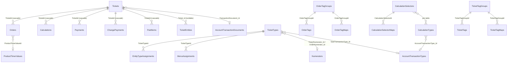
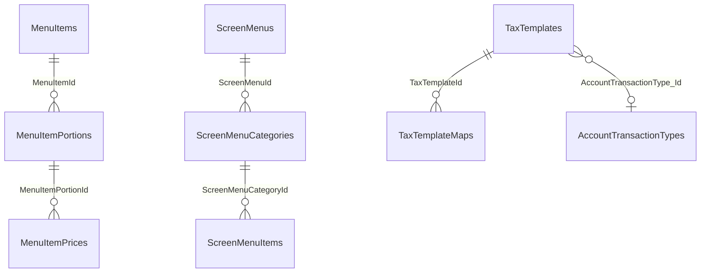
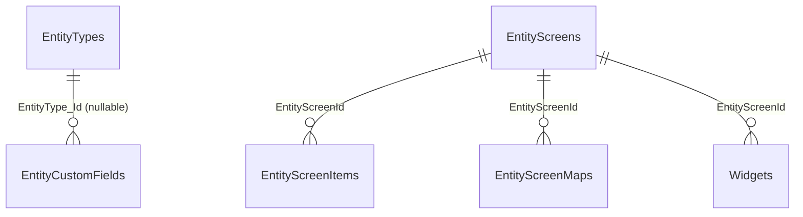
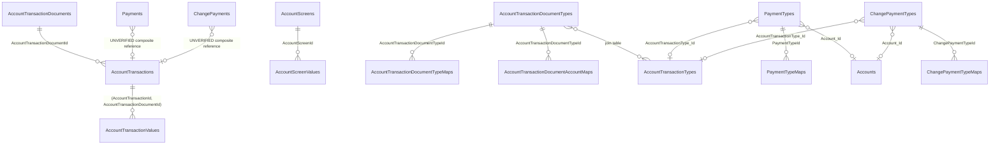
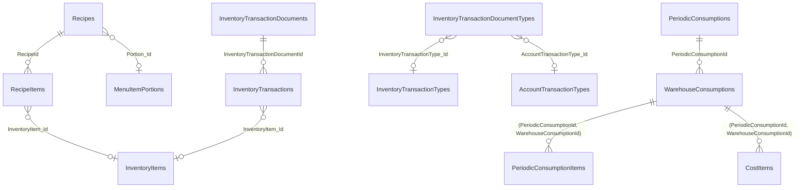
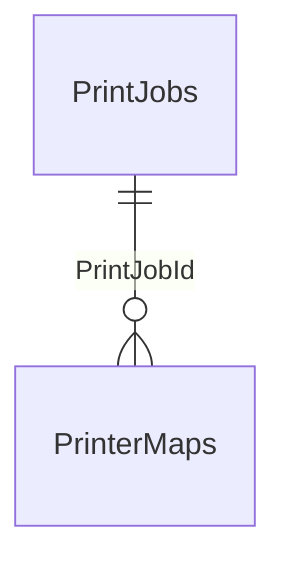
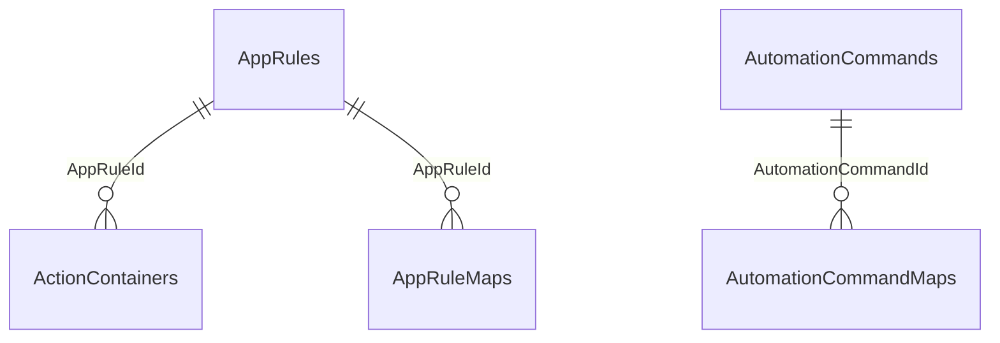
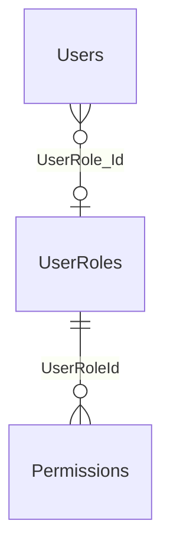
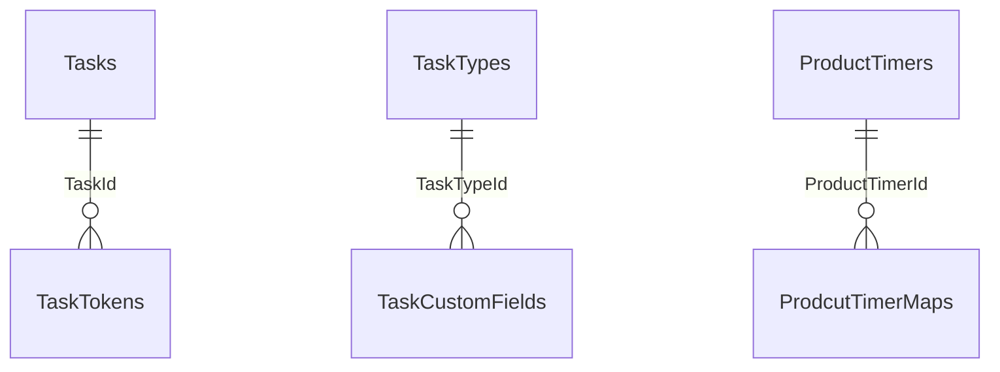

<!--
Database analysis - SambaPOS V3 (legacy)
Date of generation: 2026-11-02
Analyst: Database Analyst agent (Defra LAP reverse-engineering workflow)
Method: static reading of C# source only (no live database, no .sql files, no stored procedures, no triggers exist).
Authoritative inputs are the C# files; the derived aids under src/_reveng/database were used as a reading map and checked against the C#.

Input files processed (all paths relative to D:\cc\SambaPOS-reveng):
- src/_reveng/database/README.md
- src/_reveng/database/ef_model_inventory.json   (aid; column lists reused, then verified against domain classes - see section 1.3 for corrections)
- src/_reveng/database/migrations_inventory.json (aid; every migration file also read directly where it contained code)
- src/_reveng/database/schema_from_ef_model.sql  (aid; relationship list reviewed and corrected - see section 1.3)
- src/Samba.Persistance/Data/DataContext.cs
- src/Samba.Persistance/Data/WorkspaceFactory.cs
- src/Samba.Persistance/Data/Dao.cs
- src/Samba.Persistance/Implementations/AccountDao.cs, AutomationDao.cs, CacheDao.cs, EntityDao.cs, InventoryDao.cs, MenuDao.cs, PriceListDao.cs, PrinterDao.cs, SettingDao.cs, TicketDao.cs, UserDao.cs, WorkPeriodDao.cs
- src/Samba.Persistance/Specification/NonDuplicateSaveValidator.cs
- src/Samba.Infrastructure.Data/IEntityClass.cs, IValueClass.cs, IAbstractMapModel.cs, CollectionIdUpdater.cs
- src/Samba.Infrastructure.Data/SQL/CommonDbContext.cs, EFWorkspace.cs
- src/Samba.Infrastructure/Helpers/JsonHelper.cs
- src/Samba.Infrastructure/Settings/LocalSettings.cs (DbVersion, Decimals only)
- src/Samba.Domain/Models/** - the 93 persisted entity classes were consulted through ef_model_inventory.json (column lists) and, for the 8 non-DbSet entities, directly; the following files were read in full or in part:
  Tickets/Ticket.cs, Order.cs, Calculation.cs, Payment.cs, PaymentType..cs, TicketEntity.cs, TicketType.cs, TicketTagValue.cs, OrderTagValue.cs, OrderStateValue.cs,
  TicketStateValue.cs, TicketLogValue.cs, TaxValue.cs, EntityTypeAssignment.cs, MenuAssignment.cs, TicketTagGroup.cs;
  Accounts/Account.cs, AccountType.cs, AccountScreen.cs, AccountScreenValue.cs, AccountTransaction.cs, AccountTransactionDocument.cs, AccountTransactionType.cs,
  AccountTransactionValue.cs, AccountTransactionDocumentAccountMap.cs; Entities/Entity.cs, EntityStateValue.cs, EntityStateVal.cs, CustomDataValue.cs, EntityScreenMap.cs, Widget.cs;
  Automation/AppRule.cs, ActionContainer.cs, RuleConstraintValue.cs, AppRuleMap.cs; Inventory/PeriodicConsumption.cs, PeriodicConsumptionItem.cs, WarehouseConsumption.cs;
  Settings/Numerator.cs, State.cs, Printer.cs, PrintJob.cs; Users/User.cs, Permission.cs; Menus/TaxTemplateMap.cs; Tasks/Task.cs, TaskToken.cs, TaskCustomField.cs
- src/Samba.Persistance.DBMigration/Migration_001.cs ... Migration_024.cs (Migration_002, 008, 015, 018 read in full; others via inventory)
- src/Samba.Presentation.Services/Common/DataGeneration/DataCreationService.cs
- src/Samba.Presentation.Services/Common/DataGeneration/RuleGenerator.cs
- src/Samba.Services/Common/RuleConstraintMatch.cs
- src/SambaSetup/src/Imports/menu.txt, table.txt, accounttransactiontemplate.txt, accounttransactiondocumenttemplate.txt (seed import files, headers only)
-->

# SambaPOS V3 - Database Analysis

## 1. Overview and Method

### 1.1 What the database is

SambaPOS V3 has **no hand-written SQL schema, no stored procedures, no views and no triggers**. The mandatory "stored procedure", "view" and "trigger" sections of the standard database analysis therefore have no content; business logic that a SQL system would place there lives in C# (domain classes, `Samba.Services`, `Samba.Persistance` validators) and in *automation rules stored as data* (tables `AppRules`, `AppActions`, `ActionContainers`, `AutomationCommands`).

| Aspect | Finding | Source |
|---|---|---|
| Persistence technology | Entity Framework 4.4 Code First (`DbContext`), FluentMigrator for upgrades | `Samba.Persistance/Data/DataContext.cs`, `WorkspaceFactory.cs` |
| Database engines | SQL Server Compact 4.0 (`.sdf`) when the connection string ends `.sdf` or CE is installed and no connection string is set; SQL Server otherwise (adds `MultipleActiveResultSets=True`; `Integrated Security=True` if no user id); a flat text-file workspace (`.txt`) as demo/fallback | `WorkspaceFactory.UpdateConnection` |
| Schema version | 24 (`LocalSettings.DefaultDbVersion`; `DbVersion` may be overridden by a version file) | `Samba.Infrastructure/Settings/LocalSettings.cs` |
| Tables | 85 `DbSet` tables + 8 tables reached only through navigation properties + 2 EF-generated many-to-many join tables + `VersionInfo` = **96 physical tables** | section 3 |
| Stored procedures / views / triggers / functions | none | searched the whole `src/` tree: the only `.sql` file is the derived aid `schema_from_ef_model.sql`; `CommandText`, `StoredProcedure`, `SqlCommand`, `SqlQuery` and `ExecuteSqlCommand` do not occur in any `.cs`/`.vb` file; `ExecuteStoreCommand/Query` occurs only in `WorkspaceFactory.cs`; migrations use FluentMigrator `Execute.Sql` |
| Inline SQL in application code | Only: `select top(1) Version from VersionInfo`, `CREATE TABLE VersionInfo`, two `CREATE INDEX`, `Insert into VersionInfo`, `Alter Table PaymentTypeMaps drop column ...` (all in `WorkspaceFactory.cs`) and `Execute.Sql` statements inside migrations (section 12) | `WorkspaceFactory.cs`, `Migration_*.cs` |
| Data access | EF workspaces (`EFWorkspace`, `ReadOnlyEFWorkspace`), static `Dao` helper with an in-process cache, `TextFileWorkspace` for `.txt` | `Samba.Infrastructure.Data/SQL/*`, `Samba.Persistance/Data/Dao.cs` |

### 1.2 Terminology

The code and database use **Entity / EntityType / EntityScreen** (tables `Entities`, `EntityTypes`, `EntityScreens`, ...). Early V3 screenshots and printer-template tags use the older word "Resource". The single remaining trace in the schema is the DbSet `TaskResources` whose table is `TaskTokens`. This document uses "Entity" throughout.

### 1.3 Corrections to the derived aids (C# is authoritative)

The generated aids in `src/_reveng/database` are a useful map but were found to be wrong or misleading in these respects. A re-implementation team should not rely on them for these points.

| # | Aid statement | What the C# shows |
|---|---|---|
| 1 | `ef_model_inventory.json` gives `default_table_name` equal to the DbSet name (for example `Productimers`, `Rules`, `RuleActions`, `TaskResources`, `CalculationTypeMaps`, `ProgramSettings`, `InventoryTransactionsDocuments`) | EF Code First names tables after the **entity class** (pluralised), not the DbSet. Tables are therefore `ProductTimers`, `AppRules`, `AppActions`, `TaskTokens`, `CalculationSelectorMaps`, `ProgramSettingValues`, `InventoryTransactionDocuments`. Evidence: migrations and README address `ProductTimers` (Migration_006), `AppRules`/`AppActions` (Migration_021), `AccountScreenValues`, `EntityTypeAssignments`. |
| 2 | `schema_from_ef_model.sql` lists every `*Id` property as a foreign key ("explicit FK property") | A scalar `FooId` property creates **no FK constraint** unless a navigation property exists. Evidence: Migration_008 removes the FK `Terminal_ReportPrinter` and re-creates it as a plain `ReportPrinterId int` column; the delete validators (section 9.2) exist precisely because the database does not enforce these links. Only the relationships listed in section 5.1 are enforced by the database. |
| 3 | 85 tables | 8 further entities are persisted through navigation properties without a DbSet: `AccountScreenValues`, `EntityTypeAssignments`, `MenuAssignments`, `TaskCustomFields`, `TaxTemplateMaps`, `AppRuleMaps`, `EntityScreenMaps`, `AccountTransactionDocumentAccountMaps`; plus two join tables from `HasMany().WithMany()` (section 3.10). |
| 4 | `Payments.AccountTransactionId -> AccountTransactions(Id)` as FK | `AccountTransactions` has a composite key (`Id`, `AccountTransactionDocumentId`); a single-column FK to it is impossible. See risk R-04 (section 14). |
| 5 | JSON columns: 11 | At least 15 text columns carry serialised data: add `TicketEntities.EntityCustomData`, `EntityStateValues.EntityStates`, `Widgets.Properties`, `Printers.CustomPrinterData` (section 7). |
| 6 | `ef_model_inventory.json` FK candidates such as `ReportPrinter`, `SourceWarehouseType`, `Portion` | Name-derived guesses; the targets used in this document were resolved manually (for example `Terminals.ReportPrinterId` -> `Printers`). |

### 1.4 Conventions used in the catalogue (section 3)

- **Type:** SQL type implied by the EF configuration. Strings are `nvarchar`. Where `Max length` says `default*`, no length is configured, so EF defaults apply (`nvarchar(max)` on SQL Server; `nvarchar(4000)` on SQL Server Compact). `MAX (explicit)` means `IsMaxLength()` in `DataContext.OnModelCreating` (`nvarchar(max)`; `ntext` on Compact).
- **Decimals:** `decimal(16,2)` for money and `decimal(16,3)` for quantities where configured in `OnModelCreating`; `decimal(18,2)` is the EF 4.x default for the few decimals that are not configured (flagged in each table).
- **Nullable:** `string` and `byte[]` are nullable; value types are `NOT NULL` unless declared `int?`/`decimal?`. No `[Required]`, `[MaxLength]` or other data annotations exist in the domain classes (checked in the files read).
- **Key:** every entity has `Id` (from `ValueClass`; `EntityClass` adds `Name`). Single-key tables use an IDENTITY `Id` by convention.
- **DB FK** = constraint expected in the database. **logical ref** = column that points to another table by value only (no constraint).
- Because there is no live database, FK constraint names and shadow-column names (`X_Id`) are EF convention-derived and marked as such.

## 2. Database Platform, Creation and Upgrade Flow

Source: `src/Samba.Persistance/Data/WorkspaceFactory.cs` (class `Initializer : IDatabaseInitializer<DataContext>`), `DataContext.cs`.

1. **Connection selection** (`WorkspaceFactory.UpdateConnection`): empty connection string -> SQL Server Compact file `<DocumentPath>\<AppName>.sdf` if CE 4.0 is installed, otherwise a text file `<AppName>.txt`. `.sdf` -> `SqlCeConnectionFactory`; `.txt` -> `TextFileWorkspace`; anything else -> SQL Server (`SqlConnectionFactory`, MARS enabled).
2. **New database** (`Initializer.InitializeDatabase` -> `Create`): `Database.Create()` builds the whole schema from the EF model (no migrations run); then raw SQL creates `VersionInfo (Version bigint not null)`, the non-clustered index `IX_Tickets_LastPaymentDate` and the unique index `IX_EntityStateValue_EntityId`, and inserts one `VersionInfo` row for each version 1..`LocalSettings.DbVersion` (24). Seed data is inserted afterwards by `DataCreationService.CreateData()` (section 13).
3. **Existing database** (`Migrate`): migrations run **only if the file `<UserPath>\migrate.txt` exists**; the file is deleted afterwards. If the stored version is below 18 and the database is Compact, `ApplyV16Fix` first tries to drop `PaymentTypeMaps.DisplayAtPaymentScreen` and `.DisplayUnderTicket`. FluentMigrator then runs `Samba.Persistance.DbMigration.dll` with provider `sqlserverce` or `sqlserver`.
4. **Version read-back**: `select top(1) Version from VersionInfo order by version desc` -> `LocalSettings.CurrentDbVersion`.
5. **Model-compatibility checking is disabled**: the block that would delete and re-create the database when the model changes is commented out (`#if DEBUG` code in `Initializer`). Schema drift between the EF model and the real database is therefore not detected at start-up.
6. **Provider differences visible in code**: Migration_008 uses different FK/index names for `.sdf` vs SQL Server; Migration_018 skips the `PaymentTypeMaps` column drops on Compact; `EFWorkspace` keeps the connection open for `.sdf`.
7. **Lazy loading / proxies**: `DataContext(bool disableProxy)` turns proxy creation off for read-only contexts (`CreateReadOnly`), so read paths use explicit `Include`s (see `TicketDao.OpenTicket`).
8. **Optimistic concurrency**: only `Numerator.LastUpdateTime` is an EF concurrency token (`timestamp`). Ticket concurrency is handled by application code (`TicketConcurrencyValidator`, section 9.3).

## 3. Table Catalogue by Area

Total persisted entities: 93 classes (85 DbSet tables + 8 without DbSet), 2 join tables, plus `VersionInfo`. Tables are named after the entity class (section 1.3). Columns are in declaration order; `*` after `default` is explained in section 1.4. `Name` is `nvarchar` nullable in every `EntityClass` table.

### 3.1 Tickets and Orders

#### Tickets
- **Entity class:** `Ticket`; **DbSet:** Tickets
- **Purpose:** Header of a sale/bill: totals, status flags, tags/states/logs (JSON), link to the accounting document.
- **Source file:** `src/Samba.Domain/Models/Tickets/Ticket.cs`
- **Primary key:** `Id` int IDENTITY (EF convention).
- **Database foreign keys (derived):** `TransactionDocument_Id` -> AccountTransactionDocuments (reference nav -> shadow FK, nullable)

| Column | Type | Nullable | Max length | Key | Notes |
|---|---|---|---|---|---|
| Id | int | NO |  | PK | IDENTITY |
| Name | nvarchar | YES | default* |  |  |
| LastUpdateTime | datetime | NO |  |  |  |
| TicketNumber | nvarchar | YES | default* |  |  |
| Date | datetime | NO |  |  |  |
| LastOrderDate | datetime | NO |  |  |  |
| LastPaymentDate | datetime | NO |  |  |  |
| IsClosed | bit | NO |  |  |  |
| IsLocked | bit | NO |  |  |  |
| RemainingAmount | decimal(16,2) | NO |  |  |  |
| TotalAmount | decimal(16,2) | NO |  |  |  |
| DepartmentId | int | NO |  |  | logical ref -> Departments (no DB constraint) |
| TicketTypeId | int | NO |  |  | logical ref -> TicketTypes (no DB constraint) |
| Note | nvarchar | YES | MAX (explicit) |  |  |
| LastModifiedUserName | nvarchar | YES | default* |  |  |
| TicketTags | nvarchar | YES | MAX (explicit) |  | JSON |
| TicketStates | nvarchar | YES | MAX (explicit) |  | JSON |
| TicketLogs | nvarchar | YES | MAX (explicit) |  | JSON |
| ExchangeRate | decimal(18,2) (EF default, not configured) | NO |  |  |  |
| TaxIncluded | bit | NO |  |  |  |
| TransactionDocument_Id | int | YES | | | convention-generated FK -> AccountTransactionDocuments (reference nav -> shadow FK, nullable) |

#### TicketEntities
- **Entity class:** `TicketEntity`; **DbSet:** TicketEntities
- **Purpose:** Link from a ticket to an entity (for example a table or customer) with name, account and custom-data snapshot.
- **Source file:** `src/Samba.Domain/Models/Tickets/TicketEntity.cs`
- **Primary key:** `Id` int IDENTITY (EF convention).
- **Database foreign keys (derived):** `Ticket_Id` -> Tickets (shadow FK, nullable)

| Column | Type | Nullable | Max length | Key | Notes |
|---|---|---|---|---|---|
| Id | int | NO |  | PK | IDENTITY |
| EntityTypeId | int | NO |  |  | logical ref -> EntityTypes (no DB constraint) |
| EntityId | int | NO |  |  | logical ref -> Entities (no DB constraint) |
| AccountId | int | NO |  |  | logical ref -> Accounts (no DB constraint) |
| AccountTypeId | int | NO |  |  | logical ref -> AccountTypes (no DB constraint) |
| EntityName | nvarchar | YES | default* |  |  |
| EntityCustomData | nvarchar | YES | MAX (explicit) |  | JSON (snapshot copy of Entity.CustomData) |
| Ticket_Id | int | YES | | | convention-generated FK -> Tickets (shadow FK, nullable) |

#### Orders
- **Entity class:** `Order`; **DbSet:** Orders
- **Purpose:** A line on a ticket (product, portion, price, quantity; tags, states and taxes as JSON).
- **Source file:** `src/Samba.Domain/Models/Tickets/Order.cs`
- **Primary key:** composite (`Id`, `TicketId`); `Id` is IDENTITY (configured in DataContext.OnModelCreating or implied), the other part(s) are the parent key.
- **Database foreign keys (derived):** `TicketId` -> Tickets (1:N collection nav); `ProductTimerValueId` -> ProductTimerValues (reference nav, nullable)

| Column | Type | Nullable | Max length | Key | Notes |
|---|---|---|---|---|---|
| Id | int | NO |  | PK | IDENTITY |
| TicketId | int | NO |  | PK (part) | **DB FK** -> Tickets |
| WarehouseId | int | NO |  |  | logical ref -> Warehouses (no DB constraint) |
| DepartmentId | int | NO |  |  | logical ref -> Departments (no DB constraint) |
| MenuItemId | int | NO |  |  | logical ref -> MenuItems (no DB constraint) |
| MenuItemName | nvarchar | YES | default* |  |  |
| PortionName | nvarchar | YES | default* |  |  |
| Price | decimal(16,2) | NO |  |  |  |
| Quantity | decimal(16,3) | NO |  |  |  |
| PortionCount | int | NO |  |  |  |
| Locked | bit | NO |  |  |  |
| CalculatePrice | bit | NO |  |  |  |
| DecreaseInventory | bit | NO |  |  |  |
| IncreaseInventory | bit | NO |  |  |  |
| OrderNumber | int | NO |  |  |  |
| CreatingUserName | nvarchar | YES | default* |  |  |
| CreatedDateTime | datetime | NO |  |  |  |
| AccountTransactionTypeId | int | NO |  |  | logical ref -> AccountTransactionTypes (no DB constraint) |
| ProductTimerValueId | int | YES |  |  | **DB FK** -> ProductTimerValues |
| PriceTag | nvarchar | YES | default* |  |  |
| Tag | nvarchar | YES | default* |  |  |
| Taxes | nvarchar | YES | MAX (explicit) |  | JSON |
| OrderTags | nvarchar | YES | MAX (explicit) |  | JSON |
| OrderStates | nvarchar | YES | MAX (explicit) |  | JSON |

#### PaidItems
- **Entity class:** `PaidItem`; **DbSet:** PaidItems
- **Purpose:** Quantity of an order line already paid in partial payments.
- **Source file:** `src/Samba.Domain/Models/Tickets/PaidItem.cs`
- **Primary key:** composite (`Id`, `TicketId`); `Id` is IDENTITY (configured in DataContext.OnModelCreating or implied), the other part(s) are the parent key.
- **Database foreign keys (derived):** `TicketId` -> Tickets (1:N collection nav)

| Column | Type | Nullable | Max length | Key | Notes |
|---|---|---|---|---|---|
| Id | int | NO |  | PK | IDENTITY |
| Key | nvarchar | YES | default* |  |  |
| Quantity | decimal(16,3) | NO |  |  |  |
| TicketId | int | NO |  | PK (part) | **DB FK** -> Tickets |

#### Calculations
- **Entity class:** `Calculation`; **DbSet:** Calculations
- **Purpose:** Applied service/discount/rounding calculation on a ticket.
- **Source file:** `src/Samba.Domain/Models/Tickets/Calculation.cs`
- **Primary key:** composite (`Id`, `TicketId`); `Id` is IDENTITY (configured in DataContext.OnModelCreating or implied), the other part(s) are the parent key.
- **Database foreign keys (derived):** `TicketId` -> Tickets (1:N collection nav)

| Column | Type | Nullable | Max length | Key | Notes |
|---|---|---|---|---|---|
| Id | int | NO |  | PK | IDENTITY |
| Name | nvarchar | YES | default* |  |  |
| Order | int | NO |  |  |  |
| CalculationTypeId | int | NO |  |  | logical ref -> CalculationTypes (no DB constraint) |
| TicketId | int | NO |  | PK (part) | **DB FK** -> Tickets |
| AccountTransactionTypeId | int | NO |  |  | logical ref -> AccountTransactionTypes (no DB constraint) |
| CalculationType | int | NO |  |  |  |
| IncludeTax | bit | NO |  |  |  |
| DecreaseAmount | bit | NO |  |  |  |
| UsePlainSum | bit | NO |  |  |  |
| Amount | decimal(16,2) | NO |  |  |  |
| CalculationAmount | decimal(16,2) | NO |  |  |  |

#### CalculationTypes
- **Entity class:** `CalculationType`; **DbSet:** CalculationTypes
- **Purpose:** Definition of a calculation (method, amount, include tax, decrease) linked to a transaction type.
- **Source file:** `src/Samba.Domain/Models/Tickets/CalculationType.cs`
- **Primary key:** `Id` int IDENTITY (EF convention).
- **Database foreign keys (derived):** `AccountTransactionType_Id` -> AccountTransactionTypes (reference nav -> shadow FK, nullable)

| Column | Type | Nullable | Max length | Key | Notes |
|---|---|---|---|---|---|
| Id | int | NO |  | PK | IDENTITY |
| Name | nvarchar | YES | default* |  |  |
| SortOrder | int | NO |  |  |  |
| CalculationMethod | int | NO |  |  |  |
| Amount | decimal(16,2) | NO |  |  |  |
| MaxAmount | decimal(18,2) (EF default, not configured) | NO |  |  |  |
| IncludeTax | bit | NO |  |  |  |
| DecreaseAmount | bit | NO |  |  |  |
| UsePlainSum | bit | NO |  |  |  |
| ToggleCalculation | bit | NO |  |  |  |
| AccountTransactionType_Id | int | YES | | | convention-generated FK -> AccountTransactionTypes (reference nav -> shadow FK, nullable) |

#### CalculationSelectors
- **Entity class:** `CalculationSelector`; **DbSet:** CalculationSelectors
- **Purpose:** Button that offers one or more calculation types to the cashier.
- **Source file:** `src/Samba.Domain/Models/Tickets/CalculationSelector.cs`
- **Primary key:** `Id` int IDENTITY (EF convention).

| Column | Type | Nullable | Max length | Key | Notes |
|---|---|---|---|---|---|
| Id | int | NO |  | PK | IDENTITY |
| Name | nvarchar | YES | default* |  |  |
| ButtonHeader | nvarchar | YES | default* |  |  |
| ButtonColor | nvarchar | YES | default* |  |  |
| FontSize | int | NO |  |  |  |
| SortOrder | int | NO |  |  |  |

#### CalculationSelectorMaps
- **Entity class:** `CalculationSelectorMap`; **DbSet:** CalculationTypeMaps
- **Purpose:** Filter making a calculation selector visible by terminal/department/role/ticket type (DbSet name: CalculationTypeMaps).
- **Source file:** `src/Samba.Domain/Models/Tickets/CalculationSelectorMap.cs`
- **Primary key:** `Id` int IDENTITY (EF convention).
- **Database foreign keys (derived):** `CalculationSelectorId` -> CalculationSelectors (1:N collection nav)

| Column | Type | Nullable | Max length | Key | Notes |
|---|---|---|---|---|---|
| Id | int | NO |  | PK | IDENTITY |
| TerminalId | int | NO |  |  | logical ref -> Terminals (no DB constraint) |
| DepartmentId | int | NO |  |  | logical ref -> Departments (no DB constraint) |
| UserRoleId | int | NO |  |  | logical ref -> UserRoles (no DB constraint) |
| TicketTypeId | int | NO |  |  | logical ref -> TicketTypes (no DB constraint) |
| CalculationSelectorId | int | NO |  |  | **DB FK** -> CalculationSelectors |

#### TicketTypes
- **Entity class:** `TicketType`; **DbSet:** TicketTypes
- **Purpose:** Type of ticket: numerators, sale transaction type, menu, tax-included flag.
- **Source file:** `src/Samba.Domain/Models/Tickets/TicketType.cs`
- **Primary key:** `Id` int IDENTITY (EF convention).
- **Database foreign keys (derived):** `TicketNumerator_Id` -> Numerators (reference nav -> shadow FK, nullable); `OrderNumerator_Id` -> Numerators (reference nav -> shadow FK, nullable); `SaleTransactionType_Id` -> AccountTransactionTypes (reference nav -> shadow FK, nullable)

| Column | Type | Nullable | Max length | Key | Notes |
|---|---|---|---|---|---|
| Id | int | NO |  | PK | IDENTITY |
| Name | nvarchar | YES | default* |  |  |
| ScreenMenuId | int | NO |  |  | logical ref -> ScreenMenus (no DB constraint) |
| TaxIncluded | bit | NO |  |  |  |
| SortOrder | int | NO |  |  |  |
| TicketNumerator_Id | int | YES | | | convention-generated FK -> Numerators (reference nav -> shadow FK, nullable) |
| OrderNumerator_Id | int | YES | | | convention-generated FK -> Numerators (reference nav -> shadow FK, nullable) |
| SaleTransactionType_Id | int | YES | | | convention-generated FK -> AccountTransactionTypes (reference nav -> shadow FK, nullable) |

#### EntityTypeAssignments
- **Entity class:** `EntityTypeAssignment`; **DbSet:** (none - reached via navigation)
- **Purpose:** Assignment of an entity type to a ticket type (ask-before-create, default state, copy to new tickets).
- **Source file:** `src/Samba.Domain/Models/Tickets/EntityTypeAssignment.cs`
- **Primary key:** composite (`Id`, `TicketTypeId`); `Id` is IDENTITY (configured in DataContext.OnModelCreating or implied), the other part(s) are the parent key.
- **Database foreign keys (derived):** `TicketTypeId` -> TicketTypes (1:N collection nav)

| Column | Type | Nullable | Max length | Key | Notes |
|---|---|---|---|---|---|
| Id | int | NO |  | PK | IDENTITY |
| TicketTypeId | int | NO |  | PK (part) | **DB FK** -> TicketTypes |
| EntityTypeId | int | NO |  |  | logical ref -> EntityTypes (no DB constraint) |
| EntityTypeName | nvarchar | YES | default* |  |  |
| AskBeforeCreatingTicket | bit | NO |  |  |  |
| State | nvarchar | YES | default* |  |  |
| CopyToNewTickets | bit | NO |  |  |  |
| SortOrder | int | NO |  |  |  |

#### MenuAssignments
- **Entity class:** `MenuAssignment`; **DbSet:** (none - reached via navigation)
- **Purpose:** Assignment of a screen menu to a ticket type per terminal.
- **Source file:** `src/Samba.Domain/Models/Tickets/MenuAssignment.cs`
- **Primary key:** composite (`Id`, `TicketTypeId`); `Id` is IDENTITY (configured in DataContext.OnModelCreating or implied), the other part(s) are the parent key.
- **Database foreign keys (derived):** `TicketTypeId` -> TicketTypes (1:N collection nav)

| Column | Type | Nullable | Max length | Key | Notes |
|---|---|---|---|---|---|
| Id | int | NO |  | PK | IDENTITY |
| TicketTypeId | int | NO |  | PK (part) | **DB FK** -> TicketTypes |
| TerminalId | int | NO |  |  | logical ref -> Terminals (no DB constraint) |
| MenuId | int | NO |  |  | logical ref -> ScreenMenus (no DB constraint) |
| TerminalName | nvarchar | YES | default* |  |  |
| SortOrder | int | NO |  |  |  |

#### Departments
- **Entity class:** `Department`; **DbSet:** Departments
- **Purpose:** Operating department (price tag, default warehouse, ticket type, menu, ticket creation method).
- **Source file:** `src/Samba.Domain/Models/Tickets/Department.cs`
- **Primary key:** `Id` int IDENTITY (EF convention).

| Column | Type | Nullable | Max length | Key | Notes |
|---|---|---|---|---|---|
| Id | int | NO |  | PK | IDENTITY |
| Name | nvarchar | YES | default* |  |  |
| SortOrder | int | NO |  |  |  |
| PriceTag | nvarchar | YES | default* |  |  |
| WarehouseId | int | NO |  |  | logical ref -> Warehouses (no DB constraint) |
| TicketTypeId | int | NO |  |  | logical ref -> TicketTypes (no DB constraint) |
| ScreenMenuId | int | NO |  |  | logical ref -> ScreenMenus (no DB constraint) |
| TicketCreationMethod | int | NO |  |  |  |

#### TicketTags
- **Entity class:** `TicketTag`; **DbSet:** TicketTags
- **Purpose:** Value of a ticket tag group.
- **Source file:** `src/Samba.Domain/Models/Tickets/TicketTag.cs`
- **Primary key:** `Id` int IDENTITY (EF convention).
- **Database foreign keys (derived):** `TicketTagGroupId` -> TicketTagGroups (1:N collection nav)

| Column | Type | Nullable | Max length | Key | Notes |
|---|---|---|---|---|---|
| Id | int | NO |  | PK | IDENTITY |
| Name | nvarchar | YES | default* |  |  |
| TicketTagGroupId | int | NO |  |  | **DB FK** -> TicketTagGroups |
| SortOrder | int | NO |  |  |  |

#### TicketTagGroups
- **Entity class:** `TicketTagGroup`; **DbSet:** TicketTagGroups
- **Purpose:** Ticket tag definition (free tagging, colours, data type, force value).
- **Source file:** `src/Samba.Domain/Models/Tickets/TicketTagGroup.cs`
- **Primary key:** `Id` int IDENTITY (EF convention).

| Column | Type | Nullable | Max length | Key | Notes |
|---|---|---|---|---|---|
| Id | int | NO |  | PK | IDENTITY |
| Name | nvarchar | YES | default* |  |  |
| SortOrder | int | NO |  |  |  |
| FreeTagging | bit | NO |  |  |  |
| SaveFreeTags | bit | NO |  |  |  |
| ButtonColorWhenTagSelected | nvarchar | YES | default* |  |  |
| ButtonColorWhenNoTagSelected | nvarchar | YES | default* |  |  |
| ForceValue | bit | NO |  |  |  |
| AskBeforeCreatingTicket | bit | NO |  |  |  |
| DataType | int | NO |  |  |  |

#### TicketTagMaps
- **Entity class:** `TicketTagMap`; **DbSet:** TicketTagMaps
- **Purpose:** Filter making a ticket tag group available by terminal/department/role/ticket type.
- **Source file:** `src/Samba.Domain/Models/Tickets/TicketTagMap.cs`
- **Primary key:** `Id` int IDENTITY (EF convention).
- **Database foreign keys (derived):** `TicketTagGroupId` -> TicketTagGroups (1:N collection nav)

| Column | Type | Nullable | Max length | Key | Notes |
|---|---|---|---|---|---|
| Id | int | NO |  | PK | IDENTITY |
| TerminalId | int | NO |  |  | logical ref -> Terminals (no DB constraint) |
| DepartmentId | int | NO |  |  | logical ref -> Departments (no DB constraint) |
| UserRoleId | int | NO |  |  | logical ref -> UserRoles (no DB constraint) |
| TicketTypeId | int | NO |  |  | logical ref -> TicketTypes (no DB constraint) |
| TicketTagGroupId | int | NO |  |  | **DB FK** -> TicketTagGroups |

#### OrderTags
- **Entity class:** `OrderTag`; **DbSet:** OrderTags
- **Purpose:** A selectable tag/modifier value within an order tag group, optionally priced.
- **Source file:** `src/Samba.Domain/Models/Tickets/OrderTag.cs`
- **Primary key:** `Id` int IDENTITY (EF convention).
- **Database foreign keys (derived):** `OrderTagGroupId` -> OrderTagGroups (1:N collection nav)

| Column | Type | Nullable | Max length | Key | Notes |
|---|---|---|---|---|---|
| Id | int | NO |  | PK | IDENTITY |
| Name | nvarchar | YES | default* |  |  |
| SortOrder | int | NO |  |  |  |
| OrderTagGroupId | int | NO |  |  | **DB FK** -> OrderTagGroups |
| Price | decimal(16,2) | NO |  |  |  |
| MenuItemId | int | NO |  |  | logical ref -> MenuItems (no DB constraint) |
| MaxQuantity | int | NO |  |  |  |

#### OrderTagGroups
- **Entity class:** `OrderTagGroup`; **DbSet:** OrderTagGroups
- **Purpose:** Group of order tags with selection limits, colours and free-tagging options.
- **Source file:** `src/Samba.Domain/Models/Tickets/OrderTagGroup.cs`
- **Primary key:** `Id` int IDENTITY (EF convention).

| Column | Type | Nullable | Max length | Key | Notes |
|---|---|---|---|---|---|
| Id | int | NO |  | PK | IDENTITY |
| Name | nvarchar | YES | default* |  |  |
| SortOrder | int | NO |  |  |  |
| ColumnCount | int | NO |  |  |  |
| ButtonHeight | int | NO |  |  |  |
| FontSize | int | NO |  |  |  |
| ButtonColor | nvarchar | YES | default* |  |  |
| MaxSelectedItems | int | NO |  |  |  |
| MinSelectedItems | int | NO |  |  |  |
| AddTagPriceToOrderPrice | bit | NO |  |  |  |
| FreeTagging | bit | NO |  |  |  |
| SaveFreeTags | bit | NO |  |  |  |
| GroupTag | nvarchar | YES | default* |  |  |
| TaxFree | bit | NO |  |  |  |
| Hidden | bit | NO |  |  |  |

#### OrderTagMaps
- **Entity class:** `OrderTagMap`; **DbSet:** OrderTagMaps
- **Purpose:** Filter making an order tag group visible by terminal/department/role/ticket type and menu item group/item.
- **Source file:** `src/Samba.Domain/Models/Tickets/OrderTagMap.cs`
- **Primary key:** `Id` int IDENTITY (EF convention).
- **Database foreign keys (derived):** `OrderTagGroupId` -> OrderTagGroups (1:N collection nav)

| Column | Type | Nullable | Max length | Key | Notes |
|---|---|---|---|---|---|
| Id | int | NO |  | PK | IDENTITY |
| TerminalId | int | NO |  |  | logical ref -> Terminals (no DB constraint) |
| DepartmentId | int | NO |  |  | logical ref -> Departments (no DB constraint) |
| UserRoleId | int | NO |  |  | logical ref -> UserRoles (no DB constraint) |
| TicketTypeId | int | NO |  |  | logical ref -> TicketTypes (no DB constraint) |
| OrderTagGroupId | int | NO |  |  | **DB FK** -> OrderTagGroups |
| MenuItemGroupCode | nvarchar | YES | default* |  |  |
| MenuItemId | int | NO |  |  | logical ref -> MenuItems (no DB constraint) |

### 3.2 Menu and Pricing

#### MenuItems
- **Entity class:** `MenuItem`; **DbSet:** MenuItems
- **Purpose:** Sellable product (name, group code, barcode, tag); parent of portions.
- **Source file:** `src/Samba.Domain/Models/Menus/MenuItem.cs`
- **Primary key:** `Id` int IDENTITY (EF convention).

| Column | Type | Nullable | Max length | Key | Notes |
|---|---|---|---|---|---|
| Id | int | NO |  | PK | IDENTITY |
| Name | nvarchar | YES | default* |  |  |
| GroupCode | nvarchar | YES | default* |  |  |
| Barcode | nvarchar | YES | default* |  |  |
| Tag | nvarchar | YES | default* |  |  |

#### MenuItemPortions
- **Entity class:** `MenuItemPortion`; **DbSet:** MenuItemPortions
- **Purpose:** A size/portion of a menu item with a multiplier; price rows hang off it.
- **Source file:** `src/Samba.Domain/Models/Menus/MenuItemPortion.cs`
- **Primary key:** `Id` int IDENTITY (EF convention).
- **Database foreign keys (derived):** `MenuItemId` -> MenuItems (1:N collection nav)

| Column | Type | Nullable | Max length | Key | Notes |
|---|---|---|---|---|---|
| Id | int | NO |  | PK | IDENTITY |
| Name | nvarchar | YES | default* |  |  |
| MenuItemId | int | NO |  |  | **DB FK** -> MenuItems |
| Multiplier | int | NO |  |  |  |

#### MenuItemPrices
- **Entity class:** `MenuItemPrice`; **DbSet:** MenuItemPrices
- **Purpose:** Price of a portion for a named price tag (price list); composite key.
- **Source file:** `src/Samba.Domain/Models/Menus/MenuItemPrice.cs`
- **Primary key:** composite (`Id`, `MenuItemPortionId`); `Id` is IDENTITY (configured in DataContext.OnModelCreating or implied), the other part(s) are the parent key.
- **Database foreign keys (derived):** `MenuItemPortionId` -> MenuItemPortions (1:N collection nav)

| Column | Type | Nullable | Max length | Key | Notes |
|---|---|---|---|---|---|
| Id | int | NO |  | PK | IDENTITY |
| MenuItemPortionId | int | NO |  | PK (part) | **DB FK** -> MenuItemPortions |
| PriceTag | nvarchar | YES | default* |  |  |
| Price | decimal(16,2) | NO |  |  |  |

#### MenuItemPriceDefinitions
- **Entity class:** `MenuItemPriceDefinition`; **DbSet:** MenuItemPriceDefinitions
- **Purpose:** Defines a named price tag (price list) selectable per department.
- **Source file:** `src/Samba.Domain/Models/Menus/MenuItemPriceDefinitions.cs`
- **Primary key:** `Id` int IDENTITY (EF convention).

| Column | Type | Nullable | Max length | Key | Notes |
|---|---|---|---|---|---|
| Id | int | NO |  | PK | IDENTITY |
| Name | nvarchar | YES | default* |  |  |
| PriceTag | nvarchar | YES | default* |  |  |

#### ScreenMenus
- **Entity class:** `ScreenMenu`; **DbSet:** ScreenMenus
- **Purpose:** A menu layout (set of categories) shown at the point of sale.
- **Source file:** `src/Samba.Domain/Models/Menus/ScreenMenu.cs`
- **Primary key:** `Id` int IDENTITY (EF convention).

| Column | Type | Nullable | Max length | Key | Notes |
|---|---|---|---|---|---|
| Id | int | NO |  | PK | IDENTITY |
| Name | nvarchar | YES | default* |  |  |
| CategoryColumnCount | int | NO |  |  |  |
| CategoryColumnWidthRate | int | NO |  |  |  |

#### ScreenMenuCategories
- **Entity class:** `ScreenMenuCategory`; **DbSet:** ScreenMenuCategories
- **Purpose:** A category button group on a screen menu, with layout and colour settings.
- **Source file:** `src/Samba.Domain/Models/Menus/ScreenMenuCategory.cs`
- **Primary key:** `Id` int IDENTITY (EF convention).
- **Database foreign keys (derived):** `ScreenMenuId` -> ScreenMenus (1:N collection nav)

| Column | Type | Nullable | Max length | Key | Notes |
|---|---|---|---|---|---|
| Id | int | NO |  | PK | IDENTITY |
| Name | nvarchar | YES | default* |  |  |
| SortOrder | int | NO |  |  |  |
| ScreenMenuId | int | NO |  |  | **DB FK** -> ScreenMenus |
| MostUsedItemsCategory | bit | NO |  |  |  |
| ColumnCount | int | NO |  |  |  |
| MenuItemButtonHeight | int | NO |  |  |  |
| MenuItemButtonColor | nvarchar | YES | default* |  |  |
| MenuItemFontSize | float | NO |  |  |  |
| WrapText | bit | NO |  |  |  |
| PageCount | int | NO |  |  |  |
| MainButtonHeight | int | NO |  |  |  |
| MainButtonColor | nvarchar | YES | default* |  |  |
| MainFontSize | float | NO |  |  |  |
| SubButtonHeight | int | NO |  |  |  |
| SubButtonRows | int | NO |  |  |  |
| SubButtonColorDef | nvarchar | YES | MAX (explicit) |  | delimited colour list |
| NumeratorType | int | NO |  |  |  |
| NumeratorValues | nvarchar | YES | default* |  | delimited list |
| AlphaButtonValues | nvarchar | YES | default* |  | delimited list |
| ImagePath | nvarchar | YES | default* |  |  |
| MaxItems | int | NO |  |  |  |

#### ScreenMenuItems
- **Entity class:** `ScreenMenuItem`; **DbSet:** ScreenMenuItems
- **Purpose:** A product button inside a category, with optional preset order tags/states/automation command.
- **Source file:** `src/Samba.Domain/Models/Menus/ScreenMenuItem.cs`
- **Primary key:** `Id` int IDENTITY (EF convention).
- **Database foreign keys (derived):** `ScreenMenuCategoryId` -> ScreenMenuCategories (1:N collection nav)

| Column | Type | Nullable | Max length | Key | Notes |
|---|---|---|---|---|---|
| Id | int | NO |  | PK | IDENTITY |
| Name | nvarchar | YES | default* |  |  |
| ScreenMenuCategoryId | int | NO |  |  | **DB FK** -> ScreenMenuCategories |
| MenuItemId | int | NO |  |  | logical ref -> MenuItems (no DB constraint) |
| SortOrder | int | NO |  |  |  |
| AutoSelect | bit | NO |  |  |  |
| ButtonColor | nvarchar | YES | default* |  |  |
| Quantity | int | NO |  |  |  |
| ImagePath | nvarchar | YES | default* |  |  |
| FontSize | float | NO |  |  |  |
| SubMenuTag | nvarchar | YES | default* |  |  |
| ItemPortion | nvarchar | YES | default* |  |  |
| OrderTags | nvarchar | YES | default* |  | delimited tag list |
| OrderStates | nvarchar | YES | default* |  | delimited state list |
| AutomationCommand | nvarchar | YES | default* |  |  |
| AutomationCommandValue | nvarchar | YES | default* |  |  |

#### TaxTemplates
- **Entity class:** `TaxTemplate`; **DbSet:** TaxTemplates
- **Purpose:** Tax definition (rate, rounding) linked to an account transaction type.
- **Source file:** `src/Samba.Domain/Models/Menus/TaxTemplate.cs`
- **Primary key:** `Id` int IDENTITY (EF convention).
- **Database foreign keys (derived):** `AccountTransactionType_Id` -> AccountTransactionTypes (reference nav -> shadow FK, nullable)

| Column | Type | Nullable | Max length | Key | Notes |
|---|---|---|---|---|---|
| Id | int | NO |  | PK | IDENTITY |
| Name | nvarchar | YES | default* |  |  |
| SortOrder | int | NO |  |  |  |
| Rate | decimal(16,2) | NO |  |  |  |
| Rounding | int | NO |  |  |  |
| AccountTransactionType_Id | int | YES | | | convention-generated FK -> AccountTransactionTypes (reference nav -> shadow FK, nullable) |

#### TaxTemplateMaps
- **Entity class:** `TaxTemplateMap`; **DbSet:** (none - reached via navigation)
- **Purpose:** Assignment filter of a tax template to a menu item group or menu item (and terminal/department/role/ticket type).
- **Source file:** `src/Samba.Domain/Models/Menus/TaxTemplateMap.cs`
- **Primary key:** `Id` int IDENTITY (EF convention).
- **Database foreign keys (derived):** `TaxTemplateId` -> TaxTemplates (1:N collection nav)

| Column | Type | Nullable | Max length | Key | Notes |
|---|---|---|---|---|---|
| Id | int | NO |  | PK | IDENTITY |
| TerminalId | int | NO |  |  | logical ref -> Terminals (no DB constraint) |
| DepartmentId | int | NO |  |  | logical ref -> Departments (no DB constraint) |
| UserRoleId | int | NO |  |  | logical ref -> UserRoles (no DB constraint) |
| TicketTypeId | int | NO |  |  | logical ref -> TicketTypes (no DB constraint) |
| TaxTemplateId | int | NO |  |  | **DB FK** -> TaxTemplates |
| MenuItemGroupCode | nvarchar | YES | default* |  |  |
| MenuItemId | int | NO |  |  | logical ref -> MenuItems (no DB constraint) |

### 3.3 Entities

#### Entities
- **Entity class:** `Entity`; **DbSet:** Entities
- **Purpose:** Instance of an entity type (for example a table or customer) with custom data JSON, account and warehouse links.
- **Source file:** `src/Samba.Domain/Models/Entities/Entity.cs`
- **Primary key:** `Id` int IDENTITY (EF convention).

| Column | Type | Nullable | Max length | Key | Notes |
|---|---|---|---|---|---|
| Id | int | NO |  | PK | IDENTITY |
| Name | nvarchar | YES | default* |  |  |
| EntityTypeId | int | NO |  |  | logical ref -> EntityTypes (no DB constraint) |
| LastUpdateTime | datetime | NO |  |  |  |
| SearchString | nvarchar | YES | default* |  |  |
| CustomData | nvarchar | YES | MAX (explicit) |  | JSON |
| AccountId | int | NO |  |  | logical ref -> Accounts (no DB constraint) |
| WarehouseId | int | NO |  |  | logical ref -> Warehouses (no DB constraint) |

#### EntityTypes
- **Entity class:** `EntityType`; **DbSet:** EntityTypes
- **Purpose:** Definition of an entity kind (display names, account type, templates, formats).
- **Source file:** `src/Samba.Domain/Models/Entities/EntityType.cs`
- **Primary key:** `Id` int IDENTITY (EF convention).

| Column | Type | Nullable | Max length | Key | Notes |
|---|---|---|---|---|---|
| Id | int | NO |  | PK | IDENTITY |
| Name | nvarchar | YES | default* |  |  |
| SortOrder | int | NO |  |  |  |
| EntityName | nvarchar | YES | default* |  |  |
| AccountTypeId | int | NO |  |  | logical ref -> AccountTypes (no DB constraint) |
| WarehouseTypeId | int | NO |  |  | logical ref -> WarehouseTypes (no DB constraint) |
| AccountNameTemplate | nvarchar | YES | default* |  |  |
| PrimaryFieldName | nvarchar | YES | default* |  |  |
| PrimaryFieldFormat | nvarchar | YES | default* |  |  |
| DisplayFormat | nvarchar | YES | default* |  |  |
| AccountBalanceDisplayFormat | nvarchar | YES | default* |  |  |

#### EntityCustomFields
- **Entity class:** `EntityCustomField`; **DbSet:** EntityCustomFields
- **Purpose:** Custom field definition belonging to an entity type.
- **Source file:** `src/Samba.Domain/Models/Entities/EntityCustomField.cs`
- **Primary key:** `Id` int IDENTITY (EF convention).
- **Database foreign keys (derived):** `EntityType_Id` -> EntityTypes (shadow FK, nullable)

| Column | Type | Nullable | Max length | Key | Notes |
|---|---|---|---|---|---|
| Id | int | NO |  | PK | IDENTITY |
| Name | nvarchar | YES | default* |  |  |
| FieldType | int | NO |  |  |  |
| EditingFormat | nvarchar | YES | default* |  |  |
| ValueSource | nvarchar | YES | default* |  | delimited value list |
| Hidden | bit | NO |  |  |  |
| EntityType_Id | int | YES | | | convention-generated FK -> EntityTypes (shadow FK, nullable) |

#### EntityScreens
- **Entity class:** `EntityScreen`; **DbSet:** EntityScreens
- **Purpose:** Screen showing entities (grid/search), linked to ticket type and entity type.
- **Source file:** `src/Samba.Domain/Models/Entities/EntityScreen.cs`
- **Primary key:** `Id` int IDENTITY (EF convention).

| Column | Type | Nullable | Max length | Key | Notes |
|---|---|---|---|---|---|
| Id | int | NO |  | PK | IDENTITY |
| Name | nvarchar | YES | default* |  |  |
| TicketTypeId | int | NO |  |  | logical ref -> TicketTypes (no DB constraint) |
| EntityTypeId | int | NO |  |  | logical ref -> EntityTypes (no DB constraint) |
| SortOrder | int | NO |  |  |  |
| DisplayMode | int | NO |  |  |  |
| BackgroundColor | nvarchar | YES | default* |  |  |
| BackgroundImage | nvarchar | YES | default* |  |  |
| FontSize | int | NO |  |  |  |
| PageCount | int | NO |  |  |  |
| RowCount | int | NO |  |  |  |
| ColumnCount | int | NO |  |  |  |
| ButtonHeight | int | NO |  |  |  |
| DisplayState | nvarchar | YES | default* |  |  |
| StateFilter | nvarchar | YES | default* |  |  |
| AskTicketType | bit | NO |  |  |  |
| SearchValueReplacePattern | nvarchar | YES | default* |  |  |

#### EntityScreenItems
- **Entity class:** `EntityScreenItem`; **DbSet:** EntityScreenItems
- **Purpose:** Entity placed on an entity screen with state and order.
- **Source file:** `src/Samba.Domain/Models/Entities/EntityScreenItem.cs`
- **Primary key:** composite (`Id`, `EntityScreenId`); `Id` is IDENTITY (configured in DataContext.OnModelCreating or implied), the other part(s) are the parent key.
- **Database foreign keys (derived):** `EntityScreenId` -> EntityScreens (1:N collection nav)

| Column | Type | Nullable | Max length | Key | Notes |
|---|---|---|---|---|---|
| Id | int | NO |  | PK | IDENTITY |
| Name | nvarchar | YES | default* |  |  |
| EntityScreenId | int | NO |  | PK (part) | **DB FK** -> EntityScreens |
| EntityId | int | NO |  |  | logical ref -> Entities (no DB constraint) |
| EntityState | nvarchar | YES | default* |  |  |
| SortOrder | int | NO |  |  |  |
| LastUpdateTime | datetime | NO |  |  |  |

#### EntityScreenMaps
- **Entity class:** `EntityScreenMap`; **DbSet:** (none - reached via navigation)
- **Purpose:** Filter making an entity screen available by terminal/department/role/ticket type.
- **Source file:** `src/Samba.Domain/Models/Entities/EntityScreenMap.cs`
- **Primary key:** `Id` int IDENTITY (EF convention).
- **Database foreign keys (derived):** `EntityScreenId` -> EntityScreens (1:N collection nav)

| Column | Type | Nullable | Max length | Key | Notes |
|---|---|---|---|---|---|
| Id | int | NO |  | PK | IDENTITY |
| TerminalId | int | NO |  |  | logical ref -> Terminals (no DB constraint) |
| DepartmentId | int | NO |  |  | logical ref -> Departments (no DB constraint) |
| UserRoleId | int | NO |  |  | logical ref -> UserRoles (no DB constraint) |
| TicketTypeId | int | NO |  |  | logical ref -> TicketTypes (no DB constraint) |
| EntityScreenId | int | NO |  |  | **DB FK** -> EntityScreens |

#### EntityStateValues
- **Entity class:** `EntityStateValue`; **DbSet:** EntityStateValues
- **Purpose:** Current state set of an entity (JSON); at most one row per entity (unique index).
- **Source file:** `src/Samba.Domain/Models/Entities/EntityStateValue.cs`
- **Primary key:** `Id` int IDENTITY (EF convention).

| Column | Type | Nullable | Max length | Key | Notes |
|---|---|---|---|---|---|
| Id | int | NO |  | PK | IDENTITY |
| EntityId | int | NO |  |  | logical ref -> Entities (no DB constraint) |
| EntityStates | nvarchar | YES | default* |  | JSON |

#### Widgets
- **Entity class:** `Widget`; **DbSet:** Widgets
- **Purpose:** Positioned widget on an entity screen with JSON settings.
- **Source file:** `src/Samba.Domain/Models/Entities/Widget.cs`
- **Primary key:** `Id` int IDENTITY (EF convention).
- **Database foreign keys (derived):** `EntityScreenId` -> EntityScreens (1:N collection nav)

| Column | Type | Nullable | Max length | Key | Notes |
|---|---|---|---|---|---|
| Id | int | NO |  | PK | IDENTITY |
| Name | nvarchar | YES | default* |  |  |
| EntityScreenId | int | NO |  |  | **DB FK** -> EntityScreens |
| XLocation | int | NO |  |  |  |
| YLocation | int | NO |  |  |  |
| Height | int | NO |  |  |  |
| Width | int | NO |  |  |  |
| CornerRadius | int | NO |  |  |  |
| Angle | float | NO |  |  |  |
| Scale | float | NO |  |  |  |
| Properties | nvarchar | YES | default* |  | JSON (widget settings, no explicit max length) |
| CreatorName | nvarchar | YES | default* |  |  |
| AutoRefresh | bit | NO |  |  |  |
| AutoRefreshInterval | int | NO |  |  |  |

#### States
- **Entity class:** `State`; **DbSet:** States
- **Purpose:** Named state value (entity/ticket/order) with colour and report/ticket display flags.
- **Source file:** `src/Samba.Domain/Models/Settings/State.cs`
- **Primary key:** `Id` int IDENTITY (EF convention).

| Column | Type | Nullable | Max length | Key | Notes |
|---|---|---|---|---|---|
| Id | int | NO |  | PK | IDENTITY |
| Name | nvarchar | YES | default* |  |  |
| GroupName | nvarchar | YES | default* |  |  |
| StateType | int | NO |  |  |  |
| Color | nvarchar | YES | default* |  |  |
| ShowOnEndOfDayReport | bit | NO |  |  |  |
| ShowOnProductReport | bit | NO |  |  |  |
| ShowOnTicket | bit | NO |  |  |  |

### 3.4 Accounts and Payments

#### Accounts
- **Entity class:** `Account`; **DbSet:** Accounts
- **Purpose:** Ledger account (for example Sales, Cash, a customer account) of an account type and optional currency.
- **Source file:** `src/Samba.Domain/Models/Accounts/Account.cs`
- **Primary key:** `Id` int IDENTITY (EF convention).

| Column | Type | Nullable | Max length | Key | Notes |
|---|---|---|---|---|---|
| Id | int | NO |  | PK | IDENTITY |
| Name | nvarchar | YES | default* |  |  |
| AccountTypeId | int | NO |  |  | logical ref -> AccountTypes (no DB constraint) |
| ForeignCurrencyId | int | NO |  |  | logical ref -> ForeignCurrencies (no DB constraint) |

#### AccountTypes
- **Entity class:** `AccountType`; **DbSet:** AccountTypes
- **Purpose:** Class of account with a working rule (debit/credit permissions) and tags.
- **Source file:** `src/Samba.Domain/Models/Accounts/AccountType.cs`
- **Primary key:** `Id` int IDENTITY (EF convention).

| Column | Type | Nullable | Max length | Key | Notes |
|---|---|---|---|---|---|
| Id | int | NO |  | PK | IDENTITY |
| Name | nvarchar | YES | default* |  |  |
| DefaultFilterType | int | NO |  |  |  |
| WorkingRule | int | NO |  |  |  |
| SortOrder | int | NO |  |  |  |
| Tags | nvarchar | YES | default* |  | delimited tag list |

#### AccountScreens
- **Entity class:** `AccountScreen`; **DbSet:** AccountScreens
- **Purpose:** Configurable account overview screen (filter, tree display, command map JSON).
- **Source file:** `src/Samba.Domain/Models/Accounts/AccountScreen.cs`
- **Primary key:** `Id` int IDENTITY (EF convention).

| Column | Type | Nullable | Max length | Key | Notes |
|---|---|---|---|---|---|
| Id | int | NO |  | PK | IDENTITY |
| Name | nvarchar | YES | default* |  |  |
| Filter | int | NO |  |  |  |
| DisplayAsTree | bit | NO |  |  |  |
| SortOrder | int | NO |  |  |  |
| AutomationCommandMapData | nvarchar | YES | MAX (explicit) |  | JSON |

#### AccountScreenValues
- **Entity class:** `AccountScreenValue`; **DbSet:** (none - reached via navigation)
- **Purpose:** Account type shown on an account screen, with display options.
- **Source file:** `src/Samba.Domain/Models/Accounts/AccountScreenValue.cs`
- **Primary key:** composite (`Id`, `AccountScreenId`); `Id` is IDENTITY (configured in DataContext.OnModelCreating or implied), the other part(s) are the parent key.
- **Database foreign keys (derived):** `AccountScreenId` -> AccountScreens (1:N collection nav)

| Column | Type | Nullable | Max length | Key | Notes |
|---|---|---|---|---|---|
| Id | int | NO |  | PK | IDENTITY |
| AccountScreenId | int | NO |  | PK (part) | **DB FK** -> AccountScreens |
| AccountTypeId | int | NO |  |  | logical ref -> AccountTypes (no DB constraint) |
| AccountTypeName | nvarchar | YES | default* |  |  |
| DisplayDetails | bit | NO |  |  |  |
| HideZeroBalanceAccounts | bit | NO |  |  |  |
| SortOrder | int | NO |  |  |  |

#### AccountTransactions
- **Entity class:** `AccountTransaction`; **DbSet:** AccountTransactions
- **Purpose:** One double-entry transaction (source/target account types, amount, rate, reversal flags).
- **Source file:** `src/Samba.Domain/Models/Accounts/AccountTransaction.cs`
- **Primary key:** composite (`Id`, `AccountTransactionDocumentId`); `Id` is IDENTITY (configured in DataContext.OnModelCreating or implied), the other part(s) are the parent key.
- **Database foreign keys (derived):** `AccountTransactionDocumentId` -> AccountTransactionDocuments (1:N collection nav)

| Column | Type | Nullable | Max length | Key | Notes |
|---|---|---|---|---|---|
| Id | int | NO |  | PK | IDENTITY |
| Name | nvarchar | YES | default* |  |  |
| Amount | decimal(16,2) | NO |  |  |  |
| ExchangeRate | decimal(16,2) | NO |  |  |  |
| AccountTransactionDocumentId | int | NO |  | PK (part) | **DB FK** -> AccountTransactionDocuments |
| AccountTransactionTypeId | int | NO |  |  | logical ref -> AccountTransactionTypes (no DB constraint) |
| SourceAccountTypeId | int | NO |  |  | logical ref -> AccountTypes (no DB constraint) |
| TargetAccountTypeId | int | NO |  |  | logical ref -> AccountTypes (no DB constraint) |
| IsReversed | bit | NO |  |  |  |
| Reversable | bit | NO |  |  |  |

#### AccountTransactionValues
- **Entity class:** `AccountTransactionValue`; **DbSet:** AccountTransactionValues
- **Purpose:** Debit/credit line of a transaction against an account.
- **Source file:** `src/Samba.Domain/Models/Accounts/AccountTransactionValue.cs`
- **Primary key:** composite (`Id`, `AccountTransactionId`, `AccountTransactionDocumentId`); `Id` is IDENTITY (configured in DataContext.OnModelCreating or implied), the other part(s) are the parent key.
- **Database foreign keys (derived):** `AccountTransactionId + AccountTransactionDocumentId` -> AccountTransactions (composite FK)

| Column | Type | Nullable | Max length | Key | Notes |
|---|---|---|---|---|---|
| Id | int | NO |  | PK | IDENTITY |
| Name | nvarchar | YES | default* |  |  |
| AccountTypeId | int | NO |  |  | logical ref -> AccountTypes (no DB constraint) |
| AccountId | int | NO |  |  | logical ref -> Accounts (no DB constraint) |
| Date | datetime | NO |  |  |  |
| Debit | decimal(16,2) | NO |  |  |  |
| Credit | decimal(16,2) | NO |  |  |  |
| Exchange | decimal(16,2) | NO |  |  |  |
| AccountTransactionId | int | NO |  | PK (part) | **DB FK** (composite) -> AccountTransactions |
| AccountTransactionDocumentId | int | NO |  | PK (part) | **DB FK** (composite) -> AccountTransactions |

#### AccountTransactionTypes
- **Entity class:** `AccountTransactionType`; **DbSet:** AccountTransactionTypes
- **Purpose:** Template for a transaction: source/target account types and default accounts, currency.
- **Source file:** `src/Samba.Domain/Models/Accounts/AccountTransactionType.cs`
- **Primary key:** `Id` int IDENTITY (EF convention).

| Column | Type | Nullable | Max length | Key | Notes |
|---|---|---|---|---|---|
| Id | int | NO |  | PK | IDENTITY |
| Name | nvarchar | YES | default* |  |  |
| SortOrder | int | NO |  |  |  |
| SourceAccountTypeId | int | NO |  |  | logical ref -> AccountTypes (no DB constraint) |
| TargetAccountTypeId | int | NO |  |  | logical ref -> AccountTypes (no DB constraint) |
| DefaultSourceAccountId | int | NO |  |  | logical ref -> Accounts (no DB constraint) |
| DefaultTargetAccountId | int | NO |  |  | logical ref -> Accounts (no DB constraint) |
| ForeignCurrencyId | int | NO |  |  | logical ref -> ForeignCurrencies (no DB constraint) |

#### AccountTransactionDocuments
- **Entity class:** `AccountTransactionDocument`; **DbSet:** AccountTransactionDocuments
- **Purpose:** Accounting document grouping transactions (one per ticket, or manual document).
- **Source file:** `src/Samba.Domain/Models/Accounts/AccountTransactionDocument.cs`
- **Primary key:** `Id` int IDENTITY (EF convention).

| Column | Type | Nullable | Max length | Key | Notes |
|---|---|---|---|---|---|
| Id | int | NO |  | PK | IDENTITY |
| Name | nvarchar | YES | default* |  |  |
| Date | datetime | NO |  |  |  |
| DocumentTypeId | int | NO |  |  | logical ref -> AccountTransactionDocumentTypes (no DB constraint) |

#### AccountTransactionDocumentTypes
- **Entity class:** `AccountTransactionDocumentType`; **DbSet:** AccountTransactionDocumentTypes
- **Purpose:** Template of a manual accounting document (button, default amount/description, printer template).
- **Source file:** `src/Samba.Domain/Models/Accounts/AccountTransactionDocumentType.cs`
- **Primary key:** `Id` int IDENTITY (EF convention).

| Column | Type | Nullable | Max length | Key | Notes |
|---|---|---|---|---|---|
| Id | int | NO |  | PK | IDENTITY |
| Name | nvarchar | YES | default* |  |  |
| ButtonHeader | nvarchar | YES | default* |  |  |
| ButtonColor | nvarchar | YES | default* |  |  |
| MasterAccountTypeId | int | NO |  |  | logical ref -> AccountTypes (no DB constraint) |
| DefaultAmount | nvarchar | YES | default* |  |  |
| DescriptionTemplate | nvarchar | YES | default* |  |  |
| ExchangeTemplate | nvarchar | YES | default* |  |  |
| BatchCreateDocuments | bit | NO |  |  |  |
| Filter | int | NO |  |  |  |
| SortOrder | int | NO |  |  |  |
| PrinterTemplateId | int | NO |  |  | logical ref -> PrinterTemplates (no DB constraint) |

#### AccountTransactionDocumentTypeMaps
- **Entity class:** `AccountTransactionDocumentTypeMap`; **DbSet:** AccountTransactionDocumentTypeMaps
- **Purpose:** Filter making a document type available by terminal/department/role/ticket type.
- **Source file:** `src/Samba.Domain/Models/Accounts/AccountTransactionDocumentTypeMap.cs`
- **Primary key:** `Id` int IDENTITY (EF convention).
- **Database foreign keys (derived):** `AccountTransactionDocumentTypeId` -> AccountTransactionDocumentTypes (1:N collection nav)

| Column | Type | Nullable | Max length | Key | Notes |
|---|---|---|---|---|---|
| Id | int | NO |  | PK | IDENTITY |
| TerminalId | int | NO |  |  | logical ref -> Terminals (no DB constraint) |
| DepartmentId | int | NO |  |  | logical ref -> Departments (no DB constraint) |
| UserRoleId | int | NO |  |  | logical ref -> UserRoles (no DB constraint) |
| TicketTypeId | int | NO |  |  | logical ref -> TicketTypes (no DB constraint) |
| AccountTransactionDocumentTypeId | int | NO |  |  | **DB FK** -> AccountTransactionDocumentTypes |

#### AccountTransactionDocumentAccountMaps
- **Entity class:** `AccountTransactionDocumentAccountMap`; **DbSet:** (none - reached via navigation)
- **Purpose:** Maps an account to another account for a document type (no Name column).
- **Source file:** `src/Samba.Domain/Models/Accounts/AccountTransactionDocumentAccountMap.cs`
- **Primary key:** `Id` int IDENTITY (EF convention).
- **Database foreign keys (derived):** `AccountTransactionDocumentTypeId` -> AccountTransactionDocumentTypes (1:N collection nav)

| Column | Type | Nullable | Max length | Key | Notes |
|---|---|---|---|---|---|
| Id | int | NO |  | PK | IDENTITY |
| AccountTransactionDocumentTypeId | int | NO |  |  | **DB FK** -> AccountTransactionDocumentTypes |
| AccountId | int | NO |  |  | logical ref -> Accounts (no DB constraint) |
| AccountName | nvarchar | YES | default* |  |  |
| MappedAccountId | int | NO |  |  | logical ref -> Accounts (no DB constraint) |
| MappedAccountName | nvarchar | YES | default* |  |  |

#### ForeignCurrencies
- **Entity class:** `ForeignCurrency`; **DbSet:** ForeignCurrencies
- **Purpose:** Foreign currency with symbol, exchange rate and rounding.
- **Source file:** `src/Samba.Domain/Models/Settings/ForeignCurrency.cs`
- **Primary key:** `Id` int IDENTITY (EF convention).

| Column | Type | Nullable | Max length | Key | Notes |
|---|---|---|---|---|---|
| Id | int | NO |  | PK | IDENTITY |
| Name | nvarchar | YES | default* |  |  |
| CurrencySymbol | nvarchar | YES | default* |  |  |
| ExchangeRate | decimal(18,2) (EF default, not configured) | NO |  |  |  |
| Rounding | decimal(18,2) (EF default, not configured) | NO |  |  |  |

#### PaymentTypes
- **Entity class:** `PaymentType`; **DbSet:** PaymentTypes
- **Purpose:** Payment method (cash, card, voucher, customer account) linked to a transaction type and account.
- **Source file:** `src/Samba.Domain/Models/Tickets/PaymentType..cs`
- **Primary key:** `Id` int IDENTITY (EF convention).
- **Database foreign keys (derived):** `AccountTransactionType_Id` -> AccountTransactionTypes (reference nav -> shadow FK, nullable); `Account_Id` -> Accounts (reference nav -> shadow FK, nullable)

| Column | Type | Nullable | Max length | Key | Notes |
|---|---|---|---|---|---|
| Id | int | NO |  | PK | IDENTITY |
| Name | nvarchar | YES | default* |  |  |
| SortOrder | int | NO |  |  |  |
| ButtonColor | nvarchar | YES | default* |  |  |
| FontSize | int | NO |  |  |  |
| AccountTransactionType_Id | int | YES | | | convention-generated FK -> AccountTransactionTypes (reference nav -> shadow FK, nullable) |
| Account_Id | int | YES | | | convention-generated FK -> Accounts (reference nav -> shadow FK, nullable) |

#### PaymentTypeMaps
- **Entity class:** `PaymentTypeMap`; **DbSet:** PaymentTypeMaps
- **Purpose:** Filter making a payment type available by terminal/department/role/ticket type.
- **Source file:** `src/Samba.Domain/Models/Tickets/PaymentTypeMap.cs`
- **Primary key:** `Id` int IDENTITY (EF convention).
- **Database foreign keys (derived):** `PaymentTypeId` -> PaymentTypes (1:N collection nav)

| Column | Type | Nullable | Max length | Key | Notes |
|---|---|---|---|---|---|
| Id | int | NO |  | PK | IDENTITY |
| TerminalId | int | NO |  |  | logical ref -> Terminals (no DB constraint) |
| DepartmentId | int | NO |  |  | logical ref -> Departments (no DB constraint) |
| UserRoleId | int | NO |  |  | logical ref -> UserRoles (no DB constraint) |
| TicketTypeId | int | NO |  |  | logical ref -> TicketTypes (no DB constraint) |
| PaymentTypeId | int | NO |  |  | **DB FK** -> PaymentTypes |

#### Payments
- **Entity class:** `Payment`; **DbSet:** Payments
- **Purpose:** Payment recorded against a ticket with its accounting transaction.
- **Source file:** `src/Samba.Domain/Models/Tickets/Payment.cs`
- **Primary key:** composite (`Id`, `TicketId`); `Id` is IDENTITY (configured in DataContext.OnModelCreating or implied), the other part(s) are the parent key.
- **Database foreign keys (derived):** `TicketId` -> Tickets (1:N collection nav); `AccountTransaction_Id + AccountTransaction_AccountTransactionDocumentId` -> AccountTransactions (reference nav to a composite-key entity; shadow columns expected by EF convention - UNVERIFIED without a live database)

| Column | Type | Nullable | Max length | Key | Notes |
|---|---|---|---|---|---|
| Id | int | NO |  | PK | IDENTITY |
| PaymentTypeId | int | NO |  |  | logical ref -> PaymentTypes (no DB constraint) |
| TicketId | int | NO |  | PK (part) | **DB FK** -> Tickets |
| Name | nvarchar | YES | default* |  |  |
| Date | datetime | NO |  |  |  |
| AccountTransactionId | int | NO |  |  | plain int; logical ref -> AccountTransactions (the Id half only; whether it is the DB FK is UNVERIFIED) |
| Amount | decimal(16,2) | NO |  |  |  |
| UserId | int | NO |  |  | logical ref -> Users (no DB constraint) |
| AccountTransaction_Id + AccountTransaction_AccountTransactionDocumentId | int | YES | | | convention-generated FK -> AccountTransactions (reference nav to a composite-key entity; shadow columns expected by EF convention - UNVERIFIED without a live database) |

#### ChangePayments
- **Entity class:** `ChangePayment`; **DbSet:** ChangePayments
- **Purpose:** Change given back on a ticket with its accounting transaction.
- **Source file:** `src/Samba.Domain/Models/Tickets/ChangePayment.cs`
- **Primary key:** composite (`Id`, `TicketId`); `Id` is IDENTITY (configured in DataContext.OnModelCreating or implied), the other part(s) are the parent key.
- **Database foreign keys (derived):** `TicketId` -> Tickets (1:N collection nav); `AccountTransaction_Id + AccountTransaction_AccountTransactionDocumentId` -> AccountTransactions (reference nav to a composite-key entity; shadow columns expected by EF convention - UNVERIFIED without a live database)

| Column | Type | Nullable | Max length | Key | Notes |
|---|---|---|---|---|---|
| Id | int | NO |  | PK | IDENTITY |
| ChangePaymentTypeId | int | NO |  |  | logical ref -> ChangePaymentTypes (no DB constraint) |
| TicketId | int | NO |  | PK (part) | **DB FK** -> Tickets |
| Name | nvarchar | YES | default* |  |  |
| Date | datetime | NO |  |  |  |
| AccountTransactionId | int | NO |  |  | plain int; logical ref -> AccountTransactions (the Id half only; whether it is the DB FK is UNVERIFIED) |
| Amount | decimal(18,2) (EF default, not configured) | NO |  |  |  |
| UserId | int | NO |  |  | logical ref -> Users (no DB constraint) |
| AccountTransaction_Id + AccountTransaction_AccountTransactionDocumentId | int | YES | | | convention-generated FK -> AccountTransactions (reference nav to a composite-key entity; shadow columns expected by EF convention - UNVERIFIED without a live database) |

#### ChangePaymentTypes
- **Entity class:** `ChangePaymentType`; **DbSet:** ChangePaymentTypes
- **Purpose:** Change/refund method linked to a transaction type and account.
- **Source file:** `src/Samba.Domain/Models/Tickets/ChangePaymentType.cs`
- **Primary key:** `Id` int IDENTITY (EF convention).
- **Database foreign keys (derived):** `AccountTransactionType_Id` -> AccountTransactionTypes (reference nav -> shadow FK, nullable); `Account_Id` -> Accounts (reference nav -> shadow FK, nullable)

| Column | Type | Nullable | Max length | Key | Notes |
|---|---|---|---|---|---|
| Id | int | NO |  | PK | IDENTITY |
| Name | nvarchar | YES | default* |  |  |
| SortOrder | int | NO |  |  |  |
| AccountTransactionType_Id | int | YES | | | convention-generated FK -> AccountTransactionTypes (reference nav -> shadow FK, nullable) |
| Account_Id | int | YES | | | convention-generated FK -> Accounts (reference nav -> shadow FK, nullable) |

#### ChangePaymentTypeMaps
- **Entity class:** `ChangePaymentTypeMap`; **DbSet:** ChangePaymentTypeMaps
- **Purpose:** Filter making a change payment type available by terminal/department/role/ticket type.
- **Source file:** `src/Samba.Domain/Models/Tickets/ChangePaymentTypeMap.cs`
- **Primary key:** `Id` int IDENTITY (EF convention).
- **Database foreign keys (derived):** `ChangePaymentTypeId` -> ChangePaymentTypes (1:N collection nav)

| Column | Type | Nullable | Max length | Key | Notes |
|---|---|---|---|---|---|
| Id | int | NO |  | PK | IDENTITY |
| TerminalId | int | NO |  |  | logical ref -> Terminals (no DB constraint) |
| DepartmentId | int | NO |  |  | logical ref -> Departments (no DB constraint) |
| UserRoleId | int | NO |  |  | logical ref -> UserRoles (no DB constraint) |
| TicketTypeId | int | NO |  |  | logical ref -> TicketTypes (no DB constraint) |
| ChangePaymentTypeId | int | NO |  |  | **DB FK** -> ChangePaymentTypes |

### 3.5 Inventory

#### WarehouseTypes
- **Entity class:** `WarehouseType`; **DbSet:** WarehouseTypes
- **Purpose:** Category of warehouse.
- **Source file:** `src/Samba.Domain/Models/Inventory/WarehouseType.cs`
- **Primary key:** `Id` int IDENTITY (EF convention).

| Column | Type | Nullable | Max length | Key | Notes |
|---|---|---|---|---|---|
| Id | int | NO |  | PK | IDENTITY |
| Name | nvarchar | YES | default* |  |  |

#### Warehouses
- **Entity class:** `Warehouse`; **DbSet:** Warehouses
- **Purpose:** Stock location of a warehouse type.
- **Source file:** `src/Samba.Domain/Models/Inventory/Warehouse.cs`
- **Primary key:** `Id` int IDENTITY (EF convention).

| Column | Type | Nullable | Max length | Key | Notes |
|---|---|---|---|---|---|
| Id | int | NO |  | PK | IDENTITY |
| Name | nvarchar | YES | default* |  |  |
| WarehouseTypeId | int | NO |  |  | logical ref -> WarehouseTypes (no DB constraint) |
| SortOrder | int | NO |  |  |  |

#### InventoryItems
- **Entity class:** `InventoryItem`; **DbSet:** InventoryItems
- **Purpose:** Stock item with base/transaction units and multiplier.
- **Source file:** `src/Samba.Domain/Models/Inventory/InventoryItem.cs`
- **Primary key:** `Id` int IDENTITY (EF convention).

| Column | Type | Nullable | Max length | Key | Notes |
|---|---|---|---|---|---|
| Id | int | NO |  | PK | IDENTITY |
| Name | nvarchar | YES | default* |  |  |
| GroupCode | nvarchar | YES | default* |  |  |
| BaseUnit | nvarchar | YES | default* |  |  |
| TransactionUnit | nvarchar | YES | default* |  |  |
| TransactionUnitMultiplier | int | NO |  |  |  |
| Warehouse | nvarchar | YES | default* |  |  |

#### Recipes
- **Entity class:** `Recipe`; **DbSet:** Recipes
- **Purpose:** Recipe for one menu item portion with a fixed cost.
- **Source file:** `src/Samba.Domain/Models/Inventory/Recipe.cs`
- **Primary key:** `Id` int IDENTITY (EF convention).
- **Database foreign keys (derived):** `Portion_Id` -> MenuItemPortions (reference nav -> shadow FK, nullable)

| Column | Type | Nullable | Max length | Key | Notes |
|---|---|---|---|---|---|
| Id | int | NO |  | PK | IDENTITY |
| Name | nvarchar | YES | default* |  |  |
| FixedCost | decimal(16,2) | NO |  |  |  |
| Portion_Id | int | YES | | | convention-generated FK -> MenuItemPortions (reference nav -> shadow FK, nullable) |

#### RecipeItems
- **Entity class:** `RecipeItem`; **DbSet:** RecipeItems
- **Purpose:** Ingredient line of a recipe (inventory item and quantity).
- **Source file:** `src/Samba.Domain/Models/Inventory/RecipeItem.cs`
- **Primary key:** `Id` int IDENTITY (EF convention).
- **Database foreign keys (derived):** `RecipeId` -> Recipes (1:N collection nav); `InventoryItem_Id` -> InventoryItems (reference nav -> shadow FK, nullable)

| Column | Type | Nullable | Max length | Key | Notes |
|---|---|---|---|---|---|
| Id | int | NO |  | PK | IDENTITY |
| RecipeId | int | NO |  |  | **DB FK** -> Recipes |
| Quantity | decimal(16,3) | NO |  |  |  |
| InventoryItem_Id | int | YES | | | convention-generated FK -> InventoryItems (reference nav -> shadow FK, nullable) |

#### InventoryTransactionTypes
- **Entity class:** `InventoryTransactionType`; **DbSet:** InventoryTransactionTypes
- **Purpose:** Template of a stock movement between warehouse types/warehouses.
- **Source file:** `src/Samba.Domain/Models/Inventory/InventoryTransactionType.cs`
- **Primary key:** `Id` int IDENTITY (EF convention).

| Column | Type | Nullable | Max length | Key | Notes |
|---|---|---|---|---|---|
| Id | int | NO |  | PK | IDENTITY |
| Name | nvarchar | YES | default* |  |  |
| SourceWarehouseTypeId | int | NO |  |  | logical ref -> WarehouseTypes (no DB constraint) |
| TargetWarehouseTypeId | int | NO |  |  | logical ref -> WarehouseTypes (no DB constraint) |
| DefaultSourceWarehouseId | int | NO |  |  | logical ref -> Warehouses (no DB constraint) |
| DefaultTargetWarehouseId | int | NO |  |  | logical ref -> Warehouses (no DB constraint) |
| SortOrder | int | NO |  |  |  |

#### InventoryTransactionDocumentTypes
- **Entity class:** `InventoryTransactionDocumentType`; **DbSet:** InventoryTransactionDocumentTypes
- **Purpose:** Template of a stock document (entity types, transaction type, account transaction type).
- **Source file:** `src/Samba.Domain/Models/Inventory/InventoryTransactionDocumentType.cs`
- **Primary key:** `Id` int IDENTITY (EF convention).
- **Database foreign keys (derived):** `AccountTransactionType_Id` -> AccountTransactionTypes (reference nav -> shadow FK, nullable); `InventoryTransactionType_Id` -> InventoryTransactionTypes (reference nav -> shadow FK, nullable)

| Column | Type | Nullable | Max length | Key | Notes |
|---|---|---|---|---|---|
| Id | int | NO |  | PK | IDENTITY |
| Name | nvarchar | YES | default* |  |  |
| SourceEntityTypeId | int | NO |  |  | logical ref -> EntityTypes (no DB constraint) |
| TargetEntityTypeId | int | NO |  |  | logical ref -> EntityTypes (no DB constraint) |
| DefaultSourceEntityId | int | NO |  |  | logical ref -> Entities (no DB constraint) |
| DefaultTargetEntityId | int | NO |  |  | logical ref -> Entities (no DB constraint) |
| SortOrder | int | NO |  |  |  |
| AccountTransactionType_Id | int | YES | | | convention-generated FK -> AccountTransactionTypes (reference nav -> shadow FK, nullable) |
| InventoryTransactionType_Id | int | YES | | | convention-generated FK -> InventoryTransactionTypes (reference nav -> shadow FK, nullable) |

#### InventoryTransactionDocuments
- **Entity class:** `InventoryTransactionDocument`; **DbSet:** InventoryTransactionsDocuments
- **Purpose:** Stock document header (name, date).
- **Source file:** `src/Samba.Domain/Models/Inventory/InventoryTransactionDocument.cs`
- **Primary key:** `Id` int IDENTITY (EF convention).

| Column | Type | Nullable | Max length | Key | Notes |
|---|---|---|---|---|---|
| Id | int | NO |  | PK | IDENTITY |
| Name | nvarchar | YES | default* |  |  |
| Date | datetime | NO |  |  |  |

#### InventoryTransactions
- **Entity class:** `InventoryTransaction`; **DbSet:** InventoryTransactions
- **Purpose:** Stock movement line (item, warehouses, unit, quantity, price).
- **Source file:** `src/Samba.Domain/Models/Inventory/InventoryTransaction.cs`
- **Primary key:** `Id` int IDENTITY (EF convention).
- **Database foreign keys (derived):** `InventoryTransactionDocumentId` -> InventoryTransactionDocuments (1:N collection nav); `InventoryItem_Id` -> InventoryItems (reference nav -> shadow FK, nullable)

| Column | Type | Nullable | Max length | Key | Notes |
|---|---|---|---|---|---|
| Id | int | NO |  | PK | IDENTITY |
| InventoryTransactionDocumentId | int | NO |  |  | **DB FK** -> InventoryTransactionDocuments |
| InventoryTransactionTypeId | int | NO |  |  | logical ref -> InventoryTransactionTypes (no DB constraint) |
| SourceWarehouseId | int | NO |  |  | logical ref -> Warehouses (no DB constraint) |
| TargetWarehouseId | int | NO |  |  | logical ref -> Warehouses (no DB constraint) |
| Date | datetime | NO |  |  |  |
| Unit | nvarchar | YES | default* |  |  |
| Multiplier | int | NO |  |  |  |
| Quantity | decimal(16,3) | NO |  |  |  |
| Price | decimal(16,2) | NO |  |  |  |
| InventoryItem_Id | int | YES | | | convention-generated FK -> InventoryItems (reference nav -> shadow FK, nullable) |

#### PeriodicConsumptions
- **Entity class:** `PeriodicConsumption`; **DbSet:** PeriodicConsumptions
- **Purpose:** End-of-day inventory record for a work period.
- **Source file:** `src/Samba.Domain/Models/Inventory/PeriodicConsumption.cs`
- **Primary key:** `Id` int IDENTITY (EF convention).

| Column | Type | Nullable | Max length | Key | Notes |
|---|---|---|---|---|---|
| Id | int | NO |  | PK | IDENTITY |
| Name | nvarchar | YES | default* |  |  |
| WorkPeriodId | int | NO |  |  | logical ref -> WorkPeriods (no DB constraint) |
| StartDate | datetime | NO |  |  |  |
| EndDate | datetime | NO |  |  |  |
| LastUpdateTime | datetime | NO |  |  |  |

#### WarehouseConsumptions
- **Entity class:** `WarehouseConsumption`; **DbSet:** WarehouseConsumptions
- **Purpose:** Per-warehouse part of an end-of-day record.
- **Source file:** `src/Samba.Domain/Models/Inventory/WarehouseConsumption.cs`
- **Primary key:** composite (`Id`, `PeriodicConsumptionId`); `Id` is IDENTITY (configured in DataContext.OnModelCreating or implied), the other part(s) are the parent key.
- **Database foreign keys (derived):** `PeriodicConsumptionId` -> PeriodicConsumptions (1:N collection nav)

| Column | Type | Nullable | Max length | Key | Notes |
|---|---|---|---|---|---|
| Id | int | NO |  | PK | IDENTITY |
| PeriodicConsumptionId | int | NO |  | PK (part) | **DB FK** -> PeriodicConsumptions |
| WarehouseId | int | NO |  |  | logical ref -> Warehouses (no DB constraint) |

#### PeriodicConsumptionItems
- **Entity class:** `PeriodicConsumptionItem`; **DbSet:** PeriodicConsumptionItems
- **Purpose:** Per-item stock position and consumption for a warehouse in a period.
- **Source file:** `src/Samba.Domain/Models/Inventory/PeriodicConsumptionItem.cs`
- **Primary key:** composite (`Id`, `WarehouseConsumptionId`, `PeriodicConsumptionId`); `Id` is IDENTITY (configured in DataContext.OnModelCreating or implied), the other part(s) are the parent key.
- **Database foreign keys (derived):** `PeriodicConsumptionId + WarehouseConsumptionId` -> WarehouseConsumptions (composite FK)

| Column | Type | Nullable | Max length | Key | Notes |
|---|---|---|---|---|---|
| Id | int | NO |  | PK | IDENTITY |
| PeriodicConsumptionId | int | NO |  | PK (part) | **DB FK** (composite) -> WarehouseConsumptions |
| WarehouseConsumptionId | int | NO |  | PK (part) | **DB FK** (composite) -> WarehouseConsumptions |
| InventoryItemId | int | NO |  |  | logical ref -> InventoryItems (no DB constraint) |
| InventoryItemName | nvarchar | YES | default* |  |  |
| UnitName | nvarchar | YES | default* |  |  |
| UnitMultiplier | decimal(16,2) | NO |  |  |  |
| InStock | decimal(16,3) | NO |  |  |  |
| Added | decimal(16,3) | NO |  |  |  |
| Removed | decimal(16,3) | NO |  |  |  |
| Consumption | decimal(16,3) | NO |  |  |  |
| PhysicalInventory | decimal(16,3) | YES |  |  |  |
| Cost | decimal(16,2) | NO |  |  |  |

#### CostItems
- **Entity class:** `CostItem`; **DbSet:** CostItems
- **Purpose:** Predicted and final cost of a portion for a warehouse in a period.
- **Source file:** `src/Samba.Domain/Models/Inventory/CostItem.cs`
- **Primary key:** composite (`Id`, `WarehouseConsumptionId`, `PeriodicConsumptionId`); `Id` is IDENTITY (configured in DataContext.OnModelCreating or implied), the other part(s) are the parent key.
- **Database foreign keys (derived):** `PeriodicConsumptionId + WarehouseConsumptionId` -> WarehouseConsumptions (composite FK)

| Column | Type | Nullable | Max length | Key | Notes |
|---|---|---|---|---|---|
| Id | int | NO |  | PK | IDENTITY |
| Name | nvarchar | YES | default* |  |  |
| WarehouseConsumptionId | int | NO |  | PK (part) | **DB FK** (composite) -> WarehouseConsumptions |
| PeriodicConsumptionId | int | NO |  | PK (part) | **DB FK** (composite) -> WarehouseConsumptions |
| MenuItemId | int | NO |  |  | logical ref -> MenuItems (no DB constraint) |
| PortionId | int | NO |  |  | logical ref -> MenuItemPortions (no DB constraint) |
| PortionName | nvarchar | YES | default* |  |  |
| Quantity | decimal(16,3) | NO |  |  |  |
| CostPrediction | decimal(16,2) | NO |  |  |  |
| Cost | decimal(16,2) | NO |  |  |  |

### 3.6 Printing

#### Printers
- **Entity class:** `Printer`; **DbSet:** Printers
- **Purpose:** Printer definition (type, code page, width, custom printer settings).
- **Source file:** `src/Samba.Domain/Models/Settings/Printer.cs`
- **Primary key:** `Id` int IDENTITY (EF convention).

| Column | Type | Nullable | Max length | Key | Notes |
|---|---|---|---|---|---|
| Id | int | NO |  | PK | IDENTITY |
| Name | nvarchar | YES | default* |  |  |
| ShareName | nvarchar | YES | default* |  |  |
| PrinterType | int | NO |  |  |  |
| CodePage | int | NO |  |  |  |
| CharsPerLine | int | NO |  |  |  |
| PageHeight | int | NO |  |  |  |
| CustomPrinterName | nvarchar | YES | default* |  |  |
| CustomPrinterData | nvarchar | YES | MAX (explicit) |  | JSON (custom-printer settings) |

#### PrintJobs
- **Entity class:** `PrintJob`; **DbSet:** PrintJobs
- **Purpose:** Print job definition (what to print, paid-ticket use, tax exclusion).
- **Source file:** `src/Samba.Domain/Models/Settings/PrintJob.cs`
- **Primary key:** `Id` int IDENTITY (EF convention).

| Column | Type | Nullable | Max length | Key | Notes |
|---|---|---|---|---|---|
| Id | int | NO |  | PK | IDENTITY |
| Name | nvarchar | YES | default* |  |  |
| WhatToPrint | int | NO |  |  |  |
| UseForPaidTickets | bit | NO |  |  |  |
| ExcludeTax | bit | NO |  |  |  |

#### PrinterMaps
- **Entity class:** `PrinterMap`; **DbSet:** PrinterMaps
- **Purpose:** Maps a print job to a printer and template, optionally by menu item group/item.
- **Source file:** `src/Samba.Domain/Models/Settings/PrinterMap.cs`
- **Primary key:** `Id` int IDENTITY (EF convention).
- **Database foreign keys (derived):** `PrintJobId` -> PrintJobs (1:N collection nav)

| Column | Type | Nullable | Max length | Key | Notes |
|---|---|---|---|---|---|
| Id | int | NO |  | PK | IDENTITY |
| PrintJobId | int | NO |  |  | **DB FK** -> PrintJobs |
| MenuItemGroupCode | nvarchar | YES | default* |  |  |
| MenuItemId | int | NO |  |  | logical ref -> MenuItems (no DB constraint) |
| PrinterId | int | NO |  |  | logical ref -> Printers (no DB constraint) |
| PrinterTemplateId | int | NO |  |  | logical ref -> PrinterTemplates (no DB constraint) |

#### PrinterTemplates
- **Entity class:** `PrinterTemplate`; **DbSet:** PrinterTemplates
- **Purpose:** Print template text (large text, merge-lines flag).
- **Source file:** `src/Samba.Domain/Models/Settings/PrinterTemplate.cs`
- **Primary key:** `Id` int IDENTITY (EF convention).

| Column | Type | Nullable | Max length | Key | Notes |
|---|---|---|---|---|---|
| Id | int | NO |  | PK | IDENTITY |
| Name | nvarchar | YES | default* |  |  |
| Template | nvarchar | YES | MAX (explicit) |  |  |
| MergeLines | bit | NO |  |  |  |

### 3.7 Automation

#### AppActions
- **Entity class:** `AppAction`; **DbSet:** RuleActions
- **Purpose:** Automation action definition (type, JSON parameters) (DbSet name: RuleActions).
- **Source file:** `src/Samba.Domain/Models/Automation/AppAction.cs`
- **Primary key:** `Id` int IDENTITY (EF convention).

| Column | Type | Nullable | Max length | Key | Notes |
|---|---|---|---|---|---|
| Id | int | NO |  | PK | IDENTITY |
| Name | nvarchar | YES | default* |  |  |
| ActionType | nvarchar | YES | default* |  |  |
| Parameter | nvarchar | YES | MAX (explicit) |  | JSON (key/value array) |
| SortOrder | int | NO |  |  |  |

#### ActionContainers
- **Entity class:** `ActionContainer`; **DbSet:** ActionContainers
- **Purpose:** Binding of an action to a rule with parameter values and constraint.
- **Source file:** `src/Samba.Domain/Models/Automation/ActionContainer.cs`
- **Primary key:** `Id` int IDENTITY (EF convention).
- **Database foreign keys (derived):** `AppRuleId` -> AppRules (1:N collection nav)

| Column | Type | Nullable | Max length | Key | Notes |
|---|---|---|---|---|---|
| Id | int | NO |  | PK | IDENTITY |
| AppActionId | int | NO |  |  | logical ref -> AppActions (no DB constraint) |
| AppRuleId | int | NO |  |  | **DB FK** -> AppRules |
| Name | nvarchar | YES | default* |  |  |
| ParameterValues | nvarchar | YES | MAX (explicit) |  | delimited `Key=Value#Key=Value` |
| CustomConstraint | nvarchar | YES | default* |  |  |
| SortOrder | int | NO |  |  |  |

#### AppRules
- **Entity class:** `AppRule`; **DbSet:** Rules
- **Purpose:** Automation rule (event name, constraints, match mode) (DbSet name: Rules).
- **Source file:** `src/Samba.Domain/Models/Automation/AppRule.cs`
- **Primary key:** `Id` int IDENTITY (EF convention).

| Column | Type | Nullable | Max length | Key | Notes |
|---|---|---|---|---|---|
| Id | int | NO |  | PK | IDENTITY |
| Name | nvarchar | YES | default* |  |  |
| EventName | nvarchar | YES | default* |  |  |
| EventConstraints | nvarchar | YES | MAX (explicit) |  | delimited `Name;Operation;Value` |
| CustomConstraint | nvarchar | YES | default* |  |  |
| RuleConstraints | nvarchar | YES | MAX (explicit) |  | JSON |
| ConstraintMatch | int | NO |  |  |  |
| SortOrder | int | NO |  |  |  |

#### AppRuleMaps
- **Entity class:** `AppRuleMap`; **DbSet:** (none - reached via navigation)
- **Purpose:** Filter making a rule active by terminal/department/role/ticket type.
- **Source file:** `src/Samba.Domain/Models/Automation/AppRuleMap.cs`
- **Primary key:** `Id` int IDENTITY (EF convention).
- **Database foreign keys (derived):** `AppRuleId` -> AppRules (1:N collection nav)

| Column | Type | Nullable | Max length | Key | Notes |
|---|---|---|---|---|---|
| Id | int | NO |  | PK | IDENTITY |
| TerminalId | int | NO |  |  | logical ref -> Terminals (no DB constraint) |
| DepartmentId | int | NO |  |  | logical ref -> Departments (no DB constraint) |
| UserRoleId | int | NO |  |  | logical ref -> UserRoles (no DB constraint) |
| TicketTypeId | int | NO |  |  | logical ref -> TicketTypes (no DB constraint) |
| AppRuleId | int | NO |  |  | **DB FK** -> AppRules |

#### AutomationCommands
- **Entity class:** `AutomationCommand`; **DbSet:** AutomationCommands
- **Purpose:** Button-style command that raises an AutomationCommandExecuted event.
- **Source file:** `src/Samba.Domain/Models/Automation/AutomationCommand.cs`
- **Primary key:** `Id` int IDENTITY (EF convention).

| Column | Type | Nullable | Max length | Key | Notes |
|---|---|---|---|---|---|
| Id | int | NO |  | PK | IDENTITY |
| Name | nvarchar | YES | default* |  |  |
| ButtonHeader | nvarchar | YES | default* |  |  |
| Color | nvarchar | YES | default* |  |  |
| FontSize | int | NO |  |  |  |
| Values | nvarchar | YES | default* |  | delimited value list |
| ToggleValues | bit | NO |  |  |  |
| SortOrder | int | NO |  |  |  |

#### AutomationCommandMaps
- **Entity class:** `AutomationCommandMap`; **DbSet:** AutomationCommandMaps
- **Purpose:** Filter, display placement and state conditions of a command.
- **Source file:** `src/Samba.Domain/Models/Automation/AutomationCommandMap.cs`
- **Primary key:** `Id` int IDENTITY (EF convention).
- **Database foreign keys (derived):** `AutomationCommandId` -> AutomationCommands (1:N collection nav)

| Column | Type | Nullable | Max length | Key | Notes |
|---|---|---|---|---|---|
| Id | int | NO |  | PK | IDENTITY |
| TerminalId | int | NO |  |  | logical ref -> Terminals (no DB constraint) |
| DepartmentId | int | NO |  |  | logical ref -> Departments (no DB constraint) |
| UserRoleId | int | NO |  |  | logical ref -> UserRoles (no DB constraint) |
| TicketTypeId | int | NO |  |  | logical ref -> TicketTypes (no DB constraint) |
| AutomationCommandId | int | NO |  |  | **DB FK** -> AutomationCommands |
| DisplayOnTicket | bit | NO |  |  |  |
| DisplayOnPayment | bit | NO |  |  |  |
| DisplayOnOrders | bit | NO |  |  |  |
| DisplayOnTicketList | bit | NO |  |  |  |
| DisplayUnderTicket | bit | NO |  |  |  |
| DisplayUnderTicket2 | bit | NO |  |  |  |
| DisplayOnCommandSelector | bit | NO |  |  |  |
| EnabledStates | nvarchar | YES | default* |  | delimited state list |
| VisibleStates | nvarchar | YES | default* |  | delimited state list |

#### Scripts
- **Entity class:** `Script`; **DbSet:** Scripts
- **Purpose:** User script (handler name, code).
- **Source file:** `src/Samba.Domain/Models/Automation/Script.cs`
- **Primary key:** `Id` int IDENTITY (EF convention).

| Column | Type | Nullable | Max length | Key | Notes |
|---|---|---|---|---|---|
| Id | int | NO |  | PK | IDENTITY |
| Name | nvarchar | YES | default* |  |  |
| HandlerName | nvarchar | YES | default* |  |  |
| Code | nvarchar | YES | MAX (explicit) |  |  |

#### Triggers
- **Entity class:** `Trigger`; **DbSet:** Triggers
- **Purpose:** Scheduled trigger (expression, last fired time).
- **Source file:** `src/Samba.Domain/Models/Settings/Trigger.cs`
- **Primary key:** `Id` int IDENTITY (EF convention).

| Column | Type | Nullable | Max length | Key | Notes |
|---|---|---|---|---|---|
| Id | int | NO |  | PK | IDENTITY |
| Name | nvarchar | YES | default* |  |  |
| Expression | nvarchar | YES | default* |  |  |
| LastTrigger | datetime | NO |  |  |  |

### 3.8 Users and Settings

#### Users
- **Entity class:** `User`; **DbSet:** Users
- **Purpose:** Application user with PIN code and role.
- **Source file:** `src/Samba.Domain/Models/Users/User.cs`
- **Primary key:** `Id` int IDENTITY (EF convention).
- **Database foreign keys (derived):** `UserRole_Id` -> UserRoles (reference nav -> shadow FK, nullable)

| Column | Type | Nullable | Max length | Key | Notes |
|---|---|---|---|---|---|
| Id | int | NO |  | PK | IDENTITY |
| Name | nvarchar | YES | default* |  |  |
| PinCode | nvarchar | YES | default* |  |  |
| UserRole_Id | int | YES | | | convention-generated FK -> UserRoles (reference nav -> shadow FK, nullable) |

#### UserRoles
- **Entity class:** `UserRole`; **DbSet:** UserRoles
- **Purpose:** Role with admin flag and department; owns permissions.
- **Source file:** `src/Samba.Domain/Models/Users/UserRole.cs`
- **Primary key:** `Id` int IDENTITY (EF convention).

| Column | Type | Nullable | Max length | Key | Notes |
|---|---|---|---|---|---|
| Id | int | NO |  | PK | IDENTITY |
| Name | nvarchar | YES | default* |  |  |
| IsAdmin | bit | NO |  |  |  |
| DepartmentId | int | NO |  |  | logical ref -> Departments (no DB constraint) |

#### Permissions
- **Entity class:** `Permission`; **DbSet:** Permissions
- **Purpose:** Permission setting (name and value Enabled/Disabled/Invisible) of a role.
- **Source file:** `src/Samba.Domain/Models/Users/Permission.cs`
- **Primary key:** `Id` int IDENTITY (EF convention).
- **Database foreign keys (derived):** `UserRoleId` -> UserRoles (1:N collection nav)

| Column | Type | Nullable | Max length | Key | Notes |
|---|---|---|---|---|---|
| Id | int | NO |  | PK | IDENTITY |
| Name | nvarchar | YES | default* |  |  |
| Value | int | NO |  |  |  |
| UserRoleId | int | NO |  |  | **DB FK** -> UserRoles |

#### Terminals
- **Entity class:** `Terminal`; **DbSet:** Terminals
- **Purpose:** Workstation/terminal with report and transaction printer references.
- **Source file:** `src/Samba.Domain/Models/Settings/Terminal.cs`
- **Primary key:** `Id` int IDENTITY (EF convention).

| Column | Type | Nullable | Max length | Key | Notes |
|---|---|---|---|---|---|
| Id | int | NO |  | PK | IDENTITY |
| Name | nvarchar | YES | default* |  |  |
| IsDefault | bit | NO |  |  |  |
| AutoLogout | bit | NO |  |  |  |
| ReportPrinterId | int | NO |  |  | logical ref -> Printers (no DB constraint) |
| TransactionPrinterId | int | NO |  |  | logical ref -> Printers (no DB constraint) |

#### Numerators
- **Entity class:** `Numerator`; **DbSet:** Numerators
- **Purpose:** Counter (ticket/order numbers) with number format and concurrency token.
- **Source file:** `src/Samba.Domain/Models/Settings/Numerator.cs`
- **Primary key:** `Id` int IDENTITY (EF convention).

| Column | Type | Nullable | Max length | Key | Notes |
|---|---|---|---|---|---|
| Id | int | NO |  | PK | IDENTITY |
| Name | nvarchar | YES | default* |  |  |
| LastUpdateTime | timestamp (rowversion) | NO |  |  | optimistic-concurrency token |
| Number | int | NO |  |  |  |
| NumberFormat | nvarchar | YES | default* |  |  |

#### WorkPeriods
- **Entity class:** `WorkPeriod`; **DbSet:** WorkPeriods
- **Purpose:** Business work period (start/end timestamps and descriptions).
- **Source file:** `src/Samba.Domain/Models/Settings/WorkPeriod.cs`
- **Primary key:** `Id` int IDENTITY (EF convention).

| Column | Type | Nullable | Max length | Key | Notes |
|---|---|---|---|---|---|
| Id | int | NO |  | PK | IDENTITY |
| Name | nvarchar | YES | default* |  |  |
| StartDate | datetime | NO |  |  |  |
| EndDate | datetime | NO |  |  |  |
| StartDescription | nvarchar | YES | default* |  |  |
| EndDescription | nvarchar | YES | default* |  |  |

#### ProgramSettingValues
- **Entity class:** `ProgramSettingValue`; **DbSet:** ProgramSettings
- **Purpose:** Key/value application setting (DbSet name: ProgramSettings).
- **Source file:** `src/Samba.Domain/Models/Settings/ProgramSettingValue.cs`
- **Primary key:** `Id` int IDENTITY (EF convention).

| Column | Type | Nullable | Max length | Key | Notes |
|---|---|---|---|---|---|
| Id | int | NO |  | PK | IDENTITY |
| Name | nvarchar | YES | default* |  |  |
| Value | nvarchar | YES | default* |  |  |

### 3.9 Tasks and Timers

#### TaskTypes
- **Entity class:** `TaskType`; **DbSet:** TaskTypes
- **Purpose:** Type of task; owns custom field definitions.
- **Source file:** `src/Samba.Domain/Models/Tasks/TaskType.cs`
- **Primary key:** `Id` int IDENTITY (EF convention).

| Column | Type | Nullable | Max length | Key | Notes |
|---|---|---|---|---|---|
| Id | int | NO |  | PK | IDENTITY |
| Name | nvarchar | YES | default* |  |  |

#### Tasks
- **Entity class:** `Task`; **DbSet:** Tasks
- **Purpose:** Task record with dates, completion flag and custom data JSON.
- **Source file:** `src/Samba.Domain/Models/Tasks/Task.cs`
- **Primary key:** `Id` int IDENTITY (EF convention).

| Column | Type | Nullable | Max length | Key | Notes |
|---|---|---|---|---|---|
| Id | int | NO |  | PK | IDENTITY |
| Name | nvarchar | YES | default* |  |  |
| TaskTypeId | int | NO |  |  | logical ref -> TaskTypes (no DB constraint) |
| Content | nvarchar | YES | default* |  |  |
| StartDate | datetime | NO |  |  |  |
| EndDate | datetime | NO |  |  |  |
| CustomData | nvarchar | YES | MAX (explicit) |  | JSON |
| Completed | bit | NO |  |  |  |
| LastUpdateTime | datetime | NO |  |  |  |

#### TaskTokens
- **Entity class:** `TaskToken`; **DbSet:** TaskResources
- **Purpose:** Reference/caption token attached to a task (DbSet name: TaskResources).
- **Source file:** `src/Samba.Domain/Models/Tasks/TaskToken.cs`
- **Primary key:** composite (`Id`, `TaskId`); `Id` is IDENTITY (configured in DataContext.OnModelCreating or implied), the other part(s) are the parent key.
- **Database foreign keys (derived):** `TaskId` -> Tasks (1:N collection nav)

| Column | Type | Nullable | Max length | Key | Notes |
|---|---|---|---|---|---|
| Id | int | NO |  | PK | IDENTITY |
| TaskId | int | NO |  | PK (part) | **DB FK** -> Tasks |
| Caption | nvarchar | YES | default* |  |  |
| Value | nvarchar | YES | default* |  |  |
| Type | int | NO |  |  |  |
| ReferenceTypeId | int | NO |  |  | logical ref -> (polymorphic - unverified) (no DB constraint) |
| ReferenceId | int | NO |  |  | logical ref -> (polymorphic - unverified) (no DB constraint) |

#### TaskCustomFields
- **Entity class:** `TaskCustomField`; **DbSet:** (none - reached via navigation)
- **Purpose:** Custom field definition of a task type.
- **Source file:** `src/Samba.Domain/Models/Tasks/TaskCustomField.cs`
- **Primary key:** composite (`Id`, `TaskTypeId`); `Id` is IDENTITY (configured in DataContext.OnModelCreating or implied), the other part(s) are the parent key.
- **Database foreign keys (derived):** `TaskTypeId` -> TaskTypes (1:N collection nav)

| Column | Type | Nullable | Max length | Key | Notes |
|---|---|---|---|---|---|
| Id | int | NO |  | PK | IDENTITY |
| Name | nvarchar | YES | default* |  |  |
| TaskTypeId | int | NO |  | PK (part) | **DB FK** -> TaskTypes |
| FieldType | int | NO |  |  |  |
| EditingFormat | nvarchar | YES | default* |  |  |
| DisplayFormat | nvarchar | YES | default* |  |  |

#### ProductTimers
- **Entity class:** `ProductTimer`; **DbSet:** Productimers
- **Purpose:** Time-based pricing definition (price per duration, minimum time, rounding).
- **Source file:** `src/Samba.Domain/Models/Menus/ProductTimer.cs`
- **Primary key:** `Id` int IDENTITY (EF convention).

| Column | Type | Nullable | Max length | Key | Notes |
|---|---|---|---|---|---|
| Id | int | NO |  | PK | IDENTITY |
| Name | nvarchar | YES | default* |  |  |
| PriceType | int | NO |  |  |  |
| PriceDuration | decimal(16,2) | NO |  |  |  |
| MinTime | decimal(16,2) | NO |  |  |  |
| TimeRounding | decimal(16,2) | NO |  |  |  |
| StartTime | int | NO |  |  |  |

#### ProdcutTimerMaps
- **Entity class:** `ProdcutTimerMap`; **DbSet:** ProductTimerMaps
- **Purpose:** Filter assigning a product timer to a menu item group/item and terminal/department/role/ticket type. Class and table name are misspelt in the code ("Prodcut").
- **Source file:** `src/Samba.Domain/Models/Menus/ProdcutTimerMap.cs`
- **Primary key:** `Id` int IDENTITY (EF convention).
- **Database foreign keys (derived):** `ProductTimerId` -> ProductTimers (1:N collection nav)

| Column | Type | Nullable | Max length | Key | Notes |
|---|---|---|---|---|---|
| Id | int | NO |  | PK | IDENTITY |
| TerminalId | int | NO |  |  | logical ref -> Terminals (no DB constraint) |
| DepartmentId | int | NO |  |  | logical ref -> Departments (no DB constraint) |
| UserRoleId | int | NO |  |  | logical ref -> UserRoles (no DB constraint) |
| TicketTypeId | int | NO |  |  | logical ref -> TicketTypes (no DB constraint) |
| ProductTimerId | int | NO |  |  | **DB FK** -> ProductTimers |
| MenuItemGroupCode | nvarchar | YES | default* |  |  |
| MenuItemId | int | NO |  |  | logical ref -> MenuItems (no DB constraint) |

#### ProductTimerValues
- **Entity class:** `ProductTimerValue`; **DbSet:** ProductTimerValues
- **Purpose:** Running or recorded timer instance, snapshotting the timer parameters for an order line.
- **Source file:** `src/Samba.Domain/Models/Tickets/ProductTimerValue.cs`
- **Primary key:** `Id` int IDENTITY (EF convention).

| Column | Type | Nullable | Max length | Key | Notes |
|---|---|---|---|---|---|
| Id | int | NO |  | PK | IDENTITY |
| ProductTimerId | int | NO |  |  | logical ref -> ProductTimers (no DB constraint) |
| PriceType | int | NO |  |  |  |
| PriceDuration | decimal(16,2) | NO |  |  |  |
| MinTime | decimal(16,2) | NO |  |  |  |
| TimeRounding | decimal(16,2) | NO |  |  |  |
| Start | datetime | NO |  |  |  |
| End | datetime | NO |  |  |  |

### 3.10 Join tables generated by EF (many-to-many, no entity class)

Configured in `DataContext.OnModelCreating`: `CalculationSelector.HasMany(CalculationTypes).WithMany()` and `AccountTransactionDocumentType.HasMany(TransactionTypes).WithMany()`. Names below are the EF convention (not verifiable without a live database; the same convention produced the historic join table `TaskTypeEntityTypes` dropped in Migration_021).

| Table (convention) | Columns | Meaning |
|---|---|---|
| `CalculationSelectorCalculationTypes` | `CalculationSelector_Id` (FK -> CalculationSelectors), `CalculationType_Id` (FK -> CalculationTypes); composite PK of both | Which calculation types a selector button offers |
| `AccountTransactionDocumentTypeAccountTransactionTypes` | `AccountTransactionDocumentType_Id` (FK -> AccountTransactionDocumentTypes), `AccountTransactionType_Id` (FK -> AccountTransactionTypes); composite PK of both | Which transaction types a manual document type creates |

### 3.11 Infrastructure table not in the EF model

#### VersionInfo
- **Purpose:** FluentMigrator-style version log; created by raw SQL, not by EF.
- **Source file:** `src/Samba.Persistance/Data/WorkspaceFactory.cs`

| Column | Type | Nullable | Notes |
|---|---|---|---|
| Version | bigint | NO | No primary key; a new database receives rows 1..24 in one go; migrations add one row each |

### 3.12 Lookup / reference tables (seed contents)

Tables whose contents are created at installation (see section 13 for the rows). "Row count" is the number created for a new database in `DataCreationService`/`RuleGenerator`; counts marked "import" depend on the text files in `Imports\`.

| Table | Purpose | Row count (new database) | Source |
|---|---|---|---|
| AccountTypes | Sales, Receivable, Payment, Discount, Customer account types | 5 | `DataCreationService.cs` |
| Accounts | Sales, Receivables, Discount, Rounding, Cash, Credit Card, Voucher | 7 | `DataCreationService.cs` |
| AccountTransactionTypes | Sale, Payment, Discount, Rounding, Customer account transaction, Customer cash / credit-card payment | 7 | `DataCreationService.cs` |
| EntityTypes | Customers, Tables | 2 | `DataCreationService.cs` |
| PaymentTypes | Cash, Credit Card, Voucher, Customer Account | 4 | `DataCreationService.cs` |
| CalculationTypes / CalculationSelectors | Discount (%), Round | 2 / 2 | `DataCreationService.cs` |
| Numerators | Ticket numerator, Order numerator | 2 | `DataCreationService.cs` |
| TicketTypes | Ticket | 1 | `DataCreationService.cs` |
| Departments | Restaurant | 1 | `DataCreationService.cs` |
| WarehouseTypes / Warehouses | Warehouses / Local Warehouse | 1 / 1 | `DataCreationService.cs` |
| UserRoles / Users | Admin role / Administrator (PIN 1234) | 1 / 1 | `DataCreationService.cs` |
| PrinterTemplates / Printers / PrintJobs / PrinterMaps / Terminals | 3 templates, 3 printers, 2 print jobs, 2 maps, 1 terminal | 3 / 3 / 2 / 2 / 1 | `DataCreationService.cs` |
| States | New Orders, Available, Bill Requested (Status group); Gift (GStatus); Status | 5 | `RuleGenerator.cs` |
| AutomationCommands / AutomationCommandMaps | Close, Settle, Print Bill, Unlock, Add Ticket, Gift, Cancel Gift, Void, Cancel Void | 9 / 9 | `RuleGenerator.cs` |
| AppActions / AppRules / ActionContainers / AppRuleMaps | System automation (section 13.3) | 13 / 18 / 34 container rows / 18 | `RuleGenerator.cs` |
| ScreenMenus, MenuItems, ScreenMenuCategories, ScreenMenuItems | One empty screen menu plus menu from `Imports\menu*.txt` | import (50 lines in the shipped `menu.txt`) | `DataCreationService.ImportMenus` |
| Entities, EntityScreens, EntityScreenItems, EntityStateValues | Tables from `Imports\table*.txt` (43 lines shipped) and two customer/table screens | import | `DataCreationService.ImportTableResources` |

## 4. ER Diagrams by Area

Only database-enforced relationships (solid, see section 5.1) are drawn as `||--o{`; logical references (value-only) are listed in section 5.2. Cardinalities: a ticket "has many" lines etc. are 1 to 0..N because the FK is non-nullable on the child but the parent may have no children.

### 4.1 Tickets and Orders

### 4.2 Menu and Pricing

(`ScreenMenuItems.MenuItemId`, `MenuItemPrices.PriceTag` -> `MenuItemPriceDefinitions.PriceTag` and `Departments.PriceTag` are logical references only.)

### 4.3 Entities

(`Entities.EntityTypeId`, `Entities.AccountId`, `Entities.WarehouseId`, `EntityStateValues.EntityId` (unique), `EntityScreenItems.EntityId`, `TicketEntities.EntityId` are logical references.)

### 4.4 Accounts and Payments

(`Accounts.AccountTypeId`, `Accounts.ForeignCurrencyId`, `AccountTransactionValues.AccountId/AccountTypeId`, `AccountTransactions.AccountTransactionTypeId`, `AccountTransactionTypes.*AccountTypeId/*AccountId`, `AccountTransactionDocuments.DocumentTypeId` are logical references.)

### 4.5 Inventory

(`Warehouses.WarehouseTypeId`, `InventoryTransactions.Source/TargetWarehouseId`, `PeriodicConsumptions.WorkPeriodId`, `PeriodicConsumptionItems.InventoryItemId`, `CostItems.MenuItemId/PortionId` are logical references.)

### 4.6 Printing

(`PrinterMaps.PrinterId`, `PrinterMaps.PrinterTemplateId`, `Terminals.ReportPrinterId`, `Terminals.TransactionPrinterId`, `AccountTransactionDocumentTypes.PrinterTemplateId` are logical references.)

### 4.7 Automation

(`ActionContainers.AppActionId` is a logical reference; there is no navigation from `AppActions`.)

### 4.8 Users and Settings

(`UserRoles.DepartmentId`, `Departments.*`, `Terminals.*` are logical references.)

### 4.9 Tasks and Timers

(`Tasks.TaskTypeId`, `ProductTimerValues.ProductTimerId` are logical references.)

## 5. Relationships and Constraints

### 5.1 Database-enforced foreign keys (derived from navigation properties and `HasForeignKey`)

Constraint names are not defined in code; EF 4.4 names them `FK_dbo.<Child>_dbo.<Parent>_<column>` (this form is visible in Migration_008/012/013 for existing databases). Required relationships (non-nullable FK column) use EF's default **ON DELETE CASCADE**; nullable shadow-column relationships do not cascade.

**One-to-many (collection navigation, non-nullable FK -> cascade delete)**

| Parent | Child | Child FK column(s) | Cardinality | Source |
|---|---|---|---|---|
| MenuItems | MenuItemPortions | MenuItemId | 1 : 0..N | `MenuItem.Portions` |
| MenuItemPortions | MenuItemPrices | MenuItemPortionId (PK part) | 1 : 0..N | `DataContext` L193-195 |
| ScreenMenus | ScreenMenuCategories | ScreenMenuId | 1 : 0..N | `ScreenMenu.Categories` |
| ScreenMenuCategories | ScreenMenuItems | ScreenMenuCategoryId | 1 : 0..N | `ScreenMenuCategory.ScreenMenuItems` |
| UserRoles | Permissions | UserRoleId | 1 : 0..N | `UserRole.Permissions` |
| PrintJobs | PrinterMaps | PrintJobId | 1 : 0..N | `PrintJob.PrinterMaps` |
| Tickets | Orders, Calculations, Payments, ChangePayments, PaidItems | TicketId (PK part) | 1 : 0..N each | `DataContext` L168-191 |
| OrderTagGroups | OrderTags, OrderTagMaps | OrderTagGroupId | 1 : 0..N | `OrderTagGroup` |
| ProductTimers | ProdcutTimerMaps | ProductTimerId | 1 : 0..N | `ProductTimer.ProductTimerMaps` |
| Recipes | RecipeItems | RecipeId | 1 : 0..N | `Recipe.RecipeItems` |
| InventoryTransactionDocuments | InventoryTransactions | InventoryTransactionDocumentId | 1 : 0..N | `InventoryTransactionDocument.TransactionItems` |
| PeriodicConsumptions | WarehouseConsumptions | PeriodicConsumptionId (PK part) | 1 : 0..N | `DataContext` L139 |
| WarehouseConsumptions | PeriodicConsumptionItems, CostItems | (PeriodicConsumptionId, WarehouseConsumptionId) | 1 : 0..N | `DataContext` L143, L147 |
| TicketTagGroups | TicketTags, TicketTagMaps | TicketTagGroupId | 1 : 0..N | `TicketTagGroup` |
| AppRules | ActionContainers, AppRuleMaps | AppRuleId | 1 : 0..N | `AppRule` |
| AutomationCommands | AutomationCommandMaps | AutomationCommandId | 1 : 0..N | `AutomationCommand` |
| TaxTemplates | TaxTemplateMaps | TaxTemplateId | 1 : 0..N | `TaxTemplate.TaxTemplateMaps` |
| CalculationSelectors | CalculationSelectorMaps | CalculationSelectorId | 1 : 0..N | `CalculationSelector` |
| PaymentTypes / ChangePaymentTypes | PaymentTypeMaps / ChangePaymentTypeMaps | PaymentTypeId / ChangePaymentTypeId | 1 : 0..N | `PaymentType`, `ChangePaymentType` |
| AccountScreens | AccountScreenValues | AccountScreenId (PK part) | 1 : 0..N | `DataContext` L199 |
| AccountTransactionDocuments | AccountTransactions | AccountTransactionDocumentId (PK part) | 1 : 0..N | `DataContext` L162 |
| AccountTransactions | AccountTransactionValues | (AccountTransactionId, AccountTransactionDocumentId) | 1 : 0..N | `DataContext` L166 |
| AccountTransactionDocumentTypes | AccountTransactionDocumentTypeMaps, AccountTransactionDocumentAccountMaps | AccountTransactionDocumentTypeId | 1 : 0..N | `AccountTransactionDocumentType` |
| EntityScreens | EntityScreenMaps, EntityScreenItems, Widgets | EntityScreenId | 1 : 0..N | `EntityScreen`, `DataContext` L186 |
| Tasks | TaskTokens | TaskId (PK part) | 1 : 0..N | `DataContext` L151 |
| TaskTypes | TaskCustomFields | TaskTypeId (PK part) | 1 : 0..N | `DataContext` L155 |
| TicketTypes | EntityTypeAssignments, MenuAssignments | TicketTypeId (PK part) | 1 : 0..N | `DataContext` L203, L207 |

**Reference navigations and shadow-column foreign keys (nullable, no cascade)**

| Child | Column | Parent | Cardinality | Source |
|---|---|---|---|---|
| Tickets | TransactionDocument_Id | AccountTransactionDocuments | N : 0..1 (in practice 1 : 1 per ticket) | `Ticket.TransactionDocument` |
| TicketEntities | Ticket_Id | Tickets | N : 0..1 | `Ticket.TicketEntities` (no `TicketId` property on `TicketEntity`) |
| Orders | ProductTimerValueId (int?) | ProductTimerValues | N : 0..1 | `Order.ProductTimerValue` |
| TicketTypes | TicketNumerator_Id, OrderNumerator_Id | Numerators | N : 0..1 | `TicketType` |
| TicketTypes | SaleTransactionType_Id | AccountTransactionTypes | N : 0..1 | `TicketType` |
| PaymentTypes, ChangePaymentTypes | AccountTransactionType_Id, Account_Id | AccountTransactionTypes, Accounts | N : 0..1 | `PaymentType`, `ChangePaymentType` |
| CalculationTypes, TaxTemplates | AccountTransactionType_Id | AccountTransactionTypes | N : 0..1 | `CalculationType`, `TaxTemplate` |
| Recipes | Portion_Id | MenuItemPortions | N : 0..1 (validator makes it 1:1 per portion) | `Recipe.Portion` |
| RecipeItems, InventoryTransactions | InventoryItem_Id | InventoryItems | N : 0..1 | `RecipeItem`, `InventoryTransaction` |
| InventoryTransactionDocumentTypes | AccountTransactionType_Id, InventoryTransactionType_Id | AccountTransactionTypes, InventoryTransactionTypes | N : 0..1 | `InventoryTransactionDocumentType` |
| EntityCustomFields | EntityType_Id | EntityTypes | N : 0..1 | `EntityType.EntityCustomFields` |
| Users | UserRole_Id | UserRoles | N : 0..1 | `User.UserRole` |
| Payments, ChangePayments | AccountTransaction_* (UNVERIFIED) | AccountTransactions | N : 0..1 | `Payment.AccountTransaction`, `ChangePayment.AccountTransaction` |

**Many-to-many:** `CalculationSelector` N:M `CalculationType`; `AccountTransactionDocumentType` N:M `AccountTransactionType` (join tables in section 3.10).

### 5.2 Logical (unenforced) references

Every other `*Id` column in section 3 marked "logical ref" is a plain integer without a foreign key. Notable groups a migration must treat as referential integrity that the **application** guarantees:

- Visibility maps (`*Map` tables): `TerminalId`, `DepartmentId`, `UserRoleId`, `TicketTypeId`, with value `0` meaning "all"/"any" (see section 8.2).
- Accounting links: `Orders.AccountTransactionTypeId`, `Calculations.AccountTransactionTypeId`, `Payments.PaymentTypeId`, `AccountTransactions.AccountTransactionTypeId`, `AccountTransactionValues.AccountId/AccountTypeId`, `TicketEntities.AccountId/AccountTypeId`, `Entities.AccountId`.
- Ticket context: `Tickets.DepartmentId/TicketTypeId`, `Orders.MenuItemId/DepartmentId/WarehouseId`, `Payments.UserId`.
- Configuration: `Departments.TicketTypeId/ScreenMenuId/WarehouseId`, `TicketTypes.ScreenMenuId`, `Terminals.ReportPrinterId/TransactionPrinterId`, `PrinterMaps.PrinterId/PrinterTemplateId`, `ActionContainers.AppActionId`.
- Name-based links (not even by id): `Orders.CreatingUserName`, `Tickets.LastModifiedUserName`, `InventoryItems.Warehouse` (string), `MenuItemPrices.PriceTag`/`Departments.PriceTag`, `AccountScreens` command names in JSON, `AutomationCommandMaps` state names, `AppRules.EventConstraints` command names, `AccountTransactionDocumentTypes.Name`-based migration updates.

### 5.3 Unique constraints and indexes

| Constraint / index | Table | Column(s) | Type | Source |
|---|---|---|---|---|
| PK on every table | all | `Id` or composite (section 8.1) | clustered primary key (EF default) | `DataContext.cs` |
| `IX_Tickets_LastPaymentDate` | Tickets | LastPaymentDate | non-clustered | `WorkspaceFactory.Create` (new databases only; **no migration creates it** - see R-09) |
| `IX_EntityStateValue_EntityId` | EntityStateValues | EntityId | **unique** (one state row per entity) | `WorkspaceFactory.Create` and Migration_016 |
| `IX_<FkColumn>` on FK columns | child tables of section 5.1 | FK column | non-clustered, created by EF for each FK | evidence: `IX_TicketTypeId`, `IX_AccountScreenId` created/dropped in Migration_012/013/021 |
| (none) | - | - | No other unique constraints or indexes are defined. Uniqueness of names, PIN codes and price tags is **application-enforced** (section 9.2). | - |

### 5.4 Check constraints

None. No `CHECK` constraint exists in the model or migrations.

### 5.5 Default constraints

EF Code First defines **no database defaults**; defaults live in C# constructors. Defaults exist in the database only on columns **added by migrations** (FluentMigrator `WithDefaultValue`), so fresh and upgraded databases differ (R-02).

| Table.Column | DB default (migrated databases only) | C# default (all databases) | Migration |
|---|---|---|---|
| Calculations.UsePlainSum, CalculationTypes.UsePlainSum | 0 | false | 2 |
| TicketEntities.AccountTypeId | 0 | - | 3 |
| EntityScreens.AskTicketType | 0 | false | 3 |
| TicketTypes.SortOrder, AccountScreens.SortOrder, TicketTags.SortOrder | 0 | 0 | 3, 11, 12 |
| OrderTagGroups.TaxFree, Hidden | 0 | false | 4, 12 |
| PeriodicConsumptionItems.Added, Removed | 0 | 0 | 4 |
| Payments.UserId, ChangePayments.UserId | 0 | 0 | 5 |
| PaymentTypes.FontSize, CalculationSelectors.FontSize, AutomationCommands.FontSize | 0 (then data set to 40 / 30 / 30) | `PaymentType` ctor = 40 | 5 |
| ProductTimers.StartTime | 0 | 0 | 6 |
| TaxTemplates.Rounding | 0 | 0 | 7 |
| AccountScreenValues.HideZeroBalanceAccounts, AccountScreens.DisplayAsTree | 0 | false | 8 |
| Terminals.ReportPrinterId, TransactionPrinterId | 0 | 0 | 8 |
| AccountTransactionDocuments.DocumentTypeId, AccountTransactionDocumentTypes.PrinterTemplateId | 0 | 0 | 8 |
| AutomationCommandMaps.DisplayOnTicketList, DisplayUnderTicket, DisplayUnderTicket2, DisplayOnCommandSelector | 0 | false | 10, 14, 20 |
| EntityTypeAssignments.CopyToNewTickets | 0 (existing rows set to 1) | `EntityTypeAssignment` ctor = true | 10 |
| EntityTypeAssignments.TicketTypeId, MenuAssignments.* | 0 | 0 | 13 |
| CalculationTypes.ToggleCalculation | 0 | false | 13 |
| OrderTagGroups.FontSize | 0 | 0 | 14 |
| OrderTagGroups.ButtonColor | (re-created nullable, no default) | - | 14, 16 |
| Departments.ScreenMenuId, ScreenMenus.CategoryColumnCount / CategoryColumnWidthRate, ScreenMenuCategories.SubButtonRows | 0 (then set to 1 / 25 / 1 for all rows) | 0 | 19 |
| AppRules.ConstraintMatch | 0 (= `RuleConstraintMatch.Matches`) | 0 | 19 |
| TaskCustomFields.TaskTypeId, FieldType | 0 | 0 | 21 |
| States.ShowOnEndOfDayReport, ShowOnProductReport, ShowOnTicket | 0 | false | 22 |
| AccountTransactionTypes.ForeignCurrencyId | 0 | 0 | 23 |

C# constructor defaults carrying business meaning (applied by the application, not stored as defaults): `Order`: `CalculatePrice = true`, `DecreaseInventory = true`, `CreatedDateTime = now`; `Ticket`: `ExchangeRate = 1`, dates = now; `Numerator`: `NumberFormat = "#"`, `Number = 0`; `Printer`: `CharsPerLine = 42`, `CodePage = 857`; `AccountTransaction`: `Reversable = true`; `PaymentType.FontSize = 40`.

## 6. Coded Integer and Flag Columns (enumerations known from code)

Only enumerations that are visible in the files read are listed; other `int` option columns (for example `EntityScreens.DisplayMode`, `EntityCustomFields.FieldType`, `Departments.TicketCreationMethod`, `AccountTypes.DefaultFilterType`, `AccountScreens.Filter`, `TicketTagGroups.DataType`, `ProductTimers.PriceType`, `TaskTokens.Type`) have meanings defined in the UI/service layer that were not extracted here.

| Column | Values | Source |
|---|---|---|
| `PrintJobs.WhatToPrint` | 0 Everything, 1 LastLinesByPrinterLineCount, 2 LastPaidOrders, 3 OrdersByQuanity [sic], 4 SeparatedByQuantity | `Settings/PrintJob.cs`; Migration_006 remapped legacy values 1-4 -> 0, 5 -> 1, 6 -> 2 |
| `Permissions.Value` | 0 Enabled, 1 Disabled, 2 Invisible | `Users/Permission.cs` |
| `States.StateType` | 0 Entity state, 1 Ticket state, 2 Order state | comment in `Settings/State.cs` |
| `AccountTypes.WorkingRule` | 0 permit credit and debit, 1 disallow debit, 2 disallow credit | comment in `Accounts/AccountType.cs` |
| `Printers.PrinterType` | 0 Ticket, 1 Text, 2 Html, 3 Port, 4 Demo, 5 Windows, 6 Custom, 7 Raw | `Settings/Printer.cs` |
| `AppRules.ConstraintMatch` | 0 Matches, 1 MatchesAny, 2 MatchesAll, 3 NotMatchesAny, 4 NotMatchesAll | `Samba.Services/Common/RuleConstraintMatch.cs` |
| `Calculations.CalculationType` / `CalculationTypes.CalculationMethod` | 0 percentage of the plain sum, 1 percentage of the running sum, 2 fixed amount (default branch), 3 set the total to the entered amount, 4 rounding to a multiple, 5 special (a calculation with this type is kept even when its amount is 0) | `Tickets/Calculation.cs` (`Update`), `Ticket.cs`; seed uses 0 for Discount and 2 for Round |
| `TicketTagGroups` tag type (internal enum `TagTypes`) | 0 Alphanumeric, 1 Numeric, 2 Price | `Tickets/TicketTagGroup.cs` (mapping to column `DataType` assumed, not proven) |
| `Orders.PortionCount`, `Quantity`, `Locked`, `CalculatePrice`, `DecreaseInventory`, `IncreaseInventory` | Business flags: `CalculatePrice=false` makes the line worth 0 (gift/void); `DecreaseInventory`/`IncreaseInventory` drive stock movement | `Tickets/Order.cs`, seed rules in `RuleGenerator.cs` |
| `AutomationCommandMaps.EnabledStates` / `VisibleStates` | comma-separated state names; `*` = any; `GStatus=` = no gift state; `IsClosed` pseudo-state | `RuleGenerator.cs` |

## 7. Hidden JSON and Serialised Columns

All JSON is written with `DataContractJsonSerializer` (`Samba.Infrastructure/Helpers/JsonHelper.cs`); property names are shortened with `[DataMember(Name=...)]`. `Deserialize` returns an empty collection for null/empty text and escapes `\r`, `\n`, `\t` before parsing. Columns are `nvarchar(max)` (SQL Server). The database cannot query, validate or index inside them.

### 7.1 Catalogue of serialised columns

| Table.Column | Format | Element type / structure | Source |
|---|---|---|---|
| Tickets.TicketTags | JSON array | `{"TN": tag name, "TV": tag value}` (`TicketTagValue`) | `Tickets/TicketTagValue.cs` |
| Tickets.TicketStates | JSON array | `{"SN": state group name, "S": state, "SV": state value (omitted if empty), "Q": quantity (omitted if 0), "D": last update time}` (`TicketStateValue`) | `Tickets/TicketStateValue.cs` |
| Tickets.TicketLogs | JSON array (append-only) | `{"N": ticket number, "D": date time, "U": user name, "C": category, "L": log text}` (`TicketLogValue`) | `Tickets/TicketLogValue.cs`; `Ticket.AddLog` |
| Orders.OrderTags | JSON array | `{"TN": tag name, "TV": value, "TO": note, "UI": user id, "PR": price, "Q": quantity, "OI": order tag group id, "MI": menu item id, "AP": add tag price to order price, "PN": portion name, "OK": order key, "FT": free tag, "TF": tax free}` (`OrderTagValue`; zero/empty members omitted via `EmitDefaultValue=false` for TO, PR, Q, MI, AP, PN, FT, TF) | `Tickets/OrderTagValue.cs` |
| Orders.OrderStates | JSON array | `{"SN": state group, "S": state, "SV": value, "OK": order key, "D": date, "U": user id}` (`OrderStateValue`). **Gift / Void / Submitted / New live only here**, not in a column or table | `Tickets/OrderStateValue.cs` |
| Orders.Taxes | JSON array | `{"TR": rate, "RN": rounding digits, "TN": tax template name, "TT": tax template id, "AT": account transaction type id}` (`TaxValue`) - a **snapshot** of the tax template at order time | `Tickets/TaxValue.cs` |
| Entities.CustomData | JSON array | `{"Name": field name, "Value": value}` (`CustomDataValue`, no short keys); read by **regular expression** in `Entity.GetCustomData` (`"Name":"x","Value":"([^"]+)"`) | `Entities/CustomDataValue.cs`, `Entity.cs` |
| TicketEntities.EntityCustomData | same as above | **Copy** of the entity's `CustomData` at the time the entity was attached to the ticket; also read by regex | `Tickets/TicketEntity.cs` |
| EntityStateValues.EntityStates | JSON array | `{"SN": state group, "S": state, "D": last update, "Q": quantity}` (`EntityStateVal`); entity states such as table "Available / New Orders / Bill Requested" | `Entities/EntityStateVal.cs`, `EntityStateValue.cs` |
| Tasks.CustomData | JSON array | `{"N": field name, "V": value}` (`TaskCustomDataValue`) | `Tasks/Task.cs` |
| AppActions.Parameter | JSON | `Dictionary<string,string>` of action parameters (serialised by `DataContractJsonSerializer` as an array of `{"Key":..,"Value":..}` objects - evidenced by Migration_021's string REPLACE of `"Key":"Value"`). Values may contain placeholders such as `[:Status]` | `Automation/AppAction.cs`, `ParameterBuilder.cs` |
| AppRules.RuleConstraints | JSON array | `{"N": random 10-char name, "L": left, "O": operation, "R": right}` (`RuleConstraintValue`); evaluated with `AppRules.ConstraintMatch` | `Automation/RuleConstraintValue.cs`, `AppRule.cs` |
| AccountScreens.AutomationCommandMapData | JSON array | `{"AC": automation command name, "SO": sort order, "VT": value type (omitted if 0)}` - command references **by name** | `Accounts/AccountScreen.cs` |
| Widgets.Properties | JSON | Widget-type specific settings object (`SaveSettings`); no explicit max length (R-03) | `Entities/Widget.cs` |
| Printers.CustomPrinterData | JSON | Settings object of a custom printer (`UpdateCustomSettings`) | `Settings/Printer.cs` |

### 7.2 Other encoded text columns (not JSON)

| Column | Format | Source |
|---|---|---|
| AppRules.EventConstraints | `Name;Operation;Value`, for example `AutomationCommandName;=;Close Ticket`, `RemainingAmount;=;0`, `OrderCount;>;0`; several constraints separated in the same text (separator not confirmed in the files read) | `RuleGenerator.cs` |
| ActionContainers.ParameterValues | `Key=Value` pairs joined by `#`, for example `Status=Unpaid#Current Status=New Orders`; values may be placeholders `[:Value]`, `[:CommandValue]`, `[:LoopValue]`, `[:NumberpadValue]` (renamed from `[:Value]` in Migration_021) | `RuleGenerator.cs`, `Migration_021.cs` |
| AutomationCommandMaps.EnabledStates / VisibleStates | comma-separated list of `StateName` or `Group=State` tokens; `*` wildcard | `RuleGenerator.cs`, `Migration_015.cs` |
| ScreenMenuItems.OrderTags / OrderStates / AutomationCommand / AutomationCommandValue | preset strings applied when the button is pressed (varchar 128 when added by Migration_012) | `Migration_012.cs` |
| ScreenMenuCategories.SubButtonColorDef, NumeratorValues, AlphaButtonValues | colour/value lists | `DataContext.cs`, `Migration_019.cs` |
| AutomationCommands.Values, EntityCustomFields.ValueSource, AccountTypes.Tags | delimited value lists (format not extracted) | domain classes |

### 7.3 Consequences

- Order status (New / Submitted / Gift / Void) is not a column: reports and stock movement must parse `Orders.OrderStates` (hidden business data, as noted in the README).
- Names (tag, state, command, field) are the keys inside the JSON; renaming a tag group or state in master data does **not** rewrite historical rows.
- `Orders.Taxes` and `OrderTags.PR` freeze prices/rates at sale time; recalculation uses these snapshots, not the live `TaxTemplates`/`OrderTags`.

## 8. Composite Keys and Mapping Tables

### 8.1 Composite primary keys

Pattern: `(Id IDENTITY, ParentId)` (child tables of an aggregate). The identity `Id` is unique per table in practice (separate IDENTITY per table); the parent column is part of the key so EF can model the child as owned by the parent. All configured in `DataContext.OnModelCreating`.

| Table | Primary key | Parent relationship | DataContext lines |
|---|---|---|---|
| Orders, Payments, PaidItems, ChangePayments, Calculations | (Id, TicketId) | Tickets | 168-191 |
| AccountTransactions | (Id, AccountTransactionDocumentId) | AccountTransactionDocuments | 160-162 |
| AccountTransactionValues | (Id, AccountTransactionId, AccountTransactionDocumentId) | AccountTransactions (composite FK) | 164-166 |
| WarehouseConsumptions | (Id, PeriodicConsumptionId) | PeriodicConsumptions | 137-139 |
| PeriodicConsumptionItems, CostItems | (Id, WarehouseConsumptionId, PeriodicConsumptionId) | WarehouseConsumptions (composite FK) | 141-147 |
| EntityScreenItems | (Id, EntityScreenId) | EntityScreens | 184-186 |
| MenuItemPrices | (Id, MenuItemPortionId) | MenuItemPortions | 193-195 |
| AccountScreenValues | (Id, AccountScreenId) | AccountScreens | 197-199 |
| EntityTypeAssignments, MenuAssignments | (Id, TicketTypeId) | TicketTypes | 201-207 |
| TaskTokens | (Id, TaskId) | Tasks | 149-151 |
| TaskCustomFields | (Id, TaskTypeId) | TaskTypes | 153-155 |

Implications: (a) a child can only be reparented by delete and re-insert; (b) any logical reference **to** a child row (for example `Payments.AccountTransactionId`) is by `Id` alone, which is not a full key; (c) `Ticket` loading in `TicketDao.OpenTicket` includes the aggregate: orders (with timer value), entities, calculations, payments, paid items, change payments; (d) `CollectionIdUpdater` (`Samba.Infrastructure.Data`) is a utility that propagates a parent's id to child collections by the naming convention `<ParentClassName>Id` and assigns ids to new children through a callback; its callers are `Samba.Infrastructure.Data/Text/IdFixer.cs` (text-file workspace) and `Samba.Presentation.Common/ModelBase/EntityIdFixer.cs`.

### 8.2 Mapping ("Map") tables - the visibility filter pattern

`AbstractMap` (`Samba.Infrastructure.Data/IAbstractMapModel.cs`) defines `TerminalId`, `DepartmentId`, `UserRoleId`, `TicketTypeId` (all `int NOT NULL`, no FK). Rule evaluated in `Samba.Services/Implementations/CacheService.cs`: an item applies when, for each of the four columns, **value is 0 (any) or equals the current context value**. At least one matching map row must exist for the item to be active (a parent with no maps is invisible/inactive). Product-related maps add `MenuItemGroupCode` (null = any group; compared to `MenuItem.GroupCode`) and `MenuItemId` (0 = any).

| Map table | Parent | Extra columns | Notes |
|---|---|---|---|
| AppRuleMaps | AppRules | AppRuleId | `GetAppRules(eventName, terminal, department, userRole, ticketType)` |
| AutomationCommandMaps | AutomationCommands | DisplayOnTicket, DisplayOnPayment, DisplayOnOrders, DisplayOnTicketList, DisplayUnderTicket, DisplayUnderTicket2, DisplayOnCommandSelector, EnabledStates, VisibleStates | Also controls placement and state conditions |
| PaymentTypeMaps / ChangePaymentTypeMaps | PaymentTypes / ChangePaymentTypes | - | |
| CalculationSelectorMaps | CalculationSelectors | - | |
| AccountTransactionDocumentTypeMaps | AccountTransactionDocumentTypes | AccountTransactionDocumentTypeId (DB FK via the collection navigation) | |
| TicketTagMaps | TicketTagGroups | - | |
| OrderTagMaps | OrderTagGroups | MenuItemGroupCode, MenuItemId | |
| ProdcutTimerMaps | ProductTimers | MenuItemGroupCode, MenuItemId | `GetProductTimer`: group code null = any |
| TaxTemplateMaps | TaxTemplates | MenuItemGroupCode, MenuItemId | |
| EntityScreenMaps | EntityScreens | EntityScreenId | |
| PrinterMaps | PrintJobs | PrinterId, PrinterTemplateId, MenuItemGroupCode, MenuItemId | Not an `AbstractMap`: has no terminal/department/role/ticket-type columns |
| MenuAssignments, EntityTypeAssignments | TicketTypes | per terminal / per entity type | Assignment tables (composite key), not visibility maps |
| AccountTransactionDocumentAccountMaps | AccountTransactionDocumentTypes | AccountId, AccountName, MappedAccountId, MappedAccountName | Value class mapping account to account |

## 9. Constraints and Invariants

### 9.1 Enforced by the database

| ID | Constraint | Description | Source |
|---|---|---|---|
| DB-01 | Primary keys (single and composite) | Section 8.1; clustered PKs | `DataContext.cs` |
| DB-02 | Foreign keys with cascade delete | Section 5.1. Deleting a `Ticket` removes its lines, calculations, payments, change payments and paid items; deleting an `AccountTransactionDocument` removes its transactions and values; deleting a `PrintJob`, `OrderTagGroup`, `Recipe`, `ScreenMenu` etc. removes the children listed | EF default cascade for required relationships |
| DB-03 | `NOT NULL` on all value-type columns | Every int/bool/decimal/datetime column is `NOT NULL`; strings are nullable | EF convention |
| DB-04 | Unique index on `EntityStateValues.EntityId` | One state document per entity | `WorkspaceFactory.Create`, Migration_016 |
| DB-05 | Concurrency token `Numerators.LastUpdateTime` (timestamp) | Concurrent increments of a numerator collide with `DbUpdateConcurrencyException`; `SettingDao.GetNextString/GetNextNumber` catch it and **retry recursively** | `DataContext.cs` L287, `SettingDao.cs` |
| DB-06 | Decimal precision/scale | Money `decimal(16,2)`, quantities `decimal(16,3)` (listed per column in section 3). Values are silently rounded/truncated by the engine beyond these scales | `DataContext.cs` L209-285 |
| DB-07 | Identity columns | Integer surrogate keys generated by the database for every `Id` | EF convention + explicit `DatabaseGeneratedOption.Identity` |

No `UNIQUE`, `CHECK` or default constraints exist in the base model (section 5.3-5.5).

### 9.2 Enforced in the persistence layer (C# validators run before save/delete)

Registered through `ValidatorRegistry` in the DAO constructors (`src/Samba.Persistance/Implementations`). These replace the missing foreign keys and unique constraints and **must be re-implemented** (or turned into constraints) in any new system.

**Delete validators ("cannot delete X because it is used by Y")**

| Entity | Blocked when referenced by | Source |
|---|---|---|
| Account | PaymentType.Account; Entity.AccountId; any AccountTransactionValue.AccountId | `AccountDao.cs` |
| AccountType | any Account; AccountTransactionDocumentType.MasterAccountTypeId | `AccountDao.cs` |
| AccountTransactionType | AccountTransactionDocumentType.TransactionTypes; PaymentType; CalculationType; TicketType.SaleTransactionType | `AccountDao.cs` |
| AccountTransactionDocumentType | any AccountTransactionDocument.DocumentTypeId | `AccountDao.cs` |
| AppAction | any ActionContainer.AppActionId | `AutomationDao.cs` |
| Department | any UserRole.DepartmentId | `CacheDao.cs` |
| Entity | EntityScreenItem.EntityId; TicketEntity.EntityId | `EntityDao.cs` |
| EntityType | any Entity.EntityTypeId | `EntityDao.cs` |
| InventoryItem | PeriodicConsumptionItem.InventoryItemId | `InventoryDao.cs` |
| MenuItem | ScreenMenuItem.MenuItemId; Recipe (via portion); OrderTag.MenuItemId | `MenuDao.cs` |
| ScreenMenu | TicketType.ScreenMenuId; Department.ScreenMenuId | `MenuDao.cs` |
| Printer | Terminal.ReportPrinterId; Terminal.TransactionPrinterId; PrinterMap.PrinterId | `PrinterDao.cs` |
| PrinterTemplate | PrinterMap.PrinterTemplateId; AccountTransactionDocumentType.PrinterTemplateId | `PrinterDao.cs` |
| Numerator | TicketType.OrderNumerator / TicketNumerator | `SettingDao.cs` |
| TicketType | EntityScreen.TicketTypeId | `TicketDao.cs` |
| User | user whose role is admin; the last remaining user; any Order.CreatingUserName equal to the user name | `UserDao.cs` |
| UserRole | Id = 1 or IsAdmin; any User with the role | `UserDao.cs` |

(Not covered by any validator, so deletion is unconstrained apart from the cascades in DB-02: Terminals, Warehouses, WarehouseTypes, PaymentTypes, CalculationTypes/Selectors, TicketTagGroups, OrderTagGroups, ForeignCurrencies, States, Scripts, Triggers, WorkPeriods, TaskTypes, EntityScreens, MenuItemPriceDefinitions - as far as the files read show.)

**Save validators**

| Rule | Applies to | Source |
|---|---|---|
| Name must be unique (`NonDuplicateSaveValidator`, `EntitySpecifications.EntityDuplicates`) | Account, AccountType, AccountTransactionType, AccountTransactionDocumentType, Entity, EntityType, EntityScreenItem, InventoryItem, MenuItem | `AccountDao.cs`, `EntityDao.cs`, `InventoryDao.cs`, `MenuDao.cs` |
| `PinCode` must be unique | User | `UserDao.cs` |
| `PriceTag` unique case-insensitively | MenuItemPriceDefinition | `PriceListDao.cs` |
| Recipe: every line needs an inventory item and non-zero quantity; a portion must be selected; **at most one recipe per portion** | Recipe | `InventoryDao.cs` |
| Action parameter values must not start or end with a space | AppAction | `AutomationDao.cs` |

### 9.3 Concurrency and consistency checks on tickets

`TicketConcurrencyValidator` (`TicketDao.cs`) compares the ticket being saved with the stored version and rejects the save when: the set of attached entities differs (ticket moved); `IsClosed` differs (paid/closed elsewhere); `LastPaymentDate` differs and the stored ticket has payments unknown to the editor; or the current ticket is fully paid (`RemainingAmount = 0`) but the stored sum differs. There is no row-version column on `Tickets`; this is an application-level optimistic check.

### 9.4 Domain invariants on persisted data (maintained by domain methods, not the database)

- A ticket is closed only when `RemainingAmount = 0` and no product timer is active; closing clears `PaidItems` (`Ticket.Close`).
- `Tickets.TotalAmount` and `RemainingAmount` are stored copies recomputed by `Ticket.Recalculate()` (section 10).
- Each ticket owns exactly one `AccountTransactionDocument` (`Ticket.TransactionDocument`); it holds at most one *singleton* transaction per `AccountTransactionTypeId` for sales lines, taxes and calculations, plus one new transaction per payment/change payment.
- Every `AccountTransaction` has two `AccountTransactionValues`, one per source and target account type (`SourceTransactionValue` / `TargetTransactionValue`, not mapped). Setting `Amount` writes `Source.Credit = Amount, Source.Debit = 0` and `Target.Debit = Amount, Target.Credit = 0`; so each transaction balances to zero.
- `AccountTransactionValue.Exchange = round((Debit - Credit) / exchangeRate, 2)` (0 when the rate is 0).
- Orders are merged (`OrderMerger`) and numbered with `OrderNumber` when submitted; locked lines cannot be cancelled; lines with `Id > 0` (already stored) cannot be cancelled.
- Account type `WorkingRule` (permit / disallow debit / disallow credit) is a data rule; enforcement location was not traced here.
- Work periods: a new period can start only if the last period has `StartDate != EndDate` (closed); stopping sets `EndDate` and `EndDescription` only when the period is open (`StartDate == EndDate` means open) (`WorkPeriodDao.cs`).
- Free tags (`SaveFreeTags`) are inserted into `TicketTags`/`OrderTags` case-insensitively without duplicates (`TicketDao.SaveFreeTicketTag`, `SaveFreeOrderTag`; note `SaveFreeOrderTag` checks for an existing tag **by name across all groups**, not within the group).

## 10. Computed and Derived Values

No computed (formula) columns exist in the database. The following values are computed in C# and **stored**, or are formulas a re-implementation must reproduce exactly.

| Value | Stored where | Formula / rule | Source |
|---|---|---|---|
| Line price | not stored | `GetPrice = Price + sum(OrderTag.Price x OrderTag.Quantity)`, then product-timer adjustment | `Order.cs` |
| Line taxable price | not stored | `Price + sum of non-tax-free tag prices`, timer adjusted | `Order.cs` |
| Line value / total | not stored | `GetValue = GetPrice x Quantity`; `GetTotal = CalculatePrice ? GetValue : 0` | `Order.cs` |
| Tax per tax value | not stored | tax-included: `round(price x rate / (100 + sum of rates), Rounding digits, AwayFromZero)` (rounding only if `Rounding > 0`); tax excluded: `price x rate / 100`; if pre-tax services exist, `price += price x preTaxServices / plainSum` | `TaxValue.cs` |
| Ticket plain sum | not stored | `sum(Order.GetTotal())` | `Ticket.GetPlainSum` |
| Calculation amount | `Calculations.CalculationAmount` | by `CalculationType` (section 6); rounded to `LocalSettings.Decimals` (= 2); sign negated when `DecreaseAmount`; a calculation with `Amount = 0` (and type <> 5) is removed | `Calculation.Update`, `Ticket.CalculateServices` |
| Ticket total | `Tickets.TotalAmount` | `plain + pre-tax services (calculations with IncludeTax=false) + tax (0 if TaxIncluded) + post-tax services (IncludeTax=true, computed on the sum so far)`; order of calculations by `Calculation.Order` | `Ticket.GetSum` |
| Remaining amount | `Tickets.RemainingAmount` | `round(GetSum - sum(Payments.Amount) + sum(ChangePayments.Amount), 2)` | `Ticket.GetRemainingAmount` |
| Sale/tax transaction amounts | `AccountTransactions.Amount` | per transaction type: sum of tax-excluded line totals; per tax: `round(sum of line taxes, 2, AwayFromZero)` | `Ticket.Recalculate` |
| Payment transaction | `AccountTransactions.Amount`, `Payments.Amount` | amount paid, in the payment's account; description `<name> [<account>]` | `Ticket.AddPayment` |
| Transaction document name | `AccountTransactionDocuments.Name` | `"Ticket Transaction [<TicketNumber>]"` (set when `TicketNumber` is assigned) | `Ticket.TicketNumber` setter |
| Numerators | `Numerators.Number` | `Number + 1` per request (retry on concurrency collision); formatted with `NumberFormat` (default `#`) | `SettingDao`, `Numerator.cs` |
| Inventory prediction | `PeriodicConsumptionItems` | `Prediction = (InStock + Added) - (Consumption + Removed)`; actual consumption = `(InStock + Added) - PhysicalInventory` when a physical count exists, otherwise predicted consumption | `PeriodicConsumptionItem.cs` |
| Consumption from sales | `PeriodicConsumptionItems.Consumption` | `+= recipeItem.Quantity x saleQuantity / UnitMultiplier` | `WarehouseConsumption.UpdateConsumption` |
| Portion cost | `CostItems.Cost` | `round(Recipe.FixedCost + sum over lines of (actual consumption / predicted consumption) x recipeQty x (item cost / UnitMultiplier), 2)` | `WarehouseConsumption.UpdateFinalCost` |
| Work period open flag | derived | `StartDate == EndDate` means open | `WorkPeriodDao.cs` |

Precision caveat: all arithmetic is `System.Decimal` in the application; the database only stores the rounded results. Tax rounding mode is `AwayFromZero` in `TaxValue` and `GetTaxTotal`, but `decimal.Round(x, Decimals)` (banker's rounding, the .NET default) in `CalculateTax`, `CalculateServices`, `GetRemainingAmount`. A re-implementation must keep these differences to reproduce historic totals.

## 11. Audit and Logging Structures

There is **no audit table, no trigger and no temporal/history table**. What exists:

| Structure | Content | Limits | Source |
|---|---|---|---|
| `Tickets.TicketLogs` (JSON) | Append-only list of ticket events: ticket number, timestamp, user name, category, text | Grows unboundedly with ticket activity; one column for the whole history; users stored by **name** | `Ticket.AddLog`, `TicketLogValue.cs`; column added in Migration_018 |
| `Tickets.LastModifiedUserName` | Last user to change the ticket | Single value (added in Migration_011) | `Ticket.AddOrder` |
| `Tickets.LastUpdateTime`, `LastOrderDate`, `LastPaymentDate`, `Date` | Timestamps | Set by application | `Ticket.cs` |
| `Orders.CreatingUserName`, `CreatedDateTime` | Who/when the line was created | name-based; checked on user deletion | `Order.cs`, `UserDao.cs` |
| `Orders.OrderStates` entries `U` (user id) and `D` (date) | Who/when changed a state (gift/void...) | inside JSON | `OrderStateValue.cs` |
| `OrderTags` JSON `UI` | user id of the person who added the tag | inside JSON | `OrderTagValue.cs` |
| `Payments.UserId`, `ChangePayments.UserId`, `Payments.Date` | Who took the payment (column added in Migration_005 with default 0 - older payments have no user) | | `Payment.cs` |
| `AccountTransactionValues.Date`, `AccountTransactions.IsReversed/Reversable` | Ledger timestamps and reversal state; a transaction is reversed by flag, not deleted | | `AccountTransaction.cs` |
| `Entities.LastUpdateTime`, `Tasks.LastUpdateTime`, `EntityScreenItems.LastUpdateTime`, `PeriodicConsumptions.LastUpdateTime` | Last-change time | | domain classes |
| `Widgets.CreatorName` | Creator of a widget | | `Widget` |
| `Triggers.LastTrigger` | Last execution of a scheduled trigger | | `Trigger` |
| `WorkPeriods` (+ `StartDescription`, `EndDescription`) | Business day boundaries; used as the key for end-of-day inventory records | | `WorkPeriodDao.cs` |
| `VersionInfo` | Schema version history | no timestamps or descriptions | `WorkspaceFactory.cs` |

Gaps: no record of who changed master data (prices, tax rates, users), no deletion log, no login/logout log in the database. Deleted rows are gone.

## 12. Schema Evolution - 24 FluentMigrator Migrations

Source: `src/Samba.Persistance.DBMigration/Migration_001.cs ... 024.cs`; `migrations_inventory.json`. Each has an empty `Down()` (not reversible). Migrations run only when `migrate.txt` exists (section 2). A new database skips them entirely.

| Ver | Schema changes | Data changes | Notes |
|---|---|---|---|
| 1 | none (empty) | none | baseline |
| 2 | add `Calculations.UsePlainSum`, `CalculationTypes.UsePlainSum` (bit, default 0) | **code-level**: finds action `UpdateTicketStatus` and rule `UpdateMergedTicketsState` **by localised name**; adds an action container (`Status=New Orders`) to the rule and creates rule `TicketMovedRule` (event `TicketMoved`) | depends on resource strings of the running language; skipped silently if the action is not found |
| 3 | add `TicketEntities.AccountTypeId`, `EntityScreens.AskTicketType`, `TicketTypes.SortOrder`; **drop `Tickets.AccountId`, `AccountName`, `AccountTypeId`** | none | ticket-level account moved to ticket entities; no copy shown |
| 4 | add `OrderTagGroups.TaxFree`, `PeriodicConsumptionItems.Added`, `Removed` (decimal, default 0); drop `PeriodicConsumptionItems.Purchase` | `Update ... set Added = Purchase` | domain keeps read-only `Purchase => Added` |
| 5 | add `Payments.UserId`, `ChangePayments.UserId`, `FontSize` on `PaymentTypes`, `CalculationSelectors`, `AutomationCommands` | set FontSize 40 / 30 / 30 for **all** rows | |
| 6 | add `ProductTimers.StartTime` | remap `PrintJobs.WhatToPrint` (1-4 -> 0, 5 -> 1, 6 -> 2) | enum compaction |
| 7 | add `TaxTemplates.Rounding` | none | |
| 8 | add `AccountScreenValues.HideZeroBalanceAccounts`, `AccountScreens.DisplayAsTree`, `Terminals.ReportPrinterId`, `TransactionPrinterId`, `AccountTransactionDocuments.DocumentTypeId`, `AccountTransactionDocumentTypes.PrinterTemplateId`; **drop FK + index + column `Terminals.ReportPrinter_Id`** (provider-specific names) | copy `ReportPrinter_Id` -> `ReportPrinterId` and -> `TransactionPrinterId`; **code-level**: create `PrinterTemplate` "Customer Receipt" if absent and link it to document types "Customer - Cash" / "Customer - Credit Card" by localised name | if the template already exists the method `return`s early and skips the linking updates; relationship Terminal -> Printer became unenforced |
| 9 | add `EntityTypes.PrimaryFieldName`, `PrimaryFieldFormat` (nvarchar 128, null) | none | model says unlimited string (R-02) |
| 10 | add `AutomationCommandMaps.DisplayOnTicketList`, `Widgets.Name`, `EntityTypeAssignments.CopyToNewTickets` | `CopyToNewTickets = 1` for all | |
| 11 | add `AccountScreens.SortOrder`, `Tickets.LastModifiedUserName`, `EntityTypes.AccountBalanceDisplayFormat` | none | |
| 12 | add `ScreenMenuItems.OrderTags/OrderStates/AutomationCommand/AutomationCommandValue`, `OrderTagGroups.Hidden`, `TicketTags.SortOrder`, `Printers.CustomPrinterName`, `CustomPrinterData`; replace shadow FK `AccountScreenValues.AccountScreen_Id` by `AccountScreenId` (FK + index re-created) | delete `AccountScreenValues` rows with null `AccountScreen_Id`; copy `AccountScreen_Id` -> `AccountScreenId` | orphan rows deleted |
| 13 | add `CalculationTypes.ToggleCalculation`; replace `EntityTypeAssignments.TicketType_Id` by `TicketTypeId` (FK + index); **create table `MenuAssignments`** (+FK, index) | delete `EntityTypeAssignments` with null `TicketType_Id`; copy ids | orphan rows deleted |
| 14 | add `AutomationCommandMaps.DisplayUnderTicket`, `OrderTagGroups.FontSize`, `ButtonColor` (nvarchar 128 **default 0**) | `FontSize = 0 where null` | `ButtonColor` default `0` is a wrong default for a colour; fixed in 16 |
| 15 | none | **code-level**: insert automation commands "Close Ticket" (red, font 40, sort -1) and "Settle" (font 40, sort -2) with maps; actions DisplayPaymentScreen and CloseActiveTicket (if missing); rules for both commands | no existence check for the commands/rules: re-running would duplicate; duplicates `RuleGenerator` content |
| 16 | create **unique index `IX_EntityStateValue_EntityId`**; **drop `OrderTagGroups.ButtonColor` and re-create nullable** | none | all existing button colours on tag groups are lost (R-10); the unique index fails if duplicate state rows exist |
| 17 | add `InventoryItems.Warehouse` (nvarchar 128, null) | none | |
| 18 | add `AccountScreens.AutomationCommandMapData` (max), `Tickets.TicketLogs` (max); drop `PaymentTypeMaps.DisplayAtPaymentScreen`, `DisplayUnderTicket` when present (SQL Server only) | none | Compact edition handled by `ApplyV16Fix` |
| 19 | add `Departments.ScreenMenuId`, `ScreenMenus.CategoryColumnCount`, `CategoryColumnWidthRate`, `ScreenMenuCategories.SubButtonRows`, `SubButtonColorDef` (max), `AppRules.RuleConstraints` (max), `AppRules.ConstraintMatch` | set `CategoryColumnWidthRate = 25`, `CategoryColumnCount = 1`, `SubButtonRows = 1` for all rows | |
| 20 | add `AutomationCommandMaps.DisplayUnderTicket2`, `DisplayOnCommandSelector` | none | |
| 21 | **create table `TaskCustomFields`** (+FK, index); add `Tasks.CustomData` (max); **drop table `TaskTypeEntityTypes`** | rewrite JSON `"Key":"Value"` -> `"Key":"FieldValue"` in `AppActions.Parameter` for action type `UpdateEntityData`; rename placeholder `[:Value]` to `[:CommandValue]`, `[:LoopValue]`, `[:NumberpadValue]` in `ActionContainers.ParameterValues` depending on rule event | data rewrites cast to `NVARCHAR(4000)`: longer values are truncated (R-10); dropped join table content is not migrated |
| 22 | add `States.ShowOnEndOfDayReport/ShowOnProductReport/ShowOnTicket`, `EntityScreens.SearchValueReplacePattern` (nvarchar 256) | insert states "Gift" (group GStatus, type 2, all flags 1) and "Status" (group Status, type 2, flags 1/0/1) in the **current UI language** | duplicates if the states already exist |
| 23 | add `AccountTransactionTypes.ForeignCurrencyId` | none | |
| 24 | add `EntityTypes.DisplayFormat` (nvarchar 128, null) | none | current `DbVersion` |

Operation totals (counted from `migrations_inventory.json`): 63 column adds, 8 column drops, 2 table creates (MenuAssignments, TaskCustomFields), 1 table drop (TaskTypeEntityTypes), 4 FK creates / 4 FK drops, 5 index creates / 3 index drops, 28 `Execute.Sql` statements; plus code-level data changes in Migrations 2, 8 and 15 (and the Migration 22 inserts via SQL).

## 13. Seeded Reference and Lookup Data

Created only for a **new, empty** database (`DataCreationService.CreateData` runs when `Users` has no rows). All names come from `Resources` strings of the installation language, so text values depend on the language chosen at first start (R-07). Source: `src/Samba.Presentation.Services/Common/DataGeneration/DataCreationService.cs` and `RuleGenerator.cs`.

### 13.1 Accounting and sales configuration

| Table | Rows created |
|---|---|
| AccountTypes | "Accounts - Sales", "- Receivable", "- Payment", "- Discount", "- Customer" (names built from `Accounts_f`) |
| Accounts | Sales (Sale type), Receivables, Discount, Rounding (Discount type), Cash, Credit Card, Voucher (Payment type) |
| AccountTransactionTypes | Sale (Sales -> Receivable), Payment (Receivable -> Payment, default target Cash), Discount (Receivable -> Discount), Rounding (Receivable -> Discount, default target Rounding), Customer Account Transaction (Receivable -> Customer), Customer Cash Payment (Customer -> Payment/Cash), Customer Credit Card Payment (Customer -> Payment/Credit Card) |
| CalculationTypes | Discount (method 0 = percentage, decrease), Round (method 2, decrease, include tax) |
| CalculationSelectors | Discount ("%" button), Round - each with one `CalculationSelectorMap` (0/0/0/0 = everywhere) and one calculation type |
| PaymentTypes | Cash, Credit Card, Voucher (type Payment + matching account), Customer Account (transaction type "Customer account", no account); each with one empty `PaymentTypeMap` (available everywhere) |
| Numerators | Ticket Numerator, Order Numerator (`NumberFormat "#"`, `Number 0`) |
| TicketTypes | "Ticket": numerators above, sale transaction = Sale, `ScreenMenuId` = the new menu; assignments to entity types Tables (sort 10) and Customers (sort 20) |
| AccountScreens / AccountScreenValues | "General" screen showing Sales, Receivable, Discount, Payment account types (details on, sort 10-40) |
| AccountTransactionDocumentTypes | "Customer - Cash" and "Customer - Credit Card" (default amount `[Balance]`, receipt template, one map each, transaction type = customer payment type) |

### 13.2 Organisation, users, warehouses, printing

| Table | Rows created |
|---|---|
| EntityTypes | Customers (primary field Name, custom field Phone with format `(###) ### ####`, account name template `[Name]-[Phone]`, linked to the Customer account type), Tables |
| WarehouseTypes / Warehouses | "Warehouses" / "Local Warehouse" |
| Departments | "Restaurant" (ticket type = Ticket, warehouse = Local Warehouse) |
| InventoryTransactionTypes / InventoryTransactionDocumentTypes | "Purchase" type (target = Local Warehouse) and document type |
| UserRoles / Users | Role "Admin" (`IsAdmin = true`, `DepartmentId = 1` **hard-coded**); user "Administrator", **PIN `1234` stored as plain text** |
| PrinterTemplates | Ticket, Kitchen Order, Customer Receipt (text templates from `GetDefault*Template`) |
| Printers | Ticket Printer, Kitchen Printer, Invoice Printer (defaults `CharsPerLine 42`, `CodePage 857`) |
| PrintJobs / PrinterMaps | "Print Bill" (Everything -> Ticket Printer + Ticket template); "Print Orders To Kitchen Printer" (Everything -> Kitchen Printer + Kitchen template) |
| Terminals | "Server" (`IsDefault`, report and transaction printer = Ticket Printer) |
| EntityScreens | "Customer Search" (display mode 1), "Customer Tickets" (6 x 6, filter state "New Orders"), and "All Tables" (7 columns, display state "Status", font 50) - the last only if `table*.txt` exists; each with one empty `EntityScreenMap` |
| ScreenMenus, MenuItems, ScreenMenuCategories, ScreenMenuItems | One menu; categories and items from `Imports\menu_<lang>.txt` or `menu.txt` (lines `#Category` followed by `Name Price`; shipped English file: 50 lines) |
| Entities, EntityScreenItems, EntityStateValues | Tables from `Imports\table*.txt` (`#Group` then names; shipped: 43 lines); each gets an `EntityStateValue` with state `Status = Available` |
| Imports of `AccountTransactionType` / `AccountTransactionDocumentType` / `Entity` | `ImportItems<T>` looks for `Imports\<typename lower-case>[_lang].txt` (`accounttransactiontype.txt`, `accounttransactiondocumenttype.txt`, `entity.txt`); the shipped templates are named `accounttransactiontemplate.txt` / `accounttransactiondocumenttemplate.txt`, so **the shipped files are not picked up by this code** (R-17) |
| LocalSettings (not DB) | `CreateDefaultCurrenciesIfNeeded` sets currency/quantity display formats in local settings, not in `ForeignCurrencies` (table stays empty) |

### 13.3 System automation data (RuleGenerator.GenerateSystemRules; also re-run when file `regen.txt` exists)

| Table | Content |
|---|---|
| States (5) | New Orders (colour Orange, group Status), Available (White), Bill Requested (Maroon), Gift (group GStatus; end-of-day, product report, ticket flags on), Status (group Status; end-of-day and ticket flags on) |
| AutomationCommands (9) with AutomationCommandMaps | Close Ticket (red), Settle, Print Bill, Unlock Ticket, Add Ticket, Gift, Cancel Gift, Void, Cancel Void - each with enabled/visible state strings and placement flags |
| AppActions (13) | Update Order, Update Ticket Status, Update Order Status, Update Order Gift State, Update Entity State, Create Ticket, Close Ticket, Display Payment Screen, Execute Print Bill Job, Execute Kitchen Orders Print Job, Lock Ticket, Unlock Ticket, Mark Ticket As Closed |
| AppRules (18) with AppRuleMaps | New Ticket Creating Rule (TicketCreated), New Order Adding Rule (OrderAdded), Ticket Payment Check (BeforeTicketClosing, `RemainingAmount;=;0`), Ticket Moved Rule, Ticket Closing (prints kitchen order, sets ticket status Unpaid, order status Submitted), Gift / Cancel Gift / Void / Cancel Void (AutomationCommandExecuted), Update New Order / Available / Moved Entity Colour (ticket state/entity events), Print Bill, Unlock Ticket, Create Ticket, Update Merged Tickets State, Close Ticket, Settle (34 `ActionContainers` in total) |

These rows encode the **ticket and order life cycle** (New -> New Orders -> Unpaid -> Locked -> Paid/Closed; order states New / Submitted / Gift / Void; table states Available / New Orders / Bill Requested) as data. Their names are language-specific and several migrations and `RuleGenerator.DeleteEntities` find rows by localised name.

## 14. Data Quality and Integrity Risks

| ID | Risk | Evidence | Impact on migration / re-implementation |
|---|---|---|---|
| R-01 | **Most relationships are not enforced.** About 129 `*Id` columns (those marked "logical ref" in section 3) are plain integers; many links are by name (user names, tag/state/command names, price tags, warehouse name). | Section 5.2; Migration_008 removed an FK on purpose; delete validators in section 9.2 | Orphans are possible (ticket lines pointing at deleted menu items, payments at deleted payment types, maps at deleted terminals). Profile the source for orphans before loading into a database with real FKs. |
| R-02 | **Fresh and migrated databases differ.** Fresh: EF-created, no DB defaults, string columns `nvarchar(max)`, decimals from the model. Migrated: columns added with DB defaults, `nvarchar(128)`/`(256)` for many string columns (EntityTypes.PrimaryFieldName, PrimaryFieldFormat, AccountBalanceDisplayFormat, DisplayFormat; Widgets.Name; Tickets.LastModifiedUserName; ScreenMenuItems.OrderTags/OrderStates/AutomationCommand/AutomationCommandValue; Printers.CustomPrinterName; InventoryItems.Warehouse; OrderTagGroups.ButtonColor; EntityScreens.SearchValueReplacePattern), and FluentMigrator's default decimal precision for `PeriodicConsumptionItems.Added/Removed` (Migration_004; the EF model says `decimal(16,3)`; FluentMigrator `AsDecimal()` defaults are provider-defined - not verified) | Migrations 4, 9, 10-12, 14, 16, 17, 22, 24 | Column lengths, nullability and precision depend on database age. Inspect the real source database; do not assume the model. Truncation can occur when loading `nvarchar(max)` data into the 128-length equivalents. |
| R-03 | **Business data inside JSON/delimited text** (section 7). No schema, validation or indexing; keys are display names; regex-based reads of `CustomData` can fail on values with quotes or empty values (`([^"]+)` requires a non-empty value); `DataContractJsonSerializer` short keys (`TN`, `TV`, ...) are format-specific; dates in JSON use the .NET `\/Date(ms)\/` format (default of this serializer - not confirmed in the files read). | `Ticket.cs`, `Order.cs`, `Entity.cs`, `TicketEntity.cs` | Any report or migration needs a JSON parser per column; order status and tags are only available by parsing. `Widgets.Properties` has no explicit length (SQL Compact: 4000 characters). |
| R-04 | **Payment -> AccountTransaction reference targets a composite-key table.** `Payment.AccountTransactionId` (int) plus navigation `AccountTransaction`; `AccountTransactions` key is (Id, AccountTransactionDocumentId). EF cannot use `AccountTransactionId` alone as FK. | `Payment.cs`, `ChangePayment.cs`, `DataContext.cs` L160 | Physical columns (`AccountTransaction_Id`, `AccountTransaction_AccountTransactionDocumentId`) cannot be confirmed without a live database. The joining rule in practice is `Payments.AccountTransactionId = AccountTransactions.Id` within the same ticket document - confirm on real data. |
| R-05 | **Plain-text PIN codes** (`Users.PinCode`), seeded `1234`, uniqueness checked only in `UserSaveValidator`. | `User.cs`, `DataCreationService.cs` | Security: must be hashed on migration; duplicates may exist in old data. |
| R-06 | **Unconfigured decimals default to `decimal(18,2)`:** `Tickets.ExchangeRate`, `ForeignCurrencies.ExchangeRate`, `ForeignCurrencies.Rounding`, `CalculationTypes.MaxAmount`, `ChangePayments.Amount`; `AccountTransactions.ExchangeRate` is `(16,2)`. Exchange rates therefore keep only 2 decimals; `ChangePayments.Amount` scale 2 is adequate but differs from the `(16,2)` of `Payments.Amount`. | `DataContext.cs`, domain classes | Rates such as 0.0123 are rounded; recompute foreign-currency values with caution. |
| R-07 | **Localised seed and lookup data.** Names of states, commands, rules, actions, accounts, templates are stored in the installation language and used as lookup keys by code, rules, migrations and `RuleGenerator.DeleteEntities`. | `DataCreationService.cs`, `RuleGenerator.cs`, `Migration_002/008/015/022` | A database installed in one language and upgraded or regenerated in another produces duplicates or misses rows. Keys of the form `"GStatus"`, `"Status"` are language-neutral but the state *values* (`Gift`, `Void`, `New Orders`, `Unpaid`, `Locked`, `Paid`) are not. |
| R-08 | **Rule regeneration deletes by name.** `regen.txt` triggers deletion of commands, states, actions and rules matched by name (three culture variants) and recreates them; user-edited rows with the same names are lost; deletes cascade to `ActionContainers`/maps. | `RuleGenerator.RegenerateRules` | Customer customisations of system rules can be overwritten. |
| R-09 | **Index `IX_Tickets_LastPaymentDate` is created only in `Initializer.Create`** (databases created by the current code); no migration creates it, so databases created by older versions and upgraded may lack it. | `WorkspaceFactory.cs` | Query performance differs; the unique index on `EntityStateValues.EntityId` exists in both paths. |
| R-10 | **Destructive migration steps:** Migration_003 drops `Tickets.AccountId/AccountName/AccountTypeId` without copying; Migration_012/013 delete child rows with null parents; Migration_016 drops and re-creates `OrderTagGroups.ButtonColor` (values lost) and adds a unique index that fails on duplicate state rows; Migration_021 drops `TaskTypeEntityTypes` without migrating and rewrites `AppActions.Parameter` / `ActionContainers.ParameterValues` through `NVARCHAR(4000)` (truncation of longer text); Migration_008 returns early if the "Customer Receipt" template exists, skipping the document-type linking. | `Migration_*.cs` | Historic data may already be incomplete in upgraded databases. |
| R-11 | **Upgrade is manual and non-transactional by design:** gated by `migrate.txt`; version recorded in a table with no PK; no `Down()`; failures in `ApplyV16Fix` are swallowed (`catch {}`); an application started with a newer schema than the DB (without `migrate.txt`) will fail at query time. | `WorkspaceFactory.cs` | Check `VersionInfo` of every source database (versions 1..24) before extraction. |
| R-12 | **Hard-coded identifiers:** seed role `DepartmentId = 1`; `UserRoleDeleteValidator` protects role `Id == 1`. | `DataCreationService.cs`, `UserDao.cs` | Identity values must be preserved or these assumptions remapped. |
| R-13 | **Cascade delete on aggregates** (section 9.1 DB-02): physically deleting a ticket, document or definition removes children with no audit trail; reports based on deleted configuration (for example a deleted `PaymentType`) lose labels because lines store only ids. | EF defaults | Prefer archive-and-flag in a new system; keep names snapshotted. |
| R-14 | **No audit/history tables;** ticket logs are a growing JSON document; user identity stored as name in several places; `Payments.UserId` is 0 for payments created before Migration_005. | Section 11 | Attribution gaps in historic data. |
| R-15 | **Concurrency only on `Numerators`;** tickets rely on an application check; the process-wide static cache in `Dao` can serve stale master data; numerator retry is unbounded recursion. | `Dao.cs`, `SettingDao.cs`, `TicketDao.cs` | Multi-terminal behaviour must be redesigned with explicit locking/row versions. |
| R-16 | **Typos persisted in names:** table `ProdcutTimerMaps`, enum value `OrdersByQuanity`, DbSet `Productimers`, DbSet/table mismatches (`Rules`/`AppRules`, `RuleActions`/`AppActions`, `TaskResources`/`TaskTokens`, `CalculationTypeMaps`/`CalculationSelectorMaps`, `ProgramSettings`/`ProgramSettingValues`) | `DataContext.cs` | Map by table name, not DbSet name, when extracting. |
| R-17 | **Seed import files and code disagree:** `ImportItems<T>` expects `accounttransactiontype.txt`, `accounttransactiondocumenttype.txt`, `entity.txt` but the shipped files are named `...template.txt`; `BatchCreateTransactionTypes` indexes `parts[3]`/`parts[4]` after a `parts.Length > 2` check (an index error for 3-field lines). | `DataCreationService.cs`, `src/SambaSetup/src/Imports` | These seeds probably never load; do not treat them as part of the reference data. |
| R-18 | **Denormalised snapshots go stale by design:** `Orders.MenuItemName/PortionName/Price/Taxes/OrderTags`, `TicketEntities.EntityName/EntityCustomData`, `AccountScreenValues.AccountTypeName`, `EntityTypeAssignments.EntityTypeName`, `MenuAssignments.TerminalName`, `PeriodicConsumptionItems.InventoryItemName/UnitName/UnitMultiplier`, `CostItems.PortionName`. | domain classes | Intended for history, but master-data renames are not propagated; matching history to master data must use ids, not names. |
| R-19 | **Three storage back-ends** (SQL Server, SQL Server Compact, text file) with different capabilities: string length defaults, FK/index naming (Migration_008), `ntext` vs `nvarchar(max)` for `IsMaxLength()`. | `WorkspaceFactory.cs`, `Migration_008/018.cs` | The source of a migration may be a `.sdf` file; plan an export path. |
| R-20 | **`ScreenMenuItems.MenuItemId`, `OrderTags.MenuItemId`, `TaxTemplateMaps.MenuItemId` etc. use 0 as "any"/"none"** while also being item ids; a real id of 0 is never generated (identity starts at 1) but the dual meaning must be preserved in joins. | `CacheService.cs` | Use left joins and treat 0 as wildcard in maps. |

## 15. Data Migration Considerations

### 15.1 Volumes and growth (inferred from structure; no row counts exist in the code)

| Group | Growth driver | Expected pattern |
|---|---|---|
| Transactional, unbounded | Every sale creates 1 `Tickets` row, N `Orders`, 0..N `Calculations`, 1..N `Payments`, 1 `AccountTransactionDocuments`, and per ticket several `AccountTransactions` (one per sale/tax/calculation/payment type) each with 2 `AccountTransactionValues` | `AccountTransactionValues` is the largest table (about 2 x transactions); `Orders` the next; each ticket also carries `TicketLogs`/`OrderTags`/`OrderStates` text that grows with edits |
| Periodic | One `PeriodicConsumptions` per work period; `WarehouseConsumptions` x warehouses; `PeriodicConsumptionItems` = warehouses x inventory items per period; `CostItems` = warehouses x recipes per period | Grows with day count x stock items |
| Business events | `Entities` (customers) grow with trade; `EntityStateValues` one per entity; `Tasks` / `TaskTokens` with usage | Moderate |
| Configuration/reference | Menus, users, rules, templates | Small (hundreds to low thousands) |

Open tickets are those with `IsClosed = 0` (`TicketDao.GetOpenTicketCount`); closed tickets are never deleted by the code paths read (not exhaustively verified), so history accumulates. Identity values are per table and 32-bit.

### 15.2 Transformation concerns

1. **Extract per table name** (section 3), not per DbSet name; include the 8 non-DbSet tables, the 2 join tables and `VersionInfo`.
2. **Hidden structures first:** decide the target model for order states, ticket states/tags/logs, order tags and taxes, entity custom data, rule constraints and action parameters (section 7). Parse with the exact short-key contracts; handle empty strings (`Deserialize` treats null/empty as an empty list) and legacy rows from before the JSON columns were introduced (not distinguishable from the files read).
3. **Composite keys:** keep the `(Id, ParentId)` pairs unique; when re-keying, map child ids per parent. Payment and transaction links use the child `Id` only (R-04).
4. **Zero-as-wildcard maps** (section 8.2) must be expanded or kept as nullable "any" semantics.
5. **Accounting integrity checks after load:** per `AccountTransaction`, source credit equals target debit equals `Amount`; per ticket, `TotalAmount` equals recomputed `GetSum` and `RemainingAmount` = total - payments + change; `PeriodicConsumptionItems` arithmetic of section 10. These are not enforced by the database and may already be violated in old data.
6. **Referential clean-up:** run orphan queries for every "logical ref" column; the delete validators show which links were meant to be protected.
7. **Rounding:** reproduce the mixed rounding modes (section 10) when recomputing, or take stored values as authoritative.
8. **Localisation:** normalise state/command/rule names or store language-neutral codes; reconcile duplicates created by Migrations 15 and 22 and by rule regeneration.
9. **Security data:** hash PINs; drop or re-seed the default `Administrator/1234` user.
10. **Provider specifics:** `.sdf` sources limit string lengths to 4000 for unannotated columns and `ntext` for max columns; extraction must cope with both.
11. **Schema version handling:** read `VersionInfo`; for sources below version 24 apply the upgrade semantics of section 12 (defaults, remaps, renamed placeholders) before or during transformation.

## 16. Database-Independent Rules a Re-implementation Must Preserve

These are rules found in persistence-layer code or domain methods that act on stored data; they are listed so they are not lost because the database does not enforce them. IDs are `BR-xxx`; criticality: Core = fundamental data integrity, Supporting = important but not central, Peripheral = convenience.

| ID | Rule | Description | Criticality | Source |
|---|---|---|---|---|
| BR-001 | Ticket aggregate ownership | Orders, calculations, payments, change payments and paid items belong to exactly one ticket (composite key + cascade) | Core | `DataContext.cs` |
| BR-002 | Double-entry balance | Each account transaction has a source value (credit = amount) and a target value (debit = amount); documents hold the ticket's transactions | Core | `AccountTransaction.cs`, `AccountTransactionDocument.cs` |
| BR-003 | Ticket total formula | Plain sum + pre-tax services + tax (unless tax included) + post-tax services; stored in `TotalAmount`/`RemainingAmount` | Core | `Ticket.cs` |
| BR-004 | Ticket closure | Close only when remaining amount is 0 and no active timers; closing clears paid-item bookkeeping | Core | `Ticket.Close` |
| BR-005 | Ticket concurrency | Reject saves when entities, closed flag, payments or totals changed in the store | Core | `TicketConcurrencyValidator` |
| BR-006 | Sequential numbering | Numerators increment atomically using a version token with retry | Core | `SettingDao.cs`, `DataContext.cs` |
| BR-007 | Reference protection | Entities listed in section 9.2 cannot be deleted while referenced | Core | `*Dao.cs` validators |
| BR-008 | Name uniqueness | Account, account type, transaction type, document type, entity, entity type, entity screen item, inventory item and menu item names are unique | Supporting | `NonDuplicateSaveValidator` registrations |
| BR-009 | PIN uniqueness; admin protection | PIN codes unique; admin users/roles and the last user cannot be deleted | Core | `UserDao.cs` |
| BR-010 | Price-list tag uniqueness | Price tag unique, case-insensitive | Supporting | `PriceListDao.cs` |
| BR-011 | One recipe per portion | A recipe needs a portion, non-empty valid lines, and a portion may have only one recipe | Supporting | `InventoryDao.cs` |
| BR-012 | Visibility filtering | Maps with 0/null wildcards decide availability of rules, commands, payment types, tags, timers, taxes, screens | Core | `CacheService.cs`, `AbstractMap` |
| BR-013 | One state document per entity | `EntityStateValues.EntityId` unique | Supporting | `WorkspaceFactory.cs` |
| BR-014 | Order states as data | Gift/Void/Submitted/New and ticket statuses are JSON states driven by seeded rules; `CalculatePrice`/`DecreaseInventory` flags derive from them | Core | `RuleGenerator.cs`, `Order.cs` |
| BR-015 | Tax snapshot | Taxes and tag prices are copied into the order at sale time | Core | `Order.cs`, `TaxValue.cs` |
| BR-016 | Work period open/closed | `StartDate == EndDate` means open; a new period starts only after the last has ended | Supporting | `WorkPeriodDao.cs` |
| BR-017 | Inventory consumption model | Predicted vs physical consumption and portion cost formulas of section 10 | Supporting | `PeriodicConsumptionItem.cs`, `WarehouseConsumption.cs` |
| BR-018 | Action parameter hygiene | Action parameter values must not have leading/trailing spaces | Peripheral | `AutomationDao.cs` |
| BR-019 | Free tags saved once | Free-text tags are added to the tag group only if not already present (case-insensitive) | Peripheral | `TicketDao.cs` |
| BR-020 | Default admin bootstrap | New database seeded with admin role and user when no user exists | Supporting | `DataCreationService.cs` |

## 17. Open Points and Items Not Verifiable From Source

- No live database or DDL export is available: constraint names, shadow column names (`X_Id`), join-table names, index names and the exact FluentMigrator decimal defaults are derived from EF/FluentMigrator conventions and from names visible in migrations. Confirm by generating the schema (`schema_from_ef_model.sql` is only an approximation) or inspecting a real database.
- `Payments`/`ChangePayments` -> `AccountTransactions` physical mapping (R-04).
- Meaning of several option integers listed in section 6 and the `EventConstraints` multi-constraint separator.
- Whether `TaskTokens.ReferenceTypeId`/`ReferenceId` are polymorphic references (appears so from names; not traced).
- `CacheService.GetProductTimer` compares `ProdcutTimerMap.UserRoleId` to a parameter named `userId`; whether callers pass a role id or a user id was not checked.
- Enforcement point of `AccountTypes.WorkingRule` and the full list of callers of `Dao` cache invalidation.
- Row volumes, archive/purge procedures and existing data defects cannot be inferred from the code.
- Features listed as absent from V3 in section 9 of the knowledge base were not documented here; this analysis is limited to what the C# source implements.

