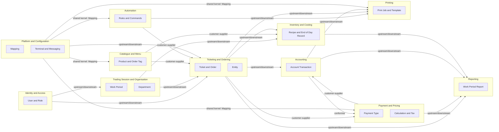

<!-- Metadata
Date of generation: 2026-11-02
Input files processed:
- output/transcripts/01_product-owner_daily-operations_curated.txt
- output/transcripts/02_product-owner_payments-accounts-reporting_curated.txt
- output/transcripts/03_product-owner_configuration-inventory-automation_curated.txt
- knowledge/SambaPOS_V3_knowledge_base.md (supporting source; section 9 read to exclude non-V3 features)
- output/html/*.html (88 mockups: v3_foreign-currencies_01-21, v3_resource-types_01-15, v3_printer-templates_01-05, manual_1-1 to manual_2-10 series). Page titles/headings were scanned to confirm vocabulary; mockups were not analysed screen by screen and add no domain claims beyond the transcripts.
-->

# SambaPOS V3 – Strategic Domain Analysis

**Source key.** To keep tables readable, sources are cited as:
- **T1** = `output/transcripts/01_product-owner_daily-operations_curated.txt` (Session 1: product vision and daily operations)
- **T2** = `output/transcripts/02_product-owner_payments-accounts-reporting_curated.txt` (Session 2: payments, accounts and reporting)
- **T3** = `output/transcripts/03_product-owner_configuration-inventory-automation_curated.txt` (Session 3: configuration, menu, inventory, printing and automation)

Timestamps in square brackets give the approximate location within a transcript. All three interviews are with the same Product Owner; no other stakeholder was interviewed. Terminology: **Entity / Entity Type / Entity Screen** is used throughout; "Resource" is the legacy (early V3) name for the same concept.

## 0. Domain Overview

SambaPOS V3 is a Windows desktop point-of-sale application for restaurants and similar businesses (cafés, bars, fast food, delivery, hotel room service). It is designed for touch screens (800x600 upwards), prints to ESC/POS thermal or dot-matrix printers, and works with barcode scanners, cash drawers and caller-ID devices [T1 00:00:41]. It runs on a single computer (SQL Server Compact `.sdf` file) or on several terminals sharing SQL Server, kept in sync by a separate messaging server [T1 00:02:02-00:02:34].

Core idea in the Product Owner's words: every sale is a **ticket**, a ticket contains **orders**, and the ticket is attached to at least one **entity** (table, customer, waiter, room); every money movement is an **account transaction** between two accounts, double-entry style [T1 00:01:11; T2 00:11:46].

The defining characteristic of V3 versus V2 is that behaviour is data, not code: tables, customers, order states, payment types, gift/void, service charges, taxes, table colours and kitchen printing were hard-coded in V2 and are now configurable through entity types, states, payment types, calculation types, tax templates, and automation rules/commands. A new database ships with default rules that make it behave as a normal restaurant [T1 00:03:18; T3 00:35:04]. The consequence is that most work in an installation is configuration performed by a reseller/installer rather than by the restaurant [T3 00:00:42; T2 00:18:06], and the system can be broken by deleting default rules [T1 00:27:19; T3 00:35:39].

The Product Owner's advice for any rebuild: separate what is built in (work-period rule, PIN login, cancel restrictions, locked-ticket checks, concurrency checks) from what is configurable (colours, kitchen printing, gift and void behaviour) [T1 00:30:02].

## 1. Ubiquitous Language

Alphabetised. "Context" in brackets is the bounded context from Section 2 that owns the term.

| Term | Definition | Source |
|------|------------|--------|
| Account | A ledger with debit, credit and balance, e.g. Sales, Receivables, Cash, Credit Card, Voucher, Discount, Rounding, one per customer if created. Has a name, an account type and optionally a currency. [Accounting] | T2 00:11:46, 00:18:06 |
| Account Details | Per-account view listing transactions (date, description, debit, credit, balance) with filters (Default, All, This Month, Past Month, This Week, Past Week, Work Period) and a Find Ticket action. [Accounting] | T2 00:14:59 |
| Account Name Template | Pattern on an entity type that builds the account name, e.g. `[Name]-[Phone]`; every field in it must be filled before an account can be created. [Accounting] | T2 00:16:26; T3 00:15:50 |
| Account Screen | A configured list of account types shown on the Accounts screen, with per-type "display details" and "hide zero balance accounts" options. [Accounting] | T2 00:14:22 |
| Account Transaction | A money movement between two accounts; the basis of all financial recording (sales, payments, discounts, rounding, tips, tax, tabs). [Accounting] | T1 00:01:11; T2 00:11:46 |
| Account Transaction Document (Document Type) | A manual transaction created from account details (defaults: Customer Cash, Customer Credit Card); has button header, master account type, transaction type(s), default amount (`[Balance]`), description template and printer template. [Accounting] | T2 00:15:30 |
| Account Transaction Type | Defines from which account type to which account type a movement goes, with optional default source/target accounts. A new database has seven. [Accounting] | T2 00:11:46, 00:13:53 |
| Account Type | A group of accounts. Defaults: Sales Accounts, Receivable Accounts, Payment Accounts, Discount Accounts, Customer Accounts. [Accounting] | T2 00:11:46 |
| Account Working Rule | Option on an account type controlling allowed directions; one option compares balance to a custom "Credit Limit" field on the customer. [Accounting] | T2 00:07:54 |
| Add Ticket | Command that starts an additional ticket for the same entity (e.g. second bill for the same table); entities flagged "Copy to New Tickets" carry over. [Ticketing] | T1 00:21:42; T3 00:18:25, 00:32:38 |
| Admin (role flag) / Administrator | A user role flag giving access to everything; the default user "Administrator" has PIN 1234 and is in the Admin role. [Identity & Access] | T1 00:06:34; T3 00:36:43, 00:37:34 |
| Ask Before Creating Ticket | Option on a ticket type's entity type or on a ticket tag group forcing the value to be chosen when a ticket starts. [Ticketing] | T1 00:21:09; T3 00:11:40, 00:18:25 |
| Auto Logout | Terminal setting that logs the user out every time a ticket is closed, so shared terminals record orders under the correct waiter. [Platform & Configuration] | T1 00:07:14; T3 00:38:07 |
| Auto Select | Menu-button flag: adding the product immediately selects the order and opens portion and order tag selection. [Catalogue & Menu] | T1 00:10:54; T3 00:05:34 |
| Automation Command | A configurable button (name, header, colour, font size, optional values) whose mapping decides where it appears and in which states; pressing it fires "Automation Command Executed" and a rule reacts. Defaults: Close, Settle, Print Bill, Unlock Ticket, Add Ticket, Gift, Cancel Gift, Void, Cancel Void. [Automation] | T2 00:00:40; T3 00:32:38 |
| Available | Default entity state in the Status group, shown white: no open tickets. [Ticketing] | T1 00:08:13 |
| Balance (mode) | Payment-screen toggle (Ticket/Balance): amount due becomes ticket plus the customer's open balance; overpayment goes to the customer account, and only payment types with a fixed account work. [Payment & Pricing] | T2 00:01:27, 00:29:18 |
| Barcode | Product field; a scanner types the code and the matching product is added. [Catalogue & Menu] | T1 00:09:14; T3 00:02:05 |
| Base Unit | Smallest unit of an inventory item, used by recipes (grams, pieces, centilitres, cans). [Inventory & Costing] | T3 00:20:11 |
| Batch Create | Text-box bulk entry: `#Name` line is a group/type, other lines are items; for products the last word is the price; existing names are skipped for entities; creates single-portion products only. [Catalogue & Menu] | T3 00:02:53, 00:16:22 |
| Bill Requested | Default entity state in the Status group (maroon/dark red): bill printed but not paid. [Ticketing] | T1 00:08:13, 00:16:48 |
| Calculation Selector | The button (or headerless automatic applier) that applies one or more calculation types to a ticket; has mappings (user role, department, ticket type, terminal). A selector without a button header is applied automatically to every new ticket where the mapping matches. [Payment & Pricing] | T2 00:04:06, 00:09:27 |
| Calculation Type | The logic of a discount/service/rounding: name, method, amount, maximum amount, flags (decrease amount, include tax, use plain sum, toggle) and its own account transaction type. Methods: rate from ticket amount, rate from previous template, fixed amount, fixed amount from ticket total, round ticket total, custom. [Payment & Pricing] | T2 00:08:20 |
| Cancel | Built-in (not an automation command) removal of an unsaved/new order as if it never happened; does not work on submitted orders. [Ticketing] | T1 00:12:05; T3 00:32:38 |
| Cancel Gift | Command that restores the price of a gifted order and clears the gift state. [Ticketing] | T1 00:12:59; T3 00:34:32 |
| Cancel Void | Command reversing a Void, only while the order is still New (before the ticket is closed); returns it to Submitted. [Ticketing] | T1 00:12:33; T3 00:34:32 |
| Category | A group of product buttons on a screen menu; has colours, button height, font size, image, column/page count, numerator type and Fast Menu flag. [Catalogue & Menu] | T1 00:08:52; T3 00:04:17 |
| Change Payment Type | Configurable way of giving change (name, change transaction type, account, mappings); the cashier is asked only when a foreign currency is selected and more than one matches. [Payment & Pricing] | T2 00:23:19, 00:24:20 |
| Change Price | Command to set a new price on a selected order using the typed number; open-price (zero-price) items can be changed by anyone, otherwise needs "change item price" permission; disabled on locked tickets. [Ticketing] | T1 00:14:25 |
| Change Transaction Type | A payment transaction reversed (Payment Accounts to Receivables), used by change payment types. [Accounting] | T2 00:23:19 |
| Close (ticket) | Saves the ticket, assigns ticket/order numbers, and fires closing rules (kitchen print, Submitted, Unpaid). Distinct from Settle. Empty tickets are discarded. [Ticketing] | T1 00:15:02, 00:15:43 |
| Collection Tag | Printer-template placeholder for a ticket collection (`{ORDERS}`, `{ENTITIES}`, `{PAYMENTS}`, `{DISCOUNTS}`; early V3 `{RESOURCES}`). [Printing] | T3 00:27:31 |
| Constraint | Condition on a rule that filters on the event's data. [Automation] | T3 00:32:05 |
| Cost Prediction / Current Cost | Per product and portion cost from the recipe versus cost after the physical count has been distributed. [Inventory & Costing] | T3 00:25:33 |
| Cost Report | Report of cost per product, and averages over several work periods. [Reporting] | T3 00:25:36; T2 00:25:45 |
| Cover | A product (e.g. bread and water) added automatically per guest by a rule bound to the Guest Count tag. [Ticketing] | T1 00:19:42; T3 00:13:01 |
| Create Ticket | Ticket creation method that opens an empty ticket directly (fast-food counter). [Operations] | T1 00:04:29 |
| Credit Limit | Custom field on the customer entity type compared by the account working rule to disable Customer Account payments over the limit. [Accounting] | T2 00:07:54 |
| Current Inventory | Physical stock count typed into the End of Day Record between work periods. [Inventory & Costing] | T3 00:23:37, 00:24:22 |
| Custom Field (entity) | Extra data on an entity type (String, WideString, Number, Date, Query) with editing format/mask, drop-down by comma-separated values, optional hidden; used for search, printing (`{ENTITY DATA:Phone}`) and automation. [Ticketing] | T3 00:14:43, 00:15:34 |
| Customer | An entity type (default) with phone/custom fields and optional account; created or searched from Customer Search, also via caller-ID. [Ticketing] | T1 00:22:46; T3 00:15:50 |
| Customer Account | The account of a customer, created from the customer card ("Create Account"); receives tabs and is settled by documents. [Accounting] | T2 00:07:23, 00:13:23, 00:16:26 |
| Customer Account (payment type) | Default payment type posting Receivables to the customer's account; disabled if no customer/account or credit limit exceeded. [Payment & Pricing] | T2 00:07:23 |
| Customer Receipt Template | Default printer template for account documents when a customer pays a balance. [Printing] | T2 00:15:30; T3 00:26:39, 00:29:44 |
| Customer Tickets | Default entity screen filtered to customers in state "New Orders" (open tickets). [Ticketing] | T1 00:22:46; T3 00:17:23 |
| Department | A section of the business working its own way (dining room, take-away, delivery); sets ticket type, screen menu, price tag, warehouse and ticket creation method. A new database has one: Restaurant. [Operations] | T1 00:04:09; T3 00:19:17 |
| Discount % | Default calculation selector command typed as a percentage; pressing with nothing typed removes it. [Payment & Pricing] | T2 00:04:09 |
| Display State / State Filter | Entity screen settings: state group that colours buttons, and a filter showing only entities in a given state. [Ticketing] | T3 00:17:23 |
| Dynamic Section | Printer-template section selected by order/entity state, e.g. `[ORDERS:Gift]`, `[ORDERS:Void]`, `[ENTITIES:Table]`; falls back to the plain section if absent. [Printing] | T3 00:28:13, 00:28:44 |
| End of Day Record | Inventory record created automatically when a work period ends (never manually); per warehouse shows In Stock, Purchase, Cost, Consumption, Predicted Inventory, Current Inventory; plus a Costs tab. [Inventory & Costing] | T1 00:05:50, 00:26:02; T3 00:23:34 |
| Entity (legacy: Resource) | Anything a ticket can be assigned to: table, customer, waiter, hotel room, delivery driver. [Ticketing] | T1 00:01:11, 00:03:52; T3 00:13:57 |
| Entity Screen | Screen for choosing entities; has ticket type, view mode (Automatic, Search, Custom), entity type and entity selection, display state, state filter, mappings. [Ticketing] | T1 00:07:32; T3 00:16:37 |
| Entity State | Named state with colour in a state group (e.g. Status) set on an entity by rules; drives table colours. [Ticketing] | T1 00:08:13 |
| Entity Type (legacy: Resource Type) | Kind of entity and its definition: name, singular entity name, account type, account name template, primary field name, custom fields. [Ticketing] | T3 00:14:43 |
| Event | Occurrence that triggers rules: Ticket Created, Order Added, Before Ticket Closing, Ticket Closing, Ticket Moved, Tickets Merged, Ticket State Updated, Ticket Tag Selected, Entity Updated, Payment Processed, Change Amount Changed, Work Period Started, Automation Command Executed, Trigger Executed. [Automation] | T3 00:32:05; T2 00:29:18 |
| Exchange Rate | Manually maintained rate of a foreign currency against the base currency. [Payment & Pricing] | T2 00:19:32 |
| Fast Menu | Category flag showing its products in a separate quick-access area, maintained by hand. [Catalogue & Menu] | T3 00:07:00 |
| Fixed Cost | Recipe cost for untracked items (salt, sauce, utilities) added to every portion sold; affects cost only, not stock. [Inventory & Costing] | T3 00:21:00 |
| Foreign Currency | Currency other than base, with name, symbol format string (`{0:N}`), exchange rate and rounding; needs its own cash account and payment type. [Payment & Pricing] | T2 00:18:58-00:21:16 |
| Free Tagging | Permits staff to type their own order or ticket tag value (optionally priced); "Save Free Tags" keeps typed values as buttons. [Catalogue & Menu] | T1 00:10:40, 00:18:48; T3 00:08:31 |
| Gift | Command making an order free: price not calculated, but stock IS consumed; prints "GIFT" on the bill; state in the GStatus group. [Ticketing] | T1 00:12:59; T3 00:23:22 |
| GStatus | Default order-state group holding Gift/Void-type states, separate from the Status group (New, Submitted). [Ticketing] | T1 00:13:19; T3 00:39:09 |
| Guest Count | Classic numeric, required ticket tag; reported with totals and average per guest; can drive automatic cover charges. [Ticketing] | T1 00:19:20; T2 00:28:00; T3 00:12:57 |
| In Stock | Opening quantity on an End of Day Record, carried from the previous record's physical count. [Inventory & Costing] | T3 00:23:37, 00:24:22 |
| Incomes | Work period report section: each payment type with amount and percentage; compared with the drawer. [Reporting] | T2 00:27:13 |
| Inventory Item | What the business buys (bottle, can, ground beef); not a product. Fields: name, group code, base unit, transaction unit and multiplier, warehouse. [Inventory & Costing] | T3 00:19:39, 00:20:11 |
| Inventory Transaction | Document recording stock movements: transaction type, number, lines (item, quantity, unit, unit price, total); purchase or warehouse transfer. [Inventory & Costing] | T3 00:22:12, 00:22:55 |
| Inventory Transaction Type | Defines source and/or target warehouse types with defaults (purchase has only target; transfer has both). [Inventory & Costing] | T3 00:22:55 |
| Kitchen Printout | Slip printed when a ticket is closed, containing only orders in New status, including voids marked "VOID". [Printing] | T1 00:15:24; T3 00:29:06 |
| Local Settings | Per-computer settings file (not database): terminal name, connection string, language, window scale, messaging server. [Platform & Configuration] | T1 00:02:02; T3 00:38:07 |
| Locked Ticket | A ticket locked after Print Bill: no new orders, no table change, no move out, Change Price and calculation buttons disabled. [Ticketing] | T1 00:17:06; T2 00:05:06 |
| Manage (Management dashboard) | Tile dashboard grouped by Products, Tickets, Entities, Inventory, Accounts, Automation, Settings, Users. [Platform & Configuration] | T3 00:00:58 |
| Mapping | Table of rows (terminal, department, user role, ticket type, and for order tags/printer maps product group and product) saying where something is available; star means all; no row means visible nowhere. [Platform & Configuration] | T1 00:10:15; T2 00:06:20; T3 00:08:54 |
| Max Items | Menu button/category setting: how many untagged buttons fill the root level when sub-menus are used; 0 shows only sub-menu buttons. [Catalogue & Menu] | T3 00:06:37 |
| Merge Tickets | Combines selected tickets (orders, payments, tags, entities) into one new ticket; requires permission; not allowed with calculations such as discounts or across different entities of the same type. [Ticketing] | T1 00:22:15 |
| Messaging Server | Separate Windows service syncing terminals (e.g. table colours). [Platform & Configuration] | T1 00:02:22 |
| Move | Moves selected saved orders from a ticket into a brand-new ticket (e.g. split bills); not on locked tickets. [Ticketing] | T1 00:13:46; T2 00:03:54 |
| New Orders | Default entity/ticket state (orange): entity has tickets with ordered items. [Ticketing] | T1 00:08:13; T3 00:33:23 |
| Numerator | Named number sequence with format; defaults Ticket Numerator and Order Numerator, selected by ticket type. [Ticketing] | T3 00:39:09 |
| Online Partner | Worked configuration example (e.g. grubhub.com): entity type with accounts, ticket tag and rules; not a built-in concept; no "internal account" flag in V3. [Accounting] | T2 00:17:13, 00:18:06 |
| Open Price Item | Product with zero price whose price anyone may set at order time. [Catalogue & Menu] | T1 00:14:25 |
| Order | A line on a ticket (product, portion, quantity, price, tags, states); grouped by round with order number, user and time. [Ticketing] | T1 00:01:11, 00:14:43 |
| Order Number | Assigned when the ticket is closed; shared by all orders of the round. [Ticketing] | T1 00:14:43 |
| Order Selector | Payment-screen list of order lines (same product and price grouped) used to pay for selected units; shows prices after spread discounts/services/taxes. [Payment & Pricing] | T2 00:03:02, 00:03:30 |
| Order State | Configurable named state on an order (e.g. New, Submitted, Gift, Void, Wasted). [Ticketing] | T1 00:03:18, 00:13:19 |
| Order Tag | Modifier on an order line ("No onion", "Medium rare") that goes to the kitchen and may cost extra; may point to a product so its recipe consumes stock. [Catalogue & Menu] | T1 00:09:46; T3 00:07:36, 00:10:12 |
| Order Tag Group | Container of order tags with min/max selected, add price to order price, tax free, free tagging, save free tags, display settings, and mappings to product group/product. [Catalogue & Menu] | T1 00:09:46; T3 00:07:51 |
| Paid | Ticket state set when the remaining amount is zero; ticket marked closed. [Ticketing] | T1 00:17:52; T3 00:34:03 |
| Partial Payment | Payment less than amount due, by amount or by selected units; ticket stays open with balance. [Payment & Pricing] | T2 00:02:23, 00:03:02 |
| Payment Screen | Screen opened by Settle: order selector, amount due/tendered, number pad with quick values and fractions, calculation selectors, payment buttons, currency buttons. [Payment & Pricing] | T2 00:00:56 |
| Payment Type | Configurable payment record: name, colour, font, account, account transaction type, mappings (defaults Cash, Credit Card, Voucher, Customer Account). [Payment & Pricing] | T2 00:05:31 |
| PIN | 4-20 digit number used for touch-screen login; no user name. [Identity & Access] | T1 00:06:34; T3 00:37:34 |
| Portion | A priced variant of a product (Small/Medium/Large); every product has at least one, default "Normal". [Catalogue & Menu] | T1 00:09:29; T3 00:02:05 |
| Predicted Inventory | In Stock plus Purchase minus Consumption. [Inventory & Costing] | T3 00:23:37 |
| Price Tag (Price Definition) | Short (10-character) name of an alternative price list (e.g. Happy Hour) with prices entered in Batch Price List; the department decides which is active. [Catalogue & Menu] | T3 00:03:44 |
| Print Bill | Command printing the bill, locking the ticket, setting the table to Bill Requested. Remains available for reprints. [Ticketing] | T1 00:16:44; T3 00:33:23 |
| Print Job | "What to print": name, What to Print option, "use for paid tickets", "exclude tax", with printer maps. Defaults: Print Bill, Print Orders to Kitchen Printer. [Printing] | T1 00:16:06; T3 00:30:28 |
| Printer | Output device definition: name, type, share name, characters per line, code page; no share name means nothing prints. Defaults: Ticket, Kitchen, Invoice. [Printing] | T3 00:27:00 |
| Printer Map | Row deciding where and with which template a print job prints, by terminal, department, role, ticket type, product group, product; most specific wins. [Printing] | T3 00:30:28 |
| Printer Template | Layout of a printout using `[LAYOUT]`, `[ORDERS]`, `[ORDER TAGS]`, collection tags and formatting commands. Defaults: Ticket Template, Kitchen Order Template, Customer Receipt Template. [Printing] | T3 00:27:29-00:29:47 |
| Product | What the business sells; has name, group code, barcode, tag, portions. [Catalogue & Menu] | T3 00:02:05, 00:19:39 |
| Product Group (Group Code) | Category such as Food, Drinks, Desserts; used by reports, order tag mappings and printer maps. [Catalogue & Menu] | T3 00:02:32 |
| Rate from Previous Template | Calculation method applying a percentage to the running total so calculations stack. [Payment & Pricing] | T2 00:08:20 |
| Receivables | Account/account type representing what is owed on open tickets (and to customers' tabs). [Accounting] | T2 00:12:22, 00:13:23 |
| Recipe | Links a product portion to inventory items with base-unit quantities and optional fixed cost; exactly one per portion. [Inventory & Costing] | T3 00:21:00 |
| Release Lock | Built-in action visible only to roles allowed to add items to locked tickets. [Ticketing] | T1 00:17:22 |
| Report | Output on the Reports screen: Work Period Report, Item Sales Report, Accounts Liability, Accounts Receivable, Internal Accounts, Inventory Purchase Report, Inventory Report, Cost Report, CSV Builder. [Reporting] | T2 00:25:45 |
| Report Filter | Drop-down (Today, Yesterday, This/Last Week, This/Last Month, individual work periods) plus custom dates; changing it needs a separate permission. [Reporting] | T2 00:26:16 |
| Reseller / Installer | Person who sets up database, printers, menu and rules for a restaurant (see Section 5). [Platform & Configuration] | T1 00:01:30; T3 00:01:51 |
| Resource | Legacy early-V3 name for Entity (also `{RESOURCES}` tag). [Ticketing] | T1 00:03:52; T3 00:13:57 |
| Round | Fixed-amount calculation decreasing the ticket (e.g. 0.30 off 42.30), booked to the Rounding account. [Payment & Pricing] | T2 00:04:09 |
| Rule | "When this event happens and these conditions hold, run these actions with these values"; has name, event, constraints, actions, mappings. [Automation] | T3 00:32:05 |
| Rule Action | Reusable system operation (update order/ticket/entity state, execute print job, lock/unlock ticket, mark ticket closed, display payment screen, create ticket, close active ticket, add order, update ticket calculation, pay ticket, change ticket entity) with fixed or `[:Variable]` parameters. [Automation] | T3 00:31:31; T2 00:06:37, 00:17:13 |
| Screen Menu | Button layout on the POS screen (categories, product buttons); selected by ticket type and department; several allowed. [Catalogue & Menu] | T1 00:08:52; T3 00:04:17 |
| Select Entity | Ticket creation method starting from an entity screen (dining-room style). [Operations] | T1 00:04:29 |
| Selection Required | Ticket tag option: ticket cannot be completed (once paid) without a value. [Ticketing] | T1 00:19:20; T3 00:11:40 |
| Service (calculation) | An increasing calculation (e.g. service charge, tip) as opposed to a discount; replaces V2 "service templates". [Payment & Pricing] | T2 00:08:20, 00:09:27 |
| Settle | Automation command that displays the payment screen. [Payment & Pricing] | T1 00:17:52; T2 00:00:40 |
| State | Named state with group, colour, type and display locations (e.g. Available, New Orders, Bill Requested in group Status). [Ticketing] | T3 00:39:09 |
| Status | Default state group for entities (Available, New Orders, Bill Requested) and for tickets/orders (New, Submitted, Unpaid, Paid, Locked). [Ticketing] | T1 00:08:13, 00:13:19; T3 00:33:23 |
| Sub Menu Tag | Menu-button property (comma-separated levels, unlimited) creating sub-menus within a category. [Catalogue & Menu] | T3 00:05:58 |
| Submitted | Order status after the ticket is closed and the kitchen job has run. [Ticketing] | T1 00:15:02 |
| Tax Template | Item-based tax: name (printed on bill), rate, rounding, account transaction type, mapped to product group/product, department, ticket type. [Payment & Pricing] | T2 00:10:45 |
| Tax Included | Ticket type setting: prices are gross and tax extracted, or tax added on top. [Ticketing] | T2 00:10:45 |
| Terminal | A POS computer: name, default flag (default named "Server"), report printer, transaction printer, auto logout. [Platform & Configuration] | T3 00:38:07 |
| Ticket | A sale: container of orders, payments, tags, calculations, attached to at least one entity. [Ticketing] | T1 00:01:11, 00:15:51 |
| Ticket Note | Free-text note on a ticket, searchable, printable on the kitchen ticket. [Ticketing] | T1 00:24:47 |
| Ticket Number | Number assigned to a new ticket on first close, from a numerator. [Ticketing] | T1 00:15:02 |
| Ticket Tag / Ticket Tag Group | Extra information on the whole ticket (guest count, waiter, order source, tip); each group is a button; tagging type alphanumeric, numeric or price; colours for selected/not selected; sub tags; mappings. [Ticketing] | T1 00:18:48; T3 00:11:20 |
| Ticket Type | Defines entity types used by the ticket (with Ask Before Creating, Copy), ticket and order numerators, sale transaction type, tax included, screen menu. [Ticketing] | T1 00:21:09; T3 00:18:25 |
| Tickets Screen | Search/list of tickets by date and filter (Only Open Tickets, All Tickets, Ticket Number, Ticket Note, per entity type); needs "display old tickets" permission. [Ticketing] | T1 00:23:33 |
| Tip | Worked example: price-type ticket tag, calculation type "Tip" (fixed, increasing, include tax) with its own transaction type, and a rule; reported separately. [Payment & Pricing] | T2 00:09:50 |
| Transaction Unit / Multiplier | Unit in which stock is bought (kg, pack) and base units per transaction unit (lamb 1000, bread 10). [Inventory & Costing] | T3 00:20:11 |
| Trigger | Scheduled event (cron-style expression) firing "Trigger Executed"; rarely used. [Automation] | T3 00:36:15 |
| Unlock Ticket | Command that unlocks a locked ticket and sets it back to Unpaid. [Ticketing] | T1 00:17:22; T3 00:33:23 |
| Unpaid | Ticket state after Close with orders submitted; sets entity to New Orders. [Ticketing] | T1 00:15:02 |
| User | Person with name, PIN and mandatory role. [Identity & Access] | T3 00:37:34 |
| User Role | Name, Admin flag, default department and permissions (navigation, management, work periods, reports, inventory, change/use departments, add to locked tickets, move orders, merge tickets, display old tickets, display other waiters' tickets, change item price, create accounts, change report filter, accounts). [Identity & Access] | T3 00:36:43; T1 00:04:46; T2 00:14:00 |
| Variable (`[:Name]`) | V3 rule parameter syntax (V2 used plain `[Name]`), e.g. `[:NumericValue]`. [Automation] | T3 00:13:40 |
| Void | Command cancelling a submitted order: stays on ticket, no price, no stock consumption, state Void, status reset to New so the kitchen is told; not printed on bill. [Ticketing] | T1 00:12:05-00:12:57; T3 00:34:32 |
| Warehouse | Stock location (default Local Warehouse); each department consumes from one; items may be restricted to a warehouse. [Inventory & Costing] | T1 00:04:09; T3 00:20:57, 00:22:55 |
| Weighted Average Cost | Cost per unit shown on the End of Day Record. [Inventory & Costing] | T3 00:23:37 |
| Work Period | The business-day/shift interval; POS usable only while open; ending it creates the End of Day Record. [Operations] | T1 00:05:15-00:06:15 |
| Work Period Report | Report with Sales, Incomes, Refunds, General Information, ticket tag blocks, User Sales, item sales by group. [Reporting] | T2 00:27:09-00:28:37 |

## 2. Bounded Contexts

The contexts below are the analyst's grouping of the vocabulary; the interviewee did not name contexts, but Manage-dashboard categories (T3 00:00:58) and the session topics support this split.

#### Trading Session & Organisation (Operations)
- **Responsibility:** Governs the trading period and the organisational sections (departments) within which POS activity is allowed.
- **Key terms:** Work Period, Department, Select Entity, Create Ticket
- **Transcript references:** T1 (00:04:09-00:06:15, 00:25:16-00:26:25); T3 (00:19:17)

#### Ticketing & Ordering
- **Responsibility:** Captures sales as tickets of orders attached to entities, with their state lifecycle, tagging, locking, moving/merging and lookup.
- **Key terms:** Add Ticket, Ask Before Creating Ticket, Available, Bill Requested, Cancel, Cancel Gift, Cancel Void, Change Price, Close (ticket), Cover, Custom Field (entity), Customer, Customer Tickets, Display State / State Filter, Entity (legacy: Resource), Entity Screen, Entity State, Entity Type (legacy: Resource Type), Gift, GStatus, Guest Count, Locked Ticket, Merge Tickets, Move, New Orders, Numerator, Order, Order Number, Order State, Paid, Print Bill, Release Lock, Resource, Selection Required, State, Status, Submitted, Tax Included, Ticket, Ticket Note, Ticket Number, Ticket Tag / Ticket Tag Group, Ticket Type, Tickets Screen, Unlock Ticket, Unpaid, Void
- **Transcript references:** T1 (most); T3 (00:11:20-00:19:17, 00:39:09)

#### Catalogue & Menu
- **Responsibility:** Defines what is sold and how it is presented and modified: products, portions, groups, price lists, screen menus and order tags.
- **Key terms:** Auto Select, Barcode, Batch Create, Category, Fast Menu, Free Tagging, Max Items, Open Price Item, Order Tag, Order Tag Group, Portion, Price Tag (Price Definition), Product, Product Group (Group Code), Screen Menu, Sub Menu Tag
- **Transcript references:** T1 (00:09:14-00:10:54); T3 (00:02:05-00:11:17)

#### Payment & Pricing Adjustments
- **Responsibility:** Takes payment against tickets and applies discounts, services, tax, rounding, tips and foreign currencies.
- **Key terms:** Balance (mode), Calculation Selector, Calculation Type, Change Payment Type, Customer Account (payment type), Discount %, Exchange Rate, Foreign Currency, Order Selector, Partial Payment, Payment Screen, Payment Type, Rate from Previous Template, Round, Service (calculation), Settle, Tax Template, Tip
- **Transcript references:** T2 (00:00:35-00:25:01, 00:29:05-00:29:43)

#### Accounting
- **Responsibility:** Records every money movement as double-entry account transactions and manages customer/partner accounts and manual account documents.
- **Key terms:** Account, Account Details, Account Name Template, Account Screen, Account Transaction, Account Transaction Document (Document Type), Account Transaction Type, Account Type, Account Working Rule, Change Transaction Type, Credit Limit, Customer Account, Online Partner, Receivables
- **Transcript references:** T2 (00:11:41-00:18:52)

#### Inventory & Costing
- **Responsibility:** Tracks purchased stock, consumption via recipes, end-of-day counts and product cost.
- **Key terms:** Base Unit, Cost Prediction / Current Cost, Current Inventory, End of Day Record, Fixed Cost, In Stock, Inventory Item, Inventory Transaction, Inventory Transaction Type, Predicted Inventory, Recipe, Transaction Unit / Multiplier, Warehouse, Weighted Average Cost
- **Transcript references:** T3 (00:19:36-00:26:36); T1 (00:05:50, 00:26:02)

#### Printing
- **Responsibility:** Defines printers, templates, print jobs and routing of printouts (kitchen slips, bills, receipts).
- **Key terms:** Collection Tag, Customer Receipt Template, Dynamic Section, Kitchen Printout, Print Job, Printer, Printer Map, Printer Template
- **Transcript references:** T3 (00:26:36-00:31:28); T1 (00:16:06)

#### Automation (Rules & Commands)
- **Responsibility:** Holds configurable behaviour: rules reacting to events, reusable actions, command buttons and schedules, including the default rule set.
- **Key terms:** Automation Command, Constraint, Event, Rule, Rule Action, Trigger, Variable (`[:Name]`)
- **Transcript references:** T3 (00:31:28-00:36:25); T1 (00:27:15); T2 (00:06:37)

#### Identity & Access
- **Responsibility:** Authenticates users by PIN and authorises them through roles and permissions.
- **Key terms:** Admin (role flag) / Administrator, PIN, User, User Role
- **Transcript references:** T1 (00:06:34); T3 (00:36:40-00:38:05)

#### Reporting
- **Responsibility:** Presents operational and financial summaries per period for managers and accountants.
- **Key terms:** Cost Report, Incomes, Report, Report Filter, Work Period Report
- **Transcript references:** T2 (00:25:45-00:29:05)

#### Platform & Configuration
- **Responsibility:** Terminals, per-computer settings, multi-terminal synchronisation, the Manage dashboard and the cross-cutting mapping mechanism used by the installer.
- **Key terms:** Auto Logout, Local Settings, Manage (Management dashboard), Mapping, Messaging Server, Reseller / Installer, Terminal
- **Transcript references:** T1 (00:02:02-00:02:52); T3 (00:00:58, 00:08:54, 00:38:07)

## 3. Subdomains

Classification (core/supporting/generic) is the analyst's judgement from the evidence cited; the Product Owner did not use these words.

#### Ticket and Order Lifecycle
- **Type:** core
- **Bounded context:** Ticketing & Ordering
- **Rationale:** "Every sale is a ticket" is the product's central concept; states (New, Submitted, Unpaid, Paid, Locked, Gift, Void), cancel/void/gift semantics, locking, move and merge dominate training and support issues [T1 00:01:11, 00:26:25].
- **Transcript references:** T1; T3 (00:33:23-00:34:32)

#### Configurable Behaviour (Rules, States, Commands)
- **Type:** core
- **Bounded context:** Automation; Ticketing & Ordering
- **Rationale:** The key V3 differentiator versus V2: "behaviour is data", every step changeable without a release; also the main risk [T3 00:35:04, 00:35:39; T1 00:30:02].
- **Transcript references:** T1 (00:03:18, 00:30:02); T3 (00:31:28-00:36:25)

#### Double-Entry Money Model
- **Type:** core
- **Bounded context:** Accounting; Payment & Pricing Adjustments
- **Rationale:** "This is the heart of V3"; new payment types, currencies, credit all become accounts and transaction types, no code [T2 00:11:46, 00:12:52, 00:30:36].
- **Transcript references:** T2 (00:11:41-00:14:00, 00:30:36)

#### Payments, Discounts, Tax and Currencies
- **Type:** supporting
- **Bounded context:** Payment & Pricing Adjustments
- **Rationale:** Significant configurability (calculation types, tax templates, multi-currency with change payment types) but built on the accounting model [T2 00:05:31-00:25:01].
- **Transcript references:** T2

#### Entity Modelling
- **Type:** supporting
- **Bounded context:** Ticketing & Ordering
- **Rationale:** Generalised tables/customers into entity types because "every customer had a different third thing" [T3 00:14:28]; enabler for ticket assignment and customer accounts.
- **Transcript references:** T3 (00:13:57-00:19:36); T1 (00:20:20-00:23:15)

#### Menu and Product Catalogue
- **Type:** supporting
- **Bounded context:** Catalogue & Menu
- **Rationale:** Needed for any sale; batch creation, price tags, sub-menus and order tags support speed of entry [T3 00:02:05-00:11:17].
- **Transcript references:** T3

#### Inventory and Cost Control
- **Type:** supporting (candidate core differentiator)
- **Bounded context:** Inventory & Costing
- **Rationale:** Optional ("you don't have to track everything"), yet the variance distribution by recipe ratios is described as the Product Owner's "favourite part" [T3 00:19:39, 00:24:45].
- **Transcript references:** T3 (00:19:36-00:26:36)

#### Work Period Management
- **Type:** supporting
- **Bounded context:** Trading Session & Organisation
- **Rationale:** Gate for POS use and trigger for the End of Day Record; "the most basic rule in the system" [T1 00:05:33].
- **Transcript references:** T1 (00:05:15-00:06:15, 00:25:16-00:26:25)

#### Printing and Templating
- **Type:** supporting
- **Bounded context:** Printing
- **Rationale:** Kitchen and bill output depends on state-aware templates; frequent first-day issue [T3 00:27:17, 00:27:31].
- **Transcript references:** T3 (00:26:36-00:31:28)

#### Reporting
- **Type:** supporting
- **Bounded context:** Reporting
- **Rationale:** Work period report is the daily closing artefact; account reports are empty in the current build [T2 00:26:44, 00:28:39].
- **Transcript references:** T2 (00:25:45-00:29:05)

#### User, Role and PIN Management
- **Type:** generic
- **Bounded context:** Identity & Access
- **Rationale:** Standard PIN login and role permissions; no distinctive logic beyond default department and permission set [T3 00:36:43-00:37:34].
- **Transcript references:** T1 (00:06:34); T3

#### Terminals, Local Settings and Synchronisation
- **Type:** generic
- **Bounded context:** Platform & Configuration
- **Rationale:** Deployment plumbing (SQL Compact/Express, messaging service, connection strings) [T1 00:02:02-00:02:34; T3 00:38:07].
- **Transcript references:** T1; T3

## 4. Context Map

### 4.1 Relationship Table

Relationship types are the analyst's interpretation of the described data/behaviour dependencies.

| Upstream Context | Downstream Context | Relationship Type | Description | Source |
|------------------|--------------------|-------------------|-------------|--------|
| Catalogue & Menu | Ticketing & Ordering | upstream/downstream (customer-supplier) | Orders are created from products, portions and order tags selected on screen menus; mappings control visibility. | T1 00:08:52-00:10:54; T3 00:02:05 |
| Trading Session & Organisation | Ticketing & Ordering | upstream/downstream | POS is available only while a work period is open; department fixes ticket type, menu, price tag, warehouse and creation method. | T1 00:04:09, 00:05:33 |
| Identity & Access | Trading Session & Organisation | upstream/downstream | Role gives default department and permissions to change department, start/end work periods. | T1 00:04:46; T3 00:36:43 |
| Identity & Access | Ticketing & Ordering | upstream/downstream | Permissions gate locked-ticket changes, move, merge, price change, viewing others' or old tickets; orders record user. | T1 00:14:43, 00:23:15; T3 00:36:43 |
| Automation | Ticketing & Ordering | customer-supplier (Automation supplies; ticketing consumes default rules) | Default rules set ticket, order and entity states, lock/unlock, kitchen print, closing; command buttons are inert until a rule reacts. | T3 00:33:23-00:34:32; T1 00:30:02 |
| Ticketing & Ordering | Payment & Pricing Adjustments | customer-supplier | Settle opens payment for a ticket; payment completes the ticket (Paid/closed); ticket type holds tax-included flag. | T1 00:17:52; T2 00:00:40, 00:10:45 |
| Payment & Pricing Adjustments | Accounting | customer-supplier | Each payment type, calculation type and tax template names an account transaction type; each payment posts a transaction. | T2 00:05:52, 00:08:20, 00:12:22 |
| Ticketing & Ordering | Accounting | upstream/downstream | Ticket type names the sale transaction type (Sales to Receivables); entity type holds account type/template; customer account found via ticket entity. | T2 00:07:23, 00:12:22, 00:16:26 |
| Accounting | Payment & Pricing Adjustments | conformist | Payment types and Customer Account availability conform to account existence, currency and working rules (no account, no charge). | T2 00:07:23, 00:07:54, 00:20:39 |
| Ticketing & Ordering | Inventory & Costing | upstream/downstream | Submitted orders consume stock via recipes; order state (Gift consumes, Void does not) decides consumption; department selects warehouse. | T3 00:23:22; T1 00:12:05, 00:12:59 |
| Catalogue & Menu | Inventory & Costing | customer-supplier | Recipes link product portions (and order-tag-linked products) to inventory items. | T3 00:10:12, 00:21:00 |
| Trading Session & Organisation | Inventory & Costing | upstream/downstream | Ending a work period creates the End of Day Record; transactions need an open work period; counts only between periods. | T1 00:05:50, 00:26:02; T3 00:22:12, 00:24:22 |
| Ticketing & Ordering | Printing | upstream/downstream | Print Bill and kitchen jobs print ticket/order data; templates are state-aware (Gift, Void). | T3 00:27:31-00:31:28 |
| Automation | Printing | upstream/downstream | Rules execute print jobs. | T3 00:31:13 |
| Accounting | Printing | upstream/downstream | Account documents print on Customer Receipt Template. | T2 00:15:30 |
| Ticketing & Ordering; Payment & Pricing Adjustments; Accounting; Inventory & Costing | Reporting | upstream/downstream | Work period report summarises sales, incomes, tags, states, user sales; cost report from inventory. | T2 00:27:09-00:28:37; T3 00:25:36 |
| Accounting | Reporting | anti-corruption gap (observed defect) | Account reports (Liability, Receivable, Internal Accounts) are listed but empty because their data part was not moved to the new account model. | T2 00:26:47 |
| Platform & Configuration | Catalogue & Menu; Payment & Pricing Adjustments; Printing; Automation; Ticketing & Ordering | shared kernel (Mapping mechanism) | The same mapping concept (role, department, ticket type, terminal, star = all) governs visibility everywhere. | T1 00:10:15; T2 00:06:20; T3 00:08:54 |
| Platform & Configuration | Ticketing & Ordering | upstream/downstream | Messaging server synchronises terminals; concurrency check on ticket close. | T1 00:02:22, 00:02:56 |

### 4.2 Context Map Diagram

## 5. Actors and Stakeholders

| Actor / Stakeholder | Role Description | Source |
|---------------------|------------------|--------|
| Owner / Manager | Configures the system, reads reports, does stock counts, settles stuck open tickets at end of day, follows up voids and gifts, restricts unlocking to themselves, may be the only one with Void/House Account access. | T1 00:01:30, 00:25:35, 00:27:04; T3 00:01:51, 00:36:25 |
| Cashier | Handles payments and cash; often starts and ends the work period; compares incomes with the drawer; records customer account payments. | T1 00:01:30; T2 00:02:15, 00:27:13 |
| Waiter | Takes orders at tables; may share terminals; usually has no navigation or management access and may be limited to own tickets. | T1 00:01:30, 00:07:14, 00:23:15 |
| Kitchen and bar staff | Receive kitchen printouts; usually do not touch the POS (a barman may log in to the bar department). | T1 00:01:30, 00:05:12 |
| Reseller / Installer | Sets up database, printers, menu, rules, mappings; assembles complex configurations; first-line recipient of support calls; runs Find Missing Recipes and regen.txt recovery; checks server clock. | T1 00:01:30, 00:06:15; T2 00:18:06; T3 00:22:10, 00:35:39 |
| Accountant | Receives saved XPS reports. | T2 00:26:16 |
| Customer / Guest | Entity on tickets (delivery, take-away, tabs); holds a customer account; disputes items ("I never ordered that"). | T1 00:14:43, 00:22:46; T2 00:16:26 |
| Online Partners (e.g. grubhub.com, seamless.com) | External companies that take orders and pay the restaurant later; modelled as entities with accounts. | T2 00:17:13 |
| Delivery staff | See which customers have open orders (Customer Tickets). | T1 00:22:46 |
| Hotel (room service) | Rooms as entities with accounts for room service charges and checkout payment. | T1 00:00:41; T2 00:16:26 |
| Tourist-area restaurant (foreign-currency customer) | Accepts several currencies; scenario owner for currency configuration. | T2 00:18:58 |
| Product Owner | Interviewee and product authority. | T1, T2, T3 |

## 6. Domain Rules and Invariants

| ID | Rule | Description | Source |
|------|------|-------------|--------|
| DR-001 | POS needs open work period | The POS button/screen is disabled until a work period is open. | T1 00:05:33 |
| DR-002 | Single open work period | At most one open work period for the whole database; Start enabled only after the last has ended. | T1 00:06:15 |
| DR-003 | Work period times from computer clock | A wrong server clock yields wrong work periods. | T1 00:06:15 |
| DR-004 | Cannot end with open tickets | End Work Period is disabled while any ticket is open ("There are 3 open tickets..."). | T1 00:25:18 |
| DR-005 | Minimum work period length | Work period must have been open more than a minute (prevents double-tap). | T1 00:25:35 |
| DR-006 | End of Day Record automatic only | Ending a work period creates it automatically; it cannot be created manually. | T1 00:26:02; T3 00:23:37 |
| DR-007 | Department switching restricted | Only if the role may use several departments and has change-department permission; not while a ticket is open or no work period is open. | T1 00:04:46 |
| DR-008 | Role default department | Each role has a default department entered at login. | T1 00:04:46; T3 00:37:15 |
| DR-009 | PIN login | PIN 4-20 digits; role required; new database has Administrator/1234 with a hint while it is the only user with that PIN on Compact/text databases. | T1 00:06:34; T3 00:37:34 |
| DR-010 | Concurrency on close | On close the system checks for changes by others; paid-elsewhere or moved tickets give a message and changes are not silently overwritten. | T1 00:02:56 |
| DR-011 | Ticket needs an entity | A ticket can be closed only if it has at least one entity (any type), or is fully paid, or has a ticket tag; empty tickets are discarded. | T1 00:15:43, 00:15:51; T3 00:18:03 |
| DR-012 | Quantity locked after submission | Plus/minus work only on new orders; submitted lines use bracketed selection. | T1 00:11:41 |
| DR-013 | Cancel only for unsaved orders | Cancel removes new orders only; after close, Void is required. | T1 00:12:05; T3 00:32:38 |
| DR-014 | Void semantics | Voided order remains on ticket, no price, no stock consumption, status reset to New, kitchen notified, hidden from bill; Void disabled on new orders. | T1 00:12:05-00:12:33; T3 00:34:32 |
| DR-015 | Cancel Void window | Only until the ticket is closed. | T1 00:12:33; T3 00:34:32 |
| DR-016 | Gift semantics | Price not calculated, but stock IS consumed; printed as GIFT. | T1 00:12:59; T3 00:23:22 |
| DR-017 | Kitchen receives only New orders | Closing prints only orders with status New, then marks Submitted; no empty slips. | T1 00:15:24; T3 00:29:06 |
| DR-018 | Order number at close | Order number is assigned when the ticket is closed; all orders of a round share it. | T1 00:14:43 |
| DR-019 | Print Bill locks ticket | Locked ticket: no new orders, no table change, no move out, Change Price and calculation buttons disabled; unlock via Unlock Ticket or Release Lock (permission). | T1 00:17:06-00:17:22; T2 00:05:06 |
| DR-020 | Move limits | Only saved orders; not on locked ticket. | T1 00:13:46 |
| DR-021 | Merge limits | Requires merge permission; not with calculations (e.g. discount); not across different entities of the same type. | T1 00:22:15 |
| DR-022 | Change Price permission | Open-price (zero price) items by anyone; otherwise "change item price" permission; a typed price is required. | T1 00:14:25 |
| DR-023 | Order tag group limits | Min/max selected; max one behaves as radio; min one blocks deselect/close until chosen. | T1 00:09:46; T3 00:07:51 |
| DR-024 | Mandatory ticket tag | Selection Required blocks completing the ticket once paid. | T1 00:19:20; T3 00:11:40 |
| DR-025 | Mapping visibility | A mapping row defines availability; star = all; no row = visible nowhere (applies to order tags, entity screens, payment types, commands, rules, print jobs). | T1 00:10:15; T3 00:08:54, 00:09:26 |
| DR-026 | No portion-level order tag mapping | Order tag mappings stop at product group/product. | T3 00:09:44 |
| DR-027 | Paid check on close | Remaining amount zero makes ticket Paid and closed; closing refused if a zero-priced calculable order exists; gifts and voids exempt. | T1 00:17:52, 00:28:26; T3 00:34:03 |
| DR-028 | Voiding everything | Voiding all orders gives zero remaining, ticket closes as paid; there is no delete ticket; every ticket with submitted orders ends paid, on an account or voided. | T1 00:28:45 |
| DR-029 | Closed paid ticket is final | Can be displayed and bill reprinted, not reopened or changed. | T1 00:24:30 |
| DR-030 | Waiter ticket visibility | Without "display other waiters' tickets", cannot open others' tickets; Tickets screen shows only own last-modified; Tickets screen needs "display old tickets". | T1 00:23:15, 00:24:05 |
| DR-031 | Tendered amount protection | If an amount is typed but unpaid, Close is disabled. | T2 00:02:23 |
| DR-032 | Change handling | Overpayment shows change; exact payment auto-closes; base-currency change comes from base cash unless change payment types exist. | T2 00:02:15, 00:23:19 |
| DR-033 | Payment tolerance | Within 0.01 of the amount due counts as exact. | T2 00:29:05 |
| DR-034 | Balance mode | Pays ticket first, remainder to customer account up to balance; cannot tender more than due; only fixed-account payment types. | T2 00:29:18 |
| DR-035 | Selector reflects spread adjustments | Order selector prices include spread discounts, services and taxes. | T2 00:03:30 |
| DR-036 | Discount limits | Calculation type maximum amount disables the button; discounts making remaining negative are all removed with a message. | T2 00:04:41 |
| DR-037 | Calculation buttons disabled when locked | Discount first, then print the bill. | T2 00:05:06 |
| DR-038 | Rounding booked separately | Round goes to its own account, distinct from discounts. | T2 00:04:09 |
| DR-039 | Tax per ticket type | Whether prices include tax is a ticket type setting; tax templates mapped to product group/product. | T2 00:10:45 |
| DR-040 | Double-entry | Every money movement is an account transaction between two accounts; sale = Sales to Receivables, payment = Receivables to payment account, discount/rounding = Receivables to discount-type account, tab = Receivables to customer, tab settlement = customer to Cash/Card. | T2 00:11:46-00:13:53 |
| DR-041 | No account, no transactions | An entity without an account cannot take account transactions; Customer Account disabled without customer/account. | T2 00:07:23, 00:16:26 |
| DR-042 | Account creation conditions | Entity type has account type, no account yet, template fields filled, create-account permission; open tickets then updated to the new account. | T2 00:16:26; T3 00:15:50 |
| DR-043 | Credit limit | Optional account working rule compares balance to the customer's "Credit Limit"; over limit disables Customer Account. | T2 00:07:54 |
| DR-044 | Currency needs cash account and payment type | Each foreign currency needs its own account (with currency) and payment type; selecting a currency shows only payment types in that currency. | T2 00:20:06, 00:21:39 |
| DR-045 | Currency rounding remainder | Rounded prices' difference goes on the order with the smallest price. | T2 00:21:39 |
| DR-046 | Change payment type asking | Cashier asked only when a foreign currency is selected and more than one change type matches; offered types must fit the payment. | T2 00:24:20 |
| DR-047 | Documents need printer template to print | No printer template, no Print button; default amount `[Balance]`. | T2 00:15:30 |
| DR-048 | Product has at least one portion | Default "Normal". | T3 00:02:05 |
| DR-049 | Batch create parsing | Last word is price (non-number gives zero); line without space skipped; single-portion only; entity duplicates skipped. | T3 00:02:53, 00:16:22 |
| DR-050 | Price tag name length | At most 10 characters. | T3 00:03:44 |
| DR-051 | Inventory item is not a product | Recipes connect them; products without recipes consume nothing. | T3 00:19:39 |
| DR-052 | One recipe per portion | Quantities in base units; if a product has recipes and a sold portion lacks one, inventory calculation fails with an error. | T3 00:21:00, 00:21:44 |
| DR-053 | Order-tag product consumption | Tagged product's recipe consumes stock, multiplied by tag and order quantity; portion with same name else first. | T3 00:10:12-00:10:59 |
| DR-054 | Inventory transaction validity | Only while a work period is open, dated after its start; no empty documents, zero quantities, or lines without unit. | T3 00:22:12 |
| DR-055 | Stock count timing | Physical count only between ending one work period and starting the next; next In Stock uses the count. | T3 00:24:22 |
| DR-056 | Variance distribution | Difference between predicted and counted is distributed by recipe ratios; products without the item untouched. | T3 00:24:45 |
| DR-057 | Gift consumes, void does not | Orders decrease inventory per state set by default rules. | T3 00:23:22 |
| DR-058 | Printer needs share name | Without it nothing prints. | T3 00:27:00 |
| DR-059 | Template section fallback | Missing state section falls back to `[ORDERS]`; empty `[ORDERS:Void]` suppresses voids on the bill; kitchen template prints "VOID". | T3 00:28:44, 00:29:06 |
| DR-060 | Printer map specificity | Most specific mapping wins (product over group over blank). | T3 00:30:28 |
| DR-061 | Buttons inert without rules | Automation commands do nothing themselves; behaviour is in rules; restricting Void is by command mapping, not permission. | T3 00:32:38, 00:36:25 |
| DR-062 | Report access | Reports and changing the report filter need separate permissions. | T2 00:25:45 |
| DR-063 | Defaults are recoverable | regen.txt in the user data folder plus restart recreates default commands, actions, states, rules; own rules stay, edits to defaults are lost. | T3 00:35:39 |
| DR-064 | Config caching | New payment types or currencies may need an application restart. | T2 00:21:16 |

## 7. Business Processes (as described by stakeholders)

1. **Start of day:** log in by PIN, Work Periods, Start Work Period (optional description) [T1 00:05:15].
2. **Order taking:** select entity (table, optionally waiter), add products (quantity via number pad, barcode, portions, order tags), Close to submit; kitchen gets only new orders [T1 00:08:52-00:15:51].
3. **Order corrections:** Cancel (new), Void (submitted), Gift, Move, Change Price, Merge, Change Table [T1 00:11:11-00:22:15].
4. **Bill and payment:** Print Bill (lock), optional Unlock, Settle, payment by type, partial/selected-item payment, discount/round, close when remaining is zero [T1 00:16:44-00:18:20; T2].
5. **Customer account tab:** settle to Customer Account; later collect with Customer Cash/Credit Card document and receipt [T2 00:13:23, 00:15:30].
6. **Foreign currency payment with change in another currency** [T2 00:18:58-00:25:01].
7. **End of day:** all tickets paid or on account; End Work Period; run Work Period Report; count stock between periods; start next period [T1 00:25:16-00:26:25; T2 00:28:39; T3 00:24:22].
8. **Stock purchase and costing:** create items, recipes, purchase documents, End of Day Record, enter counts, review costs [T3 00:19:36-00:26:16].
9. **Installation/configuration:** menu via Batch Create, mappings, printers, rules, users, terminals [T3 passim].

## 8. Pain Points and Workarounds

| Pain point | Workaround / note | Source |
|------------|-------------------|--------|
| Cancel versus Void confusion; cancel on submitted order seems broken | Training | T1 00:26:28 |
| Locked ticket after Print Bill surprises staff; discounts then disabled | Unlock Ticket; discount before printing bill | T1 00:26:28; T2 00:05:06 |
| Forgetting to press Close: nothing reaches the kitchen; half-entered ticket on shared terminal | Auto Logout | T1 00:26:28, 00:07:14 |
| Mandatory order tag groups look like a frozen screen | Keep mandatory groups minimal | T1 00:26:28 |
| Open tickets block end of day (cash taken but unsettled, test tickets) | Find via Tickets "Only Open Tickets" and settle | T1 00:25:35 |
| Managers want to know who voided what | Orders carry user name; gifts and voids visible | T1 00:27:04 |
| Mapping forgotten: "order tags don't show" | Add mapping rows (top support call) | T3 00:09:26 |
| Deleted default rules break flow | regen.txt recovery | T1 00:27:19; T3 00:35:39 |
| Printer without share name: kitchen doesn't print | Set share name | T3 00:27:00 |
| Empty `[ORDERS:Void]` section deleted: voids appear on bill | Keep empty section | T3 00:28:44 |
| Config cached: restart needed for new payment types/currencies | Restart | T2 00:21:16 |
| Manual exchange rate; stale rate gives unnoticed discounts | Manual update | T2 00:19:32, 00:25:04 |
| Payment buttons change when a currency is selected | Click currency again to return to base | T2 00:25:04 |
| Currency symbol without `{0}` placeholder shows symbol only in change display | Always include placeholder | T2 00:19:32 |
| Account reports (Liability, Receivable, Internal Accounts) empty | Use Accounts screen with hidden zero balances; print account details | T2 00:26:47 |
| Heavy configuration needed (e.g. online partners) | Reseller assembles | T2 00:18:06 |
| Inventory mistakes: counting during the day, missing multiplier, recipes in wrong unit, missing portion recipes | Find Required/Missing Recipes; count between periods | T3 00:22:10, 00:26:18 |
| Requests not supported: reopen paid tickets, portion-level order tag mapping, true top-seller sorting | Not in V3; separate products for sizes | T1 00:24:30; T3 00:09:44, 00:06:57 |

## 9. Features Explicitly Not in This V3 Code Base

Per the project instructions and the knowledge base section 9, the following must not be documented as V3 features: re-opening paid tickets, portion-level order tag mapping, order tag prefixes, inventory products (semi-products), automatic backup at end of work period, "display under ticket" flag on payment types (removed by migration; replaced by automation commands), ticket tag post-selection actions and account-linked sub tags, internal-account flag, V2 sub-menus from product tags, TopItems sort, currency names in Local Settings, handheld terminal application. The Product Owner independently confirmed several of these [T1 00:24:30; T2 00:06:37, 00:17:13; T3 00:06:57, 00:09:44, 00:12:34, 00:38:52].

## 10. Open Questions

1. Who besides the Product Owner (real cashiers, waiters, resellers) can validate the training and support pain points? All evidence comes from one person.
2. Which build state is intended for the empty account reports (Liability, Receivable, Internal Accounts)? Is migration to the new account model planned? [T2 00:26:47]
3. The default role/permission matrix is not enumerated precisely (e.g. which permission governs starting work periods or the Accounts screen beyond "role permission").
4. Tax: ticket-level tax is mentioned only as a workaround calculation; the exact V3 treatment of tax on voids, gifts and order tags beyond "tax free" is not covered.
5. Refund handling: the work period report has a Refunds section but refunds are not described as a process [T2 00:27:13].
6. Workflow for foreign currencies in credit card payments and cross-currency customer accounts is not described.
7. Default report sections for multiple ticket types are mentioned but not detailed.
8. How the concurrency check works on non-close edits is not described [T1 00:02:56].
9. Triggers (scheduled events) were deliberately not covered [T3 00:36:15].
10. The HTML mockups were only scanned by title; whether they contain vocabulary beyond the transcripts (e.g. "SambaCard") was not verified in detail.
