<!-- Interaction analysis for SambaPOS V3 (legacy application)
Date of generation: 2026-11-02
Generated by: Interaction Analyst agent (regenerated from scratch)
Input files processed:
- output/html/manual_1-1_work-period_p02_01.html
- output/html/manual_1-1_work-period_p02_02.html
- output/html/manual_1-2_pos_p03_01.html
- output/html/manual_1-2_pos_p03_02.html
- output/html/manual_1-2_pos_p04_01.html
- output/html/manual_1-2_pos_p05_01.html
- output/html/manual_1-2_pos_p06_01.html
- output/html/manual_1-3_tickets_p07_01.html
- output/html/manual_1-3_tickets_p07_02.html
- output/html/manual_1-4_accounts_p08_01.html
- output/html/manual_1-4_accounts_p08_02.html
- output/html/manual_1-4_accounts_p09_01.html
- output/html/manual_1-5_warehouses_p10_01.html
- output/html/manual_1-5_warehouses_p10_02.html
- output/html/manual_1-5_warehouses_p11_01.html
- output/html/manual_1-6_reports_p12_01.html
- output/html/manual_1-6_reports_p12_02.html
- output/html/manual_1-6_reports_p13_01.html
- output/html/manual_2-10_users_p36_01.html
- output/html/manual_2-10_users_p36_02.html
- output/html/manual_2-1_products-menus_p14_01.html
- output/html/manual_2-1_products-menus_p14_02.html
- output/html/manual_2-1_products-menus_p15_01.html
- output/html/manual_2-1_products-menus_p16_01.html
- output/html/manual_2-1_products-menus_p17_01.html
- output/html/manual_2-1_products-menus_p18_01.html
- output/html/manual_2-2_order-tags_p19_01.html
- output/html/manual_2-2_order-tags_p20_01.html
- output/html/manual_2-2_order-tags_p20_02.html
- output/html/manual_2-2_order-tags_p21_01.html
- output/html/manual_2-2_order-tags_p21_02.html
- output/html/manual_2-2_order-tags_p22_01.html
- output/html/manual_2-2_order-tags_p22_02.html
- output/html/manual_2-2_order-tags_p23_01.html
- output/html/manual_2-3_inventory-items_p25_01.html
- output/html/manual_2-4_inventory-recipes_p27_01.html
- output/html/manual_2-4_inventory-recipes_p28_01.html
- output/html/manual_2-4_inventory-recipes_p29_01.html
- output/html/manual_2-4_inventory-recipes_p30_01.html
- output/html/manual_2-4_inventory-recipes_p31_01.html
- output/html/manual_2-5_inventory-consumption-order-tags_p32_01.html
- output/html/manual_2-5_inventory-consumption-order-tags_p32_02.html
- output/html/manual_2-5_inventory-consumption-order-tags_p32_03.html
- output/html/manual_2-5_inventory-consumption-order-tags_p33_01.html
- output/html/manual_2-6_inventory-transactions_p34_01.html
- output/html/manual_2-6_inventory-transactions_p34_02.html
- output/html/manual_2-7_end-of-day-records_p35_01.html
- output/html/v3_foreign-currencies_01.html
- output/html/v3_foreign-currencies_02.html
- output/html/v3_foreign-currencies_03.html
- output/html/v3_foreign-currencies_04.html
- output/html/v3_foreign-currencies_05.html
- output/html/v3_foreign-currencies_06.html
- output/html/v3_foreign-currencies_07.html
- output/html/v3_foreign-currencies_08.html
- output/html/v3_foreign-currencies_09.html
- output/html/v3_foreign-currencies_10.html
- output/html/v3_foreign-currencies_11.html
- output/html/v3_foreign-currencies_12.html
- output/html/v3_foreign-currencies_13.html
- output/html/v3_foreign-currencies_14.html
- output/html/v3_foreign-currencies_15.html
- output/html/v3_foreign-currencies_16.html
- output/html/v3_foreign-currencies_17.html
- output/html/v3_foreign-currencies_18.html
- output/html/v3_foreign-currencies_19.html
- output/html/v3_foreign-currencies_20.html
- output/html/v3_foreign-currencies_21.html
- output/html/v3_printer-templates_01.html
- output/html/v3_printer-templates_02.html
- output/html/v3_printer-templates_03.html
- output/html/v3_printer-templates_04.html
- output/html/v3_printer-templates_05.html
- output/html/v3_resource-types_01.html
- output/html/v3_resource-types_02.html
- output/html/v3_resource-types_03.html
- output/html/v3_resource-types_04.html
- output/html/v3_resource-types_05.html
- output/html/v3_resource-types_06.html
- output/html/v3_resource-types_07.html
- output/html/v3_resource-types_08.html
- output/html/v3_resource-types_09.html
- output/html/v3_resource-types_10.html
- output/html/v3_resource-types_11.html
- output/html/v3_resource-types_12.html
- output/html/v3_resource-types_13.html
- output/html/v3_resource-types_14.html
- output/html/v3_resource-types_15.html
- output/transcripts/01_product-owner_daily-operations_curated.txt
- output/transcripts/02_product-owner_payments-accounts-reporting_curated.txt
- output/transcripts/03_product-owner_configuration-inventory-automation_curated.txt
Not read (by agent rule): raw screenshots, raw transcripts, source code, knowledge base. See "Gaps and Open Questions" for the consequence.
-->

# SambaPOS V3 – Interaction Analysis

## 0. Introduction and conventions

### 0.1 Purpose and scope

This document stitches the 88 HTML mockups in `output/html/` with the three curated stakeholder interviews in `output/transcripts/` to describe how SambaPOS V3 is used: which screens exist, who uses them, the end-to-end workflows, the navigation between screens, the workarounds and pain points, and what remains unknown. It is reference material for downstream PRD generation.

SambaPOS is a Windows desktop point-of-sale application for restaurants, bars, cafés, fast food, delivery and hotel room service. It is built for touch screens (800x600 upwards), prints to ESC/POS thermal or dot-matrix printers, and supports barcode scanners, cash drawers and caller-ID devices (T1). The core concept is: a **ticket** contains **orders** and is attached to one or more **entities** (table, customer, waiter, room); every money movement is a double-entry **account transaction** (T2). Most behaviour (colours, kitchen printing, gift/void, locking) is driven by default **rules** and **states** held as data rather than hard-coded (T1, T3).

### 0.2 Source reference keys

| Key | File |
|-----|------|
| T1 | `output/transcripts/01_product-owner_daily-operations_curated.txt` |
| T2 | `output/transcripts/02_product-owner_payments-accounts-reporting_curated.txt` |
| T3 | `output/transcripts/03_product-owner_configuration-inventory-automation_curated.txt` |

Mockup references in tables are written as the file stem only, for example `v3_foreign-currencies_09` means `output/html/v3_foreign-currencies_09.html`. Full paths are used in the Screen Inventory.

### 0.3 Terminology

- **Entity / Entity Type / Entity Screen** is the current name. Early V3 builds, the `v3_resource-types_*` mockups and the printer template tag `{RESOURCES}` use the older **Resource / Resource Type / Resource Screen**. They are synonyms (T1, T3). This document uses "Entity" throughout and notes the legacy label where a mockup shows it.
- **Mappings**: a table of rows (user role, department, ticket type, plus terminal, product group, product depending on the object) with `*` meaning "all". With no row the object is visible nowhere (T3, T2, T1).
- Mockup families: `v3_*` are V3 screenshots from a 3.00 ALPHA build dated September to December 2012 (title bar "Samba Pos Shell [App: 3.00 [ALPHA]] [DB: 1-1]", user Administrator, Turkish date strings). `manual_*` are staff-training-manual pages dated March to April 2019 named by manual section.
- Two build generations are visible in the V3 mockups. The older menu shows "Ticket Templates", "Order States" and "Currency List" (`v3_foreign-currencies_01`, `_06`); the later one shows "Ticket Types" and "Resources" tab (`v3_resource-types_13`). The transcripts use the current names (Ticket Types, Entity Types).

### 0.4 Applicability warning (V3 versus features seen in the manual)

The project instruction says that features in the manual or screenshots that are not part of this V3 code base must be flagged as not applicable rather than described as V3 functionality. The knowledge base (which lists these in its section 9) is outside this agent's permitted inputs, so the flags below are based only on contradictions or silence in the curated transcripts and are marked **"Not confirmed as V3"** where the transcripts are merely silent. See section 5.3 for the consolidated list.

---

## 1. User Types

Derived from T1 (00:01:30), T3 (00:01:51, 00:36:40) and mockups.

| User type | Typical activities | Screens used | Source |
|-----------|--------------------|--------------|--------|
| Waiter | Takes orders at tables, uses Close, Print Bill, Cancel/Void/Gift (if mapped), Move, Change Table. Often shares a terminal; Auto Logout makes each ticket close return to PIN login. Usually no access to Accounts, Reports, Manage. Optional restriction: cannot display other waiters' tickets or old tickets. | PIN login, POS entity screen, POS ticket screen, ticket list | T1 |
| Cashier | Settles tickets (payment screen), handles cash and foreign currency, customer-account payments, frequently starts and ends the work period | Work Periods, payment screen, Accounts, Account Details | T1, T2 |
| Owner / manager | Configures the system, reads reports, applies discounts, unlocks tickets, voids, finds open tickets at end of day, counts stock | Management dashboard, Reports, Accounts, Tickets, Inventory | T1, T2, T3 |
| Reseller / installer | Sets up database, printers, menu, rules, mappings, entity types, currencies; the product's flexibility is aimed at them | All Manage screens, Local Settings, Terminals | T1, T2, T3 |
| Kitchen and bar staff | Do not use the POS; receive kitchen printouts | None (printed output only) | T1 |
| Administrator (built-in) | Seeded user "Administrator", PIN 1234, Admin role. All `v3_*` mockups show "User: Administrator". Manual mockups show other users (A-Tech, Daniel, Anthony, Peter, Sarah). | All | T1, T3, `manual_2-10_users_p36_01` |

Roles are data: a user role has a name, an Admin flag, a default department and a permission list (open navigation, management dashboard, work periods, reports, inventory, change department, use each department, add items to locked tickets, move orders, merge tickets, display old tickets, display other waiters' tickets, change item price, create accounts, change report date filter) (T3 00:37:15 and T1/T2 passim). Role names seen: "Owners & Management" (`manual_2-10_users_p36_02`).

---

## 2. Screen Inventory

Screens are grouped into **A. Operational (POS, front of house)**, **B. Back-office reporting and accounts**, **C. Management and configuration**. Each screen lists every mockup that depicts it. Where a screen is described only in a transcript and no mockup exists, it is listed in section 2.D.

Common chrome in nearly all mockups: a footer with **Keyboard** (toggle on-screen keyboard), the current **User** name and **Main Menu** (returns to the main menu); a header with the product logo and date/time. Management screens in the `v3_*` mockups show a left side menu for the active module and a module bar (Settings, Products, Tickets, Accounts, Resources, Automation, Users, Samba Network) with closable document tabs (e.g. "Foreign Currency List x", "Adding New Foreign Currency x"). In the manual mockups the module bar reads Products, Tickets, Entities, Accounts, Inventory, Printing, Settings, Users.

### A. Operational screens

#### Work Periods

- **Purpose:** Start and end the business-day work period; gate for the POS screen.
- **Mockup reference:** `output/html/manual_1-1_work-period_p02_02.html` (section divider page: `output/html/manual_1-1_work-period_p02_01.html`)
- **Key fields:** Date of Work Period, Time of Work Period, Total Work Time (display); list of recent work periods with start/end times (T1).
- **Key actions:** Start Work Period (optional description prompt); End Work Period (disabled while tickets are open or if open less than one minute).
- **Navigation:** From Main Menu; Main Menu in footer returns. Ending leads to Reports (message "Visit Reports section and create Work Period Reports").
- **Access restrictions:** Role permission "work periods" (T3). Cashiers often hold it.
- **Transcript references:** T1 (00:05:15 to 00:06:32, 00:25:18 to 00:26:25), T3 (inventory count between periods).

#### POS – Entity Screen (table / waiter / customer selection)

- **Purpose:** Choose the entity (table, waiter, customer) that a new or existing ticket will attach to; buttons are coloured by entity state.
- **Mockup reference:** `output/html/manual_1-2_pos_p03_01.html` (table grid "Bar/Cash", "Open Tickets", "Staff", "Pool Table"), `output/html/v3_resource-types_07.html` (All Tables, Customer Search, Customer Tickets, Waiters tabs; B10 to M30 table buttons), `output/html/v3_resource-types_08.html` (Waiters screen list), `output/html/v3_resource-types_10.html` (Waiters list). Divider: `output/html/manual_1-2_pos_p03_02.html`.
- **Key fields:** One button per entity screen mapped to the department; grid of entity buttons; display modes Automatic (grid), Search (type name or phone), Custom (background image/floor plan) (T1).
- **Key actions:** Tap entity screen button; tap entity (creates ticket, opens existing one, or shows the ticket list if several open); right-click then Design Mode to place buttons on a custom layout (admin roles only, T3).
- **Navigation:** From Main Menu "POS" (enabled only with an open work period) or directly after login for roles without navigation. To POS ticket screen; to ticket list (multiple tickets).
- **Access restrictions:** POS disabled without a work period; department visibility via entity screen mappings; Design Mode admin only.
- **Transcript references:** T1 (00:07:30 to 00:09:00, 00:20:07 to 00:22:00), T3 (00:16:37 to 00:18:22).

#### POS – Ticket screen (order entry)

- **Purpose:** Build a ticket: add products, set portions/order tags, perform order operations, then Close, Print Bill or Settle.
- **Mockup reference:** `output/html/manual_1-2_pos_p04_01.html`, `output/html/manual_1-2_pos_p05_01.html`, `output/html/manual_1-2_pos_p06_01.html`, `output/html/v3_resource-types_09.html`, `output/html/v3_resource-types_11.html`, `output/html/v3_resource-types_15.html`, `output/html/manual_2-2_order-tags_p19_01.html`, `output/html/manual_2-2_order-tags_p22_02.html`, `output/html/manual_2-5_inventory-consumption-order-tags_p32_01.html`
- **Key fields:** Ticket title (number, entity, e.g. "# 6 Table: Bar 4"); Status; order list grouped by round ("Ord.No: 7 - A-Tech 15:37") with quantity, item, price, order states (SUBMITTED, ACTIVE, VOID:LONG WAIT, GIFT:VALUED CUSTOMER); "New Order" group for unsent lines; Ticket Opening time and elapsed minutes; Balance; screen-menu categories column and product buttons; number pad (digits, comma, C/x).
- **Key actions:**
  - With no order selected: Change Table / Select Table, Select Customer, Change/Select Waiter, Ticket Note, Print Bill, Add Ticket (`v3_resource-types_09`, `_11`, `_15`).
  - With an order selected: + and - (new orders only), Gift, Void, Cancel, Move, Change Price (`manual_1-2_pos_p06_01`); portion buttons (Rib Eye 12.00, T-Bone 16.00, Salmon 22.00); order tag groups (Modifier: Rice/Fries/Mashed Potato; Level: Rare to Well); Free Tag with Name and Price (`manual_2-2_order-tags_p19_01`); prefix buttons No/Less/More/Double with sandwich tags (`manual_2-2_order-tags_p22_02`).
  - Settle (opens payment screen) and Close (saves, prints new orders to kitchen).
  - Manual-only buttons: **Select SambaCard, Petty Expense, Open Drawer** (`manual_1-2_pos_p04_01`). Not confirmed as V3 (section 5.3).
- **Navigation:** From POS entity screen or ticket list; to Payment screen (Settle); back to entity screen on Close; to entity selection overlays (Change Table, Select Customer, Select Waiter).
- **Access restrictions:** Void/Gift/Cancel Void etc. are automation commands controlled by mapping, not role permissions (T3 00:36:25); Change Price needs "change item price" permission unless the price is zero; locked tickets block new orders, Move, table change and Change Price; "display other waiters' tickets" permission.
- **Transcript references:** T1 (00:08:50 to 00:17:50), T3 (00:04:15 to 00:11:17).

#### Ticket List for an Entity

- **Purpose:** When an entity (table or waiter) has more than one open ticket, list them and allow opening, adding or merging.
- **Mockup reference:** `output/html/v3_resource-types_12.html` (entries "Tom Parker 7,00", "1 3,00", "2 B10 4,00"; buttons Merge Tickets, Add Ticket, Close)
- **Key fields:** One button per ticket with number, entity and amount; total remaining amount for the entity.
- **Key actions:** Open a ticket; Add Ticket; select several and Merge Tickets; Close.
- **Navigation:** From entity screen; to POS ticket screen.
- **Access restrictions:** Merge needs merge permission; cannot merge tickets with calculations (e.g. discount) or with different entities of the same type (T1 00:22:15).
- **Transcript references:** T1 (00:14:08, 00:22:15, 00:20:50).

#### Entity Selection Overlay (Select Waiter / Select Customer / Change Table)

- **Purpose:** Pick an entity for the current ticket, either on creation ("Ask before creating ticket") or from the ticket buttons.
- **Mockup reference:** `output/html/v3_resource-types_14.html` (list of waiter names with Close button over the menu); `output/html/v3_resource-types_10.html` and `_08.html` show the waiter list as an entity screen.
- **Key fields:** List of entities of the chosen type.
- **Key actions:** Tap entity; Close.
- **Navigation:** Opens over the ticket screen; returns to it.
- **Access restrictions:** None observed.
- **Transcript references:** T1 (00:20:50 to 00:22:12, 00:22:49), T3 (00:18:22).

#### Payment Screen (Settle)

- **Purpose:** Take payments against a ticket: full, partial, per selected order lines, in base or foreign currency, with discount/round calculations and change handling.
- **Mockup reference:** `output/html/v3_foreign-currencies_09.html` (base currency, default buttons), `_10.html` (dollar selected with 7% discount), `_11.html` (euro selected), `_13.html` (after a euro payment: Payment Total, Balance), `_18.html` (tendered 10,00), `_19.html` (change offer), `_20.html` (change due in euros)
- **Key fields:** Order selector (left) with Ticket Total, Discount, Grand Total, Payment Total (with timed payment lines such as "15:09 Euro Cash 21,20"), Balance; foreign currency buttons ("$ 21,82", "18,63 €") under totals; Total (amount due) and Charged (tendered) fields; quick-value buttons 1, 5, 10, 20, 50, 100; numeric keypad; partial-amount buttons All, 1/2, 1/3, 1/4, 1/n; amount-due button (39,50).
- **Key actions:** Discount %; Round; payment type buttons (Cash, Credit Card, Voucher, Customer Account; Cash ($) or Cash (EUR) when a currency is selected); Close; Print Bill (T2); balance/ticket toggle and "repeat last amount" (T2, not shown in mockups); select a currency button to switch and click again to return to base.
- **Navigation:** From POS ticket screen (Settle). Returns to the ticket screen or entity screen on Close or when fully paid.
- **Access restrictions:** Payment type buttons filtered by mappings (terminal, department, user role, ticket type); calculation buttons disabled when the ticket is locked or when the typed value exceeds the calculation type's maximum; Customer Account disabled without a customer with an account.
- **Transcript references:** T2 (00:00:35 to 00:09:25, 00:18:52 to 00:25:01, 00:29:05 to 00:30:00).

#### Tickets (search / history)

- **Purpose:** Find and display tickets by date range and filter; reprint bills.
- **Mockup reference:** `output/html/manual_1-3_tickets_p07_02.html` (divider: `output/html/manual_1-3_tickets_p07_01.html`)
- **Key fields:** From/To dates, << >> day jump, Refresh, filter drop-down (shows "All Tickets"), columns (Ticket Type, Number, Date, Op-Cls, User, Ticket Note, Total, Suppliers, Deliverer, SambaCard, Table, Customer, Gift Certificate), expanded order lines, quantity/total at bottom.
- **Key actions:** Refresh; change dates; Display (opens ticket on the POS screen); filter types Only Open Tickets, All Tickets, Ticket Number, Ticket Note, per entity type (T1).
- **Navigation:** From Main Menu "Tickets"; Display leads to POS ticket screen.
- **Access restrictions:** Needs "display old tickets" permission; without "display other waiters' tickets" users see only tickets they last modified. A closed, paid ticket cannot be reopened and modified (T1 00:24:30).
- **Transcript references:** T1 (00:23:31 to 00:24:44, 00:25:35).
- **Note:** columns Suppliers, Deliverer, SambaCard, Gift Certificate in the mockup are not described in the transcripts (section 5.3).

### B. Accounts, warehouses and reports

#### Accounts

- **Purpose:** At-a-glance financial position: sales, receivables, discounts, payments, per-account debit/credit/balance.
- **Mockup reference:** `output/html/manual_1-4_accounts_p08_02.html` (divider: `output/html/manual_1-4_accounts_p08_01.html`), `output/html/v3_foreign-currencies_12.html`, `output/html/v3_foreign-currencies_21.html`
- **Key fields:** Account screen buttons (manual: SambaCard, Customer Tabs, Gift Certificates, General, Expenses, Suppliers; V3 default: "General"); accounts grouped by account type (Sales, Receivables, Discounts, Payment Accounts, Customer Accounts) with Debit, Credit, Balance; foreign currency balances shown with the currency symbol (e.g. "Euro Cash 10,00 EUR") and annotations. Values: Sales (39,50), Receivables 15,54, Discount 2,76 (`v3_foreign-currencies_12`).
- **Key actions:** Account Details; Print; per-screen automation commands/batch document buttons.
- **Navigation:** From Main Menu "Accounts"; Account Details leads to Account Details screen.
- **Access restrictions:** Role permission; waiters usually cannot see it (T2 00:14:00).
- **Transcript references:** T2 (00:11:41 to 00:14:56, 00:22:25, 00:24:44).

#### Account Details

- **Purpose:** Transaction list of one account with date, description, debit, credit, balance; create customer documents.
- **Mockup reference:** `output/html/manual_1-4_accounts_p09_01.html`
- **Key fields:** Filter (shows "Default"; options Default, All, This Month, Past Month, This Week, Past Week, Work Period); columns Date, Description, Debit, Credit, Balance; Grand Total row.
- **Key actions:** Refresh; Print; Close; Find Ticket (opens ticket behind a transaction); Cash and Credit Card document buttons (customer accounts only; default amount `[Balance]`, Save or Print receipt).
- **Navigation:** From Accounts; Find Ticket to POS ticket screen.
- **Access restrictions:** Documents appear only for the document type's master account type; Print button needs a printer template.
- **Transcript references:** T2 (00:14:56 to 00:16:22).

#### Warehouses

- **Purpose:** Show current stock per warehouse and enter purchases.
- **Mockup reference:** `output/html/manual_1-5_warehouses_p10_02.html` (divider: `output/html/manual_1-5_warehouses_p10_01.html`); document entry: `output/html/manual_1-5_warehouses_p11_01.html`
- **Key fields:** Warehouse tabs (Local Warehouse, Fridge); columns Name, Unit, In Stock, Purchase, Cost, Consumption, Inventory Prediction.
- **Key actions:** Display Cost; Purchase Transaction (opens purchase document: Document Number, Suppliers, Currency, Description, lines Name/Quantity/Unit/Price/Total, Add, Delete, Save, Close, on-screen keyboard).
- **Navigation:** From Main Menu "Warehouses".
- **Access restrictions:** "inventory" permission (T3). Transactions can only be saved while a work period is open.
- **Transcript references:** T3 (00:19:36 to 00:23:18). The Main Menu list in T1 includes Warehouses. The Suppliers field is not discussed (section 5.3).

#### Reports

- **Purpose:** Run and print/save reports for a date range or work period.
- **Mockup reference:** `output/html/manual_1-6_reports_p12_02.html` (Work Period Report, divider `output/html/manual_1-6_reports_p12_01.html`), `output/html/manual_1-6_reports_p13_01.html` (date-range filter panel)
- **Key fields:** Report list on left; filter (date range presets: Today, Yesterday, Past Week, This Week, Past Month, This Month; start date, end date; list of work periods); report preview. Work Period Report sections visible: Sales, Discount, Auto Round, Grand Total, Payments (per payment type with %), Customer Transaction Total, Customer Receivables, Ticket Details, Ticket Counts, Amount per Ticket, Order Counts. Banner "DON'T FORGET TO END WORK PERIOD!".
- **Key actions:** Refresh; Print; Save (XPS file, T2).
- **Navigation:** From Main Menu "Reports".
- **Access restrictions:** "can display reports" permission plus a separate "change report filter" permission (T2 00:25:45).
- **Transcript references:** T2 (00:25:45 to 00:29:05). See section 6 for the report catalogue.

### C. Management and configuration

#### Manage Dashboard

- **Purpose:** Tile dashboard of all configuration areas.
- **Mockup reference:** `output/html/manual_2-1_products-menus_p14_01.html` (divider page titled "Manage" only; no tiles captured)
- **Key fields:** Tiles by category: Products, Tickets, Entities, Accounts, Inventory, Automation, Settings, Users (T3 00:00:58).
- **Key actions:** Open a configuration list.
- **Navigation:** From Main Menu "Manage".
- **Access restrictions:** "management dashboard" permission. Waiters never see it.
- **Transcript references:** T3 (00:00:54 to 00:01:51).

#### Foreign Currency List and Editor ("Currency List")

- **Purpose:** Define additional currencies with exchange rate and rounding.
- **Mockup reference:** `output/html/v3_foreign-currencies_01.html` (Dollar), `output/html/v3_foreign-currencies_02.html` (Euro)
- **Key fields:** Name; Currency Symbol (format string, e.g. `$ {0:N}`, `{0:N} €`); Exchange Rate (1,81; 2,12); Rounding (0,25; 0).
- **Key actions:** Save. Menu path Settings > Currency List.
- **Navigation:** Settings side menu (Departments, Printers, Print Jobs, Printer Templates, Local Settings, Terminals, Number Generators, Currency List, Program Settings); tabs "Foreign Currency List" and "Adding New Foreign Currency".
- **Access restrictions:** Manage access.
- **Transcript references:** T2 (00:18:52 to 00:20:06).
- **Business rules:** Exchange rate is entered manually; the symbol must contain `{0}`; a single currency at rate 1 is treated as base and produces no currency buttons.

#### Account List and Account Editor

- **Purpose:** Maintain ledger accounts, including one cash account per currency.
- **Mockup reference:** `output/html/v3_foreign-currencies_03.html` (list by account type), `_04.html` (Dollar Cash editor), `_05.html` (list with Dollar Cash and Euro Cash added)
- **Key fields:** Account Name; Account Type (Payment Accounts); Currency (Dollar). List groups: Sales Accounts (Sales), Receiveable Accounts (Receivables), Discount Accounts (Discount, Rounding), Payment Accounts (Cash, Credit Card, Voucher).
- **Key actions:** Search; Add Account; Edit Account; Delete Account; Batch Create Accounts; Save.
- **Navigation:** Accounts side menu: Account Types, Accounts, Account Screens, Transaction Types, Document Types, Transaction Documents.
- **Access restrictions:** Manage access.
- **Transcript references:** T2 (00:20:06 to 00:20:39, 00:11:41).

#### Payment Type List and Editor

- **Purpose:** Define payment buttons and where the money goes.
- **Mockup reference:** `output/html/v3_foreign-currencies_06.html` (list: Cash, Credit Card, Voucher, Customer Account), `_07.html` (General Settings tab, "Cash ($)"), `_08.html` (Mappings tab)
- **Key fields:** Template Name (button caption); Account Transaction Type (Payment Transaction); Account (Dollar Cash); Button Color; Mappings table: User Role, Department, plus the legacy checkboxes "Display at payment screen" and "Display under ticket".
- **Key actions:** Add/Edit/Delete/Sort Payment Types; Search; Save; Mappings Add/Delete.
- **Navigation:** Tickets side menu: Ticket Templates (Ticket Types), Ticket Tags, Order States, Order Tag Templates, Order Tags, Payment Types, Change Payment Types, Calculation Types, Calculation Selectors.
- **Access restrictions:** Manage access.
- **Transcript references:** T2 (00:05:27 to 00:07:54, 00:20:39 to 00:21:16).
- **Business rules:** The "display at payment screen / display under ticket" checkboxes in `_08` are obsolete; they were dropped by a later migration and "under ticket" is now an automation command using the Pay Ticket action (T2 00:06:37). Do not treat them as current V3 fields.

#### Account Transaction Type List and Editor

- **Purpose:** Define the movement between account types (debit source to credit target).
- **Mockup reference:** `output/html/v3_foreign-currencies_14.html` (list: Customer Cash Payment, Customer Credit Card Payment, Discount Transaction, Rounding Transaction, Sale Transaction, Payment Transaction, Customer Account Transaction), `_15.html` (new "Change Transaction")
- **Key fields:** Account Transaction Type Name; Source Account Type (Debit) = Payment Accounts; Target Account Type (Credit) = Receiveable Accounts; Default Source Account; Default Target Account = Receivables.
- **Key actions:** Add/Edit/Delete/Sort Account Transaction Types; Search; Save.
- **Navigation:** Accounts side menu.
- **Access restrictions:** Manage access.
- **Transcript references:** T2 (00:11:41 to 00:13:57, 00:23:19 to 00:23:58).

#### Change Payment Type List and Editor

- **Purpose:** Define how change is given back, per account/currency.
- **Mockup reference:** `output/html/v3_foreign-currencies_16.html` ("TL Change"), `output/html/v3_foreign-currencies_17.html` (list: TL Change, Dollar Change, Euro Change)
- **Key fields:** Template Name; Account Transaction Type (Change Transaction); Account (Cash); Mappings tab.
- **Key actions:** Add/Edit/Delete/Sort Change Payment Types; Save.
- **Navigation:** Tickets side menu.
- **Access restrictions:** Manage access.
- **Transcript references:** T2 (00:23:17 to 00:24:42).

#### Printer Template Editor

- **Purpose:** Edit text templates for tickets and kitchen slips with layout, collection tags and state-specific sections.
- **Mockup reference:** `output/html/v3_printer-templates_01.html` (empty editor with token documentation), `_02.html` (layout with comments), `_03.html` (collection tags `{RESOURCES}`, `{ORDERS}`), `_04.html` (sections `[ORDERS]`, `[RESOURCES:Table]`, `[RESOURCES:Customer]`), `_05.html` (adds `[ORDERS:GIFT]` and empty `[ORDERS:VOID]`)
- **Key fields:** Template Name; Merge Lines; Template text area; side panel "Printer Template Token Documentation" (collection tags RESOURCES, ORDERS, ORDER TAGS, TAXES, DISCOUNTS, SERVICES, PAYMENTS; value tags TICKET DATE/TIME, DATE, TIME, TICKET ID/NO, USER NAME, DEPARTMENT, NOTE, PLAIN TOTAL, DISCOUNT TOTAL, TAX TOTAL, TICKET TOTAL, PAYMENT TOTAL, BALANCE, TOTAL TEXT, TICKET TAG:x, SETTING:x, CALCULATION TOTAL:x). Validation message: "'Name' should not be empty."
- **Key actions:** Save.
- **Navigation:** Settings side menu; tabs "Printer Template List", "Adding New Printer Template", "Editing Printer Template".
- **Access restrictions:** Manage access.
- **Transcript references:** T3 (00:26:36 to 00:30:25).
- **Business rules:** An empty `[ORDERS:Void]` section suppresses voided lines on the bill; a missing section falls back to `[ORDERS]` (T3). Entity tags: the mockup shows `{RESOURCES}`/`[RESOURCES:Table]` and `{RESOURCE NAME}`/`{RESOURCE DATA:Phone}`; current names are `{ENTITIES}`/`[ENTITIES:Table]`/`{ENTITY NAME}`/`{ENTITY DATA:Phone}` (T3 00:29:30).

#### Entity Type Editor (legacy label: Resource Type)

- **Purpose:** Define a kind of thing a ticket can be attached to, with custom fields.
- **Mockup reference:** `output/html/v3_resource-types_01.html`
- **Key fields:** Name (Waiters); Entity Name (Waiter); Account Type; Account Name Template; Custom Fields grid (Custom Field Name, Field Type, Editing Format, Values, Hidden) with rows Phone (String, `### ###-####`) and Address (WideString). Primary Field Name is described in T3 but not visible in the mockup.
- **Key actions:** Save.
- **Navigation:** Entities side menu: Resource Types (Entity Types), Resources (Entities), Resource Screens (Entity Screens).
- **Access restrictions:** Manage access.
- **Transcript references:** T3 (00:13:55 to 00:16:19), T1 (00:03:52).

#### Entity List and Batch Create (legacy label: Resource List)

- **Purpose:** Maintain entity records; create many in one go.
- **Mockup reference:** `output/html/v3_resource-types_02.html` (Tables list with Batch Create dialog "#Waiters" plus names), `output/html/v3_resource-types_03.html` (list including new Waiters)
- **Key fields:** Entity names grouped by type; Search; Batch Create text box ("We'll create Resources for each line you entered here").
- **Key actions:** Add / Edit / Delete / Batch Create entities; OK / Cancel in the dialog.
- **Navigation:** Entities side menu.
- **Access restrictions:** Manage access.
- **Transcript references:** T3 (00:16:19 to 00:16:37).
- **Business rules:** First line `#TypeName` (creates the type if missing); existing names are skipped, so repeated pastes create no duplicates.

#### Entity Screen Editor (legacy label: Resource Screen)

- **Purpose:** Define how entities are chosen on the POS entity screen and where the screen is available.
- **Mockup reference:** `output/html/v3_resource-types_04.html` (General Settings), `output/html/v3_resource-types_05.html` (Resource List tab), `output/html/v3_resource-types_06.html` (Mappings)
- **Key fields:** General: Name, Ticket Type, View Mode (Automatic), Background Image, Column Count, Row Count, Button Height, Page Count, Font Size. Entity list tab: Resource (Entity) Type, Display State ("Status"), State Filter, select entities. Mappings: User Role, Department, Ticket Type (default `* * *`). Validation message: "'Resource Type Id' must be greater than '0'." (shown when saving without an entity type).
- **Key actions:** Save; Mappings Add/Delete.
- **Navigation:** Entities side menu; tabs "Resource Screen List", "Adding New Resource Screen".
- **Access restrictions:** Manage access; Design Mode on the POS side is admin only.
- **Transcript references:** T3 (00:16:37 to 00:18:22), T1 (00:07:30 to 00:08:50).

#### Ticket Type Editor

- **Purpose:** Define ticket behaviour: numerators, sale transaction type, the entity types attached, and which are asked first.
- **Mockup reference:** `output/html/v3_resource-types_13.html`
- **Key fields:** Ticket Type Name (Ticket); POS Menu (Menu); Ticket Number Generator; Order Number Generator; Transaction Type (Sale Transaction); entity type list (Waiters, Customers, Tables) with "Ask Before Creating Ticket" state and "Copy to New Tickets" (T1/T3).
- **Key actions:** Add entity type; Save.
- **Navigation:** Tickets side menu.
- **Access restrictions:** Manage access.
- **Transcript references:** T1 (00:21:09 to 00:21:56), T3 (00:18:22 to 00:19:02), T2 (taxes included setting on ticket type, 00:10:45).

#### Product List, Batch Create and Product Editor

- **Purpose:** Maintain the sellable catalogue and portions with prices.
- **Mockup reference:** `output/html/manual_2-1_products-menus_p14_02.html` (Product List grouped by Alcohol, Coffee, Detox, Food), `output/html/manual_2-1_products-menus_p16_01.html` (Batch Create dialog `#Coffee|Cappucino Frappe 4`), `output/html/manual_2-1_products-menus_p15_01.html` (editor: Heineken), `output/html/manual_2-5_inventory-consumption-order-tags_p32_02.html` (editor for "Extra Meat Ball" in group "Product Modifiers")
- **Key fields:** Product Name; Group Code; Barcode; Tag; Portion Prices (Portion, Multiplier, Price; default "Normal"); Custom Tags (Silver %, Gold %, Platinum %, Staff %, Subtitle: not described in transcripts).
- **Key actions:** Add / Edit / Delete Product; Batch Create Products; Change Sort Order; Add Portion; Delete Portion; Save.
- **Navigation:** Products module: Product List, Menu List, Product Tag Editor (not described in transcripts), Price List Editor, Price Definitions, Tax Templates, Product Timers (`manual_2-5..._p32_02`).
- **Access restrictions:** Manage access.
- **Transcript references:** T3 (00:02:03 to 00:04:15).
- **Business rules:** In Batch Create a `#` line sets the group; the last word of other lines is the price (zero if not numeric); lines without a space are skipped; only single-portion products are created.

#### Menu (Screen Menu) Editor and Menu Button Properties

- **Purpose:** Lay out the POS menu: categories, products per category, button appearance.
- **Mockup reference:** `output/html/manual_2-1_products-menus_p17_01.html` (categories BBQ (6), Soft Drinks (10), Asian, Coffee/Tea (5), Tom Yam, Beers (4), Western, Wine (2), Pizza, Cocktails (8), Cigarettes (4), Extras (3), FastMenu (7); "Select Products for BBQ category" two-list dialog), `output/html/manual_2-1_products-menus_p18_01.html` (button grid: Product Name, Header, Appearance, Sort Order, Auto Select, Color, Image Path, Font Size, Quantity, Sub Menu Tags, Group Tags, Portion, Order Tag, Order State, Automation)
- **Key fields:** Menu Name; menu categories with counts; product selector lists ("Staff Allowance [Allowance]" etc.).
- **Key actions:** Edit Menu Properties; Add Category; Add Missing Categories; Edit Category; Edit All Categories; Delete Category; Edit Category Products; Sort Category Products; Sort Categories; Add Custom Button; Edit Product Properties; >> and << to move products; OK; Cancel; Details.
- **Navigation:** Products module.
- **Access restrictions:** Manage access.
- **Transcript references:** T3 (00:04:15 to 00:07:33).

#### Order Tag Group List and Editor

- **Purpose:** Define modifier groups, selection limits, prices and where they apply.
- **Mockup reference:** `output/html/manual_2-2_order-tags_p20_02.html` (list: Discount, Meat Option), `output/html/manual_2-2_order-tags_p20_01.html` (General Settings), `output/html/manual_2-2_order-tags_p21_01.html` (Order Tag List), `output/html/manual_2-2_order-tags_p21_02.html` (Display Settings), `output/html/manual_2-2_order-tags_p22_01.html` (Prefix List), `output/html/manual_2-2_order-tags_p23_01.html` (Mappings), `output/html/manual_2-5_inventory-consumption-order-tags_p33_01.html` (group "Extras" with Extra Meatball mapped to product)
- **Key fields:** General: Name, Min Selected Items, Max Selected Items, Group Tag, Category Tags, Add Tag Price To Order Price, Tax Free, Free Tagging, Save Free Tags, Free Tag Format. Tag list: Tag, Max Quantity, Product, Price, Rate, Color, Header, Description, Filter. Display: Button Color, Column Count, Button Height, Font Size, Display Format, Hidden. Prefix List: No, Less, More, Double with colours. Mappings: User Role, Department, Ticket Type, Product Group, Product, Product Portion.
- **Key actions:** Add / Edit / Delete / Sort Order Tag Groups; Add / Delete / Sort Order Tags; Add / Delete / Sort Prefixes; Save.
- **Navigation:** Tickets module, Order Tags.
- **Access restrictions:** Manage access.
- **Transcript references:** T3 (00:07:33 to 00:11:17), T1 (00:09:44 to 00:10:51).
- **Business rules:** Min/Max of 1 means exactly one (radio behaviour) and blocks closing until chosen; mapping stops at product group and product. The mockup `_p23_01` shows a "Product Portion" column; T3 (00:09:44) states this is not supported in this version (flag in section 5.3). The Prefix List tab and several tag-list columns (Rate, Header, Description, Filter) are not covered by the transcripts.

#### Inventory Item Editor

- **Purpose:** Define a purchasable stock item and its units.
- **Mockup reference:** `output/html/manual_2-3_inventory-items_p25_01.html` ("Coke Zero")
- **Key fields:** Inventory Item Name; Group Code; Warehouse Code; Warehouse (Local Warehouse); Currency; Base Unit (Can); Default Cost; Transaction Unit; Multiplier; Additional Units (Unit Name, Multiplier, Unit Cost).
- **Key actions:** Add; Delete (units); Save.
- **Navigation:** Inventory module tabs: Transactions, Inventory Items, Products, Recipes, End of day Records.
- **Access restrictions:** "inventory" permission.
- **Transcript references:** T3 (00:19:36 to 00:20:57).

#### Recipe Editor

- **Purpose:** Link a product portion to inventory items (or to another product) with quantities.
- **Mockup reference:** `output/html/manual_2-4_inventory-recipes_p28_01.html` (Long Island Ice Tea), `output/html/manual_2-4_inventory-recipes_p30_01.html` (Meatball Batch Recipe), `output/html/manual_2-4_inventory-recipes_p31_01.html` (Meatball BALL Recipe consuming 0.011 Batch), `output/html/manual_2-5_inventory-consumption-order-tags_p32_03.html` (Extra Meat Balls), concept diagram `output/html/manual_2-4_inventory-recipes_p27_01.html`
- **Key fields:** Recipe Name; Group Code; Product; Portion; Fixed Cost; Items grid (Order Tag, Item Type, Item Name, Quantity, Unit).
- **Key actions:** Add Inventory Item; Add Product; Delete Line; Save.
- **Navigation:** Inventory module.
- **Access restrictions:** "inventory" permission.
- **Transcript references:** T3 (00:21:00 to 00:22:10, 00:10:08 to 00:11:17).
- **Business rules:** One recipe per portion; quantities in base units; fixed cost affects cost only. Recipe lines of Item Type "Product" (nested recipes) appear in the mockups but the transcripts do not describe them.

#### Inventory Product Editor (units)

- **Purpose:** Define product units (Ball, Batch) for nested recipes.
- **Mockup reference:** `output/html/manual_2-4_inventory-recipes_p29_01.html`
- **Key fields:** Product Name (Meatball), Group Code (Meat), Units grid (Unit: Ball, Batch).
- **Key actions:** Add Unit; Delete Unit; Save.
- **Navigation:** Inventory module "Products" tab.
- **Access restrictions:** None observed.
- **Transcript references:** None. **Not confirmed as V3**; the transcripts describe inventory items and recipes only (T3 00:19:39: "An inventory item is not a product").

#### Inventory Transactions (documents)

- **Purpose:** Record purchases and transfers into/between warehouses.
- **Mockup reference:** `output/html/manual_2-6_inventory-transactions_p34_01.html` (list), `output/html/manual_2-6_inventory-transactions_p34_02.html` (document with Purchase Transaction lines)
- **Key fields:** Date; Document No; line grid (Transaction, Source, Target, Inventory Item Name, Quantity, Unit, Unit Price, Total).
- **Key actions:** Add / Edit / Delete Transaction Document; Change Sort Order; Add / Delete lines; Search.
- **Navigation:** Inventory module.
- **Access restrictions:** "inventory" permission.
- **Transcript references:** T3 (00:22:10 to 00:23:18).
- **Business rules:** Save only while a work period is open and dated after its start; no empty documents, zero quantities or lines without a unit.

#### End of Day Records

- **Purpose:** Record physical stock counts and reconcile consumption and cost after a work period.
- **Mockup reference:** `output/html/manual_2-7_end-of-day-records_p35_01.html`
- **Key fields:** Period; warehouse tab (Local Warehouse); tabs Inventory Items and Costs; columns Inventory Item Name, Unit, In Stock, Purchase, Cost, Inventory Consumption, Inventory Prediction, Current Inventory.
- **Key actions:** Save; Append Unmapped Items.
- **Navigation:** Inventory module.
- **Access restrictions:** "inventory" permission. Records are created automatically when a work period ends and cannot be created manually (T1, T3).
- **Transcript references:** T3 (00:23:34 to 00:26:36).

#### User List and User Editor

- **Purpose:** Maintain users, PIN and role.
- **Mockup reference:** `output/html/manual_2-10_users_p36_01.html` (list: A-Tech, Peter, Sarah, Anthony), `output/html/manual_2-10_users_p36_02.html` (editor)
- **Key fields:** User Name; Pin Code (masked); Password (not described in transcripts; V3 login is PIN only); User Role.
- **Key actions:** Add User; Edit User and Delete User (disabled with nothing selected); Change Sort Order; Search; Save.
- **Navigation:** Users module (User List, role list).
- **Access restrictions:** Manage access. PIN 4 to 20 digits and a role are required.
- **Transcript references:** T3 (00:36:40 to 00:38:05), T1 (00:06:32).

### D. Screens described in transcripts with no HTML mockup

| Screen | Evidence | Notes |
|--------|----------|-------|
| PIN login screen | T1 00:06:32 | Number pad, no user name, hint "Admin PIN: 1234" while default admin is the only user; version label ending CE/SQ/TX |
| Main Menu | T1 00:06:55 | Buttons: POS, Tickets, Accounts, Warehouses, Reports, Manage, Work Periods, Logout; visible according to role |
| Customer Search / Customer card | T1 00:22:49, T2 00:16:22 | Search by name/phone, create customer, Create Account button |
| Order details panel | T1 00:09:29 | Portion buttons and order tags (partially visible in `manual_2-2_order-tags_p19_01`) |
| Ticket Tag selector | T1 00:18:46 | Button per ticket tag group, sub-tag list, free-tag text box |
| Account Screen configuration | T2 00:14:22 | Account types per screen, "display details", "hide zero balance accounts" |
| Document Type configuration | T2 00:15:28 | Button header, master account type, transaction type, default amount `[Balance]`, printer template |
| Calculation Type / Calculation Selector editors | T2 00:08:15 | Methods, maximum amount, decrease, include tax, toggle |
| Tax Template editor | T2 00:10:41 | Name, rate, rounding, transaction type, mappings |
| Ticket Tag Group editor | T3 00:11:20 | Tagging type, selection required, ask before creating |
| Departments, Terminals, Local Settings, Numerators, States, Printers, Print Jobs | T1 00:04:07, T3 00:26:36 to 00:39:40 | Settings module |
| Rule, Rule Action, Automation Command, Trigger editors | T3 00:31:28 to 00:36:25 | Automation module |
| User Role editor | T3 00:36:40 | Permissions list |
| Price Definitions / Batch Price List | T3 00:03:44 | Price tags, grid per product/portion |
| Cost Report and Inventory reports | T2 00:25:45, T3 | Not shown |

---

## 3. User Workflows

### 3.1 Operational workflows

#### Start the Work Period

- **Trigger:** Start of the business day or shift; POS button is disabled ("Start Work Period to enable POS").
- **Business outcome:** A single work period is open for the whole database; POS and inventory transactions become available.

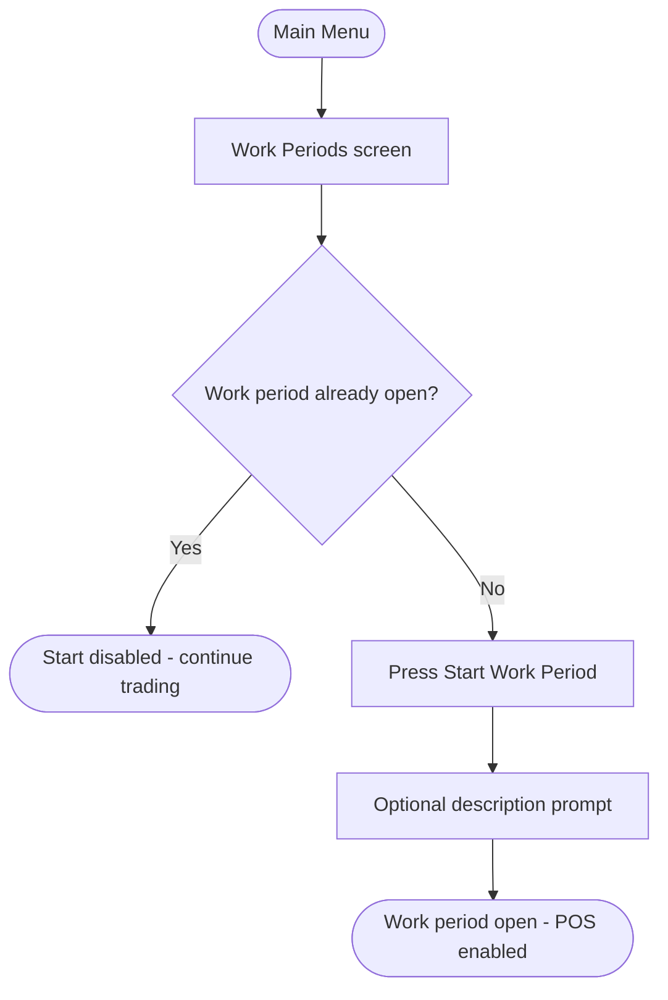

##### Step-by-step

| Step | Screen | User action | Key fields/controls | Business rules | Mockup reference | Transcript reference |
|------|--------|-------------|---------------------|----------------|------------------|----------------------|
| 1 | Main Menu | Choose Work Periods | Main menu buttons | Needs "work periods" permission | none | T1 00:06:55 |
| 2 | Work Periods | Press Start Work Period | Start/End buttons, status label | At most one open period database-wide; Start enabled only once the last has ended; times from computer clock | `manual_1-1_work-period_p02_02` | T1 00:05:15 to 00:06:32 |
| 3 | Work Periods | Enter optional description | Description prompt (e.g. "Saturday, wedding party") | Label then shows start time and elapsed duration | `manual_1-1_work-period_p02_02` | T1 00:05:33 |

#### Log in with PIN

- **Trigger:** A user approaches a terminal.
- **Business outcome:** User identified; lands in the role's default department; orders carry their name.

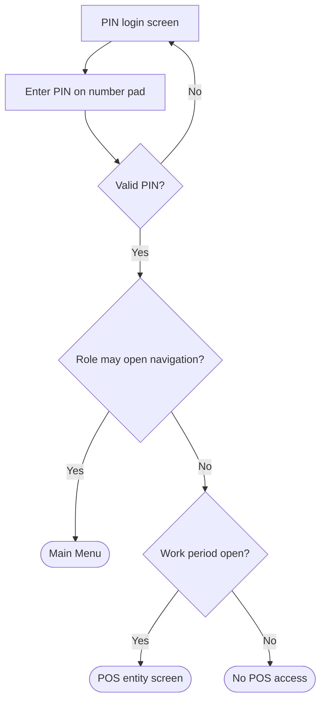

##### Step-by-step

| Step | Screen | User action | Key fields/controls | Business rules | Mockup reference | Transcript reference |
|------|--------|-------------|---------------------|----------------|------------------|----------------------|
| 1 | PIN login | Type PIN | Number pad, no user name | PIN 4 to 20 digits; default Administrator PIN 1234; hint shown on Compact/text DB while it is the only user | none (no mockup) | T1 00:06:32 |
| 2 | Main Menu or POS | Land according to role | Role default department | Role without navigation goes straight to POS when a period is open; department switching blocked while a ticket is open or no period | none | T1 00:04:43, 00:06:55 |
| 3 | (any) | Auto logout | Terminal setting Auto Logout | Closing a ticket logs the user out so the next waiter signs in | none | T1 00:07:12 |

#### Create a Ticket and Take Orders

- **Trigger:** Guests sit at a table or a counter customer orders.
- **Business outcome:** A ticket with new orders (with portions, order tags and notes) ready to be sent to the kitchen.

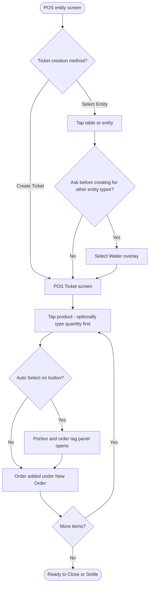

##### Step-by-step

| Step | Screen | User action | Key fields/controls | Business rules | Mockup reference | Transcript reference |
|------|--------|-------------|---------------------|----------------|------------------|----------------------|
| 1 | POS entity screen | Select entity screen then entity | Entity buttons coloured by Status state | Department "Select Entity" starts here, "Create Ticket" skips it; POS needs open work period | `v3_resource-types_07`, `manual_1-2_pos_p03_01` | T1 00:04:27, 00:07:30 |
| 2 | Entity selection overlay | Choose waiter (if configured) | Waiter list | Ticket type "Ask before creating ticket" for that entity type | `v3_resource-types_14`, `v3_resource-types_10` | T1 00:21:09 |
| 3 | POS ticket screen | Tap a product | Menu categories, products, number pad | Typing quantity first adds that quantity; barcode scanner adds by code | `v3_resource-types_09`, `manual_1-2_pos_p04_01` | T1 00:08:52 to 00:09:29 |
| 4 | Order details | Choose portion and order tags | Portion buttons, tag groups, free tag Name/Price, prefixes | Min/Max selection enforced (min 1 blocks deselect and closing); mapping decides which tags show; Auto Select opens panel automatically | `manual_2-2_order-tags_p19_01`, `manual_2-2_order-tags_p22_02` | T1 00:09:29 to 00:10:51, T3 00:05:32 |
| 5 | POS ticket screen | Add ticket note, tags, customer | Ticket Note, Select Customer, ticket tag buttons | Required ticket tag blocks completion after payment | `v3_resource-types_09` | T1 00:18:46 to 00:19:40, 00:24:44 |

#### Close the Ticket (send to kitchen)

- **Trigger:** Waiter presses Close after adding a round of orders.
- **Business outcome:** New orders printed to kitchen/bar, marked Submitted, ticket Unpaid, table turns orange.

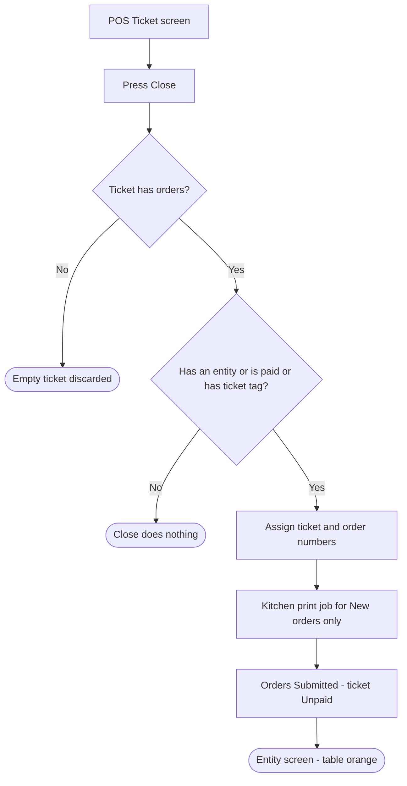

##### Step-by-step

| Step | Screen | User action | Key fields/controls | Business rules | Mockup reference | Transcript reference |
|------|--------|-------------|---------------------|----------------|------------------|----------------------|
| 1 | POS ticket screen | Press Close | Close button | Empty ticket discarded; ticket needs an entity, or is fully paid, or has a ticket tag | `v3_resource-types_11` | T1 00:15:02 to 00:16:06 |
| 2 | (automatic) | Default Ticket Closing rule runs | Rule and print job | Only orders with status New print; kitchen job skipped when none; concurrent-change check shows message if ticket was paid or moved elsewhere | none | T1 00:02:56, 00:15:24, T3 00:33:23 |
| 3 | POS entity screen | Returns to entity screen | Entity state colour | Table turns orange only on close | `v3_resource-types_07` | T1 00:15:43 |

#### Cancel, Void or Gift an Order

- **Trigger:** A wrong item was added, the guest rejects an item, or an item is given free.
- **Business outcome:** Order removed, voided (no price, no stock consumption, kitchen told) or gifted (no price, stock still consumed).

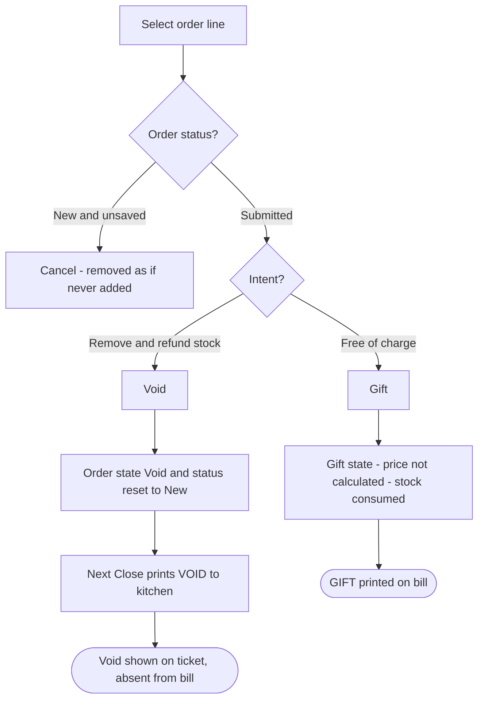

##### Step-by-step

| Step | Screen | User action | Key fields/controls | Business rules | Mockup reference | Transcript reference |
|------|--------|-------------|---------------------|----------------|------------------|----------------------|
| 1 | POS ticket screen | Select order line | Order operations column: + - Gift Void Cancel Move Change Price | + and - only on new orders; bracketed +/- on submitted lines to select part-quantity | `manual_1-2_pos_p06_01` | T1 00:11:11 to 00:12:02 |
| 2 | POS ticket screen | Press Cancel | Cancel | Built-in, only on unsaved orders | `manual_1-2_pos_p06_01` | T1 00:12:05, T3 00:32:38 |
| 3 | POS ticket screen | Press Void | Void (disabled on new orders; enabled on submitted and gifted) | Void is an automation command, can be hidden by mapping; Cancel Void only until ticket closed | `manual_1-2_pos_p04_01` (VOID:LONG WAIT) | T1 00:12:31 to 00:12:57, T3 00:34:32 |
| 4 | POS ticket screen | Press Gift | Gift; "Cancel Gift" restores price | Gift consumes stock, shows GIFT on bill with separate gift total | `manual_1-2_pos_p04_01` (GIFT:VALUED CUSTOMER) | T1 00:12:59 |
| 5 | Printer output | Close | Printer template sections `[ORDERS:GIFT]`, `[ORDERS:VOID]` | Empty void section hides voids on bill; kitchen slip shows VOID | `v3_printer-templates_05` | T3 00:28:13 to 00:29:03 |

Note: the mockup states `VOID:LONG WAIT` and `GIFT:VALUED CUSTOMER` suggest reason text; T1 (00:13:17) says V3 has no reason picker and gift/void are state commands. How the reason text is captured is not explained (section 7).

#### Split a Bill by Moving Orders

- **Trigger:** Two guests at one table want separate bills.
- **Business outcome:** Selected saved orders are moved to a new ticket on the same table.

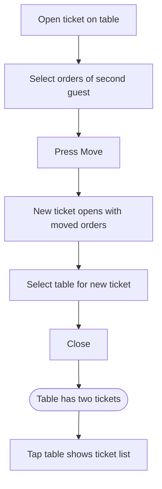

##### Step-by-step

| Step | Screen | User action | Key fields/controls | Business rules | Mockup reference | Transcript reference |
|------|--------|-------------|---------------------|----------------|------------------|----------------------|
| 1 | POS ticket screen | Select orders and press Move | Move | Only saved orders; not on a locked ticket | `manual_1-2_pos_p06_01` | T1 00:13:46 |
| 2 | Entity selection | Choose table | Table list | Normally same table | `v3_resource-types_11` (Change Table) | T1 00:13:46 |
| 3 | Ticket list | Later open one of the tickets | Ticket buttons with amounts | Shows table total remaining | `v3_resource-types_12` | T1 00:14:08 |

#### Change Table, Change Waiter, Add Ticket and Merge Tickets

- **Trigger:** Guests relocate, ticket needs another waiter, a second bill is needed, or split bills are recombined.
- **Business outcome:** Ticket re-attached; entity colours updated by default rules; merged ticket combines orders, payments, tags and entities.

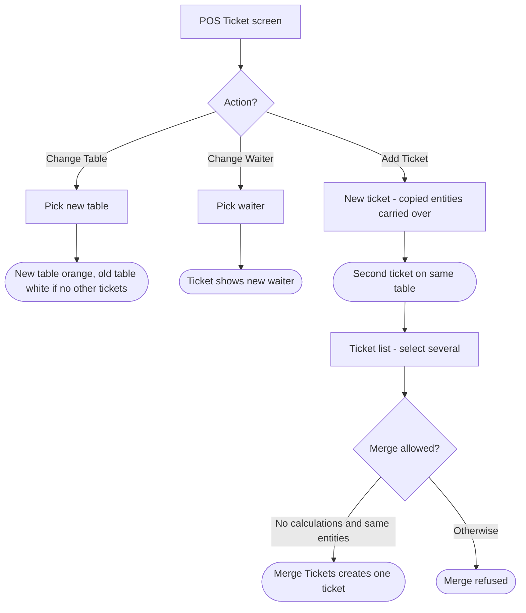

##### Step-by-step

| Step | Screen | User action | Key fields/controls | Business rules | Mockup reference | Transcript reference |
|------|--------|-------------|---------------------|----------------|------------------|----------------------|
| 1 | POS ticket screen | Press Change Table / Change Waiter / Add Ticket | Left column ticket buttons | "Copy to New Tickets" on ticket type controls carry-over | `v3_resource-types_11`, `_15` | T1 00:21:42 to 00:22:15 |
| 2 | Ticket list | Select tickets and press Merge Tickets | Merge Tickets | Merge permission; no calculations; no different entities of same type | `v3_resource-types_12` | T1 00:22:15 |

#### Print Bill, Lock and Unlock Ticket

- **Trigger:** Guests ask for the bill.
- **Business outcome:** Bill printed, ticket locked so paper and system agree; unlock needed for later changes.

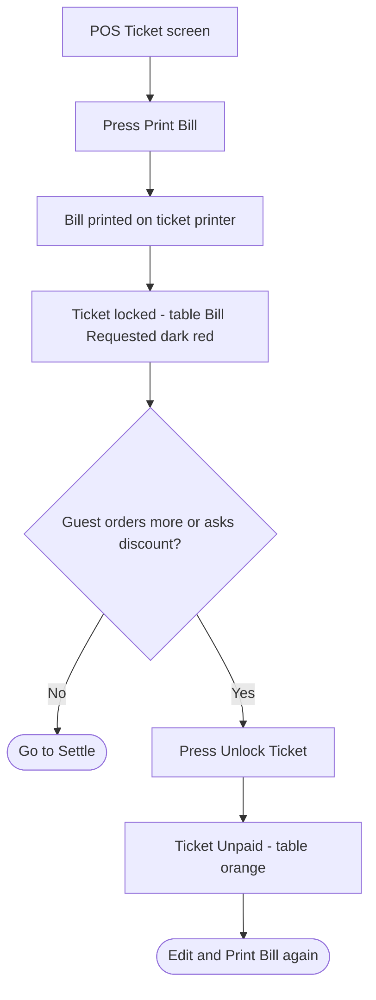

##### Step-by-step

| Step | Screen | User action | Key fields/controls | Business rules | Mockup reference | Transcript reference |
|------|--------|-------------|---------------------|----------------|------------------|----------------------|
| 1 | POS ticket screen | Press Print Bill (no order selected) | Print Bill | Default rule prints, locks, sets table Bill Requested and closes the ticket | `v3_resource-types_09` | T1 00:16:44 |
| 2 | POS ticket screen | Press Unlock Ticket (only visible on locked tickets) | Unlock Ticket, Release Lock | Locked tickets block new orders, table change, move and Change Price; calculation buttons disabled; unlocking often restricted to managers | none | T1 00:17:06 to 00:17:50, T2 00:05:03 |

#### Settle a Ticket (payment, including partial and per-item)

- **Trigger:** Guest pays; waiter or cashier presses Settle.
- **Business outcome:** Payments posted as account transactions; ticket Paid and closed when remaining amount is zero.

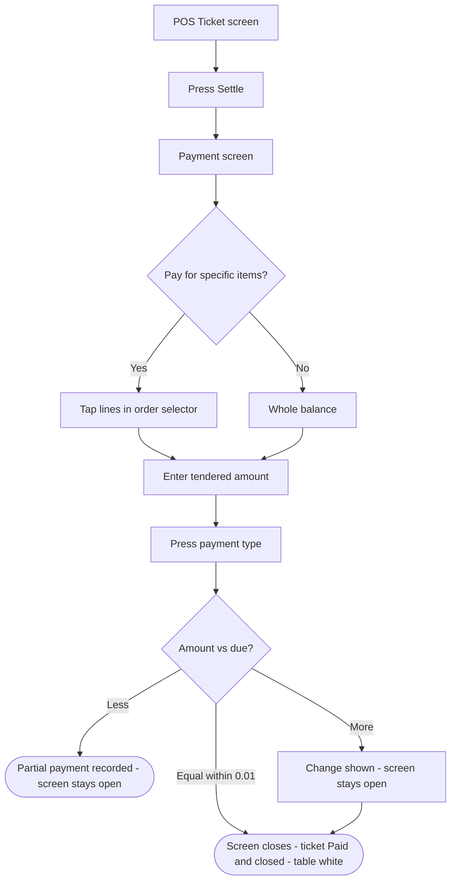

##### Step-by-step

| Step | Screen | User action | Key fields/controls | Business rules | Mockup reference | Transcript reference |
|------|--------|-------------|---------------------|----------------|------------------|----------------------|
| 1 | POS ticket screen | Press Settle | Settle command (rule: display payment screen) | Payment screen shown only if ticket has an entity or is allowed | `v3_resource-types_09` | T2 00:00:40 |
| 2 | Payment screen | Optionally select order lines | Order selector | Same product and price grouped; tapping selects one unit per tap; selector prices include spread discounts/services/taxes; paid items stay marked paid | `v3_foreign-currencies_13` | T2 00:03:02 to 00:03:51 |
| 3 | Payment screen | Enter amount | Quick values 1/5/10/20/50/100, keypad, All/1/2/1/3/1/4/1/n, repeat last amount, Ticket/Balance toggle | Quick values from program settings; amount first, then payment type; empty amount takes full due | `v3_foreign-currencies_09` | T2 00:01:24 to 00:02:32 |
| 4 | Payment screen | Press payment type | Cash, Credit Card, Voucher, Customer Account | Over-tender shows change; one-cent tolerance; Close disabled while an unpaid amount is typed | `v3_foreign-currencies_09` | T2 00:02:32 to 00:03:02, 00:29:05 |
| 5 | Payment screen | Leave with balance | Close | Ticket remains open, table occupied | `v3_foreign-currencies_13` | T2 00:02:34 |

Balance mode: payment first pays the ticket, the remainder goes to the customer's account up to their balance; cannot tender more than due and only payment types with a fixed account work (T2 00:29:18).

#### Apply a Discount or Rounding

- **Trigger:** Manager grants a percentage discount or rounds the bill.
- **Business outcome:** Ticket recalculated; amounts booked to Discount or Rounding accounts.

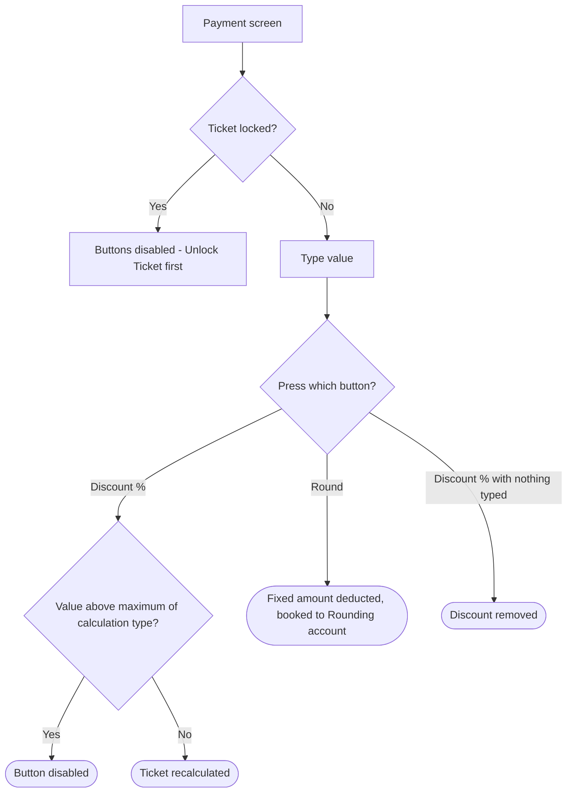

##### Step-by-step

| Step | Screen | User action | Key fields/controls | Business rules | Mockup reference | Transcript reference |
|------|--------|-------------|---------------------|----------------|------------------|----------------------|
| 1 | Payment screen | Type value, press Discount % or Round | Discount %, Round | Calculation selector mappings restrict by role, department, ticket type, terminal; if discounts push remaining negative all discount calculations are removed with a message | `v3_foreign-currencies_10` ("Discount 7% (2,76)") | T2 00:04:06 to 00:05:27 |
| 2 | POS ticket screen | Unlock first if bill printed | Unlock Ticket | Guidance: discount first, then print bill | none | T2 00:05:03 |

#### Settle to a Customer Account and Collect a Customer's Tab

- **Trigger:** Customer will pay later (tab), or later pays what they owe.
- **Business outcome:** Ticket closed against the customer's account; later receipt posts cash/card against the account.

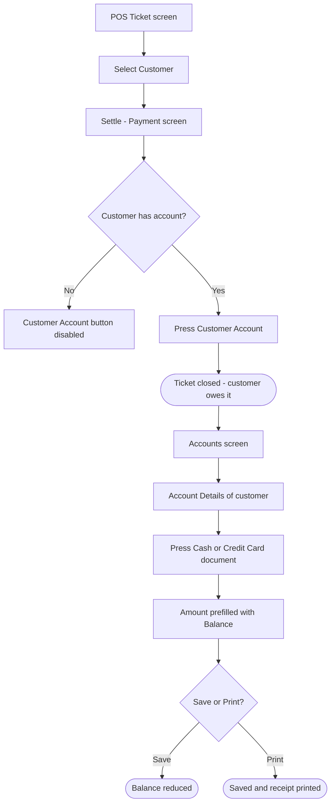

##### Step-by-step

| Step | Screen | User action | Key fields/controls | Business rules | Mockup reference | Transcript reference |
|------|--------|-------------|---------------------|----------------|------------------|----------------------|
| 1 | Customer Search | Select or create customer | Name/phone search; Create Account | Account needs account type, all template fields filled (name and phone), create-account permission | none | T1 00:22:49, T2 00:16:22 |
| 2 | Payment screen | Press Customer Account | Payment type with transaction Receivables to Customer Accounts | Disabled without account; optional credit limit via custom field "Credit Limit" | `v3_foreign-currencies_09` | T2 00:07:23 to 00:07:54 |
| 3 | Accounts | Open customer screen | Account groups, balances | Optional screen hiding zero balances to list open tabs | `manual_1-4_accounts_p08_02` | T2 00:14:22 |
| 4 | Account Details | Press Cash or Credit Card | Debit/credit/balance list, documents | Print needs printer template and terminal transaction printer | `manual_1-4_accounts_p09_01` | T2 00:14:56 to 00:16:22 |

#### Pay in a Foreign Currency with Change

- **Trigger:** A guest pays in a configured foreign currency.
- **Business outcome:** Payment posted to the currency's cash account; change returned in a chosen currency; each drawer section reconciles.

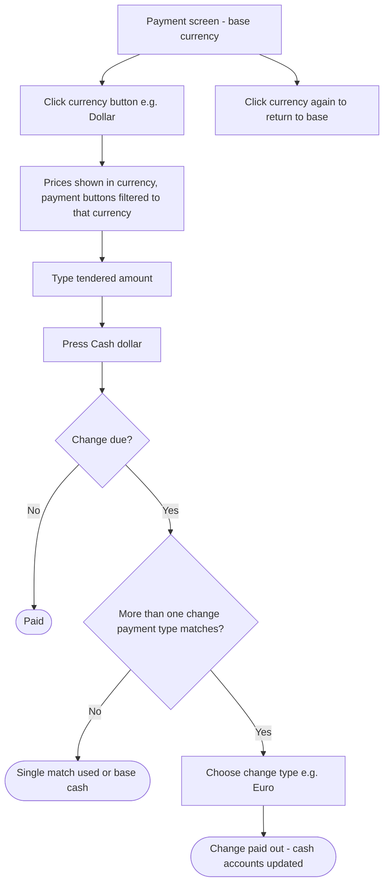

##### Step-by-step

| Step | Screen | User action | Key fields/controls | Business rules | Mockup reference | Transcript reference |
|------|--------|-------------|---------------------|----------------|------------------|----------------------|
| 1 | Payment screen | Click currency button | "$ 21,82" / "18,63 EUR" buttons | Live conversion; no buttons if only base at rate 1 | `v3_foreign-currencies_09` | T2 00:21:18 |
| 2 | Payment screen | Select Dollar | Order prices in dollars, Cash ($) only | Prices rounded to currency rounding step (0.25); rounding remainder goes on the cheapest order | `v3_foreign-currencies_10` | T2 00:21:37 |
| 3 | Payment screen | Select Euro | Cash (EUR) only | Rounding 0 shows raw converted prices | `v3_foreign-currencies_11` | T2 00:22:25 |
| 4 | Payment screen | Partial payment then close with rest unpaid | Payment total, Balance 15,54 | Receivables hold the unpaid part | `v3_foreign-currencies_13` | T2 00:22:25 |
| 5 | Payment screen | Tender 10 and press Cash ($) | Charged 10,00; offer of one button per change payment type | Asks only when a foreign currency is selected and more than one change type matches; never in base currency | `v3_foreign-currencies_18`, `_19`, `_20` | T2 00:23:00 to 00:24:42 |
| 6 | Accounts | Verify balances | Dollar Cash $10, Euro Cash 8,79 EUR | Each currency has its own cash account | `v3_foreign-currencies_21`, `_12` | T2 00:24:44 |

#### Find a Ticket (Tickets screen)

- **Trigger:** Manager needs to find open or past tickets, or check who ordered what.
- **Business outcome:** Ticket found and displayed, bill reprinted, or open tickets settled before end of day.

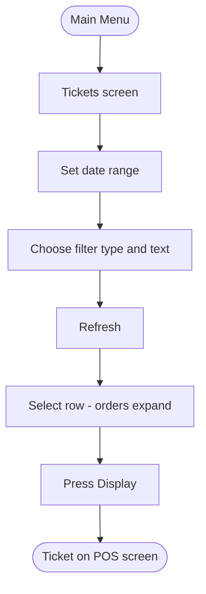

##### Step-by-step

| Step | Screen | User action | Key fields/controls | Business rules | Mockup reference | Transcript reference |
|------|--------|-------------|---------------------|----------------|------------------|----------------------|
| 1 | Tickets | Choose dates and filter | From/To, arrows, Refresh, filter drop-down | Default is today's open tickets; "display old tickets" permission needed | `manual_1-3_tickets_p07_02` | T1 00:23:31 to 00:24:25 |
| 2 | Tickets | Select row, Display | Expanded order list, Display | With open/all, text filters by product name; paid tickets cannot be reopened for modification | `manual_1-3_tickets_p07_02` | T1 00:24:25 to 00:24:44 |

#### Review Accounts

- **Trigger:** Owner or cashier wants current financial position or to reconcile the drawer.
- **Business outcome:** Sales, receivables, discounts and per-account balances visible without running a report.

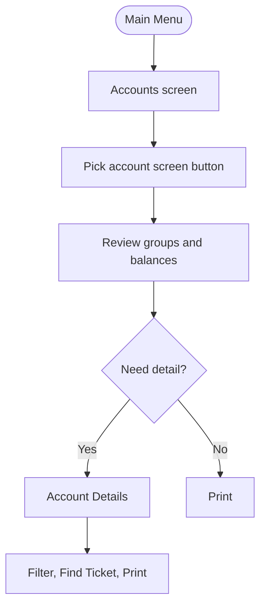

##### Step-by-step

| Step | Screen | User action | Key fields/controls | Business rules | Mockup reference | Transcript reference |
|------|--------|-------------|---------------------|----------------|------------------|----------------------|
| 1 | Accounts | Open and choose account screen | Account screen buttons, Debit/Credit/Balance | Accounts with a currency show an extra currency column | `manual_1-4_accounts_p08_02`, `v3_foreign-currencies_12` | T2 00:13:57 to 00:14:22 |
| 2 | Account Details | Filter, Find Ticket, Print | Filter Default/All/This Month/..., Find Ticket | Find Ticket opens the ticket behind a transaction | `manual_1-4_accounts_p09_01` | T2 00:14:56 |

#### Run the Work Period Report and End the Work Period

- **Trigger:** Closing time.
- **Business outcome:** All tickets settled, report printed or saved, period ended, End of Day Record created.

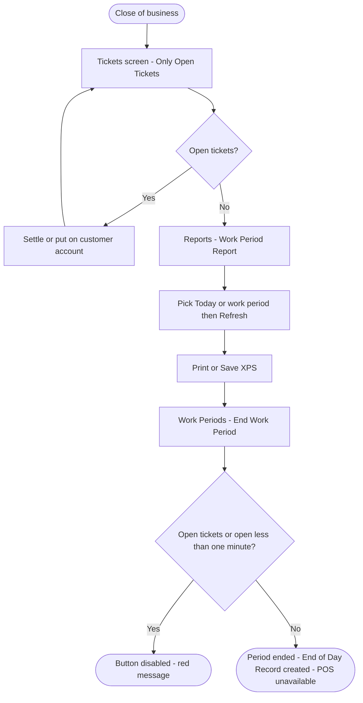

##### Step-by-step

| Step | Screen | User action | Key fields/controls | Business rules | Mockup reference | Transcript reference |
|------|--------|-------------|---------------------|----------------|------------------|----------------------|
| 1 | Tickets | Find and settle open tickets | Filter "Only Open Tickets" | Every ticket must be paid or on an account; typical causes: cash taken but not settled, test tickets | `manual_1-3_tickets_p07_02` | T1 00:25:18 to 00:25:35 |
| 2 | Reports | Run Work Period Report | Filter, Refresh, Print, Save | Can be run for the current period; banner reminds to end the period | `manual_1-6_reports_p12_02`, `manual_1-6_reports_p13_01` | T2 00:28:37 |
| 3 | Work Periods | End Work Period | End button, red message "There are 3 open tickets..." | Ending creates End of Day Record automatically; no manual creation | `manual_1-1_work-period_p02_02` | T1 00:25:18 to 00:26:25 |
| 4 | End of Day Records | (optional) count stock before starting next period | Current Inventory column | See "Count Stock and Close Inventory" below | `manual_2-7_end-of-day-records_p35_01` | T3 00:24:19 |

### 3.2 Configuration workflows

#### Set Up a Foreign Currency

- **Trigger:** Business accepts a second currency (tourist area).
- **Business outcome:** Currency selectable on the payment screen with its own cash account, payment type and optional change types.

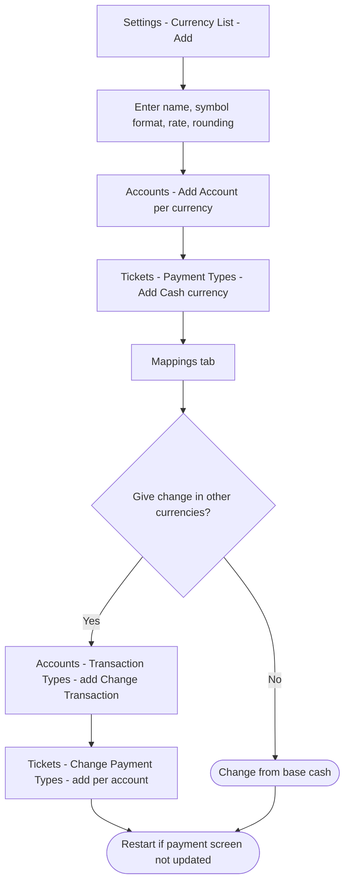

##### Step-by-step

| Step | Screen | User action | Key fields/controls | Business rules | Mockup reference | Transcript reference |
|------|--------|-------------|---------------------|----------------|------------------|----------------------|
| 1 | Foreign Currency editor | Add Dollar, Euro | Name, Currency Symbol, Exchange Rate, Rounding | Symbol must include `{0}`; rate entered by hand | `v3_foreign-currencies_01`, `_02` | T2 00:18:52 to 00:20:06 |
| 2 | Account List / Editor | Add "Dollar Cash", "Euro Cash" | Account Type = Payment Accounts, Currency | Each currency needs own cash account | `v3_foreign-currencies_03`, `_04`, `_05` | T2 00:20:06 |
| 3 | Payment Type editor | Add "Cash ($)" | Template Name, Transaction Type, Account, Mappings | Mapping rows required or button never appears | `v3_foreign-currencies_06`, `_07`, `_08` | T2 00:20:39 |
| 4 | Transaction Type editor | Clone Payment Transaction as "Change Transaction" with swapped account types | Source/Target Account Type, defaults | Reverses the payment | `v3_foreign-currencies_14`, `_15` | T2 00:23:19 |
| 5 | Change Payment Type editor | Add TL/Dollar/Euro Change | Template Name, Transaction Type, Account | Mappings required | `v3_foreign-currencies_16`, `_17` | T2 00:23:19 |

#### Configure Entity Types, Entities and Entity Screens

- **Trigger:** Business wants something other than tables on tickets (waiters, rooms, drivers).
- **Business outcome:** A new entity button appears on the POS entity screen and, if configured, is asked for at ticket creation.

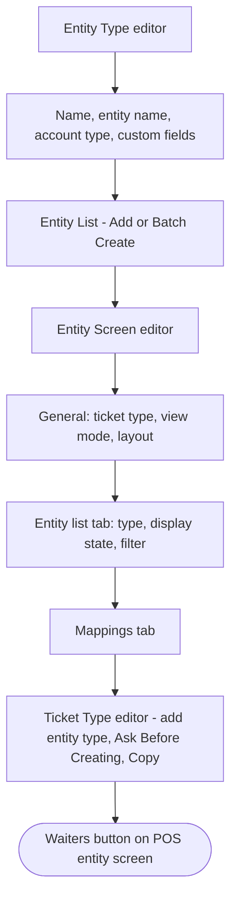

##### Step-by-step

| Step | Screen | User action | Key fields/controls | Business rules | Mockup reference | Transcript reference |
|------|--------|-------------|---------------------|----------------|------------------|----------------------|
| 1 | Entity Type editor | Create "Waiters" | Name, Entity Name, custom fields Phone/Address | Field types String, WideString, Number, Date, Query; mask for editing; account type enables Create Account | `v3_resource-types_01` | T3 00:14:41 to 00:16:19 |
| 2 | Entity List | Batch create "#Waiters" plus names | Batch Create dialog | Existing names skipped | `v3_resource-types_02`, `_03` | T3 00:16:19 |
| 3 | Entity Screen editor | Define screen | Ticket Type, View Mode, columns/rows, Display State | Save fails if no entity type chosen ("Resource Type Id must be greater than 0") | `v3_resource-types_04`, `_05` | T3 00:16:37 to 00:17:23 |
| 4 | Entity Screen editor | Mappings | User Role, Department, Ticket Type | Default `* * *`; no row means hidden | `v3_resource-types_06` | T3 00:17:23 |
| 5 | Ticket Type editor | Add Waiters, Ask Before Creating Ticket | Entity type list | Ask first, then ticket opens with both table and waiter | `v3_resource-types_13` | T3 00:18:22 |
| 6 | POS entity screen | Verify | Waiters tab | Tap waiter creates ticket assigned to him, closable without a table | `v3_resource-types_07`, `_08` | T3 00:18:00 |

#### Build Products and the Screen Menu

- **Trigger:** New installation or menu change.
- **Business outcome:** Products with portions and prices placed on POS menu buttons.

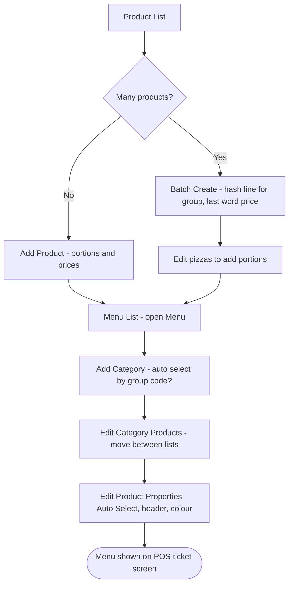

##### Step-by-step

| Step | Screen | User action | Key fields/controls | Business rules | Mockup reference | Transcript reference |
|------|--------|-------------|---------------------|----------------|------------------|----------------------|
| 1 | Product List | Batch Create | Text box, OK/Cancel | Hash = group; last word = price; comma or dot; single portion only | `manual_2-1_products-menus_p16_01` | T3 00:02:50 to 00:03:44 |
| 2 | Product editor | Set barcode, portions | Product Name, Group Code, Portion Prices | At least one portion ("Normal") | `manual_2-1_products-menus_p15_01` | T3 00:02:05 |
| 3 | Menu editor | Add categories, assign products | Category list, two-list selector | Auto-select by group code if codes are clean | `manual_2-1_products-menus_p17_01` | T3 00:04:15 to 00:04:47 |
| 4 | Menu button properties | Set Auto Select, sub menu tags | Grid of button properties | Auto Select recommended for steak, not for Coke; sub-menu levels comma-separated; Max Items controls root buttons | `manual_2-1_products-menus_p18_01` | T3 00:04:43 to 00:06:57 |

#### Configure Order Tag Groups (modifiers)

- **Trigger:** Kitchen needs cooking level, extras or free text on order lines.
- **Business outcome:** Modifier groups with limits, prices and mappings appear on selected products.

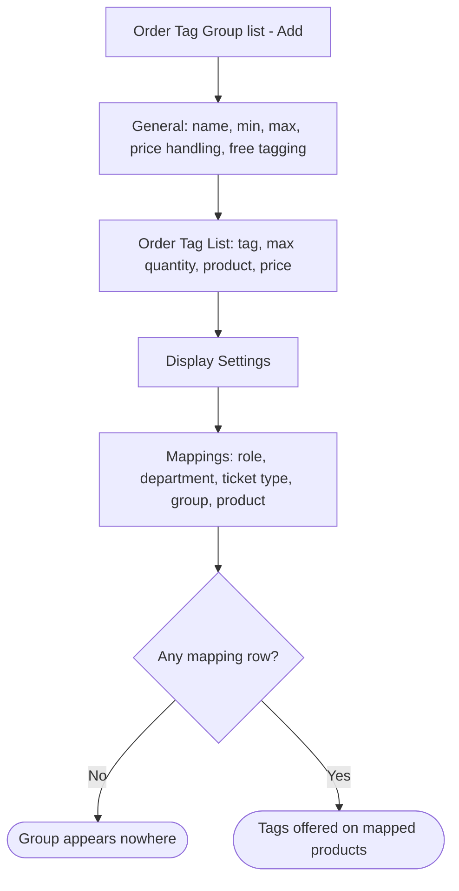

##### Step-by-step

| Step | Screen | User action | Key fields/controls | Business rules | Mockup reference | Transcript reference |
|------|--------|-------------|---------------------|----------------|------------------|----------------------|
| 1 | Order Tag Group editor | Set limits and pricing | Min/Max Selected, Add Tag Price To Order Price, Tax Free | Min 1 / Max 1 = exactly one | `manual_2-2_order-tags_p20_01` | T3 00:07:51 to 00:08:31 |
| 2 | Order Tag List | Add tags | Tag, Max Quantity, Product, Price | Product on tag consumes that product's recipe | `manual_2-2_order-tags_p21_01`, `manual_2-5_inventory-consumption-order-tags_p33_01` | T3 00:08:31, 00:10:08 |
| 3 | Mappings | Add rows | User Role, Department, Ticket Type, Product Group, Product | No mapping = invisible (top support call); no portion mapping in V3 | `manual_2-2_order-tags_p23_01` | T3 00:08:54 to 00:10:08 |

#### Count Stock and Close Inventory (inventory cycle)

- **Trigger:** Business tracks stock and costs.
- **Business outcome:** Stock levels, consumption and real product costs reconciled each work period.

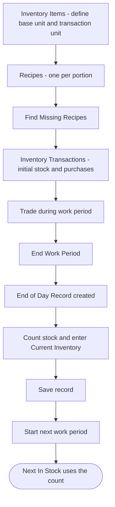

##### Step-by-step

| Step | Screen | User action | Key fields/controls | Business rules | Mockup reference | Transcript reference |
|------|--------|-------------|---------------------|----------------|------------------|----------------------|
| 1 | Inventory Item editor | Create item | Base Unit, Transaction Unit, Multiplier, Warehouse | Base unit used by recipes; multiplier zero if same unit | `manual_2-3_inventory-items_p25_01` | T3 00:20:08 |
| 2 | Recipe editor | Create recipe per portion | Items grid, Fixed Cost | Missing recipe for a sold portion makes calculation fail with an error | `manual_2-4_inventory-recipes_p28_01` | T3 00:21:00 to 00:22:10 |
| 3 | Inventory Transactions | Enter purchase document | Document No, lines | Open work period required; no zero quantities; every line needs a unit | `manual_2-6_inventory-transactions_p34_02`, `manual_1-5_warehouses_p11_01` | T3 00:22:10 to 00:23:18 |
| 4 | End of Day Records | Enter Current Inventory | In Stock, Purchase, Cost, Consumption, Prediction, Current Inventory | Count only between work periods; difference distributed by recipe ratios | `manual_2-7_end-of-day-records_p35_01` | T3 00:23:34 to 00:25:33 |
| 5 | End of Day Records – Costs tab | Review cost | Cost Prediction versus Current Cost | Real cost per product after count | `manual_2-7_end-of-day-records_p35_01` | T3 00:25:33 |

#### Design Printer Templates

- **Trigger:** Installer customises the bill or kitchen slip.
- **Business outcome:** Printed output with entity, order, state-specific lines.

```mermaid
flowchart TD
    A[Printer Template editor] --> B[Write layout with format tags]
    B --> C[Insert collection tags ORDERS and ENTITIES]
    C --> D[Define section per collection]
    D --> E[Add state sections ORDERS Gift and ORDERS Void]
    E --> F[Save]
    F --> G([Assign in Print Job printer map])
```

##### Step-by-step

| Step | Screen | User action | Key fields/controls | Business rules | Mockup reference | Transcript reference |
|------|--------|-------------|---------------------|----------------|------------------|----------------------|
| 1 | Printer Template editor | Enter name and layout | Template Name, Merge Lines, text | Name mandatory | `v3_printer-templates_01`, `_02` | T3 00:27:29 |
| 2 | Printer Template editor | Replace placeholder lines with `{RESOURCES}` / `{ORDERS}` | Token documentation panel | Collection tags need matching sections | `v3_printer-templates_03` | T3 00:27:31 |
| 3 | Printer Template editor | Add `[ORDERS]`, `[RESOURCES:Table]`, `[RESOURCES:Customer]` | Section headings | Lines starting `--` are comments | `v3_printer-templates_04` | T3 00:28:11, 00:29:30 |
| 4 | Printer Template editor | Add `[ORDERS:GIFT]` and empty `[ORDERS:VOID]` | State sections | Empty means print nothing; missing falls back to `[ORDERS]` | `v3_printer-templates_05` | T3 00:28:44 to 00:29:03 |

Format tags in the editor: `<T>` title, `<F>` fill, `<EB>`/`<DB>` bold on/off, `<J>` justify, `<C>`, `<L>`, `<R>`, `<BEEP>`, `<BMP>`, `<CUT>` (T3 00:29:44).

#### Maintain Users and Roles

- **Trigger:** New staff member or permission change.
- **Business outcome:** Staff can log in with their own PIN and see only permitted functions.

```mermaid
flowchart TD
    A[User List] --> B[Add User]
    B --> C[Name, PIN 4 to 20 digits, role]
    C --> D{Role selected?}
    D -->|No| E([Cannot save])
    D -->|Yes| F([User saved])
```

##### Step-by-step

| Step | Screen | User action | Key fields/controls | Business rules | Mockup reference | Transcript reference |
|------|--------|-------------|---------------------|----------------|------------------|----------------------|
| 1 | User List | Add or select user | Add User, Edit/Delete (disabled until selection), Change Sort Order | none | `manual_2-10_users_p36_01` | T3 00:37:32 |
| 2 | User Editor | Enter details | User Name, Pin Code, User Role | PIN 4 to 20 digits; role required; change default Administrator PIN 1234 | `manual_2-10_users_p36_02` | T3 00:37:34 |

#### Configure Automation (rules, actions, commands)

- **Trigger:** Installer changes behaviour (cover charges, tips, online partners, state colours).
- **Business outcome:** Behaviour held as data: buttons fire commands; rules react to events.
- **Mockup coverage:** None. Described only in transcripts.

```mermaid
flowchart TD
    A[Define Rule Actions with parameters] --> B[Define Automation Command with header and mapping]
    B --> C[Define Rule: event plus constraints plus actions]
    C --> D[Rule mappings]
    D --> E([User presses button or event fires - rule runs])
    E --> F{Default rules broken?}
    F -->|Yes| G[regen.txt in user data folder and restart]
    F -->|No| H([Behaviour as configured])
```

Examples from T2/T3: Guest Count tag to Add Order of product Cover with `[:Cover Quantity]` bound to `[:NumericValue]` (T3 00:13:01); Tip tag to Update Ticket Calculation (T2 00:09:50); Online Order tag to Change Ticket Entity and Display Payment Screen (T2 00:17:13); one-touch payment through Pay Ticket action (T2 00:06:37). Default rules: ticket created, order added, ticket closing, Unpaid state, Print Bill, Unlock Ticket, Settle, Close, payment check, entity updated, ticket moved, tickets merged (T3 00:33:23 to 00:34:32).

### 3.3 Workarounds

Workarounds and constraints users or installers described (no screen-level mockup support unless noted):

1. **Delivering "pay later" on fast food:** tag the ticket with a name or seat number, close it, and later find it by pressing the tag button with no ticket open (T1 00:25:00).
2. **Tracking who owes money:** because the Accounts Liability / Receivable / Internal Accounts reports come up empty, staff use an Accounts screen showing only Customer Accounts with zero balances hidden, and print from there or print per-customer Account Details (T2 00:26:47).
3. **Open-price or missing-price items:** fix a zero-priced product at sale time with Change Price before payment (T1 00:28:26).
4. **Closed day with unpaid tickets:** put the ticket on a Customer Account to be able to end the work period (T2 00:28:37).
5. **Fixed one-touch payment under the ticket:** the old "display under ticket" flag was removed; installers create an automation command and a Pay Ticket rule instead (T2 00:06:37).
6. **Order tag per portion:** not supported, so installers create separate products for different sizes (T3 00:09:50).
7. **Top-selling items:** V3 lacks automatic top-items sorting; staff manually sort popular items to the top and manually maintain the Fast Menu (T3 00:06:57).
8. **Waiter reporting:** use a ticket tag when only reporting is needed, an entity when more power is needed; installer's choice (T1 00:20:20).
9. **Cover charge, tips, online partner accounts:** assembled from ticket tags plus rules and calculation types because no dedicated feature exists (T1 00:19:40, T2 00:09:50, 00:17:13).
10. **Flat tax on the whole ticket:** modelled as an increasing calculation type but reported as a service, hence tax templates are recommended (T2 00:11:21).
11. **Currency not picked up:** restart SambaPOS after adding payment types or currencies because configuration is cached (T2 00:21:16).
12. **Broken default rules:** place `regen.txt` in the user data folder and restart (T3 00:35:39).
13. **Manual exchange rate updates:** someone must update rates by hand (T2 00:19:30).
14. **Reopening paid tickets:** requested by users but not supported; closed tickets can only be displayed and the bill reprinted (T1 00:24:30).
15. **Inexact recipes:** recipe quantities act only as weights; the physical count redistributes cost (T3 00:25:26).

---

## 4. Screen Navigation Map

Derived from side menus, tabs, buttons and footers in the mockups, supplemented by transcript navigation sequences (T1 00:06:55 for the main menu; T3 00:00:58 for Manage).

```mermaid
flowchart TD
    LOGIN[PIN Login - no mockup] --> MM[Main Menu - no mockup]
    LOGIN -->|role without navigation and period open| ES
    MM --> WP[Work Periods]
    MM --> ES[POS Entity Screen]
    MM --> TK[Tickets search]
    MM --> ACC[Accounts]
    MM --> WH[Warehouses]
    MM --> REP[Reports]
    MM --> MGR[Manage Dashboard]
    MM --> LOGIN

    WP -->|Start enables POS| ES
    WP -->|End creates| EOD[End of Day Records]
    WP -.->|Visit Reports message| REP

    ES -->|tap entity| PT[POS Ticket screen]
    ES -->|entity with several tickets| TL[Ticket List for entity]
    ES -->|Ask before creating| SEL[Entity selection overlay]
    SEL --> PT
    TL --> PT
    TL -->|Merge Tickets| PT
    PT -->|Change Table / Select Waiter / Select Customer| SEL
    PT -->|Close| ES
    PT -->|Print Bill| ES
    PT -->|Settle| PAY[Payment Screen]
    PAY -->|Close or fully paid| PT
    PAY -->|fully paid| ES
    PT -->|Add Ticket| PT

    TK -->|Display| PT
    ACC -->|Account Details| AD[Account Details]
    AD -->|Find Ticket| PT
    WH -->|Purchase Transaction| PD[Purchase document]
    REP --> WPR[Work Period Report and other reports]

    MGR --> PRODM[Products: Product List, Menu List, Price Definitions]
    MGR --> TKM[Tickets: Ticket Types, Ticket Tags, Order Tags, Payment Types, Change Payment Types, Calculation Types]
    MGR --> ENTM[Entities: Entity Types, Entities, Entity Screens]
    MGR --> ACCM[Accounts: Account Types, Accounts, Account Screens, Transaction Types, Document Types, Transaction Documents]
    MGR --> INVM[Inventory: Items, Recipes, Transactions, End of Day Records]
    MGR --> AUTM[Automation: Actions, Rules, Commands, Triggers]
    MGR --> SETM[Settings: Departments, Printers, Print Jobs, Printer Templates, Local Settings, Terminals, Numerators, Currency List]
    MGR --> USRM[Users: User List, Roles]

    INVM --> EOD
    INVM --> PD
    TKM --> ENTM
    ENTM -.->|entity type used by| TKM
    SETM -.->|templates used by print jobs| PT
    PRODM -.->|menu shown on| PT
    ACCM -.->|account screens shown on| ACC
```

Notes:
- Solid arrows are navigation actually evidenced by buttons, tabs or menus; dotted arrows are configuration dependencies, not clickable navigation.
- The mockups show a persistent module bar (Settings, Products, Tickets, Accounts, Resources, Automation, Users, Samba Network) inside management; each module opens a side menu and list/editor tabs. "Samba Network" appears in the screenshots but is not discussed in the transcripts.
- "Main Menu" in every footer returns to the main menu. The mockups do not capture any hyperlink targets (all links are `#`), so navigation is inferred from labels.

---

## 5. Cross-Reference: Transcripts to Screens

### 5.1 Transcript to screen mapping

| Transcript | Screens discussed (with mockup) | Screens discussed (no mockup) |
|------------|--------------------------------|-------------------------------|
| T1 `output/transcripts/01_product-owner_daily-operations_curated.txt` | Work Periods; POS Entity Screen; POS Ticket screen; Ticket List for an Entity; Entity Selection Overlay; Tickets; Entity Screen Editor (via waiter example); Ticket Type Editor | PIN login; Main Menu; Customer Search; Ticket Tag selector; Departments |
| T2 `output/transcripts/02_product-owner_payments-accounts-reporting_curated.txt` | Payment Screen; Accounts; Account Details; Reports; Foreign Currency editor; Account List/Editor; Payment Type list/editor; Account Transaction Type; Change Payment Type | Calculation types/selectors; Tax templates; Account Screens; Document Types; Customer card |
| T3 `output/transcripts/03_product-owner_configuration-inventory-automation_curated.txt` | Manage Dashboard; Product List/Batch/Editor; Menu editor; Order Tag Groups; Entity Type; Entity List; Entity Screen; Ticket Type; Inventory Item; Recipe; Inventory Transactions; End of Day Records; Printer Template; Users; Warehouses (purchases) | Departments; Terminals; Local Settings; Numerators; States; Printers; Print Jobs; Ticket Tags editor; Rule/Action/Command/Trigger editors; Role editor; Price Definitions; Batch Price List |

### 5.2 Mockups with no transcript coverage (or partial)

| Mockup(s) | Observation |
|-----------|-------------|
| `manual_1-2_pos_p04_01` buttons Select SambaCard, Petty Expense, Open Drawer | No transcript mention |
| `manual_1-3_tickets_p07_02` columns Suppliers, Deliverer, SambaCard, Gift Certificate | No transcript mention |
| `manual_1-4_accounts_p08_02` account screens SambaCard, Customer Tabs, Gift Certificates, Expenses, Suppliers; accounts SambaCard Refund/Sales, Bank, GC Funds/Balances/Purchases/Redemptions | Only "General" screen is described in transcripts |
| `manual_1-5_warehouses_p10_02`, `p11_01` (Warehouses screen; Suppliers field) | Warehouses is in the main menu list (T1) and purchases are discussed (T3), but the screen itself and Suppliers are not |
| `manual_1-6_reports_p12_02`, `p13_01` report list items SambaCard Work Period Report, SambaCard Transactions, Group Sales Advanced, Money Flow Report, Outstanding Customer Balance, Customer Transaction Report, Cash Transactions Report, Inventory Transaction Report, Inventory Report Group, Inventory by Warehouse, Void & Gift Report, Settlements by User | Transcript T2 lists a different set (section 6) |
| `manual_2-1_products-menus_p14_02` Product Tag Editor tab; `p15_01` Custom Tags (Silver/Gold/Platinum/Staff %, Subtitle) | No transcript mention |
| `manual_2-2_order-tags_p22_01` Prefix List tab; `p21_01` columns Rate, Header, Description, Filter; `p20_01` Group Tag, Category Tags, Free Tag Format; `p21_02` Display Format, Hidden | No transcript mention |
| `manual_2-4_inventory-recipes_p29_01` Inventory Product editor with Units; `p27_01` concept diagram | No transcript mention of nested recipes |
| `manual_2-10_users_p36_02` Password field | Not mentioned; transcripts say login is PIN only |
| `v3_foreign-currencies_12`, `_21` annotations ("We have 10 EUR in Euro Cash") | Covered by T2 narration |
| `manual_1-1_*_p02_01`, `manual_1-2_pos_p03_02`, `manual_1-3_tickets_p07_01`, `manual_1-4_accounts_p08_01`, `manual_1-5_warehouses_p10_01`, `manual_1-6_reports_p12_01`, `manual_2-1_products-menus_p14_01` | Section divider pages with a title only |
| `manual_2-1_products-menus_p14_02` Product List | Covered by T3 narrative |

### 5.3 Items not applicable to V3 or not confirmed as V3

The knowledge base section 9 was not available to this agent. The following are therefore flagged from transcript evidence only. Items labelled **Contradicted** are contradicted by the transcripts; **Unconfirmed** items are merely absent from them. Downstream steps should verify the unconfirmed ones against the knowledge base.

| Item | Mockup | Status |
|------|--------|--------|
| "Display at payment screen" and "Display under ticket" mapping checkboxes | `v3_foreign-currencies_08` | Contradicted: removed from V3 later (T2 00:06:37); replaced by automation commands |
| Order tag mapping by "Product Portion" | `manual_2-2_order-tags_p23_01` | Contradicted: not supported in this version (T3 00:09:50) |
| Accounts Liability / Accounts Receivable / Internal Accounts reports | (not in mockups) | Listed in T2 but empty in current build |
| "Internal" account flag, ticket tag linked accounts / settle option | (not in mockups) | Contradicted: absent in V3 (T2 00:17:13) |
| Major/minor currency name in Local Settings | (not in mockups) | Contradicted (T3 00:38:56) |
| SambaCard (select, accounts, transactions, work period report), Gift Certificates (accounts GC Funds, GC Balances, GC Purchases, GC Redemptions; tabs), Suppliers (accounts tab, ticket column, purchase field), Expenses tab, Deliverer column, Customer Tabs screen | `manual_1-2_pos_p04_01`, `manual_1-3_tickets_p07_02`, `manual_1-4_accounts_p08_02`, `manual_1-5_warehouses_p11_01`, `manual_1-6_reports_p12_02` | Unconfirmed: not discussed in any transcript; the transcripts describe a default of "General" account screen only. Treat as not applicable to V3 until checked |
| Petty Expense and Open Drawer ticket buttons | `manual_1-2_pos_p04_01` | Unconfirmed: transcripts list default commands as Close, Settle, Print Bill, Unlock Ticket, Add Ticket, Gift, Cancel Gift, Void, Cancel Void (T3 00:32:38); these could be installer-defined commands |
| Manual report list (Money Flow, Group Sales Advanced, Void & Gift, Settlements by User, etc.) | `manual_1-6_reports_p12_02` | Unconfirmed: differs from T2 report list |
| Product Tag Editor, Custom Tags (Silver/Gold/Platinum/Staff %), Subtitle | `manual_2-1_products-menus_p14_02`, `p15_01` | Unconfirmed |
| Prefix List (No/Less/More/Double) for order tags | `manual_2-2_order-tags_p22_01`, `p22_02` | Unconfirmed |
| Inventory "Products" tab with Units and nested "Product" recipe lines | `manual_2-4_inventory-recipes_p29_01`, `p30_01`, `p31_01` | Unconfirmed |
| User Password field | `manual_2-10_users_p36_02` | Unconfirmed |
| Main module bar entries "Entities", "Inventory", "Printing" (manual) versus "Resources" (early V3) | manual and V3 mockups | Naming differs by build |

---

## 6. Reports Seen

| Report | Where seen | Content | Source |
|--------|------------|---------|--------|
| Work Period Report | `output/html/manual_1-6_reports_p12_02.html`, `p13_01.html` | Sales (tickets, discount, auto round, grand total), Payments with percentages, Customer Transaction Total, Customer Receivables, Ticket Counts, Amount per Ticket, Order Counts. T2 adds: per ticket type sales, post-tax services such as tips, tax per template, incomes, refunds, order tag totals, order states (gifts and voids), ticket tags blocks, user sales, item sales by product group | T2 00:27:13 to 00:28:37 |
| Accounts screen (acts as a dashboard) | `manual_1-4_accounts_p08_02`, `v3_foreign-currencies_12`, `_21` | Dashboard-style position: sales, receivables, discounts, payment accounts, customer balances, currency balances | T2 00:12:52 |
| Account Details | `manual_1-4_accounts_p09_01` | Transaction statement per account | T2 00:14:56 |
| End of Day Record (Inventory and Costs tabs) | `manual_2-7_end-of-day-records_p35_01` | Stock, purchases, consumption, prediction, count, product costs | T3 00:23:34 |
| Warehouse stock view | `manual_1-5_warehouses_p10_02` | In Stock, Purchase, Cost, Consumption, Prediction | T3 |
| Reports listed in transcripts | none | Work Period Report, Item Sales Report, Accounts Liability, Accounts Receivable, Internal Accounts (last three empty in this build), Inventory Purchase Report, Inventory Report, Cost Report, CSV Builder | T2 00:25:45 |
| Reports listed in manual mockup only | `manual_1-6_reports_p12_02` | SambaCard Work Period Report, SambaCard Transactions, Group Sales Advanced, Item Sales Report, Money Flow Report, Outstanding Customer Balance, Customer Transaction Report, Cash Transactions Report, Inventory Transaction Report, Inventory Report Group, Inventory by Warehouse, Inventory Report, Cost Report, Void & Gift Report, Settlements by User | Mockup only; see 5.3 |
| Printed outputs | `v3_printer-templates_01` to `_05` | Customer bill ("TICKET") and kitchen slip layouts | T3 00:26:36 |

Report filters: Today, Yesterday, This Week, Last Week, This Month, Last Month, individual work periods, custom start and end date; Refresh rebuilds; Print goes to the terminal report printer; Save writes XPS (T2 00:26:14). Mockups show Past Week/Past Month variants.

---

## 7. Restricted Screens and Roles

| Screen / function | Restriction | Source |
|-------------------|-------------|--------|
| POS (all) | Disabled until a work period is open | T1 00:05:33 |
| Work Periods | "work periods" permission | T3 00:37:00 |
| Manage dashboard and all configuration screens | "management dashboard" permission; waiters never see it | T3 00:01:51 |
| Accounts | Role permission; waiters usually excluded | T2 00:14:00 |
| Create Account on customer | Separate "create accounts" permission | T2 00:16:26, T3 00:15:50 |
| Reports | "can display reports"; separate "change report date filter" permission | T2 00:25:45 |
| Tickets screen and old dates | "display old tickets" | T1 00:24:25 |
| Other waiters' tickets | "display other waiters' tickets"; otherwise message and only own last-modified tickets in Tickets | T1 00:23:15 |
| Change item price | "change item price" unless the product price is zero | T1 00:14:25 |
| Add items to locked tickets / Release Lock | Role permission; often managers only | T1 00:17:22 |
| Move orders, Merge tickets | Role permissions | T1 00:13:46, 00:22:15 |
| Change department / use department | Permissions; cannot switch with open ticket or without work period | T1 00:04:43 |
| Inventory (items, recipes, transactions, End of Day) | "inventory" permission | T3 00:37:00 |
| Void, Gift, discounts (Discount %), payment types (e.g. House Account) | Not role permissions: controlled by mappings of the automation command, calculation selector or payment type (user role, department, ticket type, terminal) | T3 00:36:25, T2 00:04:41, 00:06:20 |
| Design Mode (custom entity screen layout) | Admin roles only | T3 00:16:37 |
| Customer Account payment | Disabled without customer or account; optional credit limit | T2 00:07:23 |
| Discounts above maximum | Calculation type maximum amount disables button | T2 00:04:37 |
| Admin role | Sees everything | T3 00:36:40 |

---

## 8. Pain Points

From the product owner (T1 00:26:25 to 00:27:15, T2 00:21:16, 00:24:42, 00:25:01, T3 00:09:23, 00:39:45 to 00:40:40):

- **Cancel versus Void** is the top training issue; waiters try to cancel submitted orders and believe the system is broken.
- **Locked ticket after Print Bill** blocks adds and discounts; unlocking needs a manager.
- **Forgetting to press Close**: nothing goes to the kitchen; on shared terminals without auto logout the next user finds a half-entered ticket.
- **Mandatory order tag groups** make new staff think the screen froze.
- **Open tickets at end of day** and voids are managers' main concerns (who voided what).
- **Mappings**: "I created it and it doesn't show" is the number one installer question.
- **Printer without share name prints nothing** ("the kitchen doesn't print").
- **Configuration cache**: restart needed for new payment types or currencies.
- **Payment buttons change when a currency is selected**; cashiers look for Credit Card and cannot find it.
- **Stale exchange rates** silently give discounts.
- **Rebuild risk**: deleting default rules breaks the flow.
- **Inventory**: counting during the day is not saveable; kilos versus grams multiplier errors; missing recipes per portion.
- **Wrong server clock** gives wrong work periods.
- **Complex assembly**: features such as online partner accounts need many parts configured by a reseller.

---

## 9. Gaps and Open Questions

1. **Knowledge base not consulted.** The agent is limited to mockups and curated transcripts, so section 9 of the knowledge base (features not in V3) could not be applied. Section 5.3 flags items from transcript evidence only and must be verified.
2. **Two sources, two eras.** `v3_*` mockups are 2012 alpha screenshots; `manual_*` mockups are 2019 training-manual pages with branding (SambaCard, Gift Certificates, Suppliers) not discussed by the product owner. It is unclear which manual features the V3 code base supports.
3. **No mockups** for the PIN login, Main Menu, Customer Search, Ticket Tag selection, Departments, Terminals, Local Settings, Numerators, States, Printers, Print Jobs, Calculation Types/Selectors, Tax Templates, Account Types/Screens/Document Types, Rule/Action/Command/Trigger editors, User Role editor. Their fields come from narration only.
4. **Manage dashboard** mockup (`manual_2-1_products-menus_p14_01`) is only a divider title; tile layout is not visible.
5. **Mockup `href` values** are all `#`; navigation targets are inferred from labels.
6. **Reasons on gift and void.** Manual mockups display `GIFT:VALUED CUSTOMER` and `VOID:LONG WAIT`, while T1 states V3 has no reason picker (state-driven commands). How a reason text arises is unexplained.
7. **Divergent report lists** between manual and transcripts; "Accounts Liability/Receivable/Internal Accounts" are empty in the current build.
8. **Sub-flows not shown on screen:** hotel room service, caller-ID, portrait mode ("Add Order"/"Modify Order"), Price Definitions, Batch Price List, Fast Menu, sub-menus, Samba Network messaging, concurrency messages, discount rounding rules ("auto-round" setting).
9. **Payment screen elements** described but not visible: "repeat last amount" and Ticket/Balance toggle; mockups show Print Bill absent from the command row.
10. **Rounding mechanics** in foreign currencies: only demonstrated by example (smallest-price order absorbs difference).
11. **Customer Account / Online partner** flow is narrated only; no screens captured.
12. **Terminology drift** in mockups (Resource/Entity, Ticket Templates/Ticket Types, Order Tag Templates, Number Generators/Numerators, Receiveable spelling). The document normalises to current names.
13. **Role names and permission list** are partially known; there is no screen showing the permission tick-list.
14. **Dates and locale**: V3 mockups use Turkish dates and decimal commas; whether localisation is part of requirements is unknown.
15. **Mockup text anomalies** to ignore: stray annotations such as "We'll list resources here" and tutorial arrows (`v3_printer-templates_02`, `_03`; `v3_foreign-currencies_12`, `_21`).
